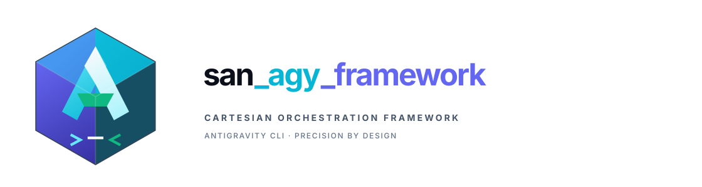
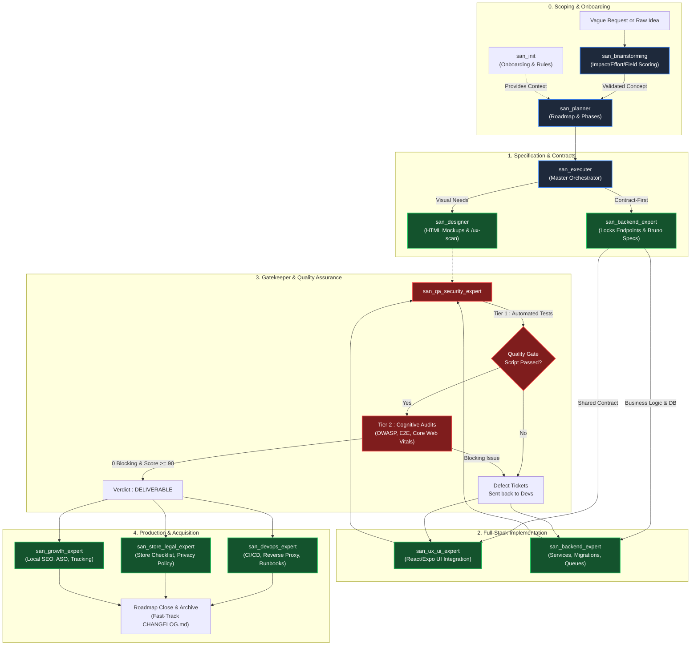

<p align="center">
  
</p>

# "GOOGLE ANTIGRAVITY" FRAMEWORK (`san_*`) — MASTER ARCHITECTURE INDEX

> **Language:** [Version française](README.md)  
> **Manifesto:** Agentic orchestration system and software engineering skill suite for Google Antigravity CLI (AGY).  
> **Author:** Alexsan.pro  
> **Target:** Any Full-Stack Web, Mobile, or API codebase (React, Next.js, Expo, React Native, Laravel, AdonisJS, Node.js).  
> **Status:** Cartesian Modular Architecture — Specification v2.0.  
> **License:** [MIT License](LICENSE)

---

## 1. VISION, CHALLENGES & TECH STACK

### Why this framework?
Across substantial projects, repeatedly prompting the agent with the same architecture, test hygiene, and context rules causes context drift, inconsistent delivery quality, and severe token waste:
- Vague functional requests resulting in misguided roadmaps;
- Superficial AI-generated code (*anti-AI taste*: generic purple/indigo gradients, lack of rhythmic soul);
- Roadmap checkboxes checked without real verification against the codebase;
- Lack of field resilience (unstable 3G/EDGE, missing offline queue, Mobile Money double-spending);
- Scattered ownership of QA, security, and performance.

The **`san_*`** framework transforms Antigravity into a **complete Senior Tech Lead & Autonomous Quality Assurance body** tailored for harsh real-world conditions (African and global).

### Sovereign Tech Stack (`alexsan.pro`)
* **Frontend Web:** React.js, strict TypeScript, Tailwind CSS, native CSS variables, semantic HTML5.
* **Mobile Cross-Platform:** React Native, Expo (EAS), 60 fps motion curves, tactile haptics (`expo-haptics`), encrypted storage (`expo-secure-store`).
* **Backend & APIs:** PHP 8.x OOP/SOLID, Laravel (latest), Node.js / AdonisJS under strict TypeScript, decoupled architecture (Actions/Services).
* **Data & Cache:** Advanced PostgreSQL (`JSONB`, GIN, PostGIS), MySQL, Redis (atomic locks, queues, cache, adaptive rate limiting).
* **Endpoint Contracts & API Tests:** Versioned collections under **Bruno** (`.bru`) with automated assertions, forbidding any payload mismatch.
* **Infrastructure & Production:** CloudPanel, Ubuntu VPS, Nginx reverse proxy, PM2/Supervisor, Mailcow (strict SPF/DKIM/DMARC/PTR deliverability).
* **Field Realities (Africa / Congo / Emerging Markets):** Unstable 3G/EDGE tolerance, Outbox persistence with `Idempotency-Key` on Redis, asynchronous Mobile Money flows (Airtel Money, MTN MoMo, STK/USSD push callbacks and proactive polling reconciliation), landmark-based geographic addressing, and WhatsApp deep linking.

---

## 2. AGENT GOVERNANCE & ORCHESTRATION MECHANISMS

### A. Model Routing (`invoke_subagent`)
The framework leverages native Antigravity CLI capabilities under a strict allocation policy:
1. **Main Session (Orchestrator & Global Reasoning):** Driven directly by the developer: nominally with **ARGON** configured at maximum reasoning (e.g. `argon-latest-max` / `ARGON 4`), or manual fallback to **Pro** (`gemini-3.1-pro-high`) or **Flash** (`gemini-3.8-flash-high`).
2. **"Brain, Architecture, Audit & Pentest" Pole:** Invoked natively with **`Model: 'inherit'`** to automatically inherit the session's master model configuration (or `'pro'` as an explicit fallback).
3. **"Atomic Execution & Coders" Pole:** Invoked natively with **`Model: 'flash'`** (`gemini-3.8-flash-high`) to maximize writing speed, strict syntax precision, and minimize token costs.

### B. Targeted Delegation & Fast-Track Hygiene
* **Strict delegation:** The orchestrator never writes business feature code and never audits its own work. All implementation is delegated to atomic execution subagents.
* **Immediate hygiene Fast-Track (without subagents):** The orchestrator is explicitly authorized to directly perform housekeeping chores: checking `[x]` boxes after test proof, archiving completed roadmaps (`mv`), and updating `CHANGELOG.md`.

### C. Two-Tier Audit Gate (Anti-Token Waste)
Before any validation, every component or endpoint goes through an airtight funnel:
* **Tier 1 (Deterministic & Zero LLM Token):** Automated check scripts (`front_quality_gate.sh`, `backend_quality_gate.sh`, `qa_security_gate.sh`). If a type error (`tsc`), red test, or broken linter occurs, **no audit subagent is launched**: the raw script error is immediately fed back to the code subagent for fixes.
* **Tier 2 (Qualitative LLM & Cognitive):** Specialized audit subagents (`Model: 'inherit'`) are launched only once Tier 1 is 100% green.

### D. Absolute Git Isolation (`.gitignore`)
The orchestration folder `.agents/` at the root of each project is **strictly ignored by Git** (via `.gitignore` and `.git/info/exclude`). The developer's personal setup never pollutes the remote repository or conflicts with team members.

---

## 3. WORKSHOP REPOSITORY STRUCTURE

This repository (`san_agy_framework`) acts as the **workshop** that designs, tests, and packages the product:

```txt
san_agy_framework/
├── package.json                        # npm manifest, CLI binaries (agy-framework & san-framework)
├── LICENSE                             # Official MIT License (Alexsan.pro)
├── README.md                           # Master Architecture Index (French)
├── README.en.md                        # Master Architecture Index (English - this file)
├── CHANGELOG.md                        # Framework Changelog (French)
├── CHANGELOG.en.md                     # Framework Changelog (English)
├── .gitignore                          # Local isolation and Git hygiene
│
├── logos/                              # Official framework brand assets
│   ├── LOGO.md                         # Visual guidelines and palette specs
│   ├── san_framework_logo.svg          # Official full vector logo (Icon + Wordmark)
│   ├── san_framework_icon.svg          # Vector favicon / app icon
│   ├── san_framework_dark.svg          # Dark terminal / banner variant
│   └── LOGO_ASCII.txt                  # Official ASCII artwork (CLI terminal only)
│
├── roadmaps/                           # Internal framework roadmap & planning
│   ├── MVP_BUILD_FRAMEWORK_23102026.md # Active development roadmap
│   └── archives/                       # Completed roadmaps (100% checked)
│
├── skills/                             # PRIMARY SKILLS SPECIFICATIONS (Workshop Blueprint)
│   ├── san_init.md                     # Onboarding, Git isolation, GEMINI.md, and context
│   ├── san_brainstorming.md            # Upstream scoping, multi-criteria idea scoring
│   ├── san_planner.md                  # Project planning, phase scheduling, auto-cleaning
│   ├── san_designer.md                 # Code-only visual design, HTML/Tailwind, /ux-scan
│   ├── san_ux_ui_expert.md             # Lead Frontend & Mobile, anti-AI taste, 5 UI states
│   ├── san_backend_expert.md           # Lead Backend & Distributed Systems, APIs, Bruno, Idempotency
│   ├── san_executer.md                 # Full-Stack Orchestrator, Contract-First delivery
│   ├── san_qa_security_expert.md       # Unified Gatekeeper: E2E QA, OWASP security, performance
│   ├── san_devops_expert.md            # Infrastructure, CloudPanel, Mailcow, CI/CD, runbooks
│   ├── san_store_legal_expert.md       # Store compliance (Play/App Store), anti-rejection, legal
│   └── san_growth_expert.md            # Local SEO, store ASO, unified event tracking
│
├── sub-skills/                         # TRANSVERSAL SUB-SKILLS SPECIFICATIONS (Workshop Blueprint)
│   ├── san_subagent_manager.md         # Factory for surgical subagents and prompt calibration
│   ├── san_searcher.md                 # High-precision researcher, official docs scraper
│   ├── san_copywriter.md               # UX writer, empathetic micro-copy, localization, zero Lorem Ipsum
│   ├── san_design_tokens.md            # Guardian of BRAND.md tokens, static and kinetic invariants
│   ├── san_exporter.md                 # Headless Playwright capture, store exports, SVG to PNG
│   └── san_doc_keeper.md               # Keeper of CHANGELOG.md, README.md, roadmaps archiving
│
├── src/                                # THE FINISHED PRODUCT (Deployed to client's .agents/)
│   ├── cli/                            # Universal interactive CLI & installer engine
│   │   ├── index.js                    # Binary entry point (`agy-framework` / `san-framework`)
│   │   └── installer.js                # Copy engine, Smart Merge, and Git hygiene
│   └── skills/                         # All 17 executable packaged modules (SKILL.md, scripts, templates)
│       ├── san_init/                   # Initialization, Git isolation, and context generation
│       ├── san_brainstorming/          # Upstream scoping, 40-pt scoring matrix
│       ├── san_planner/                # Project planning and strict archiving
│       ├── san_subagent_manager/       # Surgical subagent calibration and hermetic prompts
│       ├── san_searcher/               # Technical intelligence and official documentation scraper
│       ├── san_doc_keeper/             # SemVer versioning and documentation integrity
│       ├── san_copywriter/             # UX copy, anti-Lorem linter, and currency localization
│       ├── san_design_tokens/          # BRAND.md token compiler to CSS/Tailwind/TS
│       ├── san_exporter/               # Multi-resolution icon exports and headless Playwright captures
│       ├── san_designer/               # High-fidelity static mockups and /ux-scan analyzer
│       ├── san_ux_ui_expert/           # Lead Frontend Web & Mobile, 3G resilience, 5 UI states
│       ├── san_backend_expert/         # SOLID architecture, Bruno collections, Redis idempotency
│       ├── san_executer/               # Full-Stack Orchestrator and Contract-First protocol
│       ├── san_qa_security_expert/     # Gatekeeper for QA E2E, OWASP audits, and performance benchmarks
│       ├── san_devops_expert/          # CloudPanel/Mailcow runbooks, CI/CD, and system health checks
│       ├── san_store_legal_expert/     # Store compliance (Play/App Store) and code-backed legal drafts
│       └── san_growth_expert/          # Local SEO (Africa/Congo), store ASO, and tracking plans
│
└── tests/                              # AUTOMATED VALIDATION TEST SUITES
    ├── phase3/                         # Git isolation and roadmap archiving tests
    ├── phase4/                         # Transversal modules test suite (lorem linter, tokens)
    ├── phase5/                         # Frontend and backend quality gate tests
    ├── phase6/                         # App permissions and infrastructure check tests
    └── phase7/                         # CLI installer and deployment engine tests
```

> **Note on Client Deployment:** On the client's codebase, Antigravity CLI discovers all skills in `.agents/skills/`. Therefore, all 17 skills are deployed as first-class modules. The separation between `/skills` and `/sub-skills` exists strictly in this workshop repo for architectural maintainability.

---

## 4. MASTER INDEX OF PRIMARY SKILLS (`/skills/`)

| Primary Skill | Core Role & Responsibility | Entry Point Type | Key Deliverables |
| :--- | :--- | :--- | :--- |
| [**`san_init`**](skills/san_init.md) | Initialization, Git isolation, onboarding, and context reverse-engineering | Setup / Onboarding | `.agents/GEMINI.md`, `.agents/rules/*.md`, `.gitignore` |
| [**`san_brainstorming`**](skills/san_brainstorming.md) | Upstream scoping, idea sorting, and multi-criteria comparison | Strategy / Scoping | `/roadmaps/ideas/[THEME]_[DATE].md` |
| [**`san_planner`**](skills/san_planner.md) | Project roadmap planning, phase scheduling, and auto-cleaning | Planning / Management | `/roadmaps/[PHASE]_[DATE].md`, `CHANGELOG.md` |
| [**`san_designer`**](skills/san_designer.md) | High-fidelity code-only screen mockup design and store screenshots | Visual / UX | `/design/mockup/*`, `/design/screenshots/*` |
| [**`san_ux_ui_expert`**](skills/san_ux_ui_expert.md) | Frontend Web & Mobile engineering, anti-AI taste, 3G resilience | Client Engineering | React Pages, React Native / Expo screens, Jest tests |
| [**`san_backend_expert`**](skills/san_backend_expert.md) | REST/WebSocket APIs, SOLID architecture, Redis idempotency, DB | Server Engineering | Laravel/Adonis Code, Bruno Collections, Migrations |
| [**`san_executer`**](skills/san_executer.md) | Full-Stack Implementation Orchestrator (alias `san_execute`) | Central Engine | Synchronized Full-Stack Code, End-to-End Delivery |
| [**`san_qa_security_expert`**](skills/san_qa_security_expert.md) | Unified Gatekeeper: E2E QA, OWASP audit, and performance verdict | Verdict / Gatekeeper | `docs/QA_REPORT.md`, `docs/SECURITY_REPORT.md` |
| [**`san_devops_expert`**](skills/san_devops_expert.md) | Infrastructure, CloudPanel, Mailcow, CI/CD, reversibility | Ops / Reliability | `docs/INFRA.md`, `docs/RUNBOOKS.md`, CI/CD Pipelines |
| [**`san_store_legal_expert`**](skills/san_store_legal_expert.md) | Store compliance (Google Play/Apple), anti-rejection, code-backed legal drafts | Publication / Legal | `docs/STORE_CHECKLIST.md`, `docs/PRIVACY_POLICY.md` |
| [**`san_growth_expert`**](skills/san_growth_expert.md) | Local SEO (Africa/Congo), store ASO, analytics event tracking | Growth / Metrics | `docs/SEO.md`, `docs/ASO.md`, `docs/TRACKING_PLAN.md` |

---

## 5. GLOBAL ORCHESTRATION WORKFLOW (FEATURE LIFECYCLE)



---

## 6. TRANSVERSAL EXECUTION SUB-SKILLS (`/sub-skills/`)

While `/skills/` contains the master roles triggered directly by the developer, [`/sub-skills/`](sub-skills/) houses the **reusable execution modules** called under the hood:

| Sub-Skill | Role & Technical Specialization | Primarily Called By | Key Deliverables & Tools |
| :--- | :--- | :--- | :--- |
| [**`san_subagent_manager`**](sub-skills/san_subagent_manager.md) | Subagent factory: surgical calibration, tools isolation, anti-hallucination | `san_executer`, `san_planner`, all | Sealed prompts, `flash`/`inherit` routing |
| [**`san_searcher`**](sub-skills/san_searcher.md) | High-precision researcher, technical surveillance, noise-free doc scraping | `san_brainstorming`, `san_planner`, `san_growth_expert` | Structured synthesis `docs/research/*.md` |
| [**`san_copywriter`**](sub-skills/san_copywriter.md) | UX writer, empathetic micro-copy, localization, zero *Lorem Ipsum* | `san_designer`, `san_ux_ui_expert`, `san_growth_expert` | Realistic copy, error states, store listing copy |
| [**`san_design_tokens`**](sub-skills/san_design_tokens.md) | Guardian of `BRAND.md` tokens, static & kinetic motion invariants | `san_designer`, `san_ux_ui_expert`, `san_init` | Token compilers (CSS/Tailwind/TS), magic values audit |
| [**`san_exporter`**](sub-skills/san_exporter.md) | Headless Playwright capture and SVG $\rightarrow$ PNG vector icon processing | `san_designer`, `san_growth_expert`, `san_init` | `scripts/export_png.mjs` (stores), `scripts/svg_to_png.mjs` |
| [**`san_doc_keeper`**](sub-skills/san_doc_keeper.md) | Document integrity keeper, SemVer tracking, Fast-Track archiving | `san_planner`, `san_executer`, all | `CHANGELOG.md`, `README.md`, Fast-Track routines |

---

## 7. INSTALLATION ON A CLIENT CODEBASE

Deploying the framework onto any target repository takes a single command to instantiate the hermetic `.agents/` structure:

```bash
# Interactive deployment via npx (zero prior global installation required)
npx @alexsan/agy-framework init

# Alternative binary alias
npx @alexsan/san-framework init
```

### A. Installation Modes & CLI Flags

The CLI operates either as an interactive step-by-step wizard or in non-interactive scriptable mode via CLI flags:

| CLI Flag | Description |
| :--- | :--- |
| `--local` | *(Default)* Deploys the framework into the current project's hermetic workspace (`./.agents/`). |
| `--global` | Deploys skills into Antigravity's global user directory (`~/.gemini/antigravity-cli/skills/`). |
| `--all` | Installs all 17 skills without interactive confirmation prompts. |
| `--skills=<list>` | Granular selection of skills separated by commas (e.g. `--skills=init,planner,qa_security_expert,backend_expert`). |
| `--dry-run` | Simulates the complete deployment and displays the report without writing any file to disk. |
| `--force` | Forces overwriting of skills already present in the target destination. |
| `--opencode` | Also generates the opencode context (`AGENTS.md` + `opencode.json`) during a local install. |
| `--help`, `-h` | Displays complete command help and usage examples. |
| `--version`, `-v` | Displays current framework version. |

#### Direct Command Examples:

```bash
# Full automated installation in current project
npx @alexsan/agy-framework init --local --all

# Granular installation of core management and QA skills
npx @alexsan/agy-framework init --skills=init,planner,qa_security_expert,backend_expert

# Dry-run simulation to review changes before writing
npx @alexsan/agy-framework init --dry-run
```

### C. opencode Compatibility (`--opencode` & `update`)

The framework also works with **opencode**. Two use cases:

1. **Installation with opencode context:** the `--opencode` flag generates, on top of the `.agents/` tree, the context layer read by opencode:
   - **`AGENTS.md`** at the project root — auto-loaded instructions (routing table of the 17 skills, governance rules and orchestration).
   - **`opencode.json`** at the project root — `skills.paths: [".agents/skills"]` (skill discovery) and `instructions: [".agents/GEMINI.md"]`.

   ```bash
   npx @alexsan/agy-framework init --local --all --opencode
   ```

2. **Updating an already-deployed repo:** the `update` command re-synchronizes the skills and (re)generates the opencode context layer without touching existing rules or customizations. It makes any codebase already equipped with the framework immediately understandable by opencode:

   ```bash
   npx @alexsan/agy-framework update            # opencode context + skill resync
   npx @alexsan/agy-framework update --force    # also regenerate an existing AGENTS.md
   npx @alexsan/agy-framework update --dry-run  # simulation without writing
   ```

   After running, restart opencode to reload the context and skills.

> **opencode Smart Merge:** a customized `AGENTS.md` (without the generation marker) is never overwritten, and `opencode.json` is merged without altering existing fields. In opencode mode, `AGENTS.md` stays committable (team sharing) while `.agents/` remains hermetically isolated from Git.

### B. Core Deployment Engine Mechanisms (`installer.js`)

1. **Normative Smart Merge:**  
   Initializes fundamental project rule templates (`BRAND.md`, `PRODUCT.md`, `PROJECT.md`, `API.md`, `LOGO.md`) and the master index `GEMINI.md` in `.agents/rules/`. If a rule file already exists (customized by the developer), **it is never overwritten**.
2. **Hermetic Isolation & Git Hygiene:**  
   Automatically injects an inviolable isolation block into `.gitignore` and `.git/info/exclude`. If legacy agent files were accidentally tracked, the CLI automatically runs `git rm -r --cached` to sanitize the Git index without altering local files.
3. **Active Anti-Pollution Purge:**  
   Detects and purges obsolete competitor agent artifacts (`CLAUDE.md`, `.cursorrules`, `.windsurfrules`, `.copilot`, etc.) to ensure complete operational cleanliness.
4. **Automated Execution Permissions:**  
   Automatically sets executable bits (`chmod +x` / `0o755`) on all deployed shell and Node.js utility scripts (`scripts/*.sh`, `scripts/*.mjs`).

---

## 8. PRIORITY ORDER & IMPLEMENTATION ROADMAP

1. [x] **Primary Skills Specifications**: Documented and verified in [`/skills/`](skills/).
2. [x] **Transversal Sub-Skills Specifications**: Documented and verified in [`/sub-skills/`](sub-skills/).
3. [x] **Visual Identity & Workshop Tooling**: Vector logos in [`/logos/`](logos/), MIT License, and `CHANGELOG.md`.
4. [x] **Onboarding & Scoping Packaging**: `san_init`, `san_brainstorming`, `san_planner` packaged in `src/skills/` (Phase 3 tests passed).
5. [x] **Transversal Sub-Skills Packaging**: `san_subagent_manager`, `san_searcher`, `san_doc_keeper`, `san_copywriter`, `san_design_tokens`, `san_exporter` in `src/skills/` (Phase 4 tests passed).
6. [x] **Visual & Full-Stack Packaging**: `san_designer`, `san_ux_ui_expert`, `san_backend_expert`, `san_executer` in `src/skills/` (Phase 5 tests passed).
7. [x] **Quality, DevOps, Legal & Growth Packaging**: `san_qa_security_expert`, `san_devops_expert`, `san_store_legal_expert`, `san_growth_expert` in `src/skills/` (Phase 6 tests passed).
8. [x] **Universal CLI Installer & Distribution**: Packaged via `package.json`, interactive `src/cli/index.js`, engine `src/cli/installer.js` (Phase 7 tests passed).
9. [x] **Global E2E Integration & Release v1.0.0**: Complete 24/24 integration test suite passed 100% green (`tests/phase8/test_e2e_full.sh`), MVP roadmap archived, and v1.0.0 package ready for npm publishing.
10. [x] **opencode Compatibility & Update (v1.1.0)**: `update` command and `--opencode` flag generating the opencode context (`AGENTS.md` + `opencode.json`), dedicated Smart Merge and a Phase 9 test suite validated at 100%.

---

## 9. LICENSE

This project is licensed under the MIT License — see the [`LICENSE`](LICENSE) file for details.  
Copyright (c) 2026 Alexsan.pro. All rights reserved.
