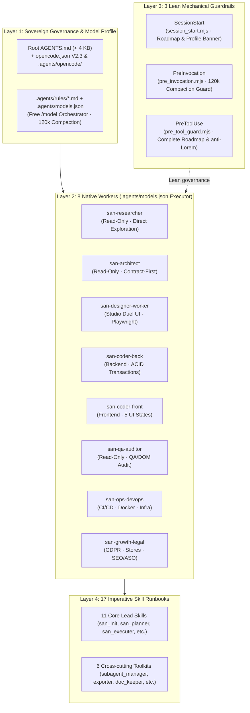

<p align="center">
  <picture>
    <source media="(prefers-color-scheme: dark)" srcset="logos/san_harness_logo_dark.svg"/>
    <source media="(prefers-color-scheme: light)" srcset="logos/san_harness_logo_light.svg"/>
    
  </picture>
</p>

<p align="center">
  
  
  
  
  
  
</p>

# SAN AI HARNESS (`san_ai_harness`) — DUAL-HARNESS ORCHESTRATION & ADAPTIVE GOVERNANCE v3.0

> **Language:** [Version française](README.md) | English  
> **Manifesto:** **Dual-Harness** agentic orchestration system (`Google Antigravity` `swarm` + `OpenCode v2.3.0` **`san_swarm`** & `subagent` plugin) with a **Free User-Selected Orchestrator (`/model`)**, **Configurable Executors** (`san-harness models`), **120k Token Auto-Compaction** (zero `.agents/cache` / zero bloat), Studio UI Engine (`--url` live capture), and **17 sovereign skills**.  
> **Author:** Alexsan.pro  
> **Status:** 4-Layer Cartesian Architecture — Official Specification v3.0.0.  
> **License:** [MIT License](LICENSE)

---

## 1. VISION, AMBITION & DOCTRINE v3.0

On complex codebases, leaving AI coding assistants to naive conversational prompts leads to critical regressions:
- **Amnesia & Context Drift:** Forgotten API contracts, accessibility gaps, and degraded architectural invariants.
- **First-Draft Sycophancy:** Docile acceptance of bland solutions, anemic domain models, 500-line monolithic components, and generic purple gradients (*AI taste*).
- **Testing Theater:** Checkboxes ticked without verifiable proof, suites bypassed with `--passWithNoTests`, or tautological mocks.
- **Context Bloat:** Maintaining giant AST maps inside `.agents/cache/` or forcing rigid subagent chains on trivial one-file fixes inflates token usage instead of reducing it.

Release **3.0.0** of **`san_ai_harness`** (`@alexsan/san-ai-harness`, primary binary **`san-harness`** with backward-compatible aliases `san-framework` / `agy-framework`) removes rigid mechanical locks across both runtimes:

1. **Decoupled Orchestrator & Adaptive Doctrine (`inherit-user-model`):** No hardcoded orchestrator model IDs anywhere in skills or `AGENTS.md`. The main thread freely inherits whatever `/model` the user picked in Antigravity or OpenCode.
   - **Simple / single-layer tasks:** Native **`Plan → Execute`** directly by the orchestrator is explicitly permitted.
   - **Multi-layer features, Studio Duel UI & Adversarial QA (`san-qa-auditor`):** Parallel worker delegation via **`swarm`** (Antigravity) or **`san_swarm` / `subagent`** (OpenCode v2.3.0) using the executor profile in `.agents/models.json` (`san-harness models`).
2. **Native OpenCode v2.3.0 Parity (`san_swarm` + Swarm Board):** Pure-Node ESM plugin **`.agents/opencode/san-harness-plugin.mjs`** (zero Bun dependency) providing the `san_swarm` tool (`dispatch`, `board`, `status`), live Markdown **Swarm Board** + Workflow Summary output, and `/san-board` command wired in `opencode.json`.
3. **Zero `.agents/cache/` & 120k Auto-Compaction:** Complete removal of token-bloating cache/transcript modules (`san_cartographer`, `REPO_MAP.md`, `san_transcriber`, `roadmaps/transcripts/`, `post_tool_indexer.mjs`, `stop_guard.mjs`). Replaced with a unified **`120 000`-token auto-compaction** threshold (`pre_invocation.mjs` on Antigravity; `compaction` config + `context`/`compaction` hooks on OpenCode v2.3.0).
4. **Rebrand to `san_ai_harness` & Adaptive SVG Logos:** Renamed package/repository branding with dedicated Dark & Light `<picture>` vector logos.

---

## 2. THE 4-LAYER v3.0 ARCHITECTURE

Execution is structured across 4 lean, concentric layers shared uniformly across `Antigravity` and `OpenCode v2.3.0`:



### Layer 1: Sovereign Governance & Normative Rules
* **Permanent Constitution `<root>/AGENTS.md` (< 4096 bytes):** Auto-loaded (`always_on`) in Google Antigravity and OpenCode v2.3. Codifies Stage 0 **Socratic & Visual Alignment**, adaptive execution (`Plan → Execute` for simple tasks, Swarm for multi-layer/Duel/QA), and Dual-Harness routing with zero hardcoded orchestrator models.
* **Model & Compaction Profile `.agents/models.json` + `opencode.json` V2.3:** Configured via `san-harness models` (`agy.executor`, `opencode.executor`, `compaction.targetTokens: 120000`) and paired with the `.agents/opencode/` Swarm Board plugin.
* **Declarative Normative Rules `.agents/rules/*.md`:** 5 YAML-frontmatter rule files (`trigger: always_on`, `trigger: model_decision`, or `trigger: glob`): [`PROJECT.md`](file://.agents/rules/PROJECT.md), [`PRODUCT.md`](file://.agents/rules/PRODUCT.md), [`BRAND.md`](file://.agents/rules/BRAND.md), [`API.md`](file://.agents/rules/API.md), [`LOGO.md`](file://.agents/rules/LOGO.md).

### Layer 2: The 8 Native Dual-Harness Workers
All 8 workers defined in `.agents/agents/*.md` (and projected into OpenCode's `"agents"` map inside `opencode.json`) resolve to the executor model configured in `.agents/models.json`, while the primary orchestrator **`san-orchestrator`** inherits the user's active `/model`:

| Runtime Harness | Main Orchestrator | Worker Executor (8 `san-*`) | Orchestration Primitive | Native Verification |
| :--- | :--- | :--- | :--- | :--- |
| **Google Antigravity (`agy`)** | **Free (`/model`)** (`inherit-user-model`) | `.agents/models.json#agy.executor` | `Plan → Execute` or `swarm` | `agy plugin validate --strict` |
| **OpenCode v2.3.0** | **Free (`/model`)** (`san-orchestrator`) | `.agents/models.json#opencode.executor` | `san_swarm` (Swarm Board) / `subagent` | `opencode --standalone debug agents` |

| Native Worker | Mode & Permissions (`OpenCode` / `Agy`) | Key Role & Responsibility | Attached Skills | Primary Deliverables |
| :--- | :--- | :--- | :--- | :--- |
| **`san-researcher`** | `subagent` · **Read-Only** (`edit: deny`) | Direct codebase reconnaissance, official doc scouting & dependency version pinning. | `san_searcher` | Research notes `docs/research/*.md`, API briefs. |
| **`san-architect`** | `subagent` · **Read-Only** (`edit: deny`) | Architecture arbitration, **Contract-First** (OpenAPI 3.1 / Zod / TypeBox), **Fitness Functions** & 6-month Pre-Mortem. | `san_planner`, `san_backend_expert` | ADRs, frozen shared contracts, Fitness Functions. |
| **`san-designer-worker`** | `subagent` · Write / Execute | **Studio Duel UI** (`option-a` vs `option-b`), live `--url` capture, Multi-Viewports & DOM Linter. | `san_design_tokens`, `san_copywriter`, `san_exporter` | `/design/*.html` mockups, PNG renders & DOM JSON reports. |
| **`san-coder-back`** | `subagent` · Write / Execute | Atomic backend implementation, ACID transactions, idempotency & real domain tests. | `san_backend_expert` | Controllers, services, migrations, Bruno `.bru`, integration tests. |
| **`san-coder-front`** | `subagent` · Write / Execute | Modular Web & Mobile frontend (< 220 lines/file), **5 non-destructive UI states** & **Motion System**. | `san_ux_ui_expert`, `san_copywriter`, `san_design_tokens` | React/Expo components, typed hooks, DOM tests. |
| **`san-qa-auditor`** | `subagent` · **Read-Only** (`edit: deny`) | Skeptical read-only inquisitor, anti-*Testing Theater* & multimodal UI audit, binary verdict. | `san_qa_security_expert` | Binary verdict `LIVRABLE` \| `RETOUR_ATELIER`, OWASP/DOM audits. |
| **`san-ops-devops`** | `subagent` · Write / Execute | CI/CD pipelines, Docker, Nginx, CloudPanel, Fail-Closed infra diagnostics. | `san_devops_expert` | CI workflows, Dockerfiles, runbooks, health checks. |
| **`san-growth-legal`** | `subagent` · Write / Execute | GDPR compliance, privacy policies, App/Play Store ASO & analytics tracking plans. | `san_store_legal_expert`, `san_growth_expert` | Privacy policies, store checklists, tracking specs. |

### Layer 3: 3 Lean Mechanical Guardrails
Configured in `.agents/hooks.json`, the hooks layer keeps only **3 lightweight scripts** (< 50ms, zero AST indexing, zero `.agents/cache`):
1. **`SessionStart` (`session_start.mjs`):** Emits a one-line context summary (active roadmap, `PROJECT_PROFILE`, compaction target; zero disk writes).
2. **`PreInvocation` (`pre_invocation.mjs`):** **120k-token auto-compaction guard** reading `compaction.targetTokens` from `.agents/models.json`. Silent (`{ injectSteps: [] }`) below threshold; injects a `/compact` reminder once the session exceeds 120k tokens.
3. **`PreToolUse` (`pre_tool_guard.mjs`):** Blocks premature archiving of incomplete roadmaps (`- [ ]`) and *Lorem ipsum* placeholders.

> On OpenCode v2.3.0, `.agents/opencode/san-harness-plugin.mjs` additionally enforces native `120 000`-token `compaction` (`auto: true, background: true, keep.tokens: 12000, buffer: 20000`) and registers the **`san_swarm`** Swarm Board tool.

### Layer 4: 17 Imperative Skill Runbooks
Every skill in `.agents/skills/*/SKILL.md` is a **condensed imperative runbook ($\le 130$ lines)** paired with byte-identical (`cmp -s`) shared scripts (`export_png.mjs`, `archive_roadmap.sh`, `svg_to_png.mjs`), Python `run_workflow` pipelines, and synchronized `v3.0.0` wrappers in `skills/*.md` and `sub-skills/*.md`.

---

## 3. DOUBT ENGINEERING & VISUAL LOOP

1. **Stage 0 Socratic & Visual Alignment:** Before drafting roadmaps or mockups, the orchestrator aligns key decisions with the user (`ask_question` / `question`) and inspects real rendered screenshots via `export_png.mjs --url=<https://...>`.
2. **Systemic Pre-Mortem (`san-architect`) & Dialectics Before Strike:** Freeze shared OpenAPI/Zod contracts first, and weigh **2 viable architectural approaches** before substantial edits.
3. **Multimodal Visual Loop (`export_png.mjs --url --viewports --audit-dom`):** Studio Duel UI (`option-a` vs `option-b`), sequential multi-viewport Chromium capture (`mobile`, `tablet`, `desktop`), DOM geometry audit, and direct PNG inspection via `read_file`.
4. **Adversarial QA Inquisition (`san-qa-auditor`):** Default presumption of defects, zero tolerance for *Testing Theater* (`--passWithNoTests`, tautological mocks), and binary verdict (`LIVRABLE` | `RETOUR_ATELIER`).

---

## 4. CONTEXTUAL PROJECT PROFILES (`PROJECT_PROFILE`)

| Context Profile | Typical Target | Specifically Activated Invariants |
| :--- | :--- | :--- |
| **`emerging_market`** | Fintechs, pan-African platforms, local commerce | Local Outbox, Redis + `Idempotency-Key`, Mobile Money (Airtel Money, MTN MoMo, USSD/STK callbacks), 3G/EDGE resilience, WhatsApp sharing. |
| **`global_saas`** | International B2B/B2C SaaS | Hermetic multi-tenancy, Stripe/Paddle, RBAC, observability, p95 < 150ms. |
| **`mobile_consumer`** | iOS & Android apps (React Native / Expo) | 60 fps motion, haptics, `expo-secure-store`, Apple/Google store compliance (`ITMS-90717`). |
| **`cli_devtools`** | CLIs, SDKs, npm/pip packages | POSIX 0/1 exit codes, non-TTY safe, `--json`, < 200ms startup. |
| **`api_platform`** | Backends & public/partner APIs | Strict OpenAPI 3.1 contracts, Bruno `.bru` suites, Redis rate limiting, uniform JSON envelope. |

---

## 5. CATALOG OF 17 SKILL RUNBOOKS

### A. 11 Core Lead Skills

| Skill | Natural Intent Trigger | Key Role | Primary Scripts & Deliverables |
| :--- | :--- | :--- | :--- |
| [**`san_init`**](file://skills/san_init.md) | *"Initialize project"* | 4-layer setup, onboarding & Git hygiene | `<root>/AGENTS.md`, `.agents/rules/*.md`, `git_ai_hygiene.sh` |
| [**`san_brainstorming`**](file://skills/san_brainstorming.md) | *"Brainstorm"*, *"Score idea"* | Socratic triage & 40-pt scoring matrix | `roadmaps/ideas/*.md`, `score_idea.py` |
| [**`san_planner`**](file://skills/san_planner.md) | *"Create roadmap"*, *"Plan phase"* | Stage 0 alignment, Contract-First, Fitness Functions & archival | `roadmaps/*.md`, `archive_roadmap.sh` |
| [**`san_designer`**](file://skills/san_designer.md) | *"Design UI"*, *"/ux-scan"* | Live `--url` capture, Studio Duel UI, Multi-Viewports & DOM Linter | `/design/*.html`, `export_png.mjs` |
| [**`san_ux_ui_expert`**](file://skills/san_ux_ui_expert.md) | *"Build UI component"* | Web & Mobile Frontend Lead, 5 states & Motion System | React/Expo components, `front_quality_gate.sh` |
| [**`san_backend_expert`**](file://skills/san_backend_expert.md) | *"Create API"*, *"Model database"* | Backend Lead, ACID, idempotency & Bruno `.bru` | Models, Services, `backend_quality_gate.sh` |
| [**`san_executer`**](file://skills/san_executer.md) | *"Execute roadmap"*, *"Implement feature"* | Adaptive flow (`Plan → Execute` or `swarm` / `san_swarm`) | `autonomous_slice_workflow.py`, `e2e_verification_gate.sh` |
| [**`san_qa_security_expert`**](file://skills/san_qa_security_expert.md) | *"Audit security"*, *"Run QA"* | Unified QA gatekeeper, parallel OWASP/DOM inquisition | `parallel_inquisition_workflow.py`, `qa_security_gate.sh` |
| [**`san_devops_expert`**](file://skills/san_devops_expert.md) | *"Configure CI/CD"*, *"Deploy"* | CloudPanel, Docker, Nginx, Mailcow, infra health | `.github/workflows/*`, `infra_health_check.sh` |
| [**`san_store_legal_expert`**](file://skills/san_store_legal_expert.md) | *"Store prep"*, *"GDPR compliance"* | Play/App Store compliance & legal policies | `docs/STORE_CHECKLIST.md`, `PRIVACY_POLICY.md` |
| [**`san_growth_expert`**](file://skills/san_growth_expert.md) | *"Local SEO"*, *"ASO"*, *"Tracking"* | Local SEO, Store ASO metadata & analytics plan | `docs/SEO.md`, `docs/TRACKING_PLAN.md` |

### B. 6 Cross-Cutting Toolkits

| Toolkit | Technical Specialty | Deliverables & Scripts |
| :--- | :--- | :--- |
| [**`san_subagent_manager`**](file://sub-skills/san_subagent_manager.md) | Dual-Harness calibration (`swarm` / `san_swarm` / `subagent`) | Tight worker prompts, `validate_subagent_spec.sh` v3.0 |
| [**`san_searcher`**](file://sub-skills/san_searcher.md) | Official documentation extraction & version pinning | `doc_scraper.sh`, `detect_stack_versions.sh`, `docs/research/*.md` |
| [**`san_copywriter`**](file://sub-skills/san_copywriter.md) | Real UX micro-copy & anti-placeholder linting | `check_lorem.sh`, zero *Lorem Ipsum* |
| [**`san_design_tokens`**](file://sub-skills/san_design_tokens.md) | `BRAND.md` token guardian & WCAG AAA contrast checks | `build_tokens.mjs`, `audit_magic_values.sh` |
| [**`san_exporter`**](file://sub-skills/san_exporter.md) | `--url` capture, Multi-Viewports, DOM Linter & app icon build | `export_png.mjs`, `svg_to_png.mjs` (`cmp -s`) |
| [**`san_doc_keeper`**](file://sub-skills/san_doc_keeper.md) | SemVer documentation hygiene & SHA-256 archival | `README.md`, `CHANGELOG.md`, `archive_roadmap.sh` (`cmp -s`) |

---

## 6. UNIVERSAL `san-harness` CLI v3.0 GUIDE

Operate the harness via **`san-harness`** (or backward-compatible aliases **`san-framework`** / **`agy-framework`**):

```bash
# Direct execution via npx
npx @alexsan/san-ai-harness <command> [options]

# Or via global binary
san-harness <command> [options]
```

### A. Common Commands

```bash
# 1. Full Dual-Harness installation (Antigravity + OpenCode v2.3 + Swarm Board)
san-harness init --local --all --opencode

# 2. Lightweight Inheritance Mode (links skills without duplicating 17 folders)
san-harness init --local --light --opencode

# 3. Global Antigravity Plugin installation
san-harness init --global --all

# 4. Non-destructive upgrade to v3.0 (auto-purges .agents/cache, migrates rules, deploys OpenCode plugin)
san-harness update --opencode

# 5. Configure worker executors & 120k compaction target (orchestrator inherits user's /model)
san-harness models --opencode=opencode-go/deepseek-v4-pro --agy=gemini-4-hydrogen-xhigh --compaction=120000
san-harness models --set=opencode-go/qwen3.8-flash

# 6. Check 6 health pillars (verifying zero .agents/cache) & display release highlights
san-harness doctor
san-harness whats-new
san-harness list
```

### B. CLI Options Reference Table

| CLI Flag | Role & Behavior |
| :--- | :--- |
| `--local` | Deploys the harness into `./.agents/` [Default in non-interactive mode]. |
| `--light` | Lightweight Inheritance Mode: writes `.agents/skills.json` without copying 17 skill folders. |
| `--global` | Packages and installs the global Antigravity plugin (`~/.gemini/antigravity-cli/plugins/san-ai-harness/`). |
| `--all` | Installs all 17 skill modules without interactive prompts. |
| `--skills=<list>` | Comma-separated granular skill selection. |
| `--opencode` | (With `init`/`update`) Generates/merges `opencode.json` V2.3 + `.agents/opencode/` Swarm Board plugin. |
| `--opencode=<model>` | (With `models`) Sets `opencode.executor` (e.g., `opencode-go/deepseek-v4-pro`, `opencode-go/qwen3.8-flash`). |
| `--agy=<model>` | (With `models`) Sets `agy.executor` (e.g., `gemini-4-hydrogen-xhigh`). |
| `--compaction=<tokens>` | (With `models`) Sets auto-compaction token threshold (default: `120000`). |
| `--set=<model>` | (With `models`) Auto-detects `<provider>/<model>` vs Antigravity executor format. |
| `--dry-run` | Simulation mode without writing to disk. |
| `--force` | Forces overwrite of existing files. |
| `--dir=<path>` | Explicitly specifies target project directory. |
| `--version`, `-v` | Displays current version (`3.0.0`). |

---

## 7. REPOSITORY LAYOUT

```txt
san_ai_harness/
├── package.json                        # @alexsan/san-ai-harness v3.0.0 manifest (san-harness / san-framework / agy-framework)
├── LICENSE                             # Official Alexsan.pro MIT License
├── README.md                           # Architecture Documentation v3.0 (French)
├── README.en.md                        # Architecture Documentation v3.0 (this file)
├── CHANGELOG.md                        # Version Changelog (French)
├── CHANGELOG.en.md                     # Version Changelog (English)
├── .gitignore                          # Git hygiene & __pycache__/
│
├── logos/                              # Adaptive Dark/Light SVG Branding
│   ├── LOGO.md                         # Brand & theme-adaptive vector guidelines
│   ├── LOGO_ASCII.txt                  # CLI ASCII banner
│   ├── san_harness_logo_dark.svg       # Dark-background GitHub logo
│   ├── san_harness_logo_light.svg      # Light-background GitHub logo
│   └── san_harness_icon.svg            # Square monogram / icon
│
├── roadmaps/                           # Internal framework roadmaps (zero transcripts/)
│   ├── ideas/                          # san_brainstorming dossiers
│   └── archives/                       # Archived completed roadmaps
│
├── skills/ & sub-skills/               # 17 documentation wrappers synchronized at v3.0.0
│
├── src/                                # DISTRIBUTABLE PACKAGE (v3.0.0)
│   ├── agents/                         # 8 Dual-Harness worker definitions (Antigravity swarm + OpenCode san_swarm / subagent)
│   ├── hooks/                          # 3 Lean guardrails (SessionStart, PreInvocation 120k, PreToolUse)
│   ├── opencode/                       # OpenCode v2.3.0 native plugin (.agents/opencode/ — san_swarm, Swarm Board, 120k compaction)
│   ├── plugin/                         # Antigravity plugin bundle (plugin.json v3.0.0 + assets/logo.svg)
│   ├── cli/                            # san-harness CLI (index.js, installer.js, whats_new.js)
│   └── skills/                         # 17 executable skill runbooks (SKILL.md <= 130 lines)
│
└── tests/                              # Automated validation suites (phase3..9 & v2/)
```

---

## 8. LICENSE

This project is licensed under the MIT License — see the [`LICENSE`](LICENSE) file for details.  
Copyright (c) 2026 Alexsan.pro. All rights reserved.
