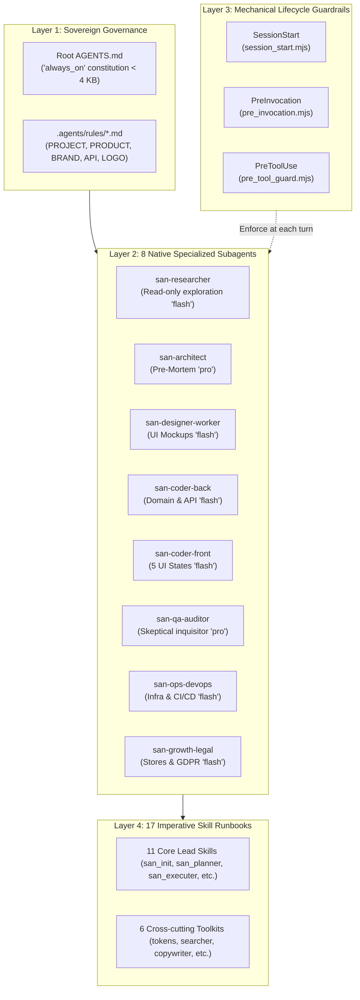
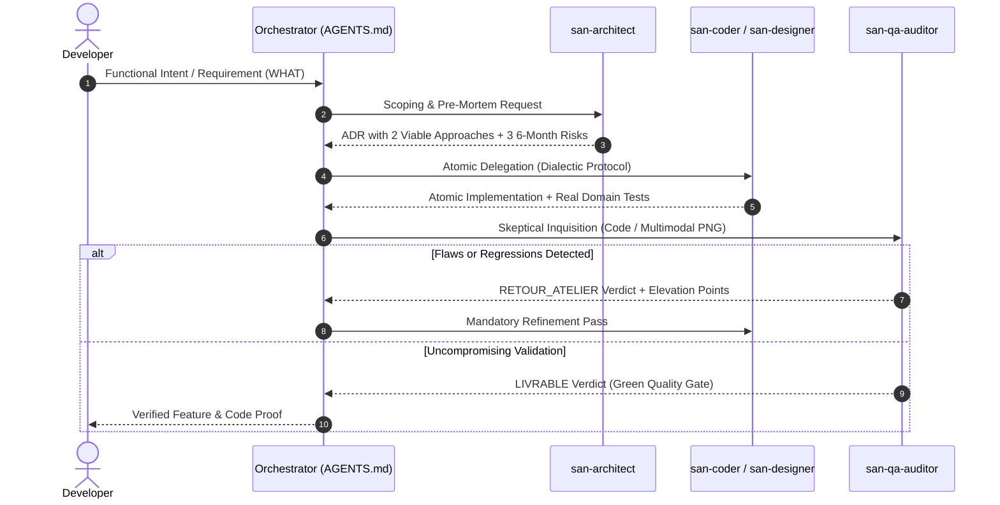

<p align="center">
  
</p>

# "GOOGLE ANTIGRAVITY" FRAMEWORK (`san_*`) — AGENTIC HARNESS & COGNITIVE GOVERNANCE v2.0

> **Language:** [Version française](README.md) | English  
> **Manifesto:** Deterministic agentic orchestration system, contradictory doubt engineering, and sovereign skill suite for Google Antigravity CLI (AGY), Antigravity 2.0 / IDE, and opencode.  
> **Author:** Alexsan.pro  
> **Status:** 4-Layer Cartesian Architecture — Official Specification v2.0.0.  
> **License:** [MIT License](LICENSE)

---

## 1. VISION, AMBITION & DOCTRINE v2.0

On complex, high-stakes codebases, leaving AI assistants to naive conversational prompting inevitably leads to critical regressions:
- **Amnesia & Context Drift:** Forgotten API contracts, overlooked accessibility standards, and degraded architectural invariants.
- **First-Draft Sycophancy:** Docile acceptance of bland solutions, anemic domain models, bloated 500-line monolithic components, and generic soulless purple/indigo gradients (*AI taste*).
- **Testing Theater:** Checkboxes marked complete without verifiable codebase proofs, test suites bypassed with flags like `--passWithNoTests`, and tautological mocks that test mocks instead of business domain logic.
- **Operational Fragility:** Missing idempotency keys on payment transactions, CORS font-loading failures, suppressed critical dependency vulnerabilities, and total ignorance of hostile degraded networks.

Release **2.0.0** of `san_agy_framework` introduces a systemic overhaul driven by two uncompromising ambitions:

1. **Mechanical Obedience (Zero Prompt Friction):** The user expresses exclusively **WHAT** to build (functional intent, domain goals, trade-off decisions). The framework mechanically enforces **HOW** to orchestrate it via lifecycle guardrails (`hooks.json`), natively auto-loaded normative rules, and surgical delegation to atomic subagents.
2. **Peak Cognitive & Creative Excellence (Zero First-Draft Mediocrity):** Built-in **Contradictory Doubt Engineering** (*Systemic Pre-Mortem*, *2-Approach Dialectic*, *Multimodal Visual Vision Loop on Real Pixels*, *QA Presumption of Flaws*) forcing agents to vigorously challenge their own assumptions and converge on senior-grade engineering.

---

## 2. THE 4-LAYER v2.0 ARCHITECTURE

The framework organizes execution across 4 concentric, hermetically sealed layers, ensuring that every agent action is governed, instrumented, and verified:



### Layer 1: Sovereign Governance & Normative Rules
* **Permanent Constitution `<root>/AGENTS.md`:** Deployed at the repository root without YAML frontmatter to trigger unconditional `always_on` auto-loading by Antigravity and `opencode`. This compact file (< 4096 bytes) codifies the 6 iron laws of orchestration (zero solo-coding, prior factual reconnaissance, atomic subagents, dialectic before commit, contract-first, proof by code) and an automated intent routing table.
* **Declarative Normative Rules `.agents/rules/*.md`:** 5 standard reference documents equipped with official YAML frontmatters (`trigger: always_on`, `trigger: model_decision`, or `trigger: glob`):
  - [`PROJECT.md`](file://.agents/rules/PROJECT.md): Project technical profile, sovereign tech stack, and model allocation matrix.
  - [`PRODUCT.md`](file://.agents/rules/PRODUCT.md): Product vision, business invariants, personas, and market constraints.
  - [`BRAND.md`](file://.agents/rules/BRAND.md): UI design tokens, aesthetic archetype, typographic tension, WCAG AAA accessibility, and 60 fps kinetic signature.
  - [`API.md`](file://.agents/rules/API.md): Interface contracts, standardized JSON envelope, ACID transactions, idempotency keys, and automated Bruno collections.
  - [`LOGO.md`](file://.agents/rules/LOGO.md): Master vector logo specifications and multi-resolution icon asset guidelines.

### Layer 2: The 8 Native Specialized Subagents
Gone are monolithic generic prompts. The framework formalizes 8 autonomous subagents declared in `.agents/agents/*.md`, each preconfigured with exact capabilities and model allocations:

| Native Subagent | Target Model | Key Role & Responsibility | Attached Skills | Primary Deliverables |
| :--- | :--- | :--- | :--- | :--- |
| **`san-researcher`** | `flash` | Read-only codebase exploration, factual architecture mapping, and third-party API documentation scraping. | `san_searcher` | Research notes, codebase maps, API reference summaries. |
| **`san-architect`** | `pro` / `inherit` | Architectural arbitration, domain modeling, and **6-Month Pre-Mortem** (confronting 2 viable approaches without strawmen). | `san_planner`, `san_backend_expert` | Architecture Decision Records (ADRs), entity relationship schemas, mitigation plans. |
| **`san-designer-worker`** | `flash` | Code-only art direction, HTML/Tailwind composition, visual archetypes, and headless Playwright PNG rendering. | `san_design_tokens`, `san_copywriter`, `san_exporter` | Static mockups `/design/*.html`, rendered screenshots `/design/screenshots/*.png`. |
| **`san-coder-back`** | `flash` | Atomic backend craftsman, strict API protocols, business logic enclosed in DB transactions, and real domain tests. | `san_backend_expert` | Controllers, services, migrations, Bruno `.bru` collections, integration tests. |
| **`san-coder-front`** | `flash` | Web & mobile frontend craftsman, modular code (< 220 lines/file), keyboard A11y, and **non-destructive 5-state UI choreography**. | `san_ux_ui_expert`, `san_copywriter`, `san_design_tokens` | React/React Native components, typed custom hooks, DOM integration tests. |
| **`san-qa-auditor`** | `pro` / `inherit` | Read-only skeptical inquisitor, test substance auditing, **multimodal visual critique on real PNG pixels**, binary verdict. | `san_qa_security_expert` | Binary verdict `LIVRABLE` or `RETOUR_ATELIER`, OWASP security audits, QA reports. |
| **`san-ops-devops`** | `flash` | CI/CD pipelines, Docker containers, Nginx reverse proxies, CloudPanel, Fail-Closed infrastructure health checks. | `san_devops_expert` | GitHub Actions workflows, Dockerfiles, operations runbooks, system health audits. |
| **`san-growth-legal`** | `flash` | Legal compliance (GDPR, e-Privacy), privacy policies, store ASO metadata, and unified analytics tracking plans. | `san_store_legal_expert`, `san_growth_expert` | Privacy policies, app store checklists, event tracking plans. |

### Layer 3: Mechanical Lifecycle Guardrails
Configured in `.agents/hooks.json`, this layer intercepts engine events to mechanically enforce developer discipline:
1. **`SessionStart` (`session_start.mjs`):** Runs at session initialization. Scans active roadmaps and `PROJECT_PROFILE`, injecting the v2.0 orchestration system prompt and alerting all 8 subagents.
2. **`PreInvocation` (`pre_invocation.mjs`):** Runs before each turn. Injects an ephemeral directive (< 110 tokens, purged immediately after the turn) forbidding inline solo-coding and enforcing contradictory challenge before committing work.
3. **`PreToolUse` (`pre_tool_guard.mjs`):** Intercepts file operations (`write_file`, `edit_file`):
   - Blocks (`decision: "deny"`) any attempt to archive roadmaps containing unchecked tasks (`- [ ]`) into `/roadmaps/archives/`.
   - Blocks (`decision: "deny"`) placeholder text injection (*Lorem ipsum*, *dolor sit amet*) into application and design directories.
   - Preserves user safety (`decision: "ask"`) for all valid code modifications.

### Layer 4: 17 Imperative Skill Runbooks
Every skill module in `.agents/skills/*/SKILL.md` has been overhauled into an **imperative, directive Runbook ($\le 130$ lines)**. Verbose conceptual explanations have been relocated to specialized subdirectories (`references/`, `templates/`, `scripts/`), keeping only actionable intent triggers, routing rules, and subagent delegation commands.

---

## 3. CONTRADICTORY DOUBT ENGINEERING (*DOUBT ENGINEERING*)

To permanently defeat the curse of bland first drafts, the framework institutes 4 mandatory cognitive protocols:



### 1. The Systemic Pre-Mortem (`san-architect`)
Before greenlighting an architecture, data schema, or major integration, `san-architect` simulates a 6-month disaster scenario:
> *"Assume we are 6 months into the future and this component / API has catastrophically collapsed in production. What are the 3 most probable systemic causes of this failure?"*
The 3 causes (write concurrency bottlenecks, unindexed data volume, consumer contract breaks) must be addressed proactively in the design before any production code is written.

### 2. The Dialectic Before Commit (`san-coder-back`, `san-coder-front`)
Prior to committing any substantial code, the implementation subagent must explicitly formulate and compare **2 viable, distinct engineering approaches** (e.g., synchronous inline processing vs. asynchronous Redis Outbox pipeline). Constructing a laughable "strawman" Option C is strictly forbidden. The chosen approach must be justified with concrete arguments on testability, type safety, and resilience.

### 3. The Visual Vision Loop
Visual code (HTML/Tailwind) cannot be assessed by reading text. The visual design pole enforces an empirical pixel feedback loop:
1. `san-designer-worker` builds the HTML/Tailwind mockup implementing the aesthetic archetype defined in `BRAND.md`.
2. The [`export_png.mjs`](file://src/skills/san_designer/scripts/export_png.mjs) script starts an ephemeral Node HTTP server on `127.0.0.1:0` and captures high-resolution PNGs via headless Playwright without CORS font-loading blocks.
3. **Multimodal Inspection Step:** `san-qa-auditor` (`model: "pro"`) physically inspects the PNG screenshot using `read_file`. It critiques focal mass balance, typographic tension, contrast ratios, and Gestalt rhythm.
4. At least **one mandatory visual refinement pass** is executed before the mockup is submitted to the developer.

### 4. QA Inquisition & Presumption of Flaws (`san-qa-auditor`)
`san-qa-auditor` operates with the mindset of an adversarial auditor:
- **Presumption of Hidden Defect:** Every first draft is assumed to harbor an unhandled edge case, a brittle assumption, or an empty test.
- **Zero Tolerance for Testing Theater:** Instant rejection of tautological assertions, tests that mock their own subject, and quality gates running with compromise flags (`--passWithNoTests`, `|| true`).
- **Inviolable Binary Verdict:** The audit report concludes strictly with `LIVRABLE` (ready for delivery) or `RETOUR_ATELIER` (precise defect list requiring worker remediation).

---

## 4. CONTEXTUAL PROJECT PROFILES (`PROJECT_PROFILE`)

The framework dynamically calibrates its rules, gates, and checks via the `PROJECT_PROFILE` variable declared in `.agents/rules/PROJECT.md`:

| Contextual Profile | Primary Target | Activated Invariants | Network & Domain Constraints |
| :--- | :--- | :--- | :--- |
| **`emerging_market`** | Fintechs, African platforms, local e-commerce | Local Outbox queue, Redis queue with `Idempotency-Key`, asynchronous Mobile Money handling (Airtel Money, MTN MoMo STK/USSD callbacks & polling reconciliation), landmark-based addressing, WhatsApp deep linking. | Unstable 3G/EDGE resilience, offline-first queuing, zero double-debit guarantee. |
| **`global_saas`** | Global B2B/B2C SaaS, cloud platforms | Strict multi-tenant isolation, Stripe/Paddle billing, granular RBAC permissions, high availability, telemetry and observability. | High concurrency, SOC2 / GDPR compliance, p95 latency < 150ms. |
| **`mobile_consumer`** | iOS & Android consumer apps (React Native, Expo) | 60 fps micro-interactions, tactile haptics (`expo-haptics`), encrypted storage (`expo-secure-store`), Apple/Google rejection-proof checklists. | Offline first, minimal battery consumption, touch-first ergonomic targets. |
| **`cli_devtools`** | CLI tools, developer SDKs, open-source packages | Deterministic POSIX return codes (0/1), non-TTY stream compatibility, `--json` flags, zero bloated dependencies, instant startup. | Fast execution (< 200ms), cross-OS compatibility, npm/pip distribution. |
| **`api_platform`** | Microservices, public/partner REST/GraphQL/gRPC APIs | Strict OpenAPI 3.1 contracts, automated Bruno test collections, adaptive rate limiting (Redis token bucket), uniform JSON envelopes. | Semantic API versioning, ACID transaction isolation, immutable contracts. |

---

## 5. CATALOG OF THE 17 SKILL RUNBOOKS

All 17 skills are organized into 11 lead director roles and 6 cross-cutting toolkits, all deployed directly into `.agents/skills/`:

### A. The 11 Core Lead Skills

| Skill Module | Natural Intent Trigger | Key Responsibility | Core Deliverables & Scripts |
| :--- | :--- | :--- | :--- |
| [**`san_init`**](file://skills/san_init.md) | *"Initialize project"*, *"Configure agents"* | Setup, onboarding, Git isolation, and context generation | `<root>/AGENTS.md`, `.agents/rules/*.md`, `git_ai_hygiene.sh` |
| [**`san_brainstorming`**](file://skills/san_brainstorming.md) | *"Brainstorm feature"*, *"Score idea"*, *"Frame requirement"* | Idea triage, contextual 40-point scoring matrix | `roadmaps/ideas/*.md`, `score_idea.py` |
| [**`san_planner`**](file://skills/san_planner.md) | *"Create roadmap"*, *"Plan next phase"* | Atomic phase breakdown and deterministic archiving | `roadmaps/*.md`, `archive_roadmap.sh` |
| [**`san_designer`**](file://skills/san_designer.md) | *"Design screen"*, *"Build mockup"*, *"Run visual audit"* | Static HTML/Tailwind mockups, headless PNG capture | `/design/*.html`, `export_png.mjs`, `/ux-scan` |
| [**`san_ux_ui_expert`**](file://skills/san_ux_ui_expert.md) | *"Build UI component"*, *"Fix accessibility"* | Lead Frontend Web & Mobile, non-destructive 5-state UI | React/Expo components, `front_quality_gate.sh` |
| [**`san_backend_expert`**](file://skills/san_backend_expert.md) | *"Create API"*, *"Add endpoint"*, *"Model database"* | Lead Backend, ACID transactions, idempotency, API contracts | Models, Services, Bruno `.bru`, `backend_quality_gate.sh` |
| [**`san_executer`**](file://skills/san_executer.md) | *"Execute roadmap"*, *"Ship phase N"*, *"Code feature"* | Full-Stack master conductor, Contract-First delivery | Synchronized code, `e2e_verification_gate.sh` |
| [**`san_qa_security_expert`**](file://skills/san_qa_security_expert.md) | *"Audit security"*, *"Run QA tests"* | Unified QA judge, OWASP audits, benchmarks, secrets scanner | `qa_security_gate.sh`, `docs/QA_REPORT.md` |
| [**`san_devops_expert`**](file://skills/san_devops_expert.md) | *"Setup CI/CD"*, *"Deploy application"*, *"Check server"* | CloudPanel, Docker, Nginx, Mailcow, CI/CD runbooks | `.github/workflows/*`, `infra_health_check.sh` |
| [**`san_store_legal_expert`**](file://skills/san_store_legal_expert.md) | *"Prepare store release"*, *"GDPR compliance"* | Google Play / Apple Store compliance, legal policies | `docs/STORE_CHECKLIST.md`, `PRIVACY_POLICY.md` |
| [**`san_growth_expert`**](file://skills/san_growth_expert.md) | *"Optimize SEO"*, *"Tracking plan"*, *"Store ASO"* | Local SEO, App Store Optimization, analytics instrumentation | `docs/SEO.md`, `docs/TRACKING_PLAN.md` |

### B. The 6 Cross-Cutting Toolkits

| Cross-Cutting Toolkit | Technical Domain | Key Deliverables & Associated Scripts |
| :--- | :--- | :--- |
| [**`san_subagent_manager`**](file://sub-skills/san_subagent_manager.md) | Calibration & supervision of surgical subagents | Hermetic subagent prompts, 2-approach tradeoff and flaw presumption clauses |
| [**`san_searcher`**](file://sub-skills/san_searcher.md) | High-precision tech scouting and clean doc extraction | `doc_scraper.sh`, `detect_stack_versions.sh`, research notes `docs/research/*.md` |
| [**`san_copywriter`**](file://sub-skills/san_copywriter.md) | Real UX copy, humanization, and anti-placeholder linter | `check_lorem.sh`, zero *Lorem Ipsum*, contextual error messages |
| [**`san_design_tokens`**](file://sub-skills/san_design_tokens.md) | Guardian of `BRAND.md` and WCAG AAA contrast compiler | `build_tokens.mjs`, `audit_magic_values.sh`, unified CSS custom properties |
| [**`san_exporter`**](file://sub-skills/san_exporter.md) | Headless Playwright capture pipeline & SVG $\rightarrow$ PNG | `export_png.mjs` (ephemeral local HTTP server), `svg_to_png.mjs` |
| [**`san_doc_keeper`**](file://sub-skills/san_doc_keeper.md) | Documentation integrity guardian and SemVer maintainer | Automated `README.md`, `CHANGELOG.md` maintenance, Fast-Track hygiene |

---

## 6. UNIVERSAL v2.0 CLI GUIDE

The framework is operated and installed using the official `san-framework` CLI (or its alias `agy-framework`):

```bash
# Direct execution via npx (no prior installation needed)
npx @alexsan/agy-framework <command> [options]

# Or via global binary if installed
san-framework <command> [options]
```

### A. The 4 Official Commands

#### 1. `san-framework init --local`
Deploys the full 4-layer architecture into `./.agents/` in your local project and generates the root `<root>/AGENTS.md` constitution.
- **Normative Smart Merge:** Inspects existing rules in `.agents/rules/` (`PROJECT.md`, `BRAND.md`, etc.). If a customized file exists, the CLI automatically injects required YAML frontmatter **without ever overwriting your business specifications**.
- **Reversible Backups:** If legacy AI configs (`CLAUDE.md`, `.cursorrules`) are detected, they are safely relocated to `.agents/backups/legacy-ai-configs/<timestamp>/` rather than destroyed.
- **Hermetic Git Lock:** Automatically configures dual protection in `.gitignore` and `.git/info/exclude`.

```bash
# Full local deployment in non-interactive mode
san-framework init --local --all

# Targeted deployment of specific skills
san-framework init --local --skills=san_init,san_planner,san_executer,san_qa_security_expert
```

#### 2. `san-framework init --global`
Bundles and installs the framework as an **Official Antigravity Plugin** in the global user directory (`~/.gemini/antigravity-cli/plugins/san-framework/`).
- 100% compliant and certified via the official engine command: `agy plugin validate --strict`.
- Packages the `plugin.json` manifest, vector logo, 8 subagents, 3 lifecycle hooks, and 17 executable skills.

```bash
san-framework init --global --all
```

#### 3. `san-framework update`
Performs an **instantaneous, non-destructive migration** from any v1.x installation to the v2.0 architecture:
- Upgrades all 17 skills to their compact runbook format ($\le 130$ lines).
- Installs the 8 native subagent definitions into `.agents/agents/`.
- Installs `.agents/hooks.json` and the 3 lifecycle hook scripts.
- Injects official YAML frontmatters into `.agents/rules/*.md` without touching developer rules.
- Regenerates `<root>/AGENTS.md` and removes legacy `.agents/rules.json`.

```bash
san-framework update
```

#### 4. `san-framework doctor`
Executes a deterministic audit of the **6 health pillars** on the target repository:

```bash
san-framework doctor
```

The diagnostic strictly verifies:
1. **Sovereign Governance:** Existence and compliance of `<root>/AGENTS.md` (size < 4 KB, no frontmatter).
2. **Normative Rules:** Existence of all 5 rule files in `.agents/rules/` with valid YAML frontmatter.
3. **Native Subagents:** Existence of all 8 subagents in `.agents/agents/*.md`.
4. **Lifecycle Guardrails:** Existence of `.agents/hooks.json` and execution permissions on all 3 `.mjs` scripts.
5. **17-Skill Catalog:** Verifies compactness of all `SKILL.md` files ($\le 130$ lines).
6. **Git Isolation:** Verifies hermetic exclusion in `.gitignore` or `.git/info/exclude`.

*Exit code: `0` if all 6 pillars pass, `1` if anomalies are found (with automated remediation guidance).*

### B. CLI Options Reference Table

| CLI Flag | Role & Behavior |
| :--- | :--- |
| `--local` | Deploys the framework locally into `./.agents/` [Default in non-interactive mode]. |
| `--global` | Packages and installs the global Plugin into the user Antigravity directory. |
| `--all` | Installs all 17 skill modules without interactive confirmation. |
| `--skills=<list>` | Granular comma-separated selection of skills to install. |
| `--dry-run` | Simulation mode: previews actions without writing files to disk. |
| `--force` | Forces overwrite and replacement of existing components. |
| `--opencode` | Additionally generates root `opencode.json` configuration and context. |
| `--dir=<path>` | Explicitly specifies the target installation directory. |
| `--version`, `-v` | Displays the current framework version (`2.0.0`). |
| `--help`, `-h` | Displays the comprehensive help guide and command list. |

---

## 7. REPOSITORY LAYOUT

```txt
san_agy_framework/
├── package.json                        # npm manifest, CLI binaries (san-framework & agy-framework)
├── LICENSE                             # Official Alexsan.pro MIT License
├── README.md                           # Master Architecture Index v2.0 (French version)
├── README.en.md                        # Master Architecture Index v2.0 (this file)
├── CHANGELOG.md                        # Project Changelog (Keep a Changelog standard)
├── CHANGELOG.en.md                     # Project Changelog (English version)
├── .gitignore                          # Local isolation and Git hygiene
│
├── logos/                              # Official vector branding
│   ├── LOGO.md                         # Visual guidelines and asset rules
│   ├── san_framework_logo.svg          # Official vector logo (Symbol + Typography)
│   ├── san_framework_icon.svg          # Vector icon / Favicon
│   └── san_framework_dark.svg          # Dark mode vector variant
│
├── roadmaps/                           # Internal framework orchestration
│   ├── V2_HARNESS_ENFORCEMENT_31102026.md # Active v2.0 engineering roadmap
│   └── archives/                       # 100% verified and archived roadmaps
│
├── src/                                # THE DISTRIBUTABLE PRODUCT (v2.0 Package)
│   ├── agents/                         # 8 native Antigravity subagent definitions
│   │   ├── san-researcher.md           # Read-only exploration and documentation scraping
│   │   ├── san-architect.md            # 6-Month Pre-Mortem, 2-approach arbitration, ADRs
│   │   ├── san-designer-worker.md      # HTML/Tailwind art direction, headless PNG renders
│   │   ├── san-coder-back.md           # Atomic backend craftsman, transactions, domain tests
│   │   ├── san-coder-front.md          # Modular frontend craftsman, 5 UI states, keyboard A11y
│   │   ├── san-qa-auditor.md           # Skeptical QA inquisitor, multimodal visual critique
│   │   ├── san-ops-devops.md           # CI/CD, containers, infrastructure diagnostics
│   │   └── san-growth-legal.md         # GDPR, store compliance, SEO/ASO analytics
│   │
│   ├── hooks/                          # Mechanical lifecycle guardrails
│   │   ├── hooks.json                  # Hook declarations (SessionStart, PreInvocation, PreToolUse)
│   │   └── scripts/                    # Deterministic executable scripts (session_start, etc.)
│   │
│   ├── plugin/                         # Official Antigravity Plugin bundle
│   │   ├── plugin.json                 # Manifest certified by 'agy plugin validate'
│   │   └── assets/logo.svg             # Packaged official vector logo
│   │
│   ├── cli/                            # Universal installer & diagnostics engine
│   │   ├── index.js                    # Executable entry point (init, update, doctor commands)
│   │   └── installer.js                # Copy logic, Smart Merge, backups, and doctor checks
│   │
│   └── skills/                         # 17 packaged executable runbooks (SKILL.md <= 130 lines)
│       ├── san_init/                   # Initialization, rules, and root constitution
│       ├── san_brainstorming/          # Idea framing, 40-point multicriteria scoring matrix
│       ├── san_planner/                # Project planning, phase scheduling, and archiving
│       ├── san_subagent_manager/       # Subagent calibration and supervision factory
│       ├── san_searcher/               # Tech scouting and targeted documentation scraping
│       ├── san_designer/               # Static mockups and headless Playwright PNG exports
│       ├── san_copywriter/             # Real UX copy, humanization, and anti-placeholder linter
│       ├── san_design_tokens/          # Design tokens and WCAG AAA contrast compiler
│       ├── san_ux_ui_expert/           # Lead Frontend, accessibility, and 5 UI states
│       ├── san_backend_expert/         # Lead Backend, API protocols, and idempotency
│       ├── san_executer/               # Full-Stack master conductor, Contract-First delivery
│       ├── san_qa_security_expert/     # Unified QA judge, OWASP audits, and benchmarks
│       ├── san_exporter/               # Graphic variations and headless capture pipeline
│       ├── san_devops_expert/          # Infrastructure runbooks, Nginx, Docker, CI/CD
│       ├── san_store_legal_expert/     # Store compliance (Play/App Store) and legal policies
│       ├── san_growth_expert/          # Local SEO, store ASO metadata, and tracking plans
│       └── san_doc_keeper/             # Documentation integrity and SemVer maintenance
│
└── tests/                              # AUTOMATED VALIDATION TEST SUITES
    ├── phase3/ to phase9/              # v1.x regression test suites
    └── v2/                             # Deterministic v2.0 validation test suites (Phases 1-6 & E2E)
```

---

## 8. LICENSE

This project is licensed under the MIT License — see the [`LICENSE`](LICENSE) file for details.  
Copyright (c) 2026 Alexsan.pro. All rights reserved.
