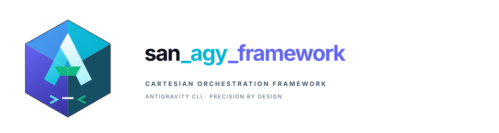
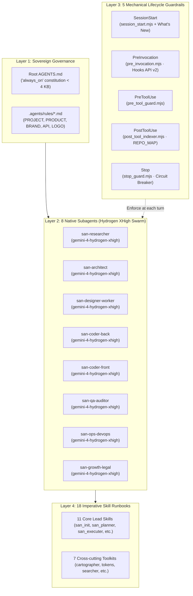
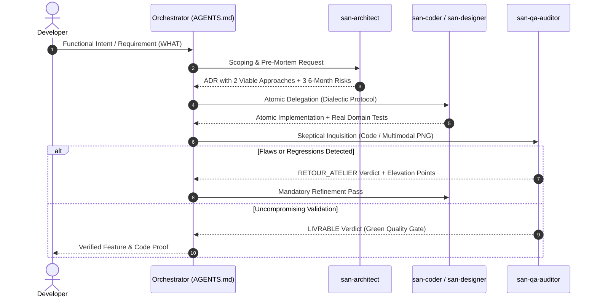

<p align="center">
  
</p>

# "GOOGLE ANTIGRAVITY" FRAMEWORK (`san_*`) — AGENTIC HARNESS & COGNITIVE GOVERNANCE v2.1

> **Language:** [Version française](README.md) | English  
> **Manifesto:** Autonomous agentic orchestration system (`Argon` $\rightarrow$ `Swarm Hydrogen XHigh`), contradictory doubt engineering, Studio UI Engine, and 18 sovereign skills for Google Antigravity CLI (AGY), Antigravity 2.0 / IDE, and opencode.  
> **Author:** Alexsan.pro  
> **Status:** 4-Layer Cartesian Architecture — Official Specification v2.1.0.  
> **License:** [MIT License](LICENSE)

---

## 1. VISION, AMBITION & DOCTRINE v2.1

On complex, high-stakes codebases, leaving AI assistants to naive conversational prompting inevitably leads to critical regressions:
- **Amnesia & Context Drift:** Forgotten API contracts, overlooked accessibility standards, and degraded architectural invariants.
- **First-Draft Sycophancy:** Docile acceptance of bland solutions, anemic domain models, bloated 500-line monolithic components, and generic soulless purple/indigo gradients (*AI taste*).
- **Testing Theater:** Checkboxes marked complete without verifiable codebase proofs, test suites bypassed with flags like `--passWithNoTests`, and tautological mocks that test mocks instead of business domain logic.
- **Operational Fragility:** Missing idempotency keys on payment transactions, CORS font-loading failures, suppressed critical dependency vulnerabilities, and total ignorance of hostile degraded networks.

Release **2.1.0** of `san_agy_framework` elevates the 4-layer architecture to **Full Mechanical Autonomy**:

1. **Sovereign Orchestrator (`Argon` / `Carbon`) $\rightarrow$ `gemini-4-hydrogen-xhigh` Swarm:** The user expresses only **WHAT** to build in a single prompt without ever touching `/model` or naming subagents. The Orchestrator mechanically coordinates parallel workers via the native `swarm(action: "add", model: "gemini-4-hydrogen-xhigh")` tool (strictly forbidding `Model: "inherit"` to protect weekly Argon quota and eliminating hidden fallback to `3.8-flash`).
2. **Map-First Continuity (`san_cartographer` & `REPO_MAP.md`) & `Stop` Guard (`stop_guard.mjs`):** The project's AST/import graph is updated in real time in $<100\text{ms}$ (`.agents/cache/REPO_MAP.md`), and the `Stop` hook blocks turn completion whenever application code is modified without a green Quality Gate proof (`.agents/cache/last-gate-status.json`), protected by a 2-retry anti-loop Circuit Breaker.
3. **Studio UI Engine & Contract-First Engineering:** Shared contract freeze (OpenAPI 3.1 / Zod / TypeBox) + *Architectural Fitness Functions*, **Studio Duel UI** (`option-a` vs `option-b`), single-Chromium **Multi-Viewport** Playwright capture (`mobile`, `tablet`, `desktop`), and mathematical **DOM Geometry Linter** (`--audit-dom`).

---

## 2. THE 4-LAYER v2.1 ARCHITECTURE

The framework organizes execution across 4 concentric, hermetically sealed layers, ensuring that every agent action is governed, instrumented, and verified:



### Layer 1: Sovereign Governance & Normative Rules
* **Permanent Constitution `<root>/AGENTS.md`:** Deployed at the repository root without YAML frontmatter to trigger unconditional `always_on` auto-loading by Antigravity and `opencode`. This compact file (< 4096 bytes) codifies the Sovereign Orchestrator (`Argon`/`Carbon`) laws, Map-First reconnaissance (`.agents/cache/REPO_MAP.md`), parallel delegation via `swarm(action: "add", model: "gemini-4-hydrogen-xhigh")`, and automated intent routing.
* **Declarative Normative Rules `.agents/rules/*.md`:** 5 standard reference documents equipped with official YAML frontmatters (`trigger: always_on`, `trigger: model_decision`, or `trigger: glob`):
  - [`PROJECT.md`](file://.agents/rules/PROJECT.md): Project technical profile, sovereign tech stack, and `Argon` (Orchestrator) $\rightarrow$ `gemini-4-hydrogen-xhigh` (Swarm Workers) model allocation matrix.
  - [`PRODUCT.md`](file://.agents/rules/PRODUCT.md): Product vision, business invariants, personas, and market constraints.
  - [`BRAND.md`](file://.agents/rules/BRAND.md): UI design tokens, aesthetic archetype, typographic tension, WCAG AAA accessibility, and 60 fps kinetic signature.
  - [`API.md`](file://.agents/rules/API.md): Interface contracts, standardized JSON envelope, ACID transactions, idempotency keys, and automated Bruno collections.
  - [`LOGO.md`](file://.agents/rules/LOGO.md): Master vector logo specifications and multi-resolution icon asset guidelines.

### Layer 2: The 8 Native Specialized Subagents (`gemini-4-hydrogen-xhigh`)
All 8 autonomous subagents declared in `.agents/agents/*.md` run on **`gemini-4-hydrogen-xhigh`** at execution time via `swarm` (while keeping `model: "pro"` in YAML frontmatter for backward CLI compatibility):

| Native Subagent | Runtime Model (Swarm) | Key Role & Responsibility | Attached Skills | Primary Deliverables |
| :--- | :--- | :--- | :--- | :--- |
| **`san-researcher`** | `gemini-4-hydrogen-xhigh` | Map-First (`REPO_MAP.md`) read-only exploration, factual architecture mapping, and third-party API doc scraping. | `san_searcher`, `san_cartographer` | Research notes, codebase maps, API reference summaries. |
| **`san-architect`** | `gemini-4-hydrogen-xhigh` | Architectural arbitration, **Contract-First** (OpenAPI 3.1 / Zod / TypeBox), **Architectural Fitness Functions**, and **6-Month Pre-Mortem**. | `san_planner`, `san_backend_expert` | ADRs, frozen shared contracts, Fitness Functions, mitigation plans. |
| **`san-designer-worker`** | `gemini-4-hydrogen-xhigh` | **Studio Duel UI** (`option-a` vs `option-b`) art direction, HTML/Tailwind composition, Multi-Viewport PNG renders, and DOM geometry auditing. | `san_design_tokens`, `san_copywriter`, `san_exporter` | Static mockups `/design/*.html`, Multi-Viewport PNGs & DOM audit JSON. |
| **`san-coder-back`** | `gemini-4-hydrogen-xhigh` | Atomic backend craftsman, Contract-First API protocols, ACID transactions, and real domain tests. | `san_backend_expert` | Controllers, services, migrations, Bruno `.bru` collections, integration tests. |
| **`san-coder-front`** | `gemini-4-hydrogen-xhigh` | Web & mobile frontend craftsman (< 220 lines/file), **5 non-destructive UI states** (*Stale-While-Revalidate*), and **Motion System** (`cubic-bezier`, `>= 44x44px`, `tabular-nums`). | `san_ux_ui_expert`, `san_copywriter`, `san_design_tokens` | React/React Native components, typed custom hooks, DOM integration tests. |
| **`san-qa-auditor`** | `gemini-4-hydrogen-xhigh` | Read-only skeptical inquisitor, test substance auditing, **multimodal visual + DOM geometry critique**, binary verdict. | `san_qa_security_expert` | Binary verdict `LIVRABLE` or `RETOUR_ATELIER`, OWASP security audits, QA reports. |
| **`san-ops-devops`** | `gemini-4-hydrogen-xhigh` | CI/CD pipelines, Docker containers, Nginx reverse proxies, CloudPanel, Fail-Closed infrastructure health checks. | `san_devops_expert` | GitHub Actions workflows, Dockerfiles, operations runbooks, system health audits. |
| **`san-growth-legal`** | `gemini-4-hydrogen-xhigh` | Legal compliance (GDPR, e-Privacy), privacy policies, store ASO metadata, and unified analytics tracking plans. | `san_store_legal_expert`, `san_growth_expert` | Privacy policies, app store checklists, event tracking plans. |

### Layer 3: The 5 Mechanical Lifecycle Guardrails
Configured in `.agents/hooks.json`, this layer intercepts engine events to mechanically enforce developer discipline:
1. **`SessionStart` (`session_start.mjs`):** Refreshes `.agents/cache/REPO_MAP.md` in $<100\text{ms}$, injects the Architectural Radar + active roadmap, and displays the one-shot `[WHAT'S NEW ON SAN.AGY v2.1.0]` banner after a `san-framework update`.
2. **`PreInvocation` (`pre_invocation.mjs` · Hooks API v2 `systemMessage`):** Injects a compact directive (< 90 tokens) enforcing Map-First reconnaissance (`REPO_MAP.md`), forbidding `Model: "inherit"` on Argon, and routing delegation through `swarm(action: "add", model: "gemini-4-hydrogen-xhigh")`.
3. **`PreToolUse` (`pre_tool_guard.mjs`):** Intercepts file operations (`write_file`, `edit_file`):
   - Blocks (`decision: "deny"`) archiving roadmaps containing unchecked tasks (`- [ ]`) into `/roadmaps/archives/`.
   - Blocks (`decision: "deny"`) placeholder text injection (*Lorem ipsum*, *dolor sit amet*).
4. **`PostToolUse` (`post_tool_indexer.mjs`):** Incrementally re-indexes (in $<50\text{ms}$ via SHA-256 hash) modified files into `.agents/cache/REPO_MAP.md`.
5. **`Stop` (`stop_guard.mjs` · Circuit Breaker):** Blocks turn completion (`decision: "continue"`) if application code was modified without a recent green Quality Gate proof in `.agents/cache/last-gate-status.json` (exempting `DOC_ONLY` sessions and capped at 2 retries).

### Layer 4: 18 Imperative Skill Runbooks
Every skill module in `.agents/skills/*/SKILL.md` is an **imperative, directive Runbook ($\le 130$ lines)** backed by deterministic scripts (`scripts/`), Python `run_workflow` pipelines (`autonomous_slice_workflow.py`, `parallel_inquisition_workflow.py`), templates (`templates/`), and references (`references/`).

---

## 3. CONTRADICTORY DOUBT ENGINEERING (*DOUBT ENGINEERING*)

To permanently defeat the curse of bland first drafts, the framework institutes 4 mandatory cognitive protocols:



### 1. The Systemic Pre-Mortem (`san-architect`)
Before greenlighting an architecture, data schema, or major integration, `san-architect` simulates a 6-month disaster scenario:
> *"Assume we are 6 months into the future and this component / API has catastrophically collapsed in production. What are the 3 most probable systemic causes of this failure?"*
The 3 causes (write concurrency bottlenecks, unindexed data volume, consumer contract breaks) must be addressed proactively in the design before any production code is written.

### 2. The Dialectic Before Commit (`san-coder-back`, `san-coder-front`)
Prior to committing any substantial code, the implementation subagent must explicitly formulate and compare **2 viable, distinct engineering approaches** (e.g., synchronous inline processing vs. asynchronous Redis Outbox pipeline). Constructing a laughable "strawman" Option C is strictly forbidden. The chosen approach must be justified with concrete arguments on testability, type safety, and resilience.

### 3. The Visual Vision Loop
Visual code (HTML/Tailwind) cannot be assessed by reading text. The visual design pole enforces an empirical pixel feedback loop:
1. `san-designer-worker` builds the HTML/Tailwind mockup implementing the aesthetic archetype defined in `BRAND.md`.
2. The [`export_png.mjs`](file://src/skills/san_designer/scripts/export_png.mjs) script starts an ephemeral Node HTTP server on `127.0.0.1:0` and captures high-resolution PNGs via headless Playwright without CORS font-loading blocks.
3. **Multimodal Inspection Step:** `san-qa-auditor` (`model: "pro"`) physically inspects the PNG screenshot using `read_file`. It critiques focal mass balance, typographic tension, contrast ratios, and Gestalt rhythm.
4. At least **one mandatory visual refinement pass** is executed before the mockup is submitted to the developer.

### 4. QA Inquisition & Presumption of Flaws (`san-qa-auditor`)
`san-qa-auditor` operates with the mindset of an adversarial auditor:
- **Presumption of Hidden Defect:** Every first draft is assumed to harbor an unhandled edge case, a brittle assumption, or an empty test.
- **Zero Tolerance for Testing Theater:** Instant rejection of tautological assertions, tests that mock their own subject, and quality gates running with compromise flags (`--passWithNoTests`, `|| true`).
- **Inviolable Binary Verdict:** The audit report concludes strictly with `LIVRABLE` (ready for delivery) or `RETOUR_ATELIER` (precise defect list requiring worker remediation).

---

## 4. CONTEXTUAL PROJECT PROFILES (`PROJECT_PROFILE`)

The framework dynamically calibrates its rules, gates, and checks via the `PROJECT_PROFILE` variable declared in `.agents/rules/PROJECT.md`:

| Contextual Profile | Primary Target | Activated Invariants | Network & Domain Constraints |
| :--- | :--- | :--- | :--- |
| **`emerging_market`** | Fintechs, African platforms, local e-commerce | Local Outbox queue, Redis queue with `Idempotency-Key`, asynchronous Mobile Money handling (Airtel Money, MTN MoMo STK/USSD callbacks & polling reconciliation), landmark-based addressing, WhatsApp deep linking. | Unstable 3G/EDGE resilience, offline-first queuing, zero double-debit guarantee. |
| **`global_saas`** | Global B2B/B2C SaaS, cloud platforms | Strict multi-tenant isolation, Stripe/Paddle billing, granular RBAC permissions, high availability, telemetry and observability. | High concurrency, SOC2 / GDPR compliance, p95 latency < 150ms. |
| **`mobile_consumer`** | iOS & Android consumer apps (React Native, Expo) | 60 fps micro-interactions, tactile haptics (`expo-haptics`), encrypted storage (`expo-secure-store`), Apple/Google rejection-proof checklists. | Offline first, minimal battery consumption, touch-first ergonomic targets. |
| **`cli_devtools`** | CLI tools, developer SDKs, open-source packages | Deterministic POSIX return codes (0/1), non-TTY stream compatibility, `--json` flags, zero bloated dependencies, instant startup. | Fast execution (< 200ms), cross-OS compatibility, npm/pip distribution. |
| **`api_platform`** | Microservices, public/partner REST/GraphQL/gRPC APIs | Strict OpenAPI 3.1 contracts, automated Bruno test collections, adaptive rate limiting (Redis token bucket), uniform JSON envelopes. | Semantic API versioning, ACID transaction isolation, immutable contracts. |

---

## 5. CATALOG OF THE 18 SKILL RUNBOOKS

All 18 skills are organized into 11 lead director roles and 7 cross-cutting toolkits, deployed directly into `.agents/skills/` (or inherited via `.agents/skills.json` in `--light` mode):

### A. The 11 Core Lead Skills

| Skill Module | Natural Intent Trigger | Key Responsibility | Core Deliverables & Scripts |
| :--- | :--- | :--- | :--- |
| [**`san_init`**](file://skills/san_init.md) | *"Initialize project"*, *"Configure agents"* | Setup, onboarding, Git isolation, and context generation | `<root>/AGENTS.md`, `.agents/rules/*.md`, `git_ai_hygiene.sh` |
| [**`san_brainstorming`**](file://skills/san_brainstorming.md) | *"Brainstorm feature"*, *"Score idea"*, *"Frame requirement"* | Idea triage, contextual 40-point scoring matrix | `roadmaps/ideas/*.md`, `score_idea.py` |
| [**`san_planner`**](file://skills/san_planner.md) | *"Create roadmap"*, *"Plan next phase"* | Contract-First phase breakdown, Fitness Functions & archiving | `roadmaps/*.md`, `archive_roadmap.sh` |
| [**`san_designer`**](file://skills/san_designer.md) | *"Design screen"*, *"Studio Duel UI"*, *"Run visual audit"* | Studio Duel UI (`option-a`/`option-b`), Multi-Viewports & DOM Linter | `/design/*.html`, `export_png.mjs --viewports --audit-dom` |
| [**`san_ux_ui_expert`**](file://skills/san_ux_ui_expert.md) | *"Build UI component"*, *"Fix accessibility"* | Lead Frontend Web & Mobile, 5 non-destructive UI states & Motion System | React/Expo components, `front_quality_gate.sh` |
| [**`san_backend_expert`**](file://skills/san_backend_expert.md) | *"Create API"*, *"Add endpoint"*, *"Model database"* | Lead Backend, ACID transactions, idempotency, API contracts | Models, Services, Bruno `.bru`, `backend_quality_gate.sh` |
| [**`san_executer`**](file://skills/san_executer.md) | *"Execute roadmap"*, *"Ship phase N"*, *"Code feature"* | Contract-First conductor, `Hydrogen XHigh` Swarm & `run_workflow` | `autonomous_slice_workflow.py`, `e2e_verification_gate.sh` |
| [**`san_qa_security_expert`**](file://skills/san_qa_security_expert.md) | *"Audit security"*, *"Run QA tests"* | Unified QA judge, parallel OWASP/Substance/DOM workflows | `parallel_inquisition_workflow.py`, `qa_security_gate.sh` |
| [**`san_devops_expert`**](file://skills/san_devops_expert.md) | *"Setup CI/CD"*, *"Deploy application"*, *"Check server"* | CloudPanel, Docker, Nginx, Mailcow, CI/CD runbooks | `.github/workflows/*`, `infra_health_check.sh` |
| [**`san_store_legal_expert`**](file://skills/san_store_legal_expert.md) | *"Prepare store release"*, *"GDPR compliance"* | Google Play / Apple Store compliance, legal policies | `docs/STORE_CHECKLIST.md`, `PRIVACY_POLICY.md` |
| [**`san_growth_expert`**](file://skills/san_growth_expert.md) | *"Optimize SEO"*, *"Tracking plan"*, *"Store ASO"* | Local SEO, App Store Optimization, analytics instrumentation | `docs/SEO.md`, `docs/TRACKING_PLAN.md` |

### B. The 7 Cross-Cutting Toolkits

| Cross-Cutting Toolkit | Technical Domain | Key Deliverables & Associated Scripts |
| :--- | :--- | :--- |
| [**`san_cartographer`**](file://sub-skills/san_cartographer.md) | Real-time architectural compass & incremental AST indexing | `repo_mapper.mjs`, `.agents/cache/REPO_MAP.md`, `post_tool_indexer.mjs` |
| [**`san_subagent_manager`**](file://sub-skills/san_subagent_manager.md) | Calibration & supervision of `swarm` workers on `gemini-4-hydrogen-xhigh` | Hermetic prompts, `validate_subagent_spec.sh` (forbidding `inherit`) |
| [**`san_searcher`**](file://sub-skills/san_searcher.md) | High-precision tech scouting and clean doc extraction | `doc_scraper.sh`, `detect_stack_versions.sh`, research notes `docs/research/*.md` |
| [**`san_copywriter`**](file://sub-skills/san_copywriter.md) | Real UX copy, humanization, and anti-placeholder linter | `check_lorem.sh`, zero *Lorem Ipsum*, contextual error messages |
| [**`san_design_tokens`**](file://sub-skills/san_design_tokens.md) | Guardian of `BRAND.md` and WCAG AAA contrast compiler | `build_tokens.mjs`, `audit_magic_values.sh`, unified CSS custom properties |
| [**`san_exporter`**](file://sub-skills/san_exporter.md) | Headless Playwright Multi-Viewport pipeline & DOM Geometry Linter | `export_png.mjs` (`--viewports`, `--audit-dom`, `--strict-dom`), `svg_to_png.mjs` |
| [**`san_doc_keeper`**](file://sub-skills/san_doc_keeper.md) | Documentation integrity guardian and SemVer maintainer | Automated `README.md`, `CHANGELOG.md` maintenance, Fast-Track hygiene |

---

## 6. UNIVERSAL v2.1 CLI GUIDE

The framework is operated and installed using the official `san-framework` CLI (or its alias `agy-framework`):

```bash
# Direct execution via npx (no prior installation needed)
npx @alexsan/agy-framework <command> [options]

# Or via global binary if installed
san-framework <command> [options]
```

### A. The 5 Official Commands

#### 1. `san-framework init --local [--light]`
Deploys the full 4-layer architecture into `./.agents/` in your local project and generates the root `<root>/AGENTS.md` constitution.
- **Lightweight Inheritance Mode (`--light`):** Generates `.agents/skills.json` (`"inherits"`) pointing to the 18 framework skills without duplicating skill folders on disk, while keeping `.agents/rules/`, `.agents/agents/`, `.agents/hooks/`, and `.agents/cache/` 100% project-local.
- **Normative Smart Merge:** Inspects existing rules in `.agents/rules/` (`PROJECT.md`, `BRAND.md`, etc.). If a customized file exists, the CLI automatically injects required YAML frontmatter **without ever overwriting your business specifications**.
- **Reversible Backups:** If legacy AI configs (`CLAUDE.md`, `.cursorrules`) are detected, they are safely relocated to `.agents/backups/legacy-ai-configs/<timestamp>/` rather than destroyed.
- **Hermetic Git Lock:** Automatically configures dual protection in `.gitignore` and `.git/info/exclude`.

```bash
# Full local deployment in non-interactive mode
san-framework init --local --all

# Local deployment in Lightweight Inheritance Mode (without copying the 18 skill folders)
san-framework init --local --light

# Targeted deployment of specific skills
san-framework init --local --skills=san_init,san_planner,san_executer,san_qa_security_expert
```

#### 2. `san-framework init --global`
Bundles and installs the framework as an **Official Antigravity Plugin** in the global user directory (`~/.gemini/antigravity-cli/plugins/san-framework/`).
- 100% compliant and certified via the official engine command: `agy plugin validate --strict`.
- Packages the `plugin.json` (`2.1.0`) manifest, vector logo, 8 subagents, 5 lifecycle hooks, and 18 executable skills.

```bash
san-framework init --global --all
```

#### 3. `san-framework update [--light]`
Performs an **instantaneous, non-destructive migration** to the `v2.1.0` architecture:
- Upgrades all 18 skills to their compact runbook format ($\le 130$ lines), or updates `.agents/skills.json` with `--light`.
- Installs the 8 native subagent definitions (`gemini-4-hydrogen-xhigh`) into `.agents/agents/`.
- Installs `.agents/hooks.json` and the 5 lifecycle hook scripts (`session_start.mjs`, `pre_invocation.mjs`, `pre_tool_guard.mjs`, `post_tool_indexer.mjs`, `stop_guard.mjs`).
- Displays the **"What's New on san-agy v2.1.0"** terminal banner and queues the one-shot notification for the 1st `SessionStart` via `.agents/cache/whats_new_pending.json`.

```bash
san-framework update
san-framework update --light
```

#### 4. `san-framework whats-new`
Displays the structured **"What's New on san-agy v2.1.0"** release summary in the terminal at any time:

```bash
san-framework whats-new
```

#### 5. `san-framework doctor`
Executes a deterministic audit of the **6 health pillars** on the target repository:

```bash
san-framework doctor
```

The diagnostic strictly verifies:
1. **Sovereign Governance:** Existence and compliance of `<root>/AGENTS.md` (size < 4 KB, no frontmatter).
2. **Normative Rules:** Existence of all 5 rule files in `.agents/rules/` with valid YAML frontmatter.
3. **Native Subagents:** Existence of all 8 subagents in `.agents/agents/*.md`.
4. **Lifecycle Guardrails:** Existence of `.agents/hooks.json` and execution permissions on all 5 `.mjs` scripts (including `post_tool_indexer.mjs` and `stop_guard.mjs`).
5. **18-Skill Catalog:** Verifies compactness of all `SKILL.md` files ($\le 130$ lines), whether installed locally or via `--light` (`.agents/skills.json`).
6. **Git Isolation:** Verifies hermetic exclusion in `.gitignore` or `.git/info/exclude`.

*Exit code: `0` if all 6 pillars pass, `1` if anomalies are found (with automated remediation guidance).*

### B. CLI Options Reference Table

| CLI Flag | Role & Behavior |
| :--- | :--- |
| `--local` | Deploys the framework locally into `./.agents/` [Default in non-interactive mode]. |
| `--light` | Lightweight Inheritance Mode: generates `.agents/skills.json` (`"inherits"`) without copying the 18 skill directories. |
| `--global` | Packages and installs the global Plugin into the user Antigravity directory. |
| `--all` | Installs all 18 skill modules without interactive confirmation. |
| `--skills=<list>` | Granular comma-separated selection of skills to install. |
| `--dry-run` | Simulation mode: previews actions without writing files to disk. |
| `--force` | Forces overwrite and replacement of existing components. |
| `--opencode` | Additionally generates root `opencode.json` configuration and context. |
| `--dir=<path>` | Explicitly specifies the target installation directory. |
| `--version`, `-v` | Displays the current framework version (`2.1.0`). |
| `--help`, `-h` | Displays the comprehensive help guide and command list. |

---

## 7. REPOSITORY LAYOUT

```txt
san_agy_framework/
├── package.json                        # npm manifest v2.1.0, CLI binaries (san-framework & agy-framework)
├── LICENSE                             # Official Alexsan.pro MIT License
├── README.md                           # Master Architecture Index v2.1 (French version)
├── README.en.md                        # Master Architecture Index v2.1 (this file)
├── CHANGELOG.md                        # Project Changelog (Keep a Changelog standard)
├── CHANGELOG.en.md                     # Project Changelog (English version)
├── .gitignore                          # Local isolation and Git hygiene
│
├── logos/                              # Official vector branding
│   ├── LOGO.md                         # Visual guidelines and asset rules
│   ├── san_framework_logo.svg          # Official vector logo (Symbol + Typography)
│   ├── san_framework_icon.svg          # Vector icon / Favicon
│   └── san_framework_dark.svg          # Dark mode vector variant
│
├── roadmaps/                           # Internal framework orchestration
│   ├── PLAN_V2_1_0_HYDROGEN_SWARM.md   # Parallel v2.1.0 execution roadmap (completed)
│   ├── ideas/                          # san_brainstorming ideation and scoring dossiers
│   └── archives/                       # 100% verified and archived roadmaps
│
├── src/                                # THE DISTRIBUTABLE PRODUCT (v2.1.0 Package)
│   ├── agents/                         # 8 native Antigravity subagent definitions (gemini-4-hydrogen-xhigh)
│   │   ├── san-researcher.md           # Map-First exploration and documentation scraping
│   │   ├── san-architect.md            # Contract-First, Fitness Functions, 6-Month Pre-Mortem
│   │   ├── san-designer-worker.md      # Studio Duel UI (option-a/b), Multi-Viewports & DOM Linter
│   │   ├── san-coder-back.md           # Atomic backend craftsman, ACID transactions, domain tests
│   │   ├── san-coder-front.md          # Modular frontend craftsman, 5 UI states & Motion System
│   │   ├── san-qa-auditor.md           # Skeptical QA inquisitor, multimodal & DOM geometry critique
│   │   ├── san-ops-devops.md           # CI/CD, containers, infrastructure diagnostics
│   │   └── san-growth-legal.md         # GDPR, store compliance, SEO/ASO analytics
│   │
│   ├── hooks/                          # 5 Mechanical lifecycle guardrails
│   │   ├── hooks.json                  # SessionStart, PreInvocation, PreToolUse, PostToolUse, Stop
│   │   └── scripts/                    # session_start, pre_invocation, pre_tool_guard, post_tool_indexer, stop_guard
│   │
│   ├── plugin/                         # Official Antigravity Plugin bundle
│   │   ├── plugin.json                 # v2.1.0 manifest certified by 'agy plugin validate --strict'
│   │   └── assets/logo.svg             # Packaged official vector logo
│   │
│   ├── cli/                            # Universal installer & diagnostics engine
│   │   ├── index.js                    # Executable entry point (init, update, whats-new, doctor)
│   │   ├── installer.js                # Copy logic, --light mode (skills.json), Smart Merge, doctor
│   │   └── whats_new.js                # "What's New on san-agy v2.1.0" module
│   │
│   └── skills/                         # 18 packaged executable runbooks (SKILL.md <= 130 lines)
│       ├── san_init/                   # Initialization, rules, and root constitution
│       ├── san_brainstorming/          # Idea framing, 40-point multicriteria scoring matrix
│       ├── san_planner/                # Contract-First planning, Fitness Functions, and archiving
│       ├── san_cartographer/           # Real-time AST codebase mapping (.agents/cache/REPO_MAP.md)
│       ├── san_subagent_manager/       # Calibration of swarm workers on gemini-4-hydrogen-xhigh
│       ├── san_searcher/               # Tech scouting and targeted documentation scraping
│       ├── san_designer/               # Studio Duel UI, export_png.mjs v2 Multi-Viewports & DOM Linter
│       ├── san_copywriter/             # Real UX copy, humanization, and anti-placeholder linter
│       ├── san_design_tokens/          # Design tokens and WCAG AAA contrast compiler
│       ├── san_ux_ui_expert/           # Lead Frontend, accessibility, 5 UI states & Motion System
│       ├── san_backend_expert/         # Lead Backend, API protocols, and idempotency
│       ├── san_executer/               # Full-Stack conductor & autonomous_slice_workflow.py
│       ├── san_qa_security_expert/     # Unified QA judge & parallel_inquisition_workflow.py
│       ├── san_exporter/               # Multi-Viewport capture pipeline & SVG->PNG conversion
│       ├── san_devops_expert/          # Infrastructure runbooks, Nginx, Docker, CI/CD
│       ├── san_store_legal_expert/     # Store compliance (Play/App Store) and legal policies
│       ├── san_growth_expert/          # Local SEO, store ASO metadata, and tracking plans
│       └── san_doc_keeper/             # Documentation integrity and SemVer maintenance
│
└── tests/                              # AUTOMATED VALIDATION TEST SUITES
    ├── phase3/ to phase9/              # v1.x regression test suites
    └── v2/                             # Deterministic v2.1 validation test suites (Phases 1-6 & E2E)
```

---

## 8. LICENSE

This project is licensed under the MIT License — see the [`LICENSE`](LICENSE) file for details.  
Copyright (c) 2026 Alexsan.pro. All rights reserved.
