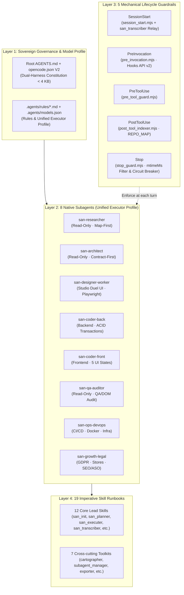
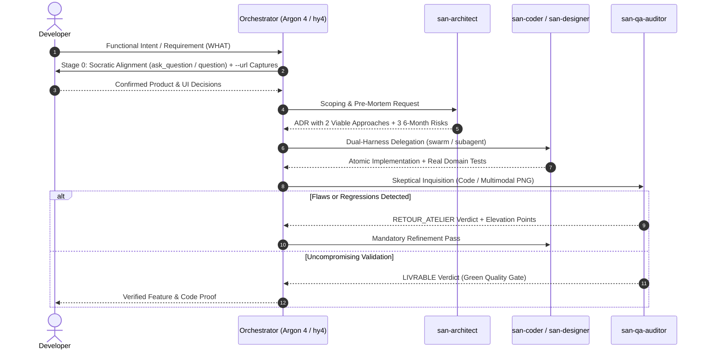

<p align="center">
  
</p>

<p align="center">
  
  
  
  
  
</p>

# "GOOGLE ANTIGRAVITY" FRAMEWORK (`san_*`) — DUAL-HARNESS ENGINE & COGNITIVE GOVERNANCE v2.2

> **Language:** [Version française](README.md) | English  
> **Manifesto:** **Dual-Harness** agentic orchestration system (`Antigravity` `swarm` + `OpenCode V2` `subagent`) powered by a **Unified Executor Profile** (`san-framework models`), contradictory doubt engineering, skeptical quota-handoff transcripts (`san_transcriber`), Studio UI Engine (`--url` live capture), and **19 sovereign skills**.  
> **Author:** Alexsan.pro  
> **Status:** 4-Layer Cartesian Architecture — Official Specification v2.2.0.  
> **License:** [MIT License](LICENSE)

---

## 1. VISION, AMBITION & DOCTRINE v2.2

On complex, high-stakes codebases, leaving AI assistants to naive conversational prompting inevitably leads to critical regressions:
- **Amnesia & Context Drift:** Forgotten API contracts, overlooked accessibility standards, and degraded architectural invariants.
- **First-Draft Sycophancy:** Docile acceptance of bland solutions, anemic domain models, bloated 500-line monolithic components, and generic soulless purple/indigo gradients (*AI taste*).
- **Testing Theater:** Checkboxes marked complete without verifiable codebase proofs, test suites bypassed with flags like `--passWithNoTests`, and tautological mocks that test mocks instead of business domain logic.
- **Operational Fragility:** Missing idempotency keys on payment transactions, CORS font-loading failures, suppressed critical dependency vulnerabilities, and total ignorance of hostile degraded networks.

Release **2.2.0** of `san_agy_framework` removes mono-vendor harness lock-in and eliminates mechanical delegation blind spots:

1. **Dual-Harness Architecture (`Antigravity` + `OpenCode V2`) & Unified Executor Profile (`san-framework models`):** One unified constitution (`AGENTS.md` + `.agents/models.json`) drives all 8 specialized `san-*` subagents across both engines:
   - **Google Antigravity (`agy`):** The Orchestrator (`Argon 4` / `Carbon`) spawns parallel workers via `swarm(action: "add", model: "<agy.executor>")` (default: `gemini-4-hydrogen-xhigh`, strictly forbidding `Model: "inherit"`).
   - **OpenCode V2 (`opencode v2.2.7+` / `2.3.0`):** The Orchestrator (`opencode-go/hy4`) invokes the native `subagent({ agent: "san-..." })` tool backed by the auto-generated `"agents"` key in `opencode.json` (default: `opencode-go/deepseek-v4-pro`, switchable in one command to `opencode-go/qwen3.8-flash` via `san-framework models`).
2. **Cognitive De-Lobotomization & Live Web Capture (`export_png.mjs --url`):** No more premature delegation to mute background workers unable to query the user, and no more blind CSS `curl` guesswork: the **Socratic & Visual Alignment Rule** requires the Orchestrator (`Argon 4` / `hy4`) to align structural choices with the user (`ask_question` / `question`) and capture real pixels of reference websites via `export_png.mjs --url=<https://...>` (Desktop + Mobile) **before** delegating roadmap authoring or mockup implementation.
3. **19th Skill `san_transcriber` (Skeptical Handoff) & Hardened `Stop` Guard:** Invoked via `/san_transcriber` when approaching quota exhaustion, the new skill writes a roadmap-linked handoff transcript to `roadmaps/transcripts/` enforcing the **Skeptical Handoff Protocol (*Doubt & Verify*)**, auto-detected on startup by `session_start.mjs`. Meanwhile, `stop_guard.mjs` applies `mtimeMs` timestamp filtering and exempts `design/**`, `logos/**`, and `opencode.json` to eliminate false positives on repositories with pre-existing dirty files.
4. **Map-First Continuity & Contract-First Studio UI Engine:** Real-time AST indexing in $<100\text{ms}$ (`.agents/cache/REPO_MAP.md`), shared contract freeze (OpenAPI 3.1 / Zod / TypeBox) + *Architectural Fitness Functions*, **Studio Duel UI** (`option-a` vs `option-b`), single-Chromium **Multi-Viewport** Playwright capture (`mobile`, `tablet`, `desktop`), and mathematical **DOM Geometry Linter** (`--audit-dom`).

---

## 2. THE 4-LAYER v2.2 ARCHITECTURE

The framework organizes execution across 4 concentric, hermetically sealed layers, ensuring that every agent action is governed, instrumented, and verified across both `Antigravity` and `OpenCode V2`:



### Layer 1: Sovereign Governance & Normative Rules
* **Permanent Constitution `<root>/AGENTS.md`:** Deployed at the repository root without YAML frontmatter for unconditional `always_on` auto-loading by Google Antigravity and OpenCode V2. This compact file (< 4096 bytes) codifies Stage 0 **Socratic & Visual Alignment**, Map-First reconnaissance (`.agents/cache/REPO_MAP.md`), Dual-Harness routing (`swarm` on Antigravity | `subagent` on OpenCode V2), and automated intent dispatch.
* **Unified Model Profile `.agents/models.json` & `opencode.json` V2:** Driven by `san-framework models`, these files declare the Orchestrator and **Unified Executor** per harness and auto-generate OpenCode V2's native `"agents"` section (`mode: "subagent"`, `system`, `model`, `permissions`).
* **Declarative Normative Rules `.agents/rules/*.md`:** 5 standard reference documents equipped with official YAML frontmatters (`trigger: always_on`, `trigger: model_decision`, or `trigger: glob`):
  - [`PROJECT.md`](file://.agents/rules/PROJECT.md): Project technical profile, sovereign tech stack, and Dual-Harness allocation doctrine (`Orchestrator` $\rightarrow$ `Unified Executor Profile`).
  - [`PRODUCT.md`](file://.agents/rules/PRODUCT.md): Product vision, business invariants, personas, and market constraints.
  - [`BRAND.md`](file://.agents/rules/BRAND.md): UI design tokens, aesthetic archetype, typographic tension, WCAG AAA accessibility, and 60 fps kinetic signature.
  - [`API.md`](file://.agents/rules/API.md): Interface contracts, standardized JSON envelope, ACID transactions, idempotency keys, and automated Bruno collections.
  - [`LOGO.md`](file://.agents/rules/LOGO.md): Master vector logo specifications and multi-resolution icon asset guidelines.

### Layer 2: The 8 Native Subagents & Unified Executor Profile
All 8 subagents defined in `.agents/agents/*.md` (and projected into OpenCode V2's `"agents"` map inside `opencode.json`) share a **Unified Executor Profile** configured in one command via `san-framework models` (`.agents/models.json`):

| Runtime Harness | Main Orchestrator | Unified Executor Profile (8 `san-*`) | Delegation Primitive | Native Verification |
| :--- | :--- | :--- | :--- | :--- |
| **Google Antigravity (`agy`)** | `Argon 4` (`gemini-4-argon-high`) / `Carbon` | `gemini-4-hydrogen-xhigh` *(default `--agy`)* | `swarm(action: "add", model: "<agy.executor>")` | `agy plugin validate --strict` |
| **OpenCode V2 (`v2.2.7+` / `2.3.0`)** | `opencode-go/hy4` | `opencode-go/deepseek-v4-pro` or `opencode-go/qwen3.8-flash` *(via `--opencode`)* | `subagent({ agent: "san-...", prompt: "..." })` | `opencode debug agents` |

> *Compatibility note: `.agents/agents/*.md` preserves `model: "pro"` in YAML frontmatter for Antigravity CLI parser backward compatibility, while runtime workers always resolve to the executor configured in `.agents/models.json` (`mode: "subagent"` in `opencode.json`).*

| Native Subagent | Mode & Permissions (`OpenCode V2` / `Agy`) | Key Role & Responsibility | Attached Skills | Primary Deliverables |
| :--- | :--- | :--- | :--- | :--- |
| **`san-researcher`** | `subagent` · **Read-Only** (`edit: deny`) | Map-First (`REPO_MAP.md`) read-only exploration, factual mapping, and third-party API doc scraping. | `san_searcher`, `san_cartographer` | Research notes, codebase maps, API reference summaries. |
| **`san-architect`** | `subagent` · **Read-Only** (`edit: deny`) | Architectural arbitration, **Contract-First** (OpenAPI 3.1 / Zod / TypeBox), **Architectural Fitness Functions**, and **6-Month Pre-Mortem**. | `san_planner`, `san_backend_expert` | ADRs, frozen shared contracts, Fitness Functions, mitigation plans. |
| **`san-designer-worker`** | `subagent` · Write / Execute | **Studio Duel UI** (`option-a` vs `option-b`) art direction, live `--url` capture, HTML/Tailwind, Multi-Viewport PNGs, and DOM auditing. | `san_design_tokens`, `san_copywriter`, `san_exporter` | Static mockups `/design/*.html`, Multi-Viewport PNGs & DOM audit JSON. |
| **`san-coder-back`** | `subagent` · Write / Execute | Atomic backend craftsman, Contract-First API protocols, ACID transactions, and real domain tests. | `san_backend_expert` | Controllers, services, migrations, Bruno `.bru` collections, integration tests. |
| **`san-coder-front`** | `subagent` · Write / Execute | Web & mobile frontend craftsman (< 220 lines/file), **5 non-destructive UI states** (*Stale-While-Revalidate*), and **Motion System** (`cubic-bezier`, `>= 44x44px`, `tabular-nums`). | `san_ux_ui_expert`, `san_copywriter`, `san_design_tokens` | React/React Native components, typed custom hooks, DOM integration tests. |
| **`san-qa-auditor`** | `subagent` · **Read-Only** (`edit: deny`) | Read-only skeptical inquisitor, test substance auditing, **multimodal visual + DOM geometry critique**, binary verdict. | `san_qa_security_expert` | Binary verdict `LIVRABLE` or `RETOUR_ATELIER`, OWASP security audits, QA reports. |
| **`san-ops-devops`** | `subagent` · Write / Execute | CI/CD pipelines, Docker containers, Nginx reverse proxies, CloudPanel, Fail-Closed infrastructure health checks. | `san_devops_expert` | GitHub Actions workflows, Dockerfiles, operations runbooks, system health audits. |
| **`san-growth-legal`** | `subagent` · Write / Execute | Legal compliance (GDPR, e-Privacy), privacy policies, store ASO metadata, and unified analytics tracking plans. | `san_store_legal_expert`, `san_growth_expert` | Privacy policies, app store checklists, event tracking plans. |

### Layer 3: The 5 Mechanical Lifecycle Guardrails
Configured in `.agents/hooks.json`, this layer enforces developer discipline across the lifecycle:
1. **`SessionStart` (`session_start.mjs`):** Refreshes `.agents/cache/REPO_MAP.md` in $<100\text{ms}$, detects the active roadmap and the **latest handoff transcript in `roadmaps/transcripts/*.md`** (`[SAN.AGY CONSTITUTION v2.2]` banner), and shows the one-shot `[WHAT'S NEW ON SAN.AGY v2.2.0]` banner after an update.
2. **`PreInvocation` (`pre_invocation.mjs` · Hooks API v2 `systemMessage`):** Injects a compact directive (< 90 tokens) enforcing Stage 0 Socratic Alignment, Map-First reconnaissance (`REPO_MAP.md`), Dual-Harness delegation (`swarm` | `subagent` via `.agents/models.json`), and forbidding `Model: "inherit"`.
3. **`PreToolUse` (`pre_tool_guard.mjs`):** Intercepts `write_file` / `edit_file` to block archiving incomplete roadmaps (`- [ ]`) and dummy text injection (*Lorem ipsum*).
4. **`PostToolUse` (`post_tool_indexer.mjs`):** Incrementally re-indexes (in $<50\text{ms}$ via SHA-256 hash) modified files into `.agents/cache/REPO_MAP.md`.
5. **`Stop` (`stop_guard.mjs` · `mtimeMs` Filter & Circuit Breaker):** Blocks turn completion (`decision: "continue"`, max 2 retries) only when **freshly modified application code** (`mtimeMs` < 10 min or newer than `last-gate-status.json`) lacks a recent green Quality Gate proof. Automatically exempts `design/**`, `logos/**`, `.opencode/**`, `opencode.json`, `opencode.jsonc`, `.gitignore`, `*.md`, `*.mdx`, `*.txt`, `roadmaps/**`, `docs/**`, and `.agents/**`, eliminating false positives on repos with pre-existing dirty files.

### Layer 4: 19 Imperative Skill Runbooks
Every module in `.agents/skills/*/SKILL.md` is an **imperative, directive Runbook ($\le 130$ lines)** backed by deterministic scripts that are **byte-identical (`cmp -s`) across shared pairs** (`export_png.mjs`, `archive_roadmap.sh`, `svg_to_png.mjs`), Python `run_workflow` pipelines, templates, and synchronized `v2.2.0` wrappers in `skills/*.md` and `sub-skills/*.md`.

---

## 3. CONTRADICTORY DOUBT ENGINEERING (*DOUBT ENGINEERING*)

To permanently defeat bland first drafts and amnesic session handoffs, the framework institutes 5 mandatory cognitive protocols:



### 1. Stage 0: Socratic & Visual Alignment Before Delegation
Before spawning background subagents (which cannot query the user directly), the Orchestrator (`Argon 4` / `hy4`) aligns key structural decisions with the developer via `ask_question` (Antigravity) or `question` (OpenCode) and inspects real reference captures via `export_png.mjs --url`.

### 2. The Systemic Pre-Mortem (`san-architect`)
Before greenlighting an architecture, data schema, or major integration, `san-architect` simulates a 6-month production failure scenario (*"What are the 3 most probable systemic causes of failure?"*) and locks mitigations into frozen OpenAPI/Zod contracts prior to coding.

### 3. The Dialectic Before Commit (`san-coder-back`, `san-coder-front`)
Prior to committing substantial code, the implementation subagent formulates and compares **2 viable, distinct engineering approaches** (no strawman options) justified by testability, type safety, and resilience.

### 4. The Visual Vision Loop & Live Web Capture (`export_png.mjs --url`)
Visual interfaces and web references are never evaluated by reading CSS text alone:
1. **Live Reference Capture (`--url`):** For any inspiration URL, run `node .agents/skills/san_designer/scripts/export_png.mjs --url=<https://...> --viewports=desktop,mobile` (or `--full-page`) to capture real pixels into `design/references/` and inspect them with `read_file`. Universal `loadPlaywright()` resolves Playwright across local project, global plugin, or `~/.npm/_npx`.
2. **Studio Duel UI (`option-a` vs `option-b`):** `san-designer-worker` builds 2 distinct HTML/Tailwind directions with zero external CDNs; `export_png.mjs` serves them on `127.0.0.1:0` and captures `mobile`, `tablet`, and `desktop` on a single Chromium instance with DOM geometry auditing (`--audit-dom`).
3. **Multimodal Inspection (`san-qa-auditor`):** Direct PNG pixel inspection via `read_file`, geometric verification, and at least **one refinement pass** prior to delivery.

### 5. QA Inquisition & Skeptical Quota-Handoff Relay (`san_transcriber`)
- **QA Inquisition (`san-qa-auditor`):** Presumption of hidden defects, zero tolerance for *Testing Theater* (`--passWithNoTests`, tautological mocks), and inviolable binary verdicts (`LIVRABLE` | `RETOUR_ATELIER`).
- **Skeptical Handoff `san_transcriber` (`/san_transcriber`):** When approaching quota limits, `/san_transcriber` generates a structured transcript in `roadmaps/transcripts/TRANSCRIPT_<ROADMAP>_<DATE>.md` (Git state + active roadmap `- [x]` / `- [ ]` progress) embedding the **Skeptical Handoff Protocol (*Doubt & Verify*)**. On the next session start, `session_start.mjs` automatically flags the transcript and instructs the incoming agent to audit and challenge the previous agent's claims and deliverables before resuming work.

---

## 4. CONTEXTUAL PROJECT PROFILES (`PROJECT_PROFILE`)

The framework dynamically calibrates its rules, gates, and checks via the `PROJECT_PROFILE` variable declared in `.agents/rules/PROJECT.md`:

| Contextual Profile | Primary Target | Activated Invariants | Network & Domain Constraints |
| :--- | :--- | :--- | :--- |
| **`emerging_market`** | Fintechs, African platforms, local e-commerce | Local Outbox queue, Redis queue with `Idempotency-Key`, asynchronous Mobile Money handling (Airtel Money, MTN MoMo STK/USSD callbacks & polling reconciliation), landmark-based addressing, WhatsApp deep linking. | Unstable 3G/EDGE resilience, offline-first queuing, zero double-debit guarantee. |
| **`global_saas`** | Global B2B/B2C SaaS, cloud platforms | Strict multi-tenant isolation, Stripe/Paddle billing, granular RBAC permissions, high availability, telemetry and observability. | High concurrency, SOC2 / GDPR compliance, p95 latency < 150ms. |
| **`mobile_consumer`** | iOS & Android consumer apps (React Native, Expo) | 60 fps micro-interactions, tactile haptics (`expo-haptics`), encrypted storage (`expo-secure-store`), Apple/Google rejection-proof checklists. | Offline first, minimal battery consumption, touch-first ergonomic targets. |
| **`cli_devtools`** | CLI tools, developer SDKs, open-source packages | Deterministic POSIX return codes (0/1), non-TTY stream compatibility, `--json` flags, zero bloated dependencies, instant startup. | Fast execution (< 200ms), cross-OS compatibility, npm/pip distribution. |
| **`api_platform`** | Microservices, public/partner REST/GraphQL/gRPC APIs | Strict OpenAPI 3.1 contracts, automated Bruno test collections, adaptive rate limiting (Redis token bucket), uniform JSON envelopes. | Semantic API versioning, ACID transaction isolation, immutable contracts. |

---

## 5. CATALOG OF THE 19 SKILL RUNBOOKS

All **19 skills** are organized into 12 core lead director roles (including the quota-handoff skill `san_transcriber`) and 7 cross-cutting toolkits, deployed directly into `.agents/skills/` (or inherited via `.agents/skills.json` in `--light` mode):

### A. The 12 Core Lead Skills

| Skill Module | Natural Intent Trigger | Key Responsibility | Core Deliverables & Scripts |
| :--- | :--- | :--- | :--- |
| [**`san_init`**](file://skills/san_init.md) | *"Initialize project"*, *"Configure agents"* | Setup, onboarding, Git isolation, and context generation | `<root>/AGENTS.md`, `.agents/rules/*.md`, `git_ai_hygiene.sh` |
| [**`san_brainstorming`**](file://skills/san_brainstorming.md) | *"Brainstorm feature"*, *"Score idea"*, *"Frame requirement"* | Socratic idea triage, contextual 40-point scoring matrix | `roadmaps/ideas/*.md`, `score_idea.py` |
| [**`san_planner`**](file://skills/san_planner.md) | *"Create roadmap"*, *"Plan next phase"* | Stage 0 Socratic Alignment, Contract-First planning, Fitness Functions & archiving | `roadmaps/*.md`, `archive_roadmap.sh` |
| [**`san_designer`**](file://skills/san_designer.md) | *"Design screen"*, *"Studio Duel UI"*, *"Run visual audit"* | Live `--url` capture, Studio Duel UI (`option-a`/`option-b`), Multi-Viewports & DOM Linter | `/design/*.html`, `export_png.mjs --url --viewports --audit-dom` |
| [**`san_ux_ui_expert`**](file://skills/san_ux_ui_expert.md) | *"Build UI component"*, *"Fix accessibility"* | Lead Frontend Web & Mobile, 5 non-destructive UI states & Motion System | React/Expo components, `front_quality_gate.sh` |
| [**`san_backend_expert`**](file://skills/san_backend_expert.md) | *"Create API"*, *"Add endpoint"*, *"Model database"* | Lead Backend, ACID transactions, idempotency, API contracts | Models, Services, Bruno `.bru`, `backend_quality_gate.sh` |
| [**`san_executer`**](file://skills/san_executer.md) | *"Execute roadmap"*, *"Ship phase N"*, *"Code feature"* | Contract-First conductor, Dual-Harness (`swarm` / `subagent`) & `run_workflow` | `autonomous_slice_workflow.py`, `e2e_verification_gate.sh` |
| [**`san_qa_security_expert`**](file://skills/san_qa_security_expert.md) | *"Audit security"*, *"Run QA tests"* | Unified QA judge, parallel OWASP/Substance/DOM workflows | `parallel_inquisition_workflow.py`, `qa_security_gate.sh` |
| [**`san_devops_expert`**](file://skills/san_devops_expert.md) | *"Setup CI/CD"*, *"Deploy application"*, *"Check server"* | CloudPanel, Docker, Nginx, Mailcow, CI/CD runbooks | `.github/workflows/*`, `infra_health_check.sh` |
| [**`san_store_legal_expert`**](file://skills/san_store_legal_expert.md) | *"Prepare store release"*, *"GDPR compliance"* | Google Play / Apple Store compliance, legal policies | `docs/STORE_CHECKLIST.md`, `PRIVACY_POLICY.md` |
| [**`san_growth_expert`**](file://skills/san_growth_expert.md) | *"Optimize SEO"*, *"Tracking plan"*, *"Store ASO"* | Local SEO, App Store Optimization, analytics instrumentation | `docs/SEO.md`, `docs/TRACKING_PLAN.md` |
| [**`san_transcriber`**](file://skills/san_transcriber.md) | *"/san_transcriber"*, *"Quota handoff"*, *"Generate transcript"* | Skeptical (*Doubt & Verify*) quota-handoff transcript linked to active roadmaps | `roadmaps/transcripts/TRANSCRIPT_*.md`, `transcript_helper.mjs` |

### B. The 7 Cross-Cutting Toolkits

| Cross-Cutting Toolkit | Technical Domain | Key Deliverables & Associated Scripts |
| :--- | :--- | :--- |
| [**`san_cartographer`**](file://sub-skills/san_cartographer.md) | Real-time architectural compass & incremental AST indexing | `repo_mapper.mjs`, `.agents/cache/REPO_MAP.md`, `post_tool_indexer.mjs` |
| [**`san_subagent_manager`**](file://sub-skills/san_subagent_manager.md) | Dual-Harness calibration (`swarm` / `subagent`) using the Unified Executor Profile (`.agents/models.json`) | Hermetic prompts, `validate_subagent_spec.sh` (forbidding `inherit`) |
| [**`san_searcher`**](file://sub-skills/san_searcher.md) | High-precision tech scouting and clean doc extraction | `doc_scraper.sh`, `detect_stack_versions.sh`, research notes `docs/research/*.md` |
| [**`san_copywriter`**](file://sub-skills/san_copywriter.md) | Real UX copy, humanization, and anti-placeholder linter | `check_lorem.sh`, zero *Lorem Ipsum*, contextual error messages |
| [**`san_design_tokens`**](file://sub-skills/san_design_tokens.md) | Guardian of `BRAND.md` and WCAG AAA contrast compiler | `build_tokens.mjs`, `audit_magic_values.sh`, unified CSS custom properties |
| [**`san_exporter`**](file://sub-skills/san_exporter.md) | Live web capture (`--url`), headless Playwright Multi-Viewport pipeline & DOM Geometry Linter | `export_png.mjs` (`--url`, `--full-page`, `--viewports`, `--audit-dom`), `svg_to_png.mjs` |
| [**`san_doc_keeper`**](file://sub-skills/san_doc_keeper.md) | Documentation integrity guardian, SemVer & SHA-256 roadmap archiving | Automated `README.md`, `CHANGELOG.md`, unified `archive_roadmap.sh` |

---

## 6. UNIVERSAL v2.2 CLI GUIDE

The framework is operated and installed using the official `san-framework` CLI (or its alias `agy-framework`):

```bash
# Direct execution via npx (no prior installation needed)
npx @alexsan/agy-framework <command> [options]

# Or via global binary if installed
san-framework <command> [options]
```

### A. The 6 Official Commands

#### 1. `san-framework init --local [--light] [--opencode]`
Deploys the full 4-layer architecture into `./.agents/`, generates root `<root>/AGENTS.md`, and initializes `.agents/models.json`.
- **OpenCode V2 Support (`--opencode`):** Generates/merges root `opencode.json` with the native `"agents"` section defining all 8 `san-*` subagents (`mode: "subagent"`, `system`, `model`, `permissions`), verifiable via `opencode debug agents`.
- **Lightweight Inheritance Mode (`--light`):** Generates `.agents/skills.json` (`"inherits"`) pointing to the 19 framework skills without duplicating directories on disk, while keeping `.agents/rules/`, `.agents/agents/`, `.agents/hooks/`, `.agents/models.json`, and `.agents/cache/` 100% project-local.
- **Normative Smart Merge & Reversible Backups:** Injects missing YAML frontmatter without overwriting business specs and safely moves legacy configs (`CLAUDE.md`, `.cursorrules`) to `.agents/backups/legacy-ai-configs/<timestamp>/`.
- **Hermetic Git Lock:** Automatically configures dual exclusion in `.gitignore` and `.git/info/exclude`.

```bash
# Full local deployment with Dual-Harness OpenCode V2 + Antigravity context
san-framework init --local --all --opencode

# Local deployment in Lightweight Inheritance Mode (without copying the 19 skill folders)
san-framework init --local --light

# Targeted deployment of specific skills
san-framework init --local --skills=san_init,san_planner,san_executer,san_transcriber
```

#### 2. `san-framework init --global`
Bundles and installs the framework as an **Official Antigravity Plugin** in `~/.gemini/antigravity-cli/plugins/san-framework/` (100% certified by `agy plugin validate --strict`, packaging `plugin.json` `2.2.0`, 8 subagents, 5 hooks, and **19 executable skills**).

```bash
san-framework init --global --all
```

#### 3. `san-framework update [--light] [--opencode]`
Performs an **instantaneous, non-destructive migration** to the `v2.2.0` architecture:
- Upgrades all 19 skills (including `san_transcriber`) or updates `.agents/skills.json` with `--light`.
- Resyncs all 8 subagents in `.agents/agents/`, all 5 hooks (including `mtimeMs`-filtered `stop_guard.mjs` and transcript-aware `session_start.mjs`), and initializes `.agents/models.json` while preserving user-selected models.
- When `opencode.json` exists in the project (or `--opencode` is passed), automatically resynchronizes the OpenCode V2 `"agents"` section.
- Displays the **"What's New on san-agy v2.2.0"** banner and queues the one-shot notification for the first `SessionStart`.

```bash
san-framework update
san-framework update --light
```

#### 4. `san-framework models [options]`
Configures the **Unified Executor Profile** in `.agents/models.json` in one second and immediately resynchronizes `opencode.json` `"agents"`:
- With no flags, prints the active `.agents/models.json` profile without blocking CI/scripts.
- Supports `--opencode=<model>`, `--agy=<model>`, `--orchestrator=<model>`, `--set=<model>`, and `--dir=<path>`.

```bash
# 1. Inspect current Dual-Harness profile
san-framework models

# 2. OpenCode V2: hy4 Orchestrator + DeepSeek V4 Pro or Qwen 3.8 Flash Executor
san-framework models --orchestrator=opencode-go/hy4 --opencode=opencode-go/deepseek-v4-pro
san-framework models --opencode=opencode-go/qwen3.8-flash

# 3. Google Antigravity: Argon 4 Orchestrator + Hydrogen XHigh Executor
san-framework models --orchestrator=gemini-4-argon-high --agy=gemini-4-hydrogen-xhigh

# 4. Unified --set shortcut (auto-detects OpenCode vs Antigravity model ID)
san-framework models --set=opencode-go/deepseek-v4-pro

# 5. Verify live OpenCode V2 subagent registration
opencode debug agents
```

#### 5. `san-framework whats-new`
Displays the structured **"What's New on san-agy v2.2.0"** release summary in the terminal at any time:

```bash
san-framework whats-new
```

#### 6. `san-framework doctor`
Executes a deterministic audit of the **6 health pillars** (`AGENTS.md` < 4 KB, 5 normative rules, 8 subagents, 5 executable hooks, **19-skill catalog** $\le 130$ lines locally or via `--light`, and Git isolation). Exit code `0` on full pass, `1` otherwise.

```bash
san-framework doctor
```

### B. CLI Options Reference Table

| CLI Flag | Role & Behavior |
| :--- | :--- |
| `--local` | Deploys the framework locally into `./.agents/` [Default in non-interactive mode]. |
| `--light` | Lightweight Inheritance Mode: generates `.agents/skills.json` (`"inherits"`) without copying the 19 skill directories. |
| `--global` | Packages and installs the global Plugin into the user Antigravity directory. |
| `--all` | Installs all 19 skill modules without interactive confirmation. |
| `--skills=<list>` | Granular comma-separated selection of skills to install. |
| `--opencode` | (With `init`/`update`) Generates/merges root `opencode.json` V2 with all 8 `san-*` subagents. |
| `--opencode=<model>` | (With `models`) Sets the OpenCode V2 Unified Executor (e.g., `opencode-go/deepseek-v4-pro`, `opencode-go/qwen3.8-flash`). |
| `--agy=<model>` | (With `models`) Sets the Antigravity Unified Executor (e.g., `gemini-4-hydrogen-xhigh`). |
| `--orchestrator=<model>` | (With `models`) Sets the Orchestrator model (e.g., `opencode-go/hy4` or `gemini-4-argon-high`). |
| `--set=<model>` | (With `models`) Unified shortcut setting the executor according to model format (`provider/model` vs `agy`). |
| `--dry-run` | Simulation mode: previews actions without writing files to disk. |
| `--force` | Forces overwrite and replacement of existing components. |
| `--dir=<path>` | Explicitly specifies the target installation / configuration directory. |
| `--version`, `-v` | Displays the current framework version (`2.2.0`). |
| `--help`, `-h` | Displays the comprehensive help guide and command list. |

---

## 7. REPOSITORY LAYOUT

```txt
san_agy_framework/
├── package.json                        # npm manifest v2.2.0, CLI binaries (san-framework & agy-framework)
├── LICENSE                             # Official Alexsan.pro MIT License
├── README.md                           # Master Architecture Index v2.2 (French version)
├── README.en.md                        # Master Architecture Index v2.2 (this file)
├── CHANGELOG.md                        # Project Changelog (Keep a Changelog standard)
├── CHANGELOG.en.md                     # Project Changelog (English version)
├── .gitignore                          # Local isolation, Git hygiene & __pycache__/
│
├── logos/                              # Official vector branding
│   ├── LOGO.md                         # Visual guidelines and asset rules
│   ├── san_framework_logo.svg          # Official vector logo (Symbol + Typography)
│   ├── san_framework_icon.svg          # Vector icon / Favicon
│   └── san_framework_dark.svg          # Dark mode vector variant
│
├── roadmaps/                           # Internal framework orchestration
│   ├── PLAN_V2_2_0_DUAL_HARNESS_UNSHACKLED.md # v2.2.0 Dual-Harness execution roadmap
│   ├── PLAN_V2_1_0_HYDROGEN_SWARM.md   # Completed v2.1.0 execution roadmap
│   ├── transcripts/                    # Skeptical quota-handoff transcripts (san_transcriber)
│   ├── ideas/                          # san_brainstorming ideation and scoring dossiers
│   └── archives/                       # 100% verified and archived roadmaps
│
├── skills/ & sub-skills/               # 19 documentation wrappers synchronized at v2.2.0 (Dual-Harness)
│
├── src/                                # THE DISTRIBUTABLE PRODUCT (v2.2.0 Package)
│   ├── agents/                         # 8 Dual-Harness subagent definitions (Antigravity swarm + OpenCode V2 subagent)
│   │   ├── san-researcher.md           # Map-First exploration and documentation scraping
│   │   ├── san-architect.md            # Contract-First, Fitness Functions, 6-Month Pre-Mortem
│   │   ├── san-designer-worker.md      # Studio Duel UI (option-a/b), --url capture, Multi-Viewports & DOM
│   │   ├── san-coder-back.md           # Atomic backend craftsman, ACID transactions, domain tests
│   │   ├── san-coder-front.md          # Modular frontend craftsman, 5 UI states & Motion System
│   │   ├── san-qa-auditor.md           # Read-only skeptical QA inquisitor, multimodal & DOM geometry critique
│   │   ├── san-ops-devops.md           # CI/CD, containers, infrastructure diagnostics
│   │   └── san-growth-legal.md         # GDPR, store compliance, SEO/ASO analytics
│   │
│   ├── hooks/                          # 5 Mechanical lifecycle guardrails
│   │   ├── hooks.json                  # SessionStart, PreInvocation, PreToolUse, PostToolUse, Stop
│   │   └── scripts/                    # session_start (+ transcripts), pre_invocation, pre_tool_guard, post_tool_indexer, stop_guard (mtimeMs)
│   │
│   ├── plugin/                         # Official Antigravity Plugin bundle
│   │   ├── plugin.json                 # v2.2.0 manifest certified by 'agy plugin validate --strict'
│   │   └── assets/logo.svg             # Packaged official vector logo
│   │
│   ├── cli/                            # Universal installer, Dual-Harness & diagnostics engine
│   │   ├── index.js                    # Entry point (init, update, models, whats-new, doctor, list)
│   │   ├── installer.js                # Copy logic, --light, .agents/models.json, opencode.json V2 "agents", doctor
│   │   └── whats_new.js                # "What's New on san-agy v2.2.0" module
│   │
│   └── skills/                         # 19 packaged executable runbooks (SKILL.md <= 130 lines)
│       ├── san_init/                   # Initialization, rules, unified svg_to_png.mjs & Git hygiene
│       ├── san_brainstorming/          # Socratic idea framing, 40-point multicriteria scoring matrix
│       ├── san_planner/                # Stage 0 Alignment, Contract-First, Fitness & unified archive_roadmap.sh
│       ├── san_cartographer/           # Real-time AST codebase mapping (.agents/cache/REPO_MAP.md)
│       ├── san_subagent_manager/       # Dual-Harness calibration (swarm / subagent) & .agents/models.json
│       ├── san_searcher/               # Tech scouting and targeted documentation scraping
│       ├── san_designer/               # Studio Duel UI, export_png.mjs (--url, Multi-Viewports, DOM Linter)
│       ├── san_copywriter/             # Real UX copy, humanization, and anti-placeholder linter
│       ├── san_design_tokens/          # Design tokens and WCAG AAA contrast compiler
│       ├── san_ux_ui_expert/           # Lead Frontend, accessibility, 5 UI states & Motion System
│       ├── san_backend_expert/         # Lead Backend, API protocols, and idempotency
│       ├── san_executer/               # Full-Stack conductor & autonomous_slice_workflow.py
│       ├── san_qa_security_expert/     # Unified QA judge & parallel_inquisition_workflow.py
│       ├── san_exporter/               # Byte-identical (cmp -s) export_png.mjs (--url) & svg_to_png.mjs
│       ├── san_devops_expert/          # Infrastructure runbooks, Nginx, Docker, CI/CD
│       ├── san_store_legal_expert/     # Store compliance (Play/App Store) and legal policies
│       ├── san_growth_expert/          # Local SEO, store ASO metadata, and tracking plans
│       ├── san_doc_keeper/             # Documentation SemVer & byte-identical archive_roadmap.sh
│       └── san_transcriber/            # 19th skill: skeptical quota-handoff transcripts (roadmaps/transcripts/)
│
└── tests/                              # AUTOMATED VALIDATION TEST SUITES
    ├── phase3/ to phase9/              # v1.x regression test suites
    └── v2/                             # Deterministic v2.x validation test suites (Phases 1-6 & E2E)
```

---

## 8. LICENSE

This project is licensed under the MIT License — see the [`LICENSE`](LICENSE) file for details.  
Copyright (c) 2026 Alexsan.pro. All rights reserved.
