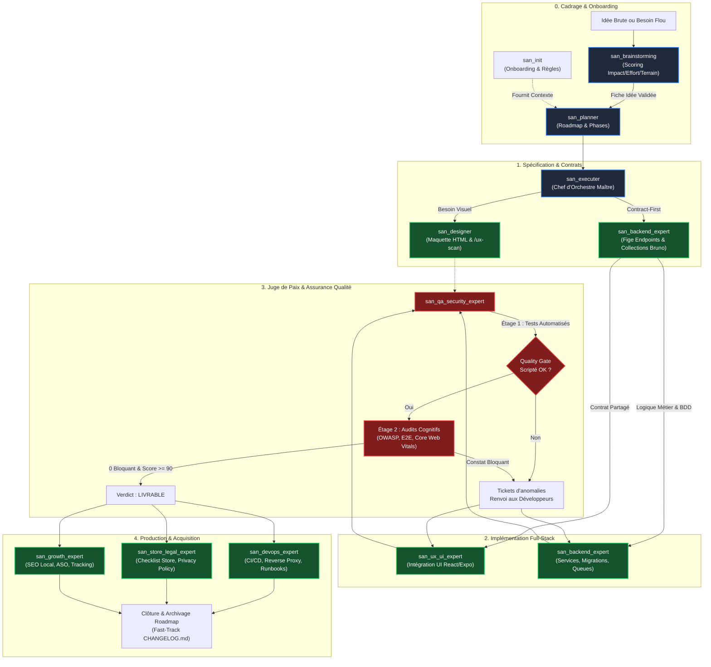

# FRAMEWORK « GOOGLE ANTIGRAVITY » (`san_*`) — INDEX MAÎTRE D'ARCHITECTURE

> **Manifeste :** Système d'orchestration agentique et suite de compétences d'ingénierie logicielle pour Google Antigravity CLI (AGY).  
> **Auteur :** Alexsan.pro  
> **Cible :** Tout projet Full-Stack Web, Mobile ou API (React, Next.js, Expo, React Native, Laravel, AdonisJS, Node.js).  
> **Statut :** Architecture Modulaire Cartésienne — Spécification v2.0.

---

## 1. VISION, ENJEUX & STACK TECHNIQUE

### Pourquoi ce framework ?
Sur chaque projet d'envergure, répéter manuellement les mêmes consignes d'architecture, d'hygiène de tests et de gestion de contexte engendre de l'amnésie, des disparités de qualité et du gaspillage de tokens :
- Demandes fonctionnelles floues aboutissant à des roadmaps inadaptées ;
- Code généré par IA superficiel (*anti-AI taste* : dégradés violet/indigo génériques, manque d'âme) ;
- Tâches cochées sans validation réelle sur le code ;
- Manque de résilience réseau (3G/EDGE instable, absence de mode hors-ligne, double dépense Mobile Money) ;
- Dispersion de la responsabilité des tests, de la sécurité et de la performance.

Le framework **`san_*`** transforme Antigravity en un **Tech Lead Senior & Organe d'Assurance Qualité complet** adapté aux réalités du terrain africain et international.

### Stack Technologique Souveraine (`alexsan.pro`)
* **Frontend Web :** React.js, TypeScript strict, Tailwind CSS, variables CSS natives, HTML5 sémantique.
* **Mobile Cross-Platform :** React Native, Expo (EAS), micro-interactions fluides 60 fps, retours haptiques (`expo-haptics`), stockage chiffré (`expo-secure-store`).
* **Backend & APIs :** PHP 8.x POO/SOLID, Laravel (dernière version), Node.js / AdonisJS sous TypeScript strict, architecture découplée (Actions/Services).
* **Données & Cache :** PostgreSQL avancé (`JSONB`, GIN, PostGIS), MySQL, Redis (verrous atomiques, files d'attente, cache, rate limiting).
* **Contrats d'Endpoints & Tests d'API :** Collections versionnées sous **Bruno** (`.bru`) avec assertions automatisées, interdisant tout mismatch de payload.
* **Infrastructure & Production :** CloudPanel, VPS Ubuntu, Nginx reverse proxy, PM2/Supervisor, Mailcow (délivrabilité e-mail stricte SPF/DKIM/DMARC/PTR).
* **Réalités Terrain (Afrique / Congo) :** Gestion des connexions 3G/EDGE instables, persistance Outbox avec `Idempotency-Key` sur Redis, gestion asynchrone des paiements Mobile Money (Airtel Money, MTN MoMo, callbacks STK/USSD et polling de réconciliation), adresses par repères urbains et partages profonds WhatsApp.

---

## 2. GOUVERNANCE AGENTIQUE & MÉCANISMES D'ORCHESTRATION

### A. Routage des Modèles (`invoke_subagent`)
Le framework exploite les capacités natives d'Antigravity CLI selon une politique stricte d'allocation :
1. **Session Principale (Orchestrateur & Raisonnement Global) :** Pilotée au sommet par le développeur selon sa propre cascade : nominalement avec **ARGON** configuré en raisonnement maximal (ex. `argon-latest-max` / `ARGON 4`), ou repli manuel sur un modèle **Pro** (`gemini-3.1-pro-high`) ou **Flash** (`gemini-3.8-flash-high`).
2. **Pôle « Cerveau, Architecture, Audit & Pentest » :** Invoqué nativement avec **`Model: 'inherit'`** pour hériter automatiquement de la puissance de raisonnement de la session principale (ou `'pro'` en fallback explicite).
3. **Pôle « Exécution Brute Atomique & Codeurs » :** Invoqué nativement avec **`Model: 'flash'`** (`gemini-3.8-flash-high`) pour maximiser la vitesse d'écriture, la précision de syntaxe et minimiser le coût en tokens.

### B. Délégation Ciblée & Fast-Track d'Hygiène
* **Délégation stricte :** L'orchestrateur ne code jamais les fonctionnalités métier et ne s'auto-audite pas. Toute l'implémentation est déléguée à des sous-agents d'exécution atomiques.
* **Fast-Track d'hygiène immédiat (sans sous-agent) :** L'orchestrateur est expressément autorisé à effectuer directement les opérations ménagères immédiates : cocher les cases `[x]` après vérification concluante d'un test, archiver le fichier de roadmap terminé (`mv`), ou consigner les entrées de mise à jour dans `CHANGELOG.md`.

### C. Entonnoir d'Audit en 2 Étages (Anti-Gaspillage de Tokens)
Avant toute validation, chaque composant ou endpoint passe par un entonnoir hermétique :
* **Étage 1 (Déterministe & Zéro-Token LLM) :** Lancement des scripts de contrôle automatisés (`front_quality_gate.sh`, `backend_quality_gate.sh`, `qa_security_gate.sh`). Si une erreur de typage (`tsc`), un test unitaire rouge ou un lint cassé survient, **aucun sous-agent d'audit n'est lancé** : l'erreur brute est directement renvoyée au sous-agent de code pour correction.
* **Étage 2 (Qualitatif LLM & Cognitif) :** Déploiement des sous-agents d'audit spécialisés (`Model: 'inherit'`) uniquement lorsque l'Étage 1 est validé à 100 %.

### D. Isolation Git Absolue (`.gitignore`)
Le dossier d'orchestration `.agents/` à la racine de chaque projet est **strictement ignoré par Git** (via `.gitignore` et `.git/info/exclude`). L'environnement personnel du développeur ne pollue jamais le dépôt distant et n'interfère pas avec les configurations d'autres collaborateurs.

---

## 3. CARTOGRAPHIE DES DOSSIERS

Le dépôt `san_agy_framework` structure la suite complète selon la séparation stricte entre les rôles maîtres et l'outillage transversal :

```txt
san_agy_framework/
├── README.md                           # Index maître d'architecture et gouvernance (ce fichier)
│
├── skills/                             # RÔLES PRINCIPAUX & ENTRY POINTS (Invoqués par le développeur)
│   ├── san_init.md                     # Onboarding, isolation Git, GEMINI.md et contextes
│   ├── san_brainstorming.md            # Cadrage amont, triage multicritères et maturation d'idées
│   ├── san_planner.md                  # Planification de projet, ordonnancement et roadmaps
│   ├── san_designer.md                 # Design visuel code-only, maquettes HTML/Tailwind, /ux-scan
│   ├── san_ux_ui_expert.md             # Lead Frontend Web & Mobile, anti-AI taste, 5 états UI
│   ├── san_backend_expert.md           # Lead Backend & Distributed Systems, APIs, Bruno, Idempotence
│   ├── san_executer.md                 # Chef d'orchestre Full-Stack, Contract-First et Delivery
│   ├── san_qa_security_expert.md       # Juge de paix unifié QA E2E, sécurité OWASP et performance
│   ├── san_devops_expert.md            # Infrastructure, CloudPanel, Mailcow, CI/CD et runbooks
│   ├── san_store_legal_expert.md       # Conformité stores Play/App Store, anti-rejet, légal
│   └── san_growth_expert.md            # SEO local, ASO stores, tracking analytics unifié
│
└── sub-skills/                         # OUTILLAGE TRANSVERSAL & ARTISANS D'EXÉCUTION
    ├── san_subagent_manager.md         # Usine de conception, calibrage et supervision des sous-agents
    ├── san_searcher.md                 # Documentaliste de précision, veille technique et scraping ciblé
    ├── san_copywriter.md               # Plume UX, micro-copies empathiques, localisation et zéro Lorem Ipsum
    ├── san_design_tokens.md            # Gardien de BRAND.md, tokens statiques et signature cinétique
    ├── san_exporter.md                 # Capture headless Playwright, exports stores et SVG vers PNG
    └── san_doc_keeper.md               # Gardien de CHANGELOG.md, README.md, archivage et fast-track
```

---

## 4. INDEX DÉTAILLÉ DES SKILLS PRINCIPAUX (`/skills/`)

| Skill Principal | Rôle & Responsabilité Clé | Type d'Entry Point | Livrables Majeurs |
| :--- | :--- | :--- | :--- |
| [**`san_init`**](skills/san_init.md) | Initialisation, isolation Git, onboarding et rétro-ingénierie du contexte | Amont / Setup | `.agents/GEMINI.md`, `.agents/rules/*.md`, `.gitignore` |
| [**`san_brainstorming`**](skills/san_brainstorming.md) | Cadrage amont, triage d'idées et comparaison multicritères | Amont / Stratégie | `/roadmaps/ideas/[THEME]_[DATE].md` |
| [**`san_planner`**](skills/san_planner.md) | Planification de projet, ordonnancement par phases et auto-nettoyage | Amont / Pilotage | `/roadmaps/[PHASE]_[DATE].md`, `CHANGELOG.md` |
| [**`san_designer`**](skills/san_designer.md) | Conception d'écrans haute fidélité en code statique, design system | Visuel / UX | `/design/mockup/*`, `/design/screenshots/*` |
| [**`san_ux_ui_expert`**](skills/san_ux_ui_expert.md) | Ingénierie Frontend Web & Mobile, anti-IA taste, résilience 3G | Ingénierie Client | Pages React, Écrans React Native / Expo, tests Jest |
| [**`san_backend_expert`**](skills/san_backend_expert.md) | APIs REST/WebSockets, architecture SOLID, idempotence, BDD | Ingénierie Serveur | Code Laravel/Adonis, Collections Bruno, Migrations |
| [**`san_executer`**](skills/san_executer.md) | Chef d'orchestre d'implémentation Full-Stack (alias `san_execute`) | Moteur Central | Code Full-Stack synchronisé, Delivery E2E |
| [**`san_qa_security_expert`**](skills/san_qa_security_expert.md) | Juge de paix unique QA E2E, audit OWASP et benchmarks performance | Contrôle / Verdict | `docs/QA_REPORT.md`, `docs/SECURITY_REPORT.md` |
| [**`san_devops_expert`**](skills/san_devops_expert.md) | Infrastructure, CloudPanel, Mailcow, CI/CD, réversibilité | Exploitation / Infra | `docs/INFRA.md`, `docs/RUNBOOKS.md`, Pipelines CI/CD |
| [**`san_store_legal_expert`**](skills/san_store_legal_expert.md) | Conformité stores Google Play/Apple, anti-rejet, chartes légales | Légal / Publication | `docs/STORE_CHECKLIST.md`, `docs/PRIVACY_POLICY.md` |
| [**`san_growth_expert`**](skills/san_growth_expert.md) | SEO local Congo/Afrique, ASO fiches stores, plan de tracking | Acquisition / Mesure | `docs/SEO.md`, `docs/ASO.md`, `docs/TRACKING_PLAN.md` |

---

## 5. FLUX D'ORCHESTRATION GLOBAL (CYCLE DE VIE D'UNE FEATURE)

Le diagramme ci-dessous illustre l'ordonnancement rigoureux des compétences, de l'émergence d'une idée brute jusqu'à la mise en production et la mesure :



---

## 6. LES SOUS-SKILLS TRANSVERSAUX D'EXÉCUTION (`/sub-skills/`)

Alors que `/skills/` regroupe les rôles directeurs que le développeur déclenche pour piloter son projet, le dossier [`/sub-skills/`](sub-skills/) accueille les **briques techniques d'exécution spécialisées** appelées en coulisses par les skills principaux :

| Sous-Skill Transversal | Rôle & Spécialité Technique | Mobilisé Principalement Par | Livrables & Outils Clés |
| :--- | :--- | :--- | :--- |
| [**`san_subagent_manager`**](sub-skills/san_subagent_manager.md) | Usine de conception, calibrage et supervision de sous-agents chirurgicaux | `san_executer`, `san_planner`, `san_init`, tous | Prompts de sous-agents étanches, routage `flash`/`inherit` |
| [**`san_searcher`**](sub-skills/san_searcher.md) | Documentaliste de haute précision, veille technique et extraction de doc | `san_brainstorming`, `san_planner`, `san_growth_expert` | Fiches de recherche `docs/research/*.md`, veille APIs |
| [**`san_copywriter`**](sub-skills/san_copywriter.md) | Plume UX, micro-copies empathiques, localisation et zéro *Lorem Ipsum* | `san_designer`, `san_ux_ui_expert`, `san_growth_expert` | Textes réels, messages d'erreurs, fiches store ASO |
| [**`san_design_tokens`**](sub-skills/san_design_tokens.md) | Gardien de la source unique de vérité `BRAND.md` et de la signature cinétique | `san_designer`, `san_ux_ui_expert`, `san_init` | Compilateur tokens CSS/Tailwind/TS, audit anti-valeurs magiques |
| [**`san_exporter`**](sub-skills/san_exporter.md) | Pipeline de capture headless Playwright et déclinaison vectorielle SVG $\rightarrow$ PNG | `san_designer`, `san_growth_expert`, `san_init` | `scripts/export_png.mjs` (stores), `scripts/svg_to_png.mjs` |
| [**`san_doc_keeper`**](sub-skills/san_doc_keeper.md) | Gardien de l'intégrité documentaire, versioning SemVer et archivage | `san_planner`, `san_executer`, tous | `CHANGELOG.md`, `README.md`, Fast-Track d'hygiène |

---

## 7. INSTALLATION SUR UNE CODEBASE CLIENT

Le déploiement du framework s'effectue en une commande sur n'importe quel dépôt cible pour initialiser l'arborescence hermétique `.agents/` :

```bash
# Déploiement et initialisation sur la codebase courante
npx @alexsan/agy-framework init
```

L'exécution instancie la structure locale complète :
* Configure automatiquement `.gitignore` et `.git/info/exclude` pour isoler `/.agents/`.
* Lance `san_init` pour extraire ou collecter le contexte du projet (`BRAND.md`, `PRODUCT.md`, `PROJECT.md`, `API.md`).
* Déploie les compétences compilées dans `<projet>/.agents/skills/`.
* Éradique les fichiers d'agents tiers polluants (`CLAUDE.md`, `.cursorrules`, etc.).

---

## 8. ORDRE DE CRÉATION & FEUILLE DE ROUTE D'IMPLÉMENTATION

1. [x] **`san_qa_security_expert`** : Spécifié et rédigé (responsable unique QA, sécurité et performance).
2. [x] **`san_devops_expert`** : Spécifié et rédigé (administration serveur CloudPanel, Mailcow, VPS, CI/CD).
3. [x] **`san_store_legal_expert`** : Spécifié et rédigé (conformité stores, anti-rejet, légal dérivé du code).
4. [x] **`san_growth_expert`** : Spécifié et rédigé (SEO local, ASO fiches stores, plan de tracking).
5. [x] **`san_brainstorming`** : Spécifié et rédigé (triage d'idées multicritères et maturation amont).
6. [x] **Développement des 6 `/sub-skills/`** : Entièrement spécifiés et rédigés avec leurs outillages et scripts.
7. [ ] **Package de déploiement universel** : Script CLI d'installation automatisée (`npx @alexsan/agy-framework init`).
