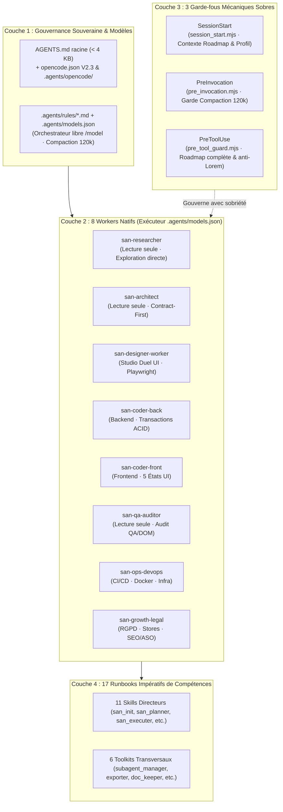

<p align="center">
  <picture>
    <source media="(prefers-color-scheme: dark)" srcset="logos/san_harness_logo_dark.svg"/>
    <source media="(prefers-color-scheme: light)" srcset="logos/san_harness_logo_light.svg"/>
    
  </picture>
</p>

<p align="center">
  
  
  
  
  
  
</p>

# SAN AI HARNESS (`san_ai_harness`) — DUAL-HARNESS ORCHESTRATION & ADAPTIVE GOVERNANCE v3.0

> **Langue :** Français | [English version](README.en.md)  
> **Manifeste :** Harnais d'orchestration agentique **Dual-Harness** (`Google Antigravity` `swarm` + `OpenCode v2.3.0` plugin **`san_swarm`** & `subagent`) à **Orchestrateur Libre (`/model`)**, **Exécuteur Configurable** (`san-harness models`), **Compaction Automatique 120k tokens** (zéro `.agents/cache` / zéro bloat), Studio UI Engine (`--url` live) et **17 compétences** souveraines.  
> **Auteur :** Alexsan.pro  
> **Statut :** Architecture Cartésienne en 4 Couches — Spécification Officielle v3.0.0.  
> **Licence :** [MIT License](LICENSE)

---

## 1. VISION, AMBITION & DOCTRINE v3.0

Sur des projets d'envergure, abandonner l'IA à des prompts conversationnels naïfs engendre inévitablement des régressions critiques :
- **Amnésie et dérive de contexte :** Oubli des contrats d'API, des standards d'accessibilité et des invariants d'architecture.
- **Complaisance du premier jet (*First-Draft Sycophancy*) :** Acceptation sans filtre de solutions plates, modèles de domaine anémiques, composants monolithiques de 500 lignes et dégradés pourpres/indigo génériques sans âme (*AI taste*).
- **Simulacre de tests (*Testing Theater*) :** Tâches validées hâtivement, suites de tests exécutées avec des contournements comme `--passWithNoTests`, mocks tautologiques qui testent le mock au lieu du domaine.
- **Surcharge de jetons (*Context Bloat*) :** Maintenir des cartes AST géantes dans `.agents/cache/` ou forcer une cascade mécanique de sous-agents sur des correctifs simples gonfle l'historique au lieu de l'alléger.

La version **3.0.0** de **`san_ai_harness`** (`@alexsan/san-ai-harness`, binaire principal **`san-harness`** avec alias rétrocompatibles `san-framework` / `agy-framework`) libère la vélocité cognitive sur les deux moteurs :

1. **Orchestrateur Découplé & Doctrine Adaptative (`inherit-user-model`) :** Plus aucun nom de modèle orchestrateur codé en dur dans les skills ou la constitution (`AGENTS.md`). Le thread principal hérite librement du modèle choisi par l'utilisateur via `/model` (Antigravity ou OpenCode).
   - **Tâche simple / mono-couche :** Cycle natif **`Plan → Execute`** autorisé directement par l'orchestrateur sans lourdeur mécanique.
   - **Chantiers multi-couches, Studio Duel UI & Inquisition QA (`san-qa-auditor`) :** Délégation parallèle via **`swarm`** (Antigravity) ou **`san_swarm` / `subagent`** (OpenCode v2.3.0) sur le modèle exécuteur défini dans `.agents/models.json` (`san-harness models`).
2. **Parité Native OpenCode v2.3.0 (`san_swarm` + Swarm Board) :** Déploiement du plugin ESM pur Node **`.agents/opencode/san-harness-plugin.mjs`** (zéro dépendance Bun) fournissant l'outil `san_swarm` (`dispatch`, `board`, `status`), le dashboard Markdown **Swarm Board** + Workflow Summary, et la commande `/san-board` dans `opencode.json`.
3. **Zéro `.agents/cache/` & Compaction Automatique 120k Tokens :** Suppression complète des anciens modules consommateurs de tokens (`san_cartographer`, `REPO_MAP.md`, `san_transcriber`, `roadmaps/transcripts/`, `post_tool_indexer.mjs`, `stop_guard.mjs`). À la place, un seuil unifié de **compaction automatique à `120 000` tokens** (`pre_invocation.mjs` sous Antigravity, configuration `compaction` + hooks `context`/`compaction` sur OpenCode v2.3.0).
4. **Identité `san_ai_harness` & Logos SVG Adaptatifs :** Renommage complet du package et du dépôt, logos vectoriels dédiés aux thèmes GitHub Sombre & Clair (`<picture>`).

---

## 2. L'ARCHITECTURE v3.0 EN 4 COUCHES

Le harnais structure son exécution sur 4 couches concentriques sobres et étanches, partagées à l'identique entre `Antigravity` et `OpenCode v2.3.0` :



### Couche 1 : Gouvernance Souveraine & Règles Normatives
* **Constitution Permanente `<root>/AGENTS.md` (< 4096 octets) :** Chargée automatiquement sur Antigravity et OpenCode v2.3 (`always_on`). Fixe l'**Alignement Socratique & Visuel** préalable (Étape 0), le cycle adaptatif (`Plan → Execute` sur tâche simple, Swarm sur multi-couches/Duel/QA) et le routage Dual-Harness sans jamais forcer de modèle orchestrateur.
* **Profil Modèles & Compaction `.agents/models.json` + `opencode.json` V2.3 :** Pilotés par `san-harness models`, ils configurent l'exécuteur Antigravity (`agy.executor`), l'exécuteur OpenCode (`opencode.executor`), le seuil de compaction (`compaction.targetTokens: 120000`) et déploient le plugin Swarm Board `.agents/opencode/`.
* **Règles Normatives Déclaratives `.agents/rules/*.md` :** 5 documents de référence dotés de frontmatters YAML officiels (`trigger: always_on`, `trigger: model_decision`, ou `trigger: glob`) : [`PROJECT.md`](file://.agents/rules/PROJECT.md), [`PRODUCT.md`](file://.agents/rules/PRODUCT.md), [`BRAND.md`](file://.agents/rules/BRAND.md), [`API.md`](file://.agents/rules/API.md), [`LOGO.md`](file://.agents/rules/LOGO.md).

### Couche 2 : Les 8 Workers Natifs Dual-Harness
Les 8 agents définis dans `.agents/agents/*.md` (et projetés dans `"agents"` de `opencode.json`) utilisent l'exécuteur configuré dans `.agents/models.json` via `san-harness models`, pendant que l'orchestrateur principal **`san-orchestrator`** hérite librement du `/model` sélectionné par l'utilisateur :

| Harnais Runtime | Orchestrateur Principal | Exécuteur Workers (8 `san-*`) | Primitive d'Orchestration | Validation Native |
| :--- | :--- | :--- | :--- | :--- |
| **Google Antigravity (`agy`)** | **Libre (`/model`)** (`inherit-user-model`) | `.agents/models.json#agy.executor` | `Plan → Execute` ou `swarm` | `agy plugin validate --strict` |
| **OpenCode v2.3.0** | **Libre (`/model`)** (`san-orchestrator`) | `.agents/models.json#opencode.executor` | `san_swarm` (Swarm Board) / `subagent` | `opencode --standalone debug agents` |

| Worker Natif | Mode & Permissions (`OpenCode` / `Agy`) | Rôle & Responsabilité Clé | Compétences Attachées | Livrables Principaux |
| :--- | :--- | :--- | :--- | :--- |
| **`san-researcher`** | `subagent` · **Read-Only** (`edit: deny`) | Exploration directe ciblée de la codebase, veille technique et pinning de versions. | `san_searcher` | Fiches de recherche `docs/research/*.md`, synthèses d'APIs. |
| **`san-architect`** | `subagent` · **Read-Only** (`edit: deny`) | Arbitrage d'architecture, **Contract-First** (OpenAPI 3.1 / Zod / TypeBox), **Architectural Fitness Functions** & Pre-Mortem. | `san_planner`, `san_backend_expert` | ADR, contrats partagés gelés, Fitness Functions. |
| **`san-designer-worker`** | `subagent` · Write / Execute | Direction artistique **Studio Duel UI** (`option-a` vs `option-b`), capture `--url`, Multi-Viewports & DOM Linter. | `san_design_tokens`, `san_copywriter`, `san_exporter` | Maquettes `/design/*.html`, captures PNG & rapports DOM JSON. |
| **`san-coder-back`** | `subagent` · Write / Execute | Artisan backend atomique, protocoles API Contract-First, transactions ACID et tests réels. | `san_backend_expert` | Contrôleurs, services, migrations, Bruno `.bru`, tests intégrés. |
| **`san-coder-front`** | `subagent` · Write / Execute | Artisan frontend web & mobile (< 220 lignes/fichier), **5 états UI** & **Motion System**. | `san_ux_ui_expert`, `san_copywriter`, `san_design_tokens` | Composants React/Expo, hooks typés, tests DOM. |
| **`san-qa-auditor`** | `subagent` · **Read-Only** (`edit: deny`) | Inquisiteur sceptique en lecture seule, audit anti-*Testing Theater* & critique visuelle multimodale, verdict binaire. | `san_qa_security_expert` | Verdict `LIVRABLE` \| `RETOUR_ATELIER`, audits OWASP/DOM. |
| **`san-ops-devops`** | `subagent` · Write / Execute | Pipelines CI/CD, conteneurs Docker, serveurs web Nginx, CloudPanel, diagnostics infra. | `san_devops_expert` | Workflows CI, Dockerfiles, runbooks, health checks. |
| **`san-growth-legal`** | `subagent` · Write / Execute | Conformité légale RGPD, politiques de confidentialité, fiches stores ASO et tracking analytique. | `san_store_legal_expert`, `san_growth_expert` | Politiques de confidentialité, checklists stores, plans tracking. |

### Couche 3 : Les 3 Garde-fous Mécaniques Sobres
Configurée dans `.agents/hooks.json`, la couche hooks ne comporte que **3 scripts légers** (< 50ms, zéro index AST, zéro `.agents/cache`) :
1. **`SessionStart` (`session_start.mjs`) :** Injecte en une ligne la roadmap active, le `PROJECT_PROFILE` et le seuil de compaction (0 écriture disque).
2. **`PreInvocation` (`pre_invocation.mjs`) :** Garde de **compaction automatique à `120 000` tokens** (`compaction.targetTokens` de `.agents/models.json`). Silencieux (`{ injectSteps: [] }`) sous le seuil ; émet une invite `/compact` uniquement quand la session dépasse 120k tokens.
3. **`PreToolUse` (`pre_tool_guard.mjs`) :** Bloque l'archivage prématuré d'une roadmap contenant encore des `- [ ]` et l'injection de *Lorem ipsum*.

> Côté OpenCode v2.3.0, `.agents/opencode/san-harness-plugin.mjs` ajoute la gestion native de compaction à `120 000` tokens via `compaction` (`auto: true, background: true, keep.tokens: 12000, buffer: 20000`) et l'outil **`san_swarm`** (Swarm Board Markdown + Workflow Summary).

### Couche 4 : 17 Runbooks Impératifs de Compétences
Chaque module dans `.agents/skills/*/SKILL.md` est un **Runbook impératif condensé ($\le 130$ lignes)** accompagné de scripts déterministes **identiques à l'octet près (`cmp -s`)** (`export_png.mjs`, `archive_roadmap.sh`, `svg_to_png.mjs`), de workflows Python `run_workflow` et de wrappers `v3.0.0` dans `skills/*.md` et `sub-skills/*.md`.

---

## 3. L'INGÉNIERIE DU DOUTE & BOUCLE VISUELLE

1. **Alignement Socratique & Visuel Préalable (Étape 0) :** Avant de rédiger une roadmap ou une maquette, l'orchestrateur valide les choix structurants avec l'utilisateur (`ask_question` / `question`) et capture les références web réelles via `export_png.mjs --url=<https://...>`.
2. **Pre-Mortem Systémique (`san-architect`) & Dialectique Avant Frappe :** Gel des contrats OpenAPI/Zod avant codage et confrontation de **2 approches viables distinctes** avant édition substantielle.
3. **Boucle Visuelle Multimodale (`export_png.mjs --url --viewports --audit-dom`) :** Studio Duel UI (`option-a` vs `option-b`), capture multi-viewports (`mobile`, `tablet`, `desktop`), audit géométrique DOM et lecture physique des PNG via `read_file`.
4. **Inquisition QA (`san-qa-auditor`) :** Présomption de défaut, zéro tolérance au *Testing Theater* (`--passWithNoTests`, mocks tautologiques) et verdict binaire (`LIVRABLE` | `RETOUR_ATELIER`).

---

## 4. LES PROFILS CONTEXTUELS DE PROJET (`PROJECT_PROFILE`)

| Profil Contextuel | Cible Typique | Invariants Activés Spécifiquement |
| :--- | :--- | :--- |
| **`emerging_market`** | Fintechs, plateformes panafricaines, e-commerce local | Outbox locale, Redis + `Idempotency-Key`, Mobile Money (Airtel Money, MTN MoMo, callbacks USSD/STK), résilience 3G/EDGE, partages WhatsApp. |
| **`global_saas`** | SaaS B2B/B2C international | Multi-tenant hermétique, Stripe/Paddle, RBAC, observabilité, p95 < 150ms. |
| **`mobile_consumer`** | Apps iOS & Android (React Native / Expo) | 60 fps, haptique, `expo-secure-store`, anti-rejet stores Apple/Google (`ITMS-90717`). |
| **`cli_devtools`** | CLIs, SDKs, packages npm/pip | Codes POSIX 0/1, non-TTY, `--json`, démarrage < 200ms. |
| **`api_platform`** | Backends & APIs publiques/partenaires | Contrats OpenAPI 3.1, collections Bruno `.bru`, rate limiting Redis, enveloppe JSON uniforme. |

---

## 5. CATALOGUE DES 17 RUNBOOKS DE COMPÉTENCES

### A. Les 11 Compétences Directrices

| Compétence | Déclencheur Naturel | Rôle Clé | Livrables & Scripts |
| :--- | :--- | :--- | :--- |
| [**`san_init`**](file://skills/san_init.md) | *"Initialiser le projet"* | Setup 4 couches, onboarding & isolation Git | `<root>/AGENTS.md`, `.agents/rules/*.md`, `git_ai_hygiene.sh` |
| [**`san_brainstorming`**](file://skills/san_brainstorming.md) | *"Brainstormer"*, *"Cadrer le besoin"* | Triage socratique & scoring 40 pts | `roadmaps/ideas/*.md`, `score_idea.py` |
| [**`san_planner`**](file://skills/san_planner.md) | *"Créer la roadmap"*, *"Planifier"* | Étape 0, Contract-First, Fitness Functions & archivage | `roadmaps/*.md`, `archive_roadmap.sh` |
| [**`san_designer`**](file://skills/san_designer.md) | *"Designer l'écran"*, *"/ux-scan"* | Capture `--url`, Studio Duel UI, Multi-Viewports & Linter DOM | `/design/*.html`, `export_png.mjs` |
| [**`san_ux_ui_expert`**](file://skills/san_ux_ui_expert.md) | *"Intégrer le composant UI"* | Lead Frontend Web & Mobile, 5 états & Motion System | Composants React/Expo, `front_quality_gate.sh` |
| [**`san_backend_expert`**](file://skills/san_backend_expert.md) | *"Créer l'API"*, *"Modéliser la BDD"* | Lead Backend, ACID, idempotence & Bruno `.bru` | Modèles, Services, `backend_quality_gate.sh` |
| [**`san_executer`**](file://skills/san_executer.md) | *"Exécuter la roadmap"*, *"Coder"* | Cycle adaptatif (`Plan → Execute` ou `swarm` / `san_swarm`) | `autonomous_slice_workflow.py`, `e2e_verification_gate.sh` |
| [**`san_qa_security_expert`**](file://skills/san_qa_security_expert.md) | *"Auditer la sécurité"*, *"QA"* | Juge QA unifié, Inquisition parallèle OWASP/DOM | `parallel_inquisition_workflow.py`, `qa_security_gate.sh` |
| [**`san_devops_expert`**](file://skills/san_devops_expert.md) | *"CI/CD"*, *"Déployer"* | CloudPanel, Docker, Nginx, Mailcow, santé prod | `.github/workflows/*`, `infra_health_check.sh` |
| [**`san_store_legal_expert`**](file://skills/san_store_legal_expert.md) | *"Stores"*, *"RGPD"* | Conformité Google Play / Apple Store & chartes légales | `docs/STORE_CHECKLIST.md`, `PRIVACY_POLICY.md` |
| [**`san_growth_expert`**](file://skills/san_growth_expert.md) | *"SEO local"*, *"ASO"*, *"Tracking"* | Référencement local, ASO stores, JSON-LD & analytics | `docs/SEO.md`, `docs/TRACKING_PLAN.md` |

### B. Les 6 Toolkits Transversaux

| Toolkit Transversal | Spécialité Technique | Livrables & Scripts |
| :--- | :--- | :--- |
| [**`san_subagent_manager`**](file://sub-skills/san_subagent_manager.md) | Calibrage Dual-Harness (`swarm` / `san_swarm` / `subagent`) | Prompts étanches, `validate_subagent_spec.sh` v3.0 |
| [**`san_searcher`**](file://sub-skills/san_searcher.md) | Veille documentaire officielle & pinning de versions | `doc_scraper.sh`, `detect_stack_versions.sh`, `docs/research/*.md` |
| [**`san_copywriter`**](file://sub-skills/san_copywriter.md) | Micro-copies UX réelles & anti-faux-texte | `check_lorem.sh`, zéro *Lorem Ipsum* |
| [**`san_design_tokens`**](file://sub-skills/san_design_tokens.md) | Gardien de `BRAND.md` & contrastes WCAG AAA | `build_tokens.mjs`, `audit_magic_values.sh` |
| [**`san_exporter`**](file://sub-skills/san_exporter.md) | Capture `--url`, Multi-Viewports & Linter DOM + icônes iOS/Android | `export_png.mjs`, `svg_to_png.mjs` (`cmp -s`) |
| [**`san_doc_keeper`**](file://sub-skills/san_doc_keeper.md) | Hygiène documentaire SemVer & archivage SHA-256 | `README.md`, `CHANGELOG.md`, `archive_roadmap.sh` (`cmp -s`) |

---

## 6. LE GUIDE CLI UNIVERSEL `san-harness` v3.0

Le harnais se pilote via **`san-harness`** (et ses alias rétrocompatibles **`san-framework`** et **`agy-framework`**) :

```bash
# Exécution directe via npx
npx @alexsan/san-ai-harness <commande> [options]

# Ou via binaire global si installé
san-harness <commande> [options]
```

### A. Commandes Principales

```bash
# 1. Installation complète Dual-Harness (Antigravity + OpenCode v2.3 + Swarm Board)
san-harness init --local --all --opencode

# 2. Installation en Mode Héritage Léger (sans dupliquer les 17 dossiers de skills)
san-harness init --local --light --opencode

# 3. Installation globale en tant que Plugin Antigravity
san-harness init --global --all

# 4. Mise à jour non-destructive v3.0 (purge auto de .agents/cache, migration règles, plugin OpenCode)
san-harness update --opencode

# 5. Configurer les exécuteurs workers et le seuil de compaction (l'orchestrateur reste libre via /model)
san-harness models --opencode=opencode-go/deepseek-v4-pro --agy=gemini-4-hydrogen-xhigh --compaction=120000
san-harness models --set=opencode-go/qwen3.8-flash

# 6. Contrôler les 6 piliers de santé (dont absence de .agents/cache) & afficher les nouveautés
san-harness doctor
san-harness whats-new
san-harness list
```

### B. Drapeaux CLI

| Drapeau CLI | Rôle & Comportement |
| :--- | :--- |
| `--local` | Déploie le harnais dans le projet local (`./.agents/`) [Défaut non-interactif]. |
| `--light` | Mode Héritage Léger : génère `.agents/skills.json` sans copier les 17 dossiers de skills. |
| `--global` | Assemble le Plugin global Antigravity (`~/.gemini/antigravity-cli/plugins/san-ai-harness/`). |
| `--all` | Installe l'intégralité des 17 compétences sans confirmation interactive. |
| `--skills=<liste>` | Sélection granulaire de compétences séparées par des virgules. |
| `--opencode` | (Avec `init`/`update`) Génère/fusionne `opencode.json` V2.3 + plugin Swarm Board `.agents/opencode/`. |
| `--opencode=<model>` | (Avec `models`) Définit `opencode.executor` (ex: `opencode-go/deepseek-v4-pro`, `opencode-go/qwen3.8-flash`). |
| `--agy=<model>` | (Avec `models`) Définit `agy.executor` (ex: `gemini-4-hydrogen-xhigh`). |
| `--compaction=<tokens>` | (Avec `models`) Définit le seuil de compaction auto (défaut : `120000`). |
| `--set=<model>` | (Avec `models`) Raccourci unifié auto-détectant `<provider>/<model>` vs Antigravity. |
| `--dry-run` | Simulation complète sans écriture disque. |
| `--force` | Force le remplacement des composants existants. |
| `--dir=<chemin>` | Spécifie le répertoire cible. |
| `--version`, `-v` | Affiche la version courante (`3.0.0`). |

---

## 7. CARTOGRAPHIE DU DÉPÔT

```txt
san_ai_harness/
├── package.json                        # Manifeste @alexsan/san-ai-harness v3.0.0 (bin san-harness / san-framework / agy-framework)
├── LICENSE                             # Licence officielle MIT Alexsan.pro
├── README.md                           # Documentation d'architecture v3.0 (ce fichier)
├── README.en.md                        # Architecture Documentation v3.0 (English)
├── CHANGELOG.md                        # Journal des versions (Keep a Changelog)
├── CHANGELOG.en.md                     # Release Changelog (English)
├── .gitignore                          # Hygiène Git & __pycache__/
│
├── logos/                              # Identité visuelle vectorielle adaptative Dark/Light
│   ├── LOGO.md                         # Spécifications logo & thème adaptatif
│   ├── LOGO_ASCII.txt                  # Bannière ASCII CLI
│   ├── san_harness_logo_dark.svg       # Logo adapté aux fonds sombres
│   ├── san_harness_logo_light.svg      # Logo adapté aux fonds clairs
│   └── san_harness_icon.svg            # Monogramme / Icône carrée
│
├── roadmaps/                           # Pilotage interne (zéro transcripts/)
│   ├── ideas/                          # Dossiers de cadrage san_brainstorming
│   └── archives/                       # Roadmaps archivées
│
├── skills/ & sub-skills/               # 17 wrappers documentaires synchronisés en v3.0.0
│
├── src/                                # PRODUIT DISTRIBUABLE (Package v3.0.0)
│   ├── agents/                         # 8 workers Dual-Harness (Antigravity swarm + OpenCode san_swarm / subagent)
│   ├── hooks/                          # 3 Garde-fous sobres (SessionStart, PreInvocation 120k, PreToolUse)
│   ├── opencode/                       # Plugin natif OpenCode v2.3.0 (.agents/opencode/ — outil san_swarm, Swarm Board, compaction 120k)
│   ├── plugin/                         # Bundle Plugin Antigravity (plugin.json v3.0.0 + assets/logo.svg)
│   ├── cli/                            # CLI san-harness (index.js, installer.js, whats_new.js)
│   └── skills/                         # 17 runbooks exécutables (SKILL.md <= 130 lignes)
│
└── tests/                              # Suites de tests automatisées (phase3..9 & v2/)
```

---

## 8. LICENCE

Ce projet est sous licence MIT — voir le fichier [`LICENSE`](LICENSE) pour plus de détails.  
Copyright (c) 2026 Alexsan.pro. Tous droits réservés.
