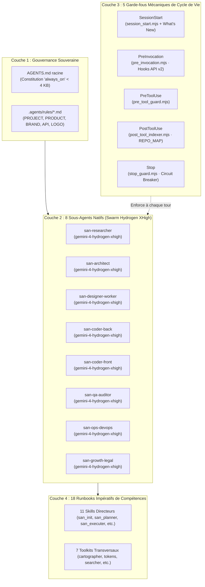
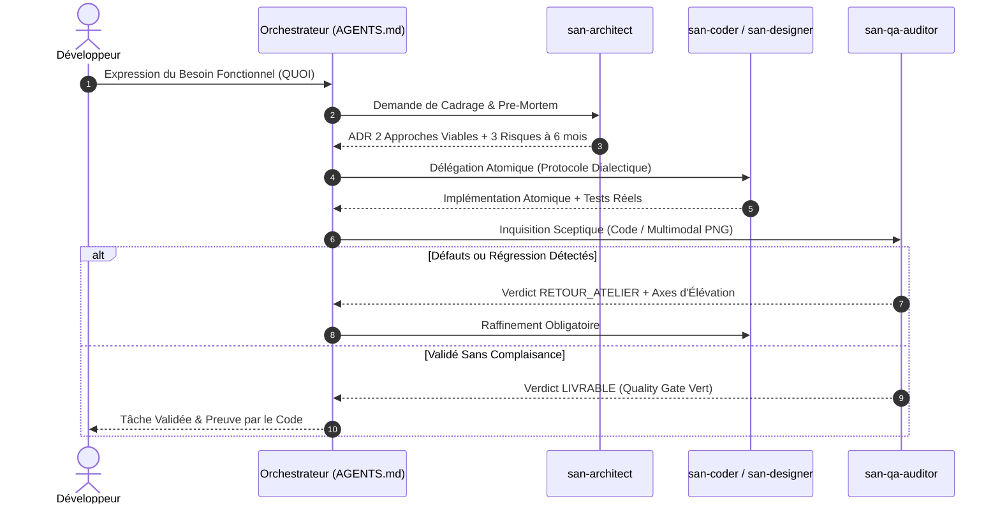

<p align="center">
  
</p>

# FRAMEWORK « GOOGLE ANTIGRAVITY » (`san_*`) — HARNESS AGENTIQUE & GOUVERNANCE COGNITIVE v2.1

> **Langue :** Français | [English version](README.en.md)  
> **Manifeste :** Système d'orchestration agentique autonome (`Argon` $\rightarrow$ `Swarm Hydrogen XHigh`), ingénierie du doute contradictoire, Studio UI Engine et suite de 18 compétences souveraines pour Google Antigravity CLI (AGY), Antigravity 2.0 / IDE et opencode.  
> **Auteur :** Alexsan.pro  
> **Statut :** Architecture Cartésienne en 4 Couches — Spécification Officielle v2.1.0.  
> **Licence :** [MIT License](LICENSE)

---

## 1. VISION, AMBITION & DOCTRINE v2.1

Sur des projets d'envergure, abandonner l'IA à des prompts conversationnels naïfs engendre inévitablement des régressions critiques :
- **Amnésie et dérive de contexte :** Oubli des contrats d'API, des standards d'accessibilité et des invariants d'architecture.
- **Complaisance du premier jet (*First-Draft Sycophancy*) :** Acceptation sans filtre de solutions plates, modèles de domaine anémiques, composants monolithiques de 500 lignes et dégradés pourpres/indigo génériques sans âme (*AI taste*).
- **Simulacre de tests (*Testing Theater*) :** Tâches validées hâtivement, suites de tests exécutées avec des contournements comme `--passWithNoTests`, mocks tautologiques qui testent le mock au lieu du domaine.
- **Fragilité opérationnelle :** Absence d'idempotence sur les transactions, blocages CORS en production, vulnérabilités de dépendances étouffées et non-prise en compte des réseaux dégradés.

La version **2.1.0** de `san_agy_framework` propulse l'architecture en 4 couches vers l'**Autonomie Mécanique Totale** :

1. **Orchestrateur Souverain (`Argon` / `Carbon`) $\rightarrow$ Essaim `gemini-4-hydrogen-xhigh` :** L'utilisateur formule uniquement le **QUOI** en une phrase sans jamais manipuler `/model` ni dicter quel sous-agent appeler. L'Orchestrateur pilote mécaniquement ses workers en parallèle via l'outil natif `swarm(action: "add", model: "gemini-4-hydrogen-xhigh")` (interdiction de `Model: "inherit"` pour sanctuariser le quota hebdomadaire Argon et éradication du fallback caché sur `3.8-flash`).
2. **Continuité Map-First (`san_cartographer` & `REPO_MAP.md`) & Garde-fous `Stop` (`stop_guard.mjs`) :** Le graphe AST/imports du projet est maintenu en temps réel en $<100\text{ms}$ (`.agents/cache/REPO_MAP.md`), et le hook `Stop` empêche toute clôture de tâche tant que le Quality Gate (`.agents/cache/last-gate-status.json`) n'est pas validé (avec Circuit Breaker anti-boucle à 2 relances max).
3. **Studio UI Engine & Ingénierie Contract-First :** Gel préalable des contrats partagés (OpenAPI 3.1 / Zod / TypeBox) + *Architectural Fitness Functions*, mode **Studio Duel UI** (`option-a` vs `option-b`), capture Playwright **Multi-Viewports** (`mobile`, `tablet`, `desktop` sur une instance Chromium unique) et **Linter Géométrique DOM** (`--audit-dom`).

---

## 2. L'ARCHITECTURE v2.1 EN 4 COUCHES

Le framework structure son exécution sur 4 couches concentriques et étanches, garantissant que chaque décision d'agent est gouvernée, outillée et vérifiée :



### Couche 1 : Gouvernance Souveraine & Règles Normatives
* **Constitution Permanente `<root>/AGENTS.md` :** Déployé à la racine du projet sans frontmatter YAML pour activer le chargement inconditionnel `always_on` par Antigravity et `opencode`. Ce fichier compact (< 4096 octets) fixe les lois d'airain de l'Orchestrateur Souverain (`Argon`/`Carbon`), la lecture Map-First (`.agents/cache/REPO_MAP.md`), la délégation parallèle via `swarm(action: "add", model: "gemini-4-hydrogen-xhigh")` et la table de routage automatique d'intention.
* **Règles Normatives Déclaratives `.agents/rules/*.md` :** 5 documents de référence équipés de frontmatters YAML officiels (`trigger: always_on`, `trigger: model_decision`, ou `trigger: glob`) :
  - [`PROJECT.md`](file://.agents/rules/PROJECT.md) : Profil technique du projet, stack souveraine et matrice d'allocation `Argon` (Orchestrateur) $\rightarrow$ `gemini-4-hydrogen-xhigh` (Workers Swarm).
  - [`PRODUCT.md`](file://.agents/rules/PRODUCT.md) : Vision produit, invariants métier, personas et contraintes de marché.
  - [`BRAND.md`](file://.agents/rules/BRAND.md) : Tokens UI, archétype esthétique, tension typographique, accessibilité WCAG AAA et signature cinétique 60 fps.
  - [`API.md`](file://.agents/rules/API.md) : Contrats d'interfaces, enveloppe JSON standardisée, transactions ACID, idempotence et collections Bruno.
  - [`LOGO.md`](file://.agents/rules/LOGO.md) : Spécifications vectorielles maîtres et déclinaisons d'icônes multi-résolutions.

### Couche 2 : Les 8 Sous-Agents Natifs et Spécialisés (`gemini-4-hydrogen-xhigh`)
Fini les prompts génériques monolithiques et le fallback caché sur des modèles légers. Les 8 sous-agents autonomes déclarés dans `.agents/agents/*.md` sont tous propulsés en exécution réelle par **`gemini-4-hydrogen-xhigh`** (via `swarm` ou `agy -p --model gemini-4-hydrogen-xhigh`, avec `model: "pro"` conservé dans le frontmatter YAML pour compatibilité ascendante du parser CLI) :

| Sous-Agent Natif | Modèle Runtime (Swarm) | Rôle & Responsabilité Clé | Compétences Attachées | Livrables Principaux |
| :--- | :--- | :--- | :--- | :--- |
| **`san-researcher`** | `gemini-4-hydrogen-xhigh` | Exploration cartographique Map-First (`REPO_MAP.md`), lecture seule, veille technique et documentation sans effet de bord. | `san_searcher`, `san_cartographer` | Fiches de recherche, cartographies de code, synthèses d'APIs tierces. |
| **`san-architect`** | `gemini-4-hydrogen-xhigh` | Arbitrage d'architecture, **Contract-First** (OpenAPI 3.1 / Zod / TypeBox), **Architectural Fitness Functions** et **Pre-Mortem** à 6 mois. | `san_planner`, `san_backend_expert` | ADR, contrats partagés gelés, Fitness Functions, plans d'atténuation. |
| **`san-designer-worker`** | `gemini-4-hydrogen-xhigh` | Direction artistique **Studio Duel UI** (`option-a` vs `option-b`), HTML/Tailwind, rendu Playwright Multi-Viewports et audit géométrique DOM. | `san_design_tokens`, `san_copywriter`, `san_exporter` | Maquettes `/design/*.html`, captures Multi-Viewports PNG & rapports DOM JSON. |
| **`san-coder-back`** | `gemini-4-hydrogen-xhigh` | Artisan backend atomique, protocoles API Contract-First, logique métier encapsulée en transactions et tests de domaine réels. | `san_backend_expert` | Contrôleurs, services, migrations, collections Bruno, tests intégrés. |
| **`san-coder-front`** | `gemini-4-hydrogen-xhigh` | Artisan frontend web & mobile (< 220 lignes/fichier), **5 états UI non-destructifs** (*Stale-While-Revalidate*) et **Motion System** (`cubic-bezier`, `>= 44x44px`, `tabular-nums`). | `san_ux_ui_expert`, `san_copywriter`, `san_design_tokens` | Composants React/React Native, hooks typés, tests d'intégration DOM. |
| **`san-qa-auditor`** | `gemini-4-hydrogen-xhigh` | Inquisiteur sceptique en lecture seule, audit de substance des tests, **critique visuelle multimodale + géométrique DOM**, verdict binaire. | `san_qa_security_expert` | Verdict binaire `LIVRABLE` ou `RETOUR_ATELIER`, audits OWASP, rapports QA. |
| **`san-ops-devops`** | `gemini-4-hydrogen-xhigh` | Pipelines CI/CD, conteneurs Docker, serveurs web Nginx, CloudPanel, diagnostics d'infrastructure Fail-Closed. | `san_devops_expert` | Workflows GitHub Actions, Dockerfiles, runbooks d'exploitation, audits de santé. |
| **`san-growth-legal`** | `gemini-4-hydrogen-xhigh` | Conformité légale RGPD/e-Privacy, politiques de confidentialité, fiches stores ASO et instrumentation analytique. | `san_store_legal_expert`, `san_growth_expert` | Politiques de confidentialité, checklists stores, plans de tracking. |

### Couche 3 : Les 5 Garde-fous Mécaniques du Cycle de Vie
Configurée dans `.agents/hooks.json`, cette couche intercepte les événements du moteur Antigravity pour verrouiller la discipline opérationnelle :
1. **`SessionStart` (`session_start.mjs`) :** Exécuté au lancement d'une session. Rafraîchit `.agents/cache/REPO_MAP.md` en $<100\text{ms}$, injecte le Radar Architectural + la roadmap active, et affiche en **one-shot** la bannière `[WHAT'S NEW ON SAN.AGY v2.1.0]` après un `san-framework update`.
2. **`PreInvocation` (`pre_invocation.mjs` · Hooks API v2 `systemMessage`) :** S'exécute avant chaque tour d'agent. Injecte un rappel compact (< 90 tokens) imposant la lecture Map-First (`REPO_MAP.md`), l'interdiction de `Model: "inherit"` sur Argon et la délégation parallèle via `swarm(action: "add", model: "gemini-4-hydrogen-xhigh")`.
3. **`PreToolUse` (`pre_tool_guard.mjs`) :** Intercepte les écritures et modifications de fichiers (`write_file`, `edit_file`) :
   - Bloque (`decision: "deny"`) tout archivage d'une roadmap dans `/roadmaps/archives/` contenant des tâches incomplètes (`- [ ]`).
   - Bloque (`decision: "deny"`) l'injection de faux-texte (*Lorem ipsum*, *dolor sit amet*) dans les dossiers de code et maquettes.
4. **`PostToolUse` (`post_tool_indexer.mjs`) :** Ré-indexe de manière incrémentale (en $<50\text{ms}$ par hash SHA-256) chaque fichier modifié dans `.agents/cache/REPO_MAP.md` pour maintenir la boussole architecturale toujours fraîche.
5. **`Stop` (`stop_guard.mjs` · Circuit Breaker) :** Empêche l'agent de clore son tour (`decision: "continue"`) si du code applicatif a été modifié sans preuve récente de Quality Gate vert dans `.agents/cache/last-gate-status.json` (avec exemption automatique des sessions purement documentaires `DOC_ONLY` et coupe-circuit à 2 relances maximum).

### Couche 4 : 18 Runbooks Impératifs de Compétences
Chaque module de compétence dans `.agents/skills/*/SKILL.md` est un **Runbook impératif condensé ($\le 130$ lignes)** accompagné de scripts déterministes (`scripts/`), de workflows Python `run_workflow` (`autonomous_slice_workflow.py`, `parallel_inquisition_workflow.py`), de gabarits (`templates/`) et de références (`references/`).

---

## 3. L'INGÉNIERIE DU DOUTE CONTRADICTOIRE (*DOUBT ENGINEERING*)

Pour éradiquer la médiocrité des solutions générées au premier jet, le framework formalise 4 protocoles cognitifs obligatoires :



### 1. Le Pre-Mortem Systémique (`san-architect`)
Avant de valider une architecture, un schéma de données ou une intégration structurante, `san-architect` simule une projection à 6 mois :
> *« Supposons que nous soyons dans 6 mois et que ce composant / cette API s'effondre en production. Quelles sont les 3 causes systémiques les plus probables de l'échec ? »*
Les 3 causes (concurrence d'écritures, volume de données imprévu, rupture de contrat client) doivent être traitées préventivement dans la conception avant toute écriture de code applicatif.

### 2. La Dialectique Avant Frappe (`san-coder-back`, `san-coder-front`)
Avant tout commit ou édition de code substantielle, le sous-agent d'implémentation doit formuler et confronter **2 approches viables distinctes** (par exemple : approche synchrone directe vs pipeline asynchrone Outbox avec Redis). L'invention d'une option d'épouvantail caricaturale est formellement interdite. Le choix retenu doit être justifié par des critères factuels de maintenabilité, typage et résilience.

### 3. La Boucle Visuelle Multimodale (*Visual Vision Loop*)
Le code CSS/HTML ne peut pas être jugé uniquement sur sa syntaxe textuelle. Le pôle design applique une boucle de rétroaction sur pixels réels :
1. `san-designer-worker` génère la maquette HTML/Tailwind basée sur l'archétype de `BRAND.md`.
2. Le script [`export_png.mjs`](file://src/skills/san_designer/scripts/export_png.mjs) monte un micro-serveur HTTP éphémère Node sur `127.0.0.1:0` et capture le rendu en PNG via Playwright headless sans blocage CORS.
3. **Étape d'Inspection Multimodale :** `san-qa-auditor` (`model: "pro"`) inspecte physiquement l'image PNG via l'outil `read_file`. Il examine l'équilibre des masses, la tension typographique, le contraste et le rythme Gestalt.
4. Au moins **une passe de raffinement esthétique** est exigée avant toute livraison au développeur.

### 4. L'Inquisition QA & Présomption de Défaut (`san-qa-auditor`)
`san-qa-auditor` agit avec une psychologie d'auditeur sceptique :
- **Présomption de vice caché :** Tout premier jet est présumé contenir un défaut de robustesse, un cas d'erreur non couvert ou un test de complaisance.
- **Tolérance Zéro au Testing Theater :** Rejet systématique des tests sans assertions réelles, des tests qui mockent leur propre sujet et des Quality Gates lancés avec des options de complaisance (`--passWithNoTests`, `|| true`).
- **Verdict Binaire Inviolable :** Le rapport se conclut exclusivement par `LIVRABLE` (prêt pour intégration) ou `RETOUR_ATELIER` (détail précis des régressions à corriger par l'artisan).

---

## 4. LES PROFILS CONTEXTUELS DE PROJET (`PROJECT_PROFILE`)

Le framework s'adapte sans friction à la réalité métier de votre projet via la variable `PROJECT_PROFILE` renseignée dans `.agents/rules/PROJECT.md` :

| Profil Contextuel | Cible Typique | Invariants Activés Spécifiquement | Contraintes Réseau & Métier |
| :--- | :--- | :--- | :--- |
| **`emerging_market`** | Fintechs, plateformes panafricaines, e-commerce local | Persistance Outbox locale, file d'attente Redis avec `Idempotency-Key`, gestion asynchrone des paiements Mobile Money (Airtel Money, MTN MoMo, callbacks STK/USSD et polling de réconciliation), repères géographiques urbains, partages WhatsApp. | Résilience réseau 3G/EDGE instable, mode hors-ligne, zéro double-débit. |
| **`global_saas`** | SaaS B2B/B2C international, plateformes cloud | Architecture multi-tenant hermétique, facturation Stripe/Paddle, gestion fine des autorisations (RBAC), haute disponibilité, observabilité et métriques. | Haute concurrence, conformité SOC2 / RGPD, temps de réponse p95 < 150ms. |
| **`mobile_consumer`** | Applications mobiles iOS & Android (React Native, Expo) | Micro-interactions fluides 60 fps, retours haptiques tactiles, stockage chiffré sécurisé (`expo-secure-store`), soumission anti-rejet Play Store et App Store. | Mode hors-ligne premier, consommation batterie minimale, UI tactile optimisée. |
| **`cli_devtools`** | Utilitaires en ligne de commande, SDKs, packages open-source | Codes de retour déterministes (POSIX 0/1), support strict des flux non-TTY, drapeaux `--json`, zéro dépendance inutile, démarrage instantané. | Rapidité d'exécution (< 200ms), compatibilité multi-OS, packaging npm/pip. |
| **`api_platform`** | Backends microservices, APIs publiques ou partenaires | Contrats OpenAPI 3.1 stricts, collections de tests Bruno automatisées, limitation de débit adaptative (Rate Limiting Redis), format JSON uniforme. | Versioning d'API rigoureux, isolation des transactions ACID, contrats immuables. |

---

## 5. CATALOGUE DES 18 RUNBOOKS DE COMPÉTENCES

Les 18 compétences sont réparties en 11 rôles directeurs et 7 toolkits transversaux d'exécution, déployés dans `.agents/skills/` (ou hérités via `.agents/skills.json` en mode `--light`) :

### A. Les 11 Compétences Directrices

| Compétence | Déclencheur Naturel d'Intention | Rôle Clé | Livrables & Outils Déterminants |
| :--- | :--- | :--- | :--- |
| [**`san_init`**](file://skills/san_init.md) | *"Initialiser le projet"*, *"Configurer les agents"* | Setup, onboarding, isolation Git et génération du contexte | `<root>/AGENTS.md`, `.agents/rules/*.md`, `git_ai_hygiene.sh` |
| [**`san_brainstorming`**](file://skills/san_brainstorming.md) | *"Brainstormer"*, *"Évaluer cette idée"*, *"Cadrer le besoin"* | Triage d'idées, matrice de scoring 40 pts contextuelle | `roadmaps/ideas/*.md`, `score_idea.py` |
| [**`san_planner`**](file://skills/san_planner.md) | *"Créer la roadmap"*, *"Planifier la phase suivante"* | Découpage Contract-First, Fitness Functions & archivage | `roadmaps/*.md`, `archive_roadmap.sh` |
| [**`san_designer`**](file://skills/san_designer.md) | *"Designer l'écran"*, *"Studio Duel UI"*, *"Audit visuel"* | Studio Duel UI (`option-a`/`option-b`), Multi-Viewports & Linter DOM | `/design/*.html`, `export_png.mjs --viewports --audit-dom` |
| [**`san_ux_ui_expert`**](file://skills/san_ux_ui_expert.md) | *"Intégrer le composant UI"*, *"Corriger l'accessibilité"* | Lead Frontend Web & Mobile, 5 états non-destructifs & Motion System | Composants React/Expo, `front_quality_gate.sh` |
| [**`san_backend_expert`**](file://skills/san_backend_expert.md) | *"Créer l'API"*, *"Ajouter l'endpoint"*, *"Modéliser la BDD"* | Lead Backend, transactions ACID, idempotence et contrats API | Modèles, Services, Bruno `.bru`, `backend_quality_gate.sh` |
| [**`san_executer`**](file://skills/san_executer.md) | *"Exécuter la roadmap"*, *"Livrer le lot N"*, *"Coder la feature"* | Chef d'orchestre Contract-First, Swarm `Hydrogen XHigh` & `run_workflow` | `autonomous_slice_workflow.py`, `e2e_verification_gate.sh` |
| [**`san_qa_security_expert`**](file://skills/san_qa_security_expert.md) | *"Auditer la sécurité"*, *"Lancer les tests QA"* | Juge de paix QA unifié, workflows parallèles OWASP/Substance/DOM | `parallel_inquisition_workflow.py`, `qa_security_gate.sh` |
| [**`san_devops_expert`**](file://skills/san_devops_expert.md) | *"Configurer la CI/CD"*, *"Déployer"*, *"Vérifier le serveur"* | Infrastructure CloudPanel, Docker, Nginx, Mailcow, CI/CD | `.github/workflows/*`, `infra_health_check.sh` |
| [**`san_store_legal_expert`**](file://skills/san_store_legal_expert.md) | *"Préparer la mise sur les stores"*, *"Conformité RGPD"* | Conformité Google Play / Apple Store, chartes juridiques | `docs/STORE_CHECKLIST.md`, `PRIVACY_POLICY.md` |
| [**`san_growth_expert`**](file://skills/san_growth_expert.md) | *"Optimiser le SEO"*, *"Plan de tracking"*, *"Fiche ASO"* | Référencement naturel, ASO des stores, tracking analytics | `docs/SEO.md`, `docs/TRACKING_PLAN.md` |

### B. Les 7 Toolkits Transversaux

| Toolkit Transversal | Spécialité Technique | Livrables & Scripts Associés |
| :--- | :--- | :--- |
| [**`san_cartographer`**](file://sub-skills/san_cartographer.md) | Boussole architecturale temps réel & indexation AST incrémentale | `repo_mapper.mjs`, `.agents/cache/REPO_MAP.md`, `post_tool_indexer.mjs` |
| [**`san_subagent_manager`**](file://sub-skills/san_subagent_manager.md) | Calibrage et supervision d'essaims `swarm` sur `gemini-4-hydrogen-xhigh` | Prompts atomiques étanches, `validate_subagent_spec.sh` (interdiction `inherit`) |
| [**`san_searcher`**](file://sub-skills/san_searcher.md) | Veille documentaire de haute précision et extraction propre | `doc_scraper.sh`, `detect_stack_versions.sh`, synthèses `docs/research/*.md` |
| [**`san_copywriter`**](file://sub-skills/san_copywriter.md) | Micro-copies UX réelles, humanisation et linter anti-faux-texte | `check_lorem.sh`, zéro *Lorem Ipsum*, messages d'erreur contextualisés |
| [**`san_design_tokens`**](file://sub-skills/san_design_tokens.md) | Gardien de `BRAND.md` et validation des contrastes WCAG AAA | `build_tokens.mjs`, `audit_magic_values.sh`, CSS variables unifiées |
| [**`san_exporter`**](file://sub-skills/san_exporter.md) | Pipeline de capture Playwright Multi-Viewports & Linter Géométrique DOM | `export_png.mjs` (`--viewports`, `--audit-dom`, `--strict-dom`), `svg_to_png.mjs` |
| [**`san_doc_keeper`**](file://sub-skills/san_doc_keeper.md) | Gardien de l'intégrité documentaire et du versioning SemVer | Maintien de `README.md`, `CHANGELOG.md` et Fast-Track d'hygiène |

---

## 6. LE GUIDE CLI UNIVERSEL v2.1

Le framework se pilote et se déploie via les commandes officielles `san-framework` (ou son alias `agy-framework`) :

```bash
# Exécution directe via npx (sans installation préalable requise)
npx @alexsan/agy-framework <commande> [options]

# Ou via binaire global si installé
san-framework <commande> [options]
```

### A. Les 5 Commandes Officielles

#### 1. `san-framework init --local [--light]`
Déploie l'architecture complète en 4 couches dans l'espace hermétique `./.agents/` de votre projet et génère le fichier `<root>/AGENTS.md` souverain.
- **Mode Héritage Léger (`--light`) :** Génère `.agents/skills.json` (`"inherits"`) pointant vers les 18 skills du framework sans dupliquer les répertoires sur le disque, tout en conservant `.agents/rules/`, `.agents/agents/`, `.agents/hooks/` et `.agents/cache/` 100 % locaux au projet.
- **Smart Merge Normatif :** Analyse les règles existantes dans `.agents/rules/` (`PROJECT.md`, `BRAND.md`, etc.). Si un fichier personnalisé est déjà présent, le CLI injecte automatiquement le frontmatter YAML requis **sans jamais écraser vos spécifications métier**.
- **Sauvegarde Réversible :** Si d'anciens résidus d'outils IA concurrents (`CLAUDE.md`, `.cursorrules`) sont détectés, ils sont déplacés en toute sécurité dans `.agents/backups/legacy-ai-configs/<timestamp>/` au lieu d'être détruits.
- **Verrouillage Git Hermétique :** Isole bidirectionnellement `.agents/` dans `.gitignore` et `.git/info/exclude`.

```bash
# Déploiement local complet non-interactif
san-framework init --local --all

# Déploiement local en Mode Héritage Léger (sans dupliquer les 18 dossiers de skills)
san-framework init --local --light

# Déploiement ciblé d'une sélection de skills
san-framework init --local --skills=san_init,san_planner,san_executer,san_qa_security_expert
```

#### 2. `san-framework init --global`
Assemble et installe le package sous forme de **Plugin officiel complet Antigravity** dans le répertoire utilisateur global (`~/.gemini/antigravity-cli/plugins/san-framework/`).
- Package validé à 100 % par la commande officielle Antigravity : `agy plugin validate --strict`.
- Inclut le manifeste `plugin.json` (`2.1.0`), le logo vectoriel, les 8 sous-agents, les 5 hooks de cycle de vie et les 18 skills exécutables.

```bash
san-framework init --global --all
```

#### 3. `san-framework update [--light]`
Effectue une **migration instantanée et non-destructive** vers l'architecture `v2.1.0` :
- Met à niveau les 18 skills vers leurs runbooks impératifs $\le 130$ lignes (ou met à jour `.agents/skills.json` avec `--light`).
- Met à jour les 8 définitions de sous-agents natifs (`gemini-4-hydrogen-xhigh`) dans `.agents/agents/`.
- Installe le gestionnaire `.agents/hooks.json` et les 5 scripts de contrôle (`session_start.mjs`, `pre_invocation.mjs`, `pre_tool_guard.mjs`, `post_tool_indexer.mjs`, `stop_guard.mjs`).
- Affiche l'encart **"What's New on san-agy v2.1.0"** dans le terminal et programme la notification unique au 1er `SessionStart` via `.agents/cache/whats_new_pending.json`.

```bash
san-framework update
san-framework update --light
```

#### 4. `san-framework whats-new`
Affiche à tout moment dans le terminal le récapitulatif structuré des nouveautés de la version `v2.1.0` :

```bash
san-framework whats-new
```

#### 5. `san-framework doctor`
Exécute un audit déterministe et infalsifiable des **6 piliers de santé** de l'installation sur le projet cible :

```bash
san-framework doctor
```

Le diagnostic vérifie et rapporte avec précision :
1. **Gouvernance Souveraine :** Présence et conformité de `<root>/AGENTS.md` (taille < 4 KB, sans frontmatter).
2. **Règles Normatives :** Présence des 5 fichiers dans `.agents/rules/` avec frontmatters YAML valides.
3. **Sous-Agents Natifs :** Présence des 8 sous-agents dans `.agents/agents/*.md`.
4. **Garde-fous de Cycle de Vie :** Présence de `.agents/hooks.json` et droits d'exécution sur les 5 scripts `.mjs` (incluant `post_tool_indexer.mjs` et `stop_guard.mjs`).
5. **Catalogue des 18 Skills :** Vérification de la compacité de chaque `SKILL.md` ($\le 130$ lignes), que l'installation soit locale ou en mode `--light` (`.agents/skills.json`).
6. **Étanchéité Git :** Vérification de l'isolation hermétique dans `.gitignore` ou `.git/info/exclude`.

*Code retour : `0` si l'ensemble des piliers sont conformes, `1` si des anomalies sont détectées (avec conseils de remédiation automatique).*

### B. Tableau Récapitulatif des Drapeaux CLI

| Drapeau CLI | Rôle & Comportement |
| :--- | :--- |
| `--local` | Déploie le framework dans le projet local (`./.agents/`) [Option par défaut en mode script]. |
| `--light` | Mode Héritage Léger : génère `.agents/skills.json` (`"inherits"`) sans copier les 18 dossiers de skills. |
| `--global` | Assemble le Plugin global dans le répertoire utilisateur Antigravity CLI. |
| `--all` | Installe l'intégralité des 18 compétences sans confirmation interactive. |
| `--skills=<liste>` | Sélection granulaire de compétences séparées par des virgules. |
| `--dry-run` | Mode simulation complète : affiche les actions prévues sans écrire aucun fichier. |
| `--force` | Force la réécriture et le remplacement des composants existants. |
| `--opencode` | Génère également la configuration et le contexte `opencode.json` à la racine. |
| `--dir=<chemin>` | Spécifie explicitement le répertoire cible d'installation. |
| `--version`, `-v` | Affiche le numéro de version courante (`2.1.0`). |
| `--help`, `-h` | Affiche l'aide complète et la liste des commandes. |

---

## 7. CARTOGRAPHIE DU DÉPÔT

```txt
san_agy_framework/
├── package.json                        # Manifeste npm v2.1.0, binaires CLI (san-framework & agy-framework)
├── LICENSE                             # Licence officielle MIT Alexsan.pro
├── README.md                           # Index maître d'architecture v2.1 (ce fichier)
├── README.en.md                        # Master Architecture Index v2.1 (Version anglaise)
├── CHANGELOG.md                        # Journal des versions (norme Keep a Changelog)
├── CHANGELOG.en.md                     # Release Changelog (Version anglaise)
├── .gitignore                          # Isolation locale et hygiène Git
│
├── logos/                              # Identité visuelle vectorielle
│   ├── LOGO.md                         # Charte graphique et règles d'utilisation
│   ├── san_framework_logo.svg          # Logo officiel (Symbole + Typographie)
│   ├── san_framework_icon.svg          # Icône vectorielle / Favicon
│   └── san_framework_dark.svg          # Variante vectorielle pour fonds sombres
│
├── roadmaps/                           # Pilotage et ordonnancement interne
│   ├── PLAN_V2_1_0_HYDROGEN_SWARM.md   # Roadmap d'exécution parallèle v2.1.0 (complétée)
│   ├── ideas/                          # Dossiers de cadrage et scoring san_brainstorming
│   └── archives/                       # Roadmaps validées à 100 % et archivées
│
├── src/                                # LE PRODUIT DISTRIBUABLE (Package v2.1.0)
│   ├── agents/                         # Définitions des 8 sous-agents natifs (Swarm gemini-4-hydrogen-xhigh)
│   │   ├── san-researcher.md           # Exploration Map-First, lecture seule, veille technique
│   │   ├── san-architect.md            # Contract-First, Fitness Functions, Pre-Mortem à 6 mois
│   │   ├── san-designer-worker.md      # Studio Duel UI (option-a/b), Multi-Viewports & Linter DOM
│   │   ├── san-coder-back.md           # Backend atomique, transactions ACID, tests de domaine
│   │   ├── san-coder-front.md          # Frontend modulaire, 5 états UI non-destructifs & Motion System
│   │   ├── san-qa-auditor.md           # Inquisiteur QA sceptique, critique multimodale & DOM
│   │   ├── san-ops-devops.md           # CI/CD, conteneurs, diagnostics d'infrastructure
│   │   └── san-growth-legal.md         # RGPD, conformité des stores, SEO/ASO
│   │
│   ├── hooks/                          # 5 Garde-fous mécaniques de cycle de vie
│   │   ├── hooks.json                  # SessionStart, PreInvocation, PreToolUse, PostToolUse, Stop
│   │   └── scripts/                    # session_start, pre_invocation, pre_tool_guard, post_tool_indexer, stop_guard
│   │
│   ├── plugin/                         # Bundle Plugin officiel Antigravity
│   │   ├── plugin.json                 # Manifeste v2.1.0 compatible 'agy plugin validate --strict'
│   │   └── assets/logo.svg             # Logo officiel packagé
│   │
│   ├── cli/                            # Moteur d'installation et de diagnostic universel
│   │   ├── index.js                    # Point d'entrée (init, update, whats-new, doctor)
│   │   ├── installer.js                # Copie, mode --light (skills.json), Smart Merge, doctor
│   │   └── whats_new.js                # Module "What's New on san-agy v2.1.0"
│   │
│   └── skills/                         # Les 18 runbooks exécutables packagés (SKILL.md <= 130 lignes)
│       ├── san_init/                   # Initialisation, règles et constitution souveraine
│       ├── san_brainstorming/          # Cadrage d'idées, scoring multicritères 40 pts
│       ├── san_planner/                # Planification Contract-First, Fitness Functions & archivage
│       ├── san_cartographer/           # Cartographie AST temps réel (.agents/cache/REPO_MAP.md)
│       ├── san_subagent_manager/       # Calibration d'essaims swarm sur gemini-4-hydrogen-xhigh
│       ├── san_searcher/               # Veille technique et scraping ciblé
│       ├── san_designer/               # Studio Duel UI, export_png.mjs v2 Multi-Viewports & DOM Linter
│       ├── san_copywriter/             # Micro-copies UX réelles et détection de faux-texte
│       ├── san_design_tokens/          # Tokens graphiques et compilation de contrastes
│       ├── san_ux_ui_expert/           # Lead Frontend, accessibilité, 5 états UI & Motion System
│       ├── san_backend_expert/         # Lead Backend, protocoles API et idempotence
│       ├── san_executer/               # Orchestration Full-Stack & autonomous_slice_workflow.py
│       ├── san_qa_security_expert/     # Juge QA E2E & parallel_inquisition_workflow.py
│       ├── san_exporter/               # Pipeline de capture Multi-Viewports & conversion SVG->PNG
│       ├── san_devops_expert/          # Runbooks infrastructure, Nginx, Docker, CI/CD
│       ├── san_store_legal_expert/     # Conformité stores Play/App Store et chartes légales
│       ├── san_growth_expert/          # SEO local, fiches stores ASO et tracking plan
│       └── san_doc_keeper/             # Maintenance documentaire et hygiène de versions
│
└── tests/                              # SUITES DE TESTS AUTOMATISÉES DE VALIDATION
    ├── phase3/ à phase9/               # Suites de régression v1.x
    └── v2/                             # Suites de validation déterministes v2.1 (Phases 1 à 6 & E2E)
```

---

## 8. LICENCE

Ce projet est sous licence MIT — voir le fichier [`LICENSE`](LICENSE) pour plus de détails.  
Copyright (c) 2026 Alexsan.pro. Tous droits réservés.
