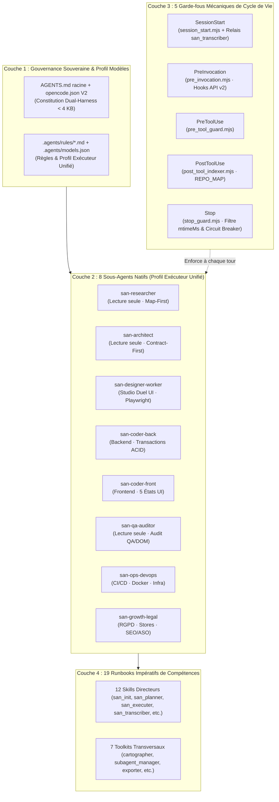
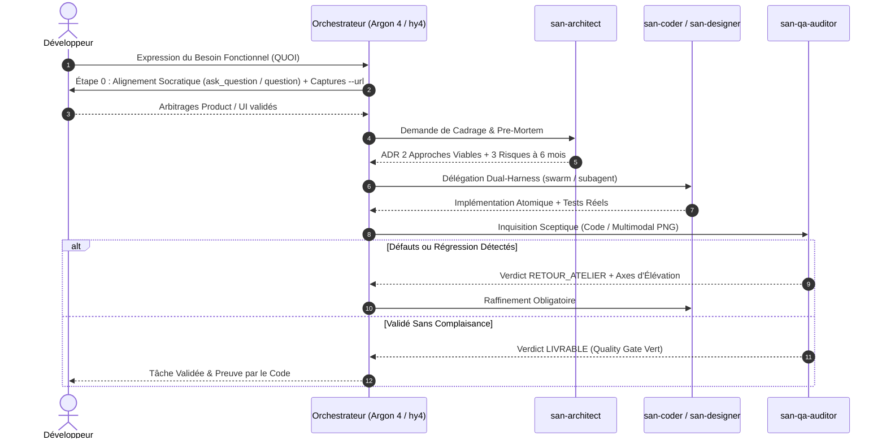

<p align="center">
  
</p>

<p align="center">
  
  
  
  
  
</p>

# FRAMEWORK « GOOGLE ANTIGRAVITY » (`san_*`) — HARNESS DUAL-ENGINE & GOUVERNANCE COGNITIVE v2.2

> **Langue :** Français | [English version](README.en.md)  
> **Manifeste :** Système d'orchestration agentique **Dual-Harness** (`Antigravity` `swarm` + `OpenCode V2` `subagent`) à **Profil Exécuteur Unifié** (`san-framework models`), ingénierie du doute contradictoire, relais sceptique de fin de quota (`san_transcriber`), Studio UI Engine (`--url` live) et suite de **19 compétences** souveraines.  
> **Auteur :** Alexsan.pro  
> **Statut :** Architecture Cartésienne en 4 Couches — Spécification Officielle v2.2.0.  
> **Licence :** [MIT License](LICENSE)

---

## 1. VISION, AMBITION & DOCTRINE v2.2

Sur des projets d'envergure, abandonner l'IA à des prompts conversationnels naïfs engendre inévitablement des régressions critiques :
- **Amnésie et dérive de contexte :** Oubli des contrats d'API, des standards d'accessibilité et des invariants d'architecture.
- **Complaisance du premier jet (*First-Draft Sycophancy*) :** Acceptation sans filtre de solutions plates, modèles de domaine anémiques, composants monolithiques de 500 lignes et dégradés pourpres/indigo génériques sans âme (*AI taste*).
- **Simulacre de tests (*Testing Theater*) :** Tâches validées hâtivement, suites de tests exécutées avec des contournements comme `--passWithNoTests`, mocks tautologiques qui testent le mock au lieu du domaine.
- **Fragilité opérationnelle :** Absence d'idempotence sur les transactions, blocages CORS en production, vulnérabilités de dépendances étouffées et non-prise en compte des réseaux dégradés.

La version **2.2.0** de `san_agy_framework` affranchit le framework du couplage mono-moteur et corrige les blocages cognitifs des workflows parallèles :

1. **Architecture Dual-Harness (`Antigravity` + `OpenCode V2`) & Profil Exécuteur Unifié (`san-framework models`) :** Une constitution unique (`AGENTS.md` + `.agents/models.json`) orchestre les 8 sous-agents `san-*` sur les deux moteurs :
   - **Google Antigravity (`agy`) :** L'Orchestrateur (`Argon 4` / `Carbon`) pilote ses workers via `swarm(action: "add", model: "<agy.executor>")` (défaut : `gemini-4-hydrogen-xhigh`, interdiction de `Model: "inherit"`).
   - **OpenCode V2 (`opencode v2.2.7+` / `2.3.0`) :** L'Orchestrateur (`opencode-go/hy4`) invoque l'outil natif `subagent({ agent: "san-..." })` adossé à la clé `"agents"` générée automatiquement dans `opencode.json` (défaut : `opencode-go/deepseek-v4-pro`, basculable en 1 commande vers `opencode-go/qwen3.8-flash` via `san-framework models`).
2. **Dé-Lobotomisation Cognitive & Capture Web Live (`export_png.mjs --url`) :** Fini la délégation prématurée à des workers muets incapables d'interroger l'utilisateur et l'inspection CSS à l'aveugle : la **Règle d'Alignement Socratique & Visuel** oblige l'Orchestrateur (`Argon 4` / `hy4`) à aligner les choix structurants via `ask_question` / `question` et à capturer les vrais pixels de sites de référence via `export_png.mjs --url=<https://...>` (Desktop + Mobile) **avant** de déléguer la rédaction de roadmaps ou de maquettes.
3. **19e Skill `san_transcriber` (Relais Sceptique) & `Stop` Guard Assaini :** Invoqué via `/san_transcriber` en fin de quota, le nouveau skill génère un transcript lié aux roadmaps actives dans `roadmaps/transcripts/` avec **Protocole de Relais Sceptique (*Doubt & Verify*)**, automatiquement détecté au démarrage par `session_start.mjs`. Parallèlement, `stop_guard.mjs` filtre les fichiers modifiés par horodatage `mtimeMs` et exempte `design/**`, `logos/**` et `opencode.json` pour éliminer 100 % des faux positifs sur dépôts contenant des modifications préexistantes.
4. **Continuité Map-First & Studio UI Engine Contract-First :** Indexation AST temps réel en $<100\text{ms}$ (`.agents/cache/REPO_MAP.md`), gel des contrats partagés (OpenAPI 3.1 / Zod / TypeBox) + *Architectural Fitness Functions*, **Studio Duel UI** (`option-a` vs `option-b`), capture Playwright **Multi-Viewports** (`mobile`, `tablet`, `desktop` sur Chromium unique) et **Linter Géométrique DOM** (`--audit-dom`).

---

## 2. L'ARCHITECTURE v2.2 EN 4 COUCHES

Le framework structure son exécution sur 4 couches concentriques et étanches, garantissant que chaque décision d'agent est gouvernée, outillée et vérifiée quel que soit le harnais (`Antigravity` ou `OpenCode V2`) :



### Couche 1 : Gouvernance Souveraine & Règles Normatives
* **Constitution Permanente `<root>/AGENTS.md` :** Déployée à la racine sans frontmatter YAML pour activer le chargement `always_on` sous Google Antigravity et OpenCode V2. Ce fichier compact (< 4096 octets) fixe l'**Alignement Socratique & Visuel** préalable (Étape 0), la lecture Map-First (`.agents/cache/REPO_MAP.md`), le routage Dual-Harness (`swarm` sous Antigravity | `subagent` sous OpenCode V2) et la table d'intention.
* **Profil Modèles Unifié `.agents/models.json` & Configuration `opencode.json` V2 :** Pilotés par `san-framework models`, ces deux fichiers définissent l'Orchestrateur et l'**Exécuteur Unifié** pour chaque harnais et génèrent automatiquement la clé `"agents"` native d'OpenCode V2 (`mode: "subagent"`, `system`, `model`, `permissions`).
* **Règles Normatives Déclaratives `.agents/rules/*.md` :** 5 documents de référence dotés de frontmatters YAML officiels (`trigger: always_on`, `trigger: model_decision`, ou `trigger: glob`) :
  - [`PROJECT.md`](file://.agents/rules/PROJECT.md) : Profil technique du projet, stack souveraine et doctrine d'allocation Dual-Harness (`Orchestrateur` $\rightarrow$ `Profil Exécuteur Unifié`).
  - [`PRODUCT.md`](file://.agents/rules/PRODUCT.md) : Vision produit, invariants métier, personas et contraintes de marché.
  - [`BRAND.md`](file://.agents/rules/BRAND.md) : Tokens UI, archétype esthétique, tension typographique, accessibilité WCAG AAA et signature cinétique 60 fps.
  - [`API.md`](file://.agents/rules/API.md) : Contrats d'interfaces, enveloppe JSON standardisée, transactions ACID, idempotence et collections Bruno.
  - [`LOGO.md`](file://.agents/rules/LOGO.md) : Spécifications vectorielles maîtres et déclinaisons d'icônes multi-résolutions.

### Couche 2 : Les 8 Sous-Agents Natifs & le Profil Exécuteur Unifié
Les 8 sous-agents définis dans `.agents/agents/*.md` (et projetés dans la clé `"agents"` de `opencode.json` sous OpenCode V2) partagent tous un **Profil Exécuteur Unifié** configurable en une commande via `san-framework models` (`.agents/models.json`) :

| Harnais Runtime | Orchestrateur Principal | Profil Exécuteur Unifié (8 `san-*`) | Primitive d'Invocation | Validation Native |
| :--- | :--- | :--- | :--- | :--- |
| **Google Antigravity (`agy`)** | `Argon 4` (`gemini-4-argon-high`) / `Carbon` | `gemini-4-hydrogen-xhigh` *(défaut `--agy`)* | `swarm(action: "add", model: "<agy.executor>")` | `agy plugin validate --strict` |
| **OpenCode V2 (`v2.2.7+` / `2.3.0`)** | `opencode-go/hy4` | `opencode-go/deepseek-v4-pro` ou `opencode-go/qwen3.8-flash` *(via `--opencode`)* | `subagent({ agent: "san-...", prompt: "..." })` | `opencode debug agents` |

> *Note de compatibilité : dans `.agents/agents/*.md`, le frontmatter YAML conserve `model: "pro"` pour compatibilité ascendante du parser Antigravity CLI, tandis qu'à l'exécution les workers utilisent toujours le modèle défini dans `.agents/models.json` (`Mode: "subagent"` dans `opencode.json`).*

| Sous-Agent Natif | Mode & Permissions (`OpenCode V2` / `Agy`) | Rôle & Responsabilité Clé | Compétences Attachées | Livrables Principaux |
| :--- | :--- | :--- | :--- | :--- |
| **`san-researcher`** | `subagent` · **Read-Only** (`edit: deny`) | Exploration cartographique Map-First (`REPO_MAP.md`), veille technique et documentation sans effet de bord. | `san_searcher`, `san_cartographer` | Fiches de recherche, cartographies de code, synthèses d'APIs tierces. |
| **`san-architect`** | `subagent` · **Read-Only** (`edit: deny`) | Arbitrage d'architecture, **Contract-First** (OpenAPI 3.1 / Zod / TypeBox), **Architectural Fitness Functions** et **Pre-Mortem** à 6 mois. | `san_planner`, `san_backend_expert` | ADR, contrats partagés gelés, Fitness Functions, plans d'atténuation. |
| **`san-designer-worker`** | `subagent` · Write / Execute | Direction artistique **Studio Duel UI** (`option-a` vs `option-b`), capture `--url`, HTML/Tailwind, rendu Multi-Viewports et audit DOM. | `san_design_tokens`, `san_copywriter`, `san_exporter` | Maquettes `/design/*.html`, captures Multi-Viewports PNG & rapports DOM JSON. |
| **`san-coder-back`** | `subagent` · Write / Execute | Artisan backend atomique, protocoles API Contract-First, logique métier encapsulée en transactions et tests de domaine réels. | `san_backend_expert` | Contrôleurs, services, migrations, collections Bruno, tests intégrés. |
| **`san-coder-front`** | `subagent` · Write / Execute | Artisan frontend web & mobile (< 220 lignes/fichier), **5 états UI non-destructifs** (*Stale-While-Revalidate*) et **Motion System** (`cubic-bezier`, `>= 44x44px`, `tabular-nums`). | `san_ux_ui_expert`, `san_copywriter`, `san_design_tokens` | Composants React/React Native, hooks typés, tests d'intégration DOM. |
| **`san-qa-auditor`** | `subagent` · **Read-Only** (`edit: deny`) | Inquisiteur sceptique en lecture seule, audit de substance des tests, **critique visuelle multimodale + géométrique DOM**, verdict binaire. | `san_qa_security_expert` | Verdict binaire `LIVRABLE` ou `RETOUR_ATELIER`, audits OWASP, rapports QA. |
| **`san-ops-devops`** | `subagent` · Write / Execute | Pipelines CI/CD, conteneurs Docker, serveurs web Nginx, CloudPanel, diagnostics d'infrastructure Fail-Closed. | `san_devops_expert` | Workflows GitHub Actions, Dockerfiles, runbooks d'exploitation, audits de santé. |
| **`san-growth-legal`** | `subagent` · Write / Execute | Conformité légale RGPD/e-Privacy, politiques de confidentialité, fiches stores ASO et instrumentation analytique. | `san_store_legal_expert`, `san_growth_expert` | Politiques de confidentialité, checklists stores, plans de tracking. |

### Couche 3 : Les 5 Garde-fous Mécaniques du Cycle de Vie
Configurée dans `.agents/hooks.json`, cette couche verrouille la discipline opérationnelle :
1. **`SessionStart` (`session_start.mjs`) :** Rafraîchit `.agents/cache/REPO_MAP.md` en $<100\text{ms}$, détecte la roadmap active ainsi que le **dernier transcript de relais dans `roadmaps/transcripts/*.md`** (bannière `[SAN.AGY CONSTITUTION v2.2]`), et affiche en **one-shot** `[WHAT'S NEW ON SAN.AGY v2.2.0]` après un `san-framework update`.
2. **`PreInvocation` (`pre_invocation.mjs` · Hooks API v2 `systemMessage`) :** Injecte un rappel compact (< 90 tokens) imposant l'Alignement Socratique (Étape 0), la lecture Map-First (`REPO_MAP.md`), la délégation Dual-Harness (`swarm` | `subagent` via `.agents/models.json`) et l'interdiction de `Model: "inherit"`.
3. **`PreToolUse` (`pre_tool_guard.mjs`) :** Intercepte `write_file` / `edit_file` pour bloquer l'archivage de roadmaps incomplètes (`- [ ]`) et l'injection de faux-texte (*Lorem ipsum*).
4. **`PostToolUse` (`post_tool_indexer.mjs`) :** Ré-indexe incrémentalement (en $<50\text{ms}$ par hash SHA-256) chaque fichier modifié dans `.agents/cache/REPO_MAP.md`.
5. **`Stop` (`stop_guard.mjs` · Filtre `mtimeMs` & Circuit Breaker) :** Empêche la clôture de tour (`decision: "continue"`, max 2 relances) uniquement si du **code applicatif fraîchement modifié** (`mtimeMs` récent < 10 min ou postérieur au dernier `last-gate-status.json`) n'a pas de Quality Gate vert récent. Exempte automatiquement `design/**`, `logos/**`, `.opencode/**`, `opencode.json`, `opencode.jsonc`, `.gitignore`, `*.md`, `*.mdx`, `*.txt`, `roadmaps/**`, `docs/**` et `.agents/**`, éliminant tout faux positif sur dépôts déjà sales.

### Couche 4 : 19 Runbooks Impératifs de Compétences
Chaque module dans `.agents/skills/*/SKILL.md` est un **Runbook impératif condensé ($\le 130$ lignes)** accompagné de scripts déterministes partagés et **strictement unifiés à l'octet près (`cmp -s`)** (`export_png.mjs`, `archive_roadmap.sh`, `svg_to_png.mjs`), de workflows Python `run_workflow`, de gabarits (`templates/`) et de wrappers synchronisés en `v2.2.0` dans `skills/*.md` et `sub-skills/*.md`.

---

## 3. L'INGÉNIERIE DU DOUTE CONTRADICTOIRE (*DOUBT ENGINEERING*)

Pour éradiquer la médiocrité des solutions générées au premier jet et les relais de session amnésiques, le framework formalise 5 protocoles cognitifs obligatoires :



### 1. L'Alignement Socratique & Visuel Préalable (Étape 0)
Avant de déléguer la rédaction d'une roadmap ou d'une maquette à un sous-agent d'arrière-plan (qui ne peut pas dialoguer avec l'utilisateur), l'Orchestrateur (`Argon 4` / `hy4`) tranche avec le développeur les choix structurants via `ask_question` (Antigravity) ou `question` (OpenCode), et inspecte les vraies références visuelles via `export_png.mjs --url`.

### 2. Le Pre-Mortem Systémique (`san-architect`)
Avant de valider une architecture, un schéma de données ou une intégration structurante, `san-architect` simule une projection à 6 mois (*« Quelles sont les 3 causes systémiques les plus probables de l'effondrement en production ? »*) et verrouille les contre-mesures dans les contrats OpenAPI/Zod avant toute écriture de code applicatif.

### 3. La Dialectique Avant Frappe (`san-coder-back`, `san-coder-front`)
Avant toute édition substantielle, le sous-agent d'implémentation confronte **2 approches viables distinctes** (sans option d'épouvantail) et justifie factuellement son choix par la maintenabilité, le typage et la résilience.

### 4. La Boucle Visuelle Multimodale & Capture Web Live (`export_png.mjs --url`)
Le code CSS/HTML et les inspirations web ne s'évaluent jamais en lisant du texte brut ou en `curl`-ant des variables CSS :
1. **Capture de Sites d'Inspiration Live (`--url`) :** Pour toute référence web fournie, exécuter `node .agents/skills/san_designer/scripts/export_png.mjs --url=<https://...> --viewports=desktop,mobile` (ou `--full-page`) afin de capturer les vrais pixels dans `design/references/` et de les inspecter physiquement via `read_file`. La résolution universelle `loadPlaywright()` détecte automatiquement Playwright dans le projet local, le plugin global ou `~/.npm/_npx`.
2. **Studio Duel UI (`option-a` vs `option-b`) :** `san-designer-worker` génère 2 directions artistiques HTML/Tailwind sans CDN externe ; `export_png.mjs` monte un micro-serveur HTTP éphémère sur `127.0.0.1:0` et capture `mobile`, `tablet`, `desktop` sur une instance Chromium unique avec audit DOM (`--audit-dom`).
3. **Inspection Multimodale (`san-qa-auditor`) :** Lecture des PNG via `read_file`, contrôle des métriques géométriques et au moins **une passe de raffinement esthétique** avant livraison.

### 5. L'Inquisition QA & le Relais Sceptique de Fin de Quota (`san_transcriber`)
- **Inquisition QA (`san-qa-auditor`) :** Présomption de vice caché, tolérance zéro au *Testing Theater* (`--passWithNoTests`, mocks tautologiques), et verdict binaire inviolable (`LIVRABLE` | `RETOUR_ATELIER`).
- **Relais Sceptique `san_transcriber` (`/san_transcriber`) :** Lorsqu'une session atteint la fin de son quota, `/san_transcriber` génère dans `roadmaps/transcripts/TRANSCRIPT_<ROADMAP>_<DATE>.md` un transcript structuré (état Git, avancement `- [x]` / `- [ ]` des roadmaps actives) accompagné du **Protocole de Relais Sceptique (*Doubt & Verify*)**. Au démarrage de la session suivante, `session_start.mjs` détecte ce transcript et enjoint à l'agent entrant d'auditer et de challenger les affirmations et livrables du premier agent avant de poursuivre.

---

## 4. LES PROFILS CONTEXTUELS DE PROJET (`PROJECT_PROFILE`)

Le framework s'adapte sans friction à la réalité métier de votre projet via la variable `PROJECT_PROFILE` renseignée dans `.agents/rules/PROJECT.md` :

| Profil Contextuel | Cible Typique | Invariants Activés Spécifiquement | Contraintes Réseau & Métier |
| :--- | :--- | :--- | :--- |
| **`emerging_market`** | Fintechs, plateformes panafricaines, e-commerce local | Persistance Outbox locale, file d'attente Redis avec `Idempotency-Key`, gestion asynchrone des paiements Mobile Money (Airtel Money, MTN MoMo, callbacks STK/USSD et polling de réconciliation), repères géographiques urbains, partages WhatsApp. | Résilience réseau 3G/EDGE instable, mode hors-ligne, zéro double-débit. |
| **`global_saas`** | SaaS B2B/B2C international, plateformes cloud | Architecture multi-tenant hermétique, facturation Stripe/Paddle, gestion fine des autorisations (RBAC), haute disponibilité, observabilité et métriques. | Haute concurrence, conformité SOC2 / RGPD, temps de réponse p95 < 150ms. |
| **`mobile_consumer`** | Applications mobiles iOS & Android (React Native, Expo) | Micro-interactions fluides 60 fps, retours haptiques tactiles, stockage chiffré sécurisé (`expo-secure-store`), soumission anti-rejet Play Store et App Store. | Mode hors-ligne premier, consommation batterie minimale, UI tactile optimisée. |
| **`cli_devtools`** | Utilitaires en ligne de commande, SDKs, packages open-source | Codes de retour déterministes (POSIX 0/1), support strict des flux non-TTY, drapeaux `--json`, zéro dépendance inutile, démarrage instantané. | Rapidité d'exécution (< 200ms), compatibilité multi-OS, packaging npm/pip. |
| **`api_platform`** | Backends microservices, APIs publiques ou partenaires | Contrats OpenAPI 3.1 stricts, collections de tests Bruno automatisées, limitation de débit adaptative (Rate Limiting Redis), format JSON uniforme. | Versioning d'API rigoureux, isolation des transactions ACID, contrats immuables. |

---

## 5. CATALOGUE DES 19 RUNBOOKS DE COMPÉTENCES

Les **19 compétences** sont réparties en 12 compétences directrices (incluant le relais de session `san_transcriber`) et 7 toolkits transversaux d'exécution, déployées dans `.agents/skills/` (ou héritées via `.agents/skills.json` en mode `--light`) :

### A. Les 12 Compétences Directrices

| Compétence | Déclencheur Naturel d'Intention | Rôle Clé | Livrables & Outils Déterminants |
| :--- | :--- | :--- | :--- |
| [**`san_init`**](file://skills/san_init.md) | *"Initialiser le projet"*, *"Configurer les agents"* | Setup, onboarding, isolation Git et génération du contexte | `<root>/AGENTS.md`, `.agents/rules/*.md`, `git_ai_hygiene.sh` |
| [**`san_brainstorming`**](file://skills/san_brainstorming.md) | *"Brainstormer"*, *"Évaluer cette idée"*, *"Cadrer le besoin"* | Triage d'idées socratique, matrice de scoring 40 pts contextuelle | `roadmaps/ideas/*.md`, `score_idea.py` |
| [**`san_planner`**](file://skills/san_planner.md) | *"Créer la roadmap"*, *"Planifier la phase suivante"* | Alignement Socratique (Étape 0), Contract-First, Fitness Functions & archivage | `roadmaps/*.md`, `archive_roadmap.sh` |
| [**`san_designer`**](file://skills/san_designer.md) | *"Designer l'écran"*, *"Studio Duel UI"*, *"Audit visuel"* | Capture live `--url`, Studio Duel UI (`option-a`/`option-b`), Multi-Viewports & Linter DOM | `/design/*.html`, `export_png.mjs --url --viewports --audit-dom` |
| [**`san_ux_ui_expert`**](file://skills/san_ux_ui_expert.md) | *"Intégrer le composant UI"*, *"Corriger l'accessibilité"* | Lead Frontend Web & Mobile, 5 états non-destructifs & Motion System | Composants React/Expo, `front_quality_gate.sh` |
| [**`san_backend_expert`**](file://skills/san_backend_expert.md) | *"Créer l'API"*, *"Ajouter l'endpoint"*, *"Modéliser la BDD"* | Lead Backend, transactions ACID, idempotence et contrats API | Modèles, Services, Bruno `.bru`, `backend_quality_gate.sh` |
| [**`san_executer`**](file://skills/san_executer.md) | *"Exécuter la roadmap"*, *"Livrer le lot N"*, *"Coder la feature"* | Chef d'orchestre Contract-First, Dual-Harness (`swarm` / `subagent`) & `run_workflow` | `autonomous_slice_workflow.py`, `e2e_verification_gate.sh` |
| [**`san_qa_security_expert`**](file://skills/san_qa_security_expert.md) | *"Auditer la sécurité"*, *"Lancer les tests QA"* | Juge de paix QA unifié, workflows parallèles OWASP/Substance/DOM | `parallel_inquisition_workflow.py`, `qa_security_gate.sh` |
| [**`san_devops_expert`**](file://skills/san_devops_expert.md) | *"Configurer la CI/CD"*, *"Déployer"*, *"Vérifier le serveur"* | Infrastructure CloudPanel, Docker, Nginx, Mailcow, CI/CD | `.github/workflows/*`, `infra_health_check.sh` |
| [**`san_store_legal_expert`**](file://skills/san_store_legal_expert.md) | *"Préparer la mise sur les stores"*, *"Conformité RGPD"* | Conformité Google Play / Apple Store, chartes juridiques | `docs/STORE_CHECKLIST.md`, `PRIVACY_POLICY.md` |
| [**`san_growth_expert`**](file://skills/san_growth_expert.md) | *"Optimiser le SEO"*, *"Plan de tracking"*, *"Fiche ASO"* | Référencement naturel, ASO des stores, tracking analytics | `docs/SEO.md`, `docs/TRACKING_PLAN.md` |
| [**`san_transcriber`**](file://skills/san_transcriber.md) | *"/san_transcriber"*, *"Fin de quota"*, *"Relais de session"* | Relais sceptique (*Doubt & Verify*) de fin de quota lié aux roadmaps actives | `roadmaps/transcripts/TRANSCRIPT_*.md`, `transcript_helper.mjs` |

### B. Les 7 Toolkits Transversaux

| Toolkit Transversal | Spécialité Technique | Livrables & Scripts Associés |
| :--- | :--- | :--- |
| [**`san_cartographer`**](file://sub-skills/san_cartographer.md) | Boussole architecturale temps réel & indexation AST incrémentale | `repo_mapper.mjs`, `.agents/cache/REPO_MAP.md`, `post_tool_indexer.mjs` |
| [**`san_subagent_manager`**](file://sub-skills/san_subagent_manager.md) | Calibrage Dual-Harness (`swarm` / `subagent`) selon le Profil Exécuteur Unifié (`.agents/models.json`) | Prompts atomiques étanches, `validate_subagent_spec.sh` (interdiction `inherit`) |
| [**`san_searcher`**](file://sub-skills/san_searcher.md) | Veille documentaire de haute précision et extraction propre | `doc_scraper.sh`, `detect_stack_versions.sh`, synthèses `docs/research/*.md` |
| [**`san_copywriter`**](file://sub-skills/san_copywriter.md) | Micro-copies UX réelles, humanisation et linter anti-faux-texte | `check_lorem.sh`, zéro *Lorem Ipsum*, messages d'erreur contextualisés |
| [**`san_design_tokens`**](file://sub-skills/san_design_tokens.md) | Gardien de `BRAND.md` et validation des contrastes WCAG AAA | `build_tokens.mjs`, `audit_magic_values.sh`, CSS variables unifiées |
| [**`san_exporter`**](file://sub-skills/san_exporter.md) | Capture web live (`--url`), Playwright Multi-Viewports & Linter Géométrique DOM | `export_png.mjs` (`--url`, `--full-page`, `--viewports`, `--audit-dom`), `svg_to_png.mjs` |
| [**`san_doc_keeper`**](file://sub-skills/san_doc_keeper.md) | Gardien de l'intégrité documentaire, versioning SemVer & archivage SHA-256 | Maintien de `README.md`, `CHANGELOG.md`, `archive_roadmap.sh` unifié |

---

## 6. LE GUIDE CLI UNIVERSEL v2.2

Le framework se pilote et se déploie via les commandes officielles `san-framework` (ou son alias `agy-framework`) :

```bash
# Exécution directe via npx (sans installation préalable requise)
npx @alexsan/agy-framework <commande> [options]

# Ou via binaire global si installé
san-framework <commande> [options]
```

### A. Les 6 Commandes Officielles

#### 1. `san-framework init --local [--light] [--opencode]`
Déploie l'architecture complète en 4 couches dans `./.agents/`, génère `<root>/AGENTS.md` et initialise `.agents/models.json`.
- **Support OpenCode V2 (`--opencode`) :** Génère ou fusionne `opencode.json` à la racine avec la section native `"agents"` déclarant les 8 sous-agents `san-*` (`mode: "subagent"`, `system`, `model`, `permissions`), vérifiable via `opencode debug agents`.
- **Mode Héritage Léger (`--light`) :** Génère `.agents/skills.json` (`"inherits"`) pointant vers les 19 skills du framework sans dupliquer les dossiers sur disque, tout en conservant `.agents/rules/`, `.agents/agents/`, `.agents/hooks/`, `.agents/models.json` et `.agents/cache/` 100 % locaux.
- **Smart Merge & Sauvegarde Réversible :** Injecte le frontmatter YAML dans les règles existantes sans écraser vos spécifications métier et déplace d'éventuels résidus tiers (`CLAUDE.md`, `.cursorrules`) vers `.agents/backups/legacy-ai-configs/<timestamp>/`.
- **Verrouillage Git Hermétique :** Isole `.agents/` dans `.gitignore` et `.git/info/exclude`.

```bash
# Déploiement local complet avec contexte Dual-Harness OpenCode V2 + Antigravity
san-framework init --local --all --opencode

# Déploiement local en Mode Héritage Léger (sans dupliquer les 19 dossiers de skills)
san-framework init --local --light

# Déploiement ciblé d'une sélection de skills
san-framework init --local --skills=san_init,san_planner,san_executer,san_transcriber
```

#### 2. `san-framework init --global`
Assemble et installe le package sous forme de **Plugin officiel complet Antigravity** dans `~/.gemini/antigravity-cli/plugins/san-framework/` (validé à 100 % par `agy plugin validate --strict`, manifeste `plugin.json` `2.2.0`, 8 sous-agents, 5 hooks, **19 skills**).

```bash
san-framework init --global --all
```

#### 3. `san-framework update [--light] [--opencode]`
Effectue une **migration instantanée et non-destructive** vers l'architecture `v2.2.0` :
- Met à niveau les 19 skills (dont `san_transcriber`) ou met à jour `.agents/skills.json` avec `--light`.
- Resynchronise les 8 sous-agents dans `.agents/agents/`, les 5 hooks (dont `stop_guard.mjs` avec filtre `mtimeMs` et `session_start.mjs` avec détection des transcripts) et initialise `.agents/models.json` sans écraser vos choix de modèles existants.
- Si `opencode.json` est déjà présent dans le projet (ou avec `--opencode`), régénère automatiquement la clé `"agents"` OpenCode V2.
- Affiche l'encart **"What's New on san-agy v2.2.0"** et programme la notification one-shot au 1er `SessionStart`.

```bash
san-framework update
san-framework update --light
```

#### 4. `san-framework models [options]`
Pilote en une seconde le **Profil Exécuteur Unifié** dans `.agents/models.json` et resynchronise immédiatement la clé `"agents"` de `opencode.json` :
- Sans argument, affiche la configuration courante (`.agents/models.json`) sans bloquer en CI/scripts.
- Supporte `--opencode=<model>`, `--agy=<model>`, `--orchestrator=<model>`, `--set=<model>` et `--dir=<chemin>`.

```bash
# 1. Consulter le profil Dual-Harness actif
san-framework models

# 2. OpenCode V2 : Orchestrateur hy4 + Exécuteur DeepSeek V4 Pro ou Qwen 3.8 Flash
san-framework models --orchestrator=opencode-go/hy4 --opencode=opencode-go/deepseek-v4-pro
san-framework models --opencode=opencode-go/qwen3.8-flash

# 3. Google Antigravity : Orchestrateur Argon 4 + Exécuteur Hydrogen XHigh
san-framework models --orchestrator=gemini-4-argon-high --agy=gemini-4-hydrogen-xhigh

# 4. Raccourci unifié --set (détection automatique OpenCode vs Antigravity)
san-framework models --set=opencode-go/deepseek-v4-pro

# 5. Vérifier le chargement réel des 8 sous-agents côté OpenCode V2
opencode debug agents
```

#### 5. `san-framework whats-new`
Affiche à tout moment dans le terminal le récapitulatif structuré des nouveautés de la version `v2.2.0` :

```bash
san-framework whats-new
```

#### 6. `san-framework doctor`
Exécute un audit déterministe des **6 piliers de santé** (`AGENTS.md` < 4 KB, 5 règles normatives, 8 sous-agents, 5 hooks exécutables, **catalogue des 19 skills** $\le 130$ lignes en mode local ou `--light`, et étanchéité Git). Retourne `0` si conforme, `1` sinon.

```bash
san-framework doctor
```

### B. Tableau Récapitulatif des Drapeaux CLI

| Drapeau CLI | Rôle & Comportement |
| :--- | :--- |
| `--local` | Déploie le framework dans le projet local (`./.agents/`) [Défaut en non-interactif]. |
| `--light` | Mode Héritage Léger : génère `.agents/skills.json` (`"inherits"`) sans copier les 19 dossiers de skills. |
| `--global` | Assemble le Plugin global dans le répertoire utilisateur Antigravity CLI. |
| `--all` | Installe l'intégralité des 19 compétences sans confirmation interactive. |
| `--skills=<liste>` | Sélection granulaire de compétences séparées par des virgules. |
| `--opencode` | (Avec `init`/`update`) Génère/fusionne `opencode.json` V2 avec les 8 sous-agents `san-*`. |
| `--opencode=<model>` | (Avec `models`) Définit l'Exécuteur Unifié OpenCode V2 (ex: `opencode-go/deepseek-v4-pro`, `opencode-go/qwen3.8-flash`). |
| `--agy=<model>` | (Avec `models`) Définit l'Exécuteur Unifié Antigravity (ex: `gemini-4-hydrogen-xhigh`). |
| `--orchestrator=<model>` | (Avec `models`) Définit le modèle Orchestrateur (ex: `opencode-go/hy4` ou `gemini-4-argon-high`). |
| `--set=<model>` | (Avec `models`) Raccourci unifié configurant le modèle exécuteur selon le format (`provider/model` vs `agy`). |
| `--dry-run` | Mode simulation complète : affiche les actions prévues sans écrire aucun fichier. |
| `--force` | Force la réécriture et le remplacement des composants existants. |
| `--dir=<chemin>` | Spécifie explicitement le répertoire cible d'installation / configuration. |
| `--version`, `-v` | Affiche le numéro de version courante (`2.2.0`). |
| `--help`, `-h` | Affiche l'aide complète et la liste des commandes. |

---

## 7. CARTOGRAPHIE DU DÉPÔT

```txt
san_agy_framework/
├── package.json                        # Manifeste npm v2.2.0, binaires CLI (san-framework & agy-framework)
├── LICENSE                             # Licence officielle MIT Alexsan.pro
├── README.md                           # Index maître d'architecture v2.2 (ce fichier)
├── README.en.md                        # Master Architecture Index v2.2 (Version anglaise)
├── CHANGELOG.md                        # Journal des versions (norme Keep a Changelog)
├── CHANGELOG.en.md                     # Release Changelog (Version anglaise)
├── .gitignore                          # Isolation locale, hygiène Git & __pycache__/
│
├── logos/                              # Identité visuelle vectorielle
│   ├── LOGO.md                         # Charte graphique et règles d'utilisation
│   ├── san_framework_logo.svg          # Logo officiel (Symbole + Typographie)
│   ├── san_framework_icon.svg          # Icône vectorielle / Favicon
│   └── san_framework_dark.svg          # Variante vectorielle pour fonds sombres
│
├── roadmaps/                           # Pilotage et ordonnancement interne
│   ├── PLAN_V2_2_0_DUAL_HARNESS_UNSHACKLED.md # Roadmap d'exécution v2.2.0
│   ├── PLAN_V2_1_0_HYDROGEN_SWARM.md   # Roadmap v2.1.0 complétée
│   ├── transcripts/                    # Transcripts sceptiques de relais de quota (san_transcriber)
│   ├── ideas/                          # Dossiers de cadrage et scoring san_brainstorming
│   └── archives/                       # Roadmaps validées à 100 % et archivées
│
├── skills/ & sub-skills/               # 19 wrappers documentaires synchronisés en v2.2.0 (Dual-Harness)
│
├── src/                                # LE PRODUIT DISTRIBUABLE (Package v2.2.0)
│   ├── agents/                         # 8 sous-agents Dual-Harness (Antigravity swarm + OpenCode V2 subagent)
│   │   ├── san-researcher.md           # Exploration Map-First, lecture seule, veille technique
│   │   ├── san-architect.md            # Contract-First, Fitness Functions, Pre-Mortem à 6 mois
│   │   ├── san-designer-worker.md      # Studio Duel UI (option-a/b), capture --url, Multi-Viewports & DOM
│   │   ├── san-coder-back.md           # Backend atomique, transactions ACID, tests de domaine
│   │   ├── san-coder-front.md          # Frontend modulaire, 5 états UI non-destructifs & Motion System
│   │   ├── san-qa-auditor.md           # Inquisiteur QA sceptique en lecture seule, multimodal & DOM
│   │   ├── san-ops-devops.md           # CI/CD, conteneurs, diagnostics d'infrastructure
│   │   └── san-growth-legal.md         # RGPD, conformité des stores, SEO/ASO
│   │
│   ├── hooks/                          # 5 Garde-fous mécaniques de cycle de vie
│   │   ├── hooks.json                  # SessionStart, PreInvocation, PreToolUse, PostToolUse, Stop
│   │   └── scripts/                    # session_start (+ transcripts), pre_invocation, pre_tool_guard, post_tool_indexer, stop_guard (mtimeMs)
│   │
│   ├── plugin/                         # Bundle Plugin officiel Antigravity
│   │   ├── plugin.json                 # Manifeste v2.2.0 compatible 'agy plugin validate --strict'
│   │   └── assets/logo.svg             # Logo officiel packagé
│   │
│   ├── cli/                            # Moteur d'installation, Dual-Harness & diagnostic universel
│   │   ├── index.js                    # Point d'entrée (init, update, models, whats-new, doctor, list)
│   │   ├── installer.js                # Déploiement, --light, .agents/models.json, opencode.json V2 "agents", doctor
│   │   └── whats_new.js                # Module "What's New on san-agy v2.2.0"
│   │
│   └── skills/                         # Les 19 runbooks exécutables packagés (SKILL.md <= 130 lignes)
│       ├── san_init/                   # Initialisation, règles, svg_to_png.mjs unifié & hygiène Git
│       ├── san_brainstorming/          # Cadrage d'idées socratique, scoring multicritères 40 pts
│       ├── san_planner/                # Alignement Socratique, Contract-First, Fitness & archive_roadmap.sh unifié
│       ├── san_cartographer/           # Cartographie AST temps réel (.agents/cache/REPO_MAP.md)
│       ├── san_subagent_manager/       # Calibration Dual-Harness (swarm / subagent) & .agents/models.json
│       ├── san_searcher/               # Veille technique et scraping ciblé
│       ├── san_designer/               # Studio Duel UI, export_png.mjs (--url, Multi-Viewports, DOM Linter)
│       ├── san_copywriter/             # Micro-copies UX réelles et détection de faux-texte
│       ├── san_design_tokens/          # Tokens graphiques et compilation de contrastes
│       ├── san_ux_ui_expert/           # Lead Frontend, accessibilité, 5 états UI & Motion System
│       ├── san_backend_expert/         # Lead Backend, protocoles API et idempotence
│       ├── san_executer/               # Orchestration Full-Stack & autonomous_slice_workflow.py
│       ├── san_qa_security_expert/     # Juge QA E2E & parallel_inquisition_workflow.py
│       ├── san_exporter/               # export_png.mjs (--url) & svg_to_png.mjs strictement unifiés (cmp -s)
│       ├── san_devops_expert/          # Runbooks infrastructure, Nginx, Docker, CI/CD
│       ├── san_store_legal_expert/     # Conformité stores Play/App Store et chartes légales
│       ├── san_growth_expert/          # SEO local, fiches stores ASO et tracking plan
│       ├── san_doc_keeper/             # Documentation SemVer & archive_roadmap.sh unifié (cmp -s)
│       └── san_transcriber/            # 19e skill : relais sceptique de fin de quota (roadmaps/transcripts/)
│
└── tests/                              # SUITES DE TESTS AUTOMATISÉES DE VALIDATION
    ├── phase3/ à phase9/               # Suites de régression v1.x
    └── v2/                             # Suites de validation déterministes v2.x (Phases 1 à 6 & E2E)
```

---

## 8. LICENCE

Ce projet est sous licence MIT — voir le fichier [`LICENSE`](LICENSE) pour plus de détails.  
Copyright (c) 2026 Alexsan.pro. Tous droits réservés.
