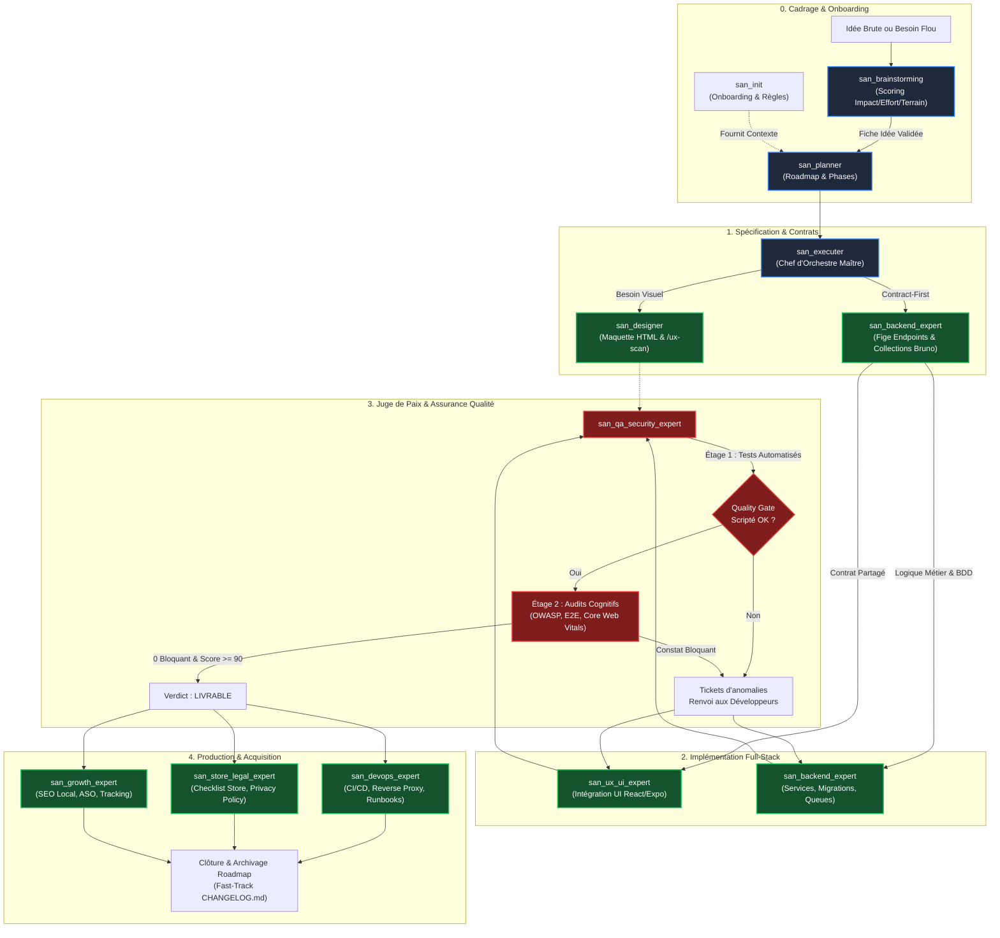

<p align="center">
  
</p>

# FRAMEWORK « GOOGLE ANTIGRAVITY » (`san_*`) — INDEX MAÎTRE D'ARCHITECTURE

> **Langue :** Français | [English version](README.en.md)  
> **Manifeste :** Système d'orchestration agentique et suite de compétences d'ingénierie logicielle pour Google Antigravity CLI (AGY).  
> **Auteur :** Alexsan.pro  
> **Cible :** Tout projet Full-Stack Web, Mobile ou API (React, Next.js, Expo, React Native, Laravel, AdonisJS, Node.js).  
> **Statut :** Architecture Modulaire Cartésienne — Spécification v2.0.  
> **Licence :** [MIT License](LICENSE)

---

## 1. VISION, ENJEUX & STACK TECHNIQUE

### Pourquoi ce framework ?
Sur chaque projet d'envergure, répéter manuellement les mêmes consignes d'architecture, d'hygiène de tests et de gestion de contexte engendre de l'amnésie, des disparités de qualité et du gaspillage de tokens :
- Demandes fonctionnelles floues aboutissant à des roadmaps inadaptées ;
- Code généré par IA superficiel (*anti-AI taste* : dégradés violet/indigo génériques, manque d'âme) ;
- Tâches cochées sans validation réelle sur le code ;
- Manque de résilience réseau (3G/EDGE instable, absence de mode hors-ligne, double dépense Mobile Money) ;
- Dispersion de la responsabilité des tests, de la sécurité et de la performance.

Le framework **`san_*`** transforme Antigravity en un **Tech Lead Senior & Organe d'Assurance Qualité complet** adapté aux réalités du terrain africain et international.

### Stack Technologique Souveraine (`alexsan.pro`)
* **Frontend Web :** React.js, TypeScript strict, Tailwind CSS, variables CSS natives, HTML5 sémantique.
* **Mobile Cross-Platform :** React Native, Expo (EAS), micro-interactions fluides 60 fps, retours haptiques (`expo-haptics`), stockage chiffré (`expo-secure-store`).
* **Backend & APIs :** PHP 8.x POO/SOLID, Laravel (dernière version), Node.js / AdonisJS sous TypeScript strict, architecture découplée (Actions/Services).
* **Données & Cache :** PostgreSQL avancé (`JSONB`, GIN, PostGIS), MySQL, Redis (verrous atomiques, files d'attente, cache, rate limiting).
* **Contrats d'Endpoints & Tests d'API :** Collections versionnées sous **Bruno** (`.bru`) avec assertions automatisées, interdisant tout mismatch de payload.
* **Infrastructure & Production :** CloudPanel, VPS Ubuntu, Nginx reverse proxy, PM2/Supervisor, Mailcow (délivrabilité e-mail stricte SPF/DKIM/DMARC/PTR).
* **Réalités Terrain (Afrique / Congo) :** Gestion des connexions 3G/EDGE instables, persistance Outbox avec `Idempotency-Key` sur Redis, gestion asynchrone des paiements Mobile Money (Airtel Money, MTN MoMo, callbacks STK/USSD et polling de réconciliation), adresses par repères urbains et partages profonds WhatsApp.

---

## 2. GOUVERNANCE AGENTIQUE & MÉCANISMES D'ORCHESTRATION

### A. Routage des Modèles (`invoke_subagent`)
Le framework exploite les capacités natives d'Antigravity CLI selon une politique stricte d'allocation :
1. **Session Principale (Orchestrateur & Raisonnement Global) :** Pilotée au sommet par le développeur selon sa propre cascade : nominalement avec **ARGON** configuré en raisonnement maximal (ex. `argon-latest-max` / `ARGON 4`), ou repli manuel sur un modèle **Pro** (`gemini-3.1-pro-high`) ou **Flash** (`gemini-3.8-flash-high`).
2. **Pôle « Cerveau, Architecture, Audit & Pentest » :** Invoqué nativement avec **`Model: 'inherit'`** pour hériter automatiquement de la puissance de raisonnement de la session principale (ou `'pro'` en fallback explicite).
3. **Pôle « Exécution Brute Atomique & Codeurs » :** Invoqué nativement avec **`Model: 'flash'`** (`gemini-3.8-flash-high`) pour maximiser la vitesse d'écriture, la précision de syntaxe et minimiser le coût en tokens.

### B. Délégation Ciblée & Fast-Track d'Hygiène
* **Délégation stricte :** L'orchestrateur ne code jamais les fonctionnalités métier et ne s'auto-audite pas. Toute l'implémentation est déléguée à des sous-agents d'exécution atomiques.
* **Fast-Track d'hygiène immédiat (sans sous-agent) :** L'orchestrateur est expressément autorisé à effectuer directement les opérations ménagères immédiates : cocher les cases `[x]` après vérification concluante d'un test, archiver le fichier de roadmap terminé (`mv`), ou consigner les entrées de mise à jour dans `CHANGELOG.md`.

### C. Entonnoir d'Audit en 2 Étages (Anti-Gaspillage de Tokens)
Avant toute validation, chaque composant ou endpoint passe par un entonnoir hermétique :
* **Étage 1 (Déterministe & Zéro-Token LLM) :** Lancement des scripts de contrôle automatisés (`front_quality_gate.sh`, `backend_quality_gate.sh`, `qa_security_gate.sh`). Si une erreur de typage (`tsc`), un test unitaire rouge ou un lint cassé survient, **aucun sous-agent d'audit n'est lancé** : l'erreur brute est directement renvoyée au sous-agent de code pour correction.
* **Étage 2 (Qualitatif LLM & Cognitif) :** Déploiement des sous-agents d'audit spécialisés (`Model: 'inherit'`) uniquement lorsque l'Étage 1 est validé à 100 %.

### D. Isolation Git Absolue (`.gitignore`)
Le dossier d'orchestration `.agents/` à la racine de chaque projet est **strictement ignoré par Git** (via `.gitignore` et `.git/info/exclude`). L'environnement personnel du développeur ne pollue jamais le dépôt distant et n'interfère pas avec les configurations d'autres collaborateurs.

---

## 3. CARTOGRAPHIE DES DOSSIERS

Le dépôt `san_agy_framework` structure la suite complète selon la séparation stricte entre les rôles maîtres, l'outillage transversal, la gouvernance de notre dépôt et les modules distribuables :

```txt
san_agy_framework/
├── package.json                        # Manifeste npm, binaires CLI (agy-framework & san-framework)
├── LICENSE                             # Licence officielle MIT Alexsan.pro
├── README.md                           # Index maître d'architecture et gouvernance (ce fichier)
├── README.en.md                        # Master Architecture Index (Version anglaise)
├── CHANGELOG.md                        # Journal des versions du framework (Keep a Changelog)
├── CHANGELOG.en.md                     # Framework Changelog (Version anglaise)
├── .gitignore                          # Isolation locale et hygiène Git
│
├── logos/                              # Identité visuelle officielle de la bibliothèque
│   ├── LOGO.md                         # Charte graphique et règles d'utilisation
│   ├── san_framework_logo.svg          # Logo officiel vectoriel (Symbole + Typographie)
│   ├── san_framework_icon.svg          # Icône / Favicon vectorielle
│   ├── san_framework_dark.svg          # Variante vectorielle pour fonds sombres
│   └── LOGO_ASCII.txt                  # Empreinte ASCII officielle (réservée au terminal CLI)
│
├── roadmaps/                           # Pilotage et ordonnancement interne du framework
│   ├── MVP_BUILD_FRAMEWORK_23102026.md # Roadmap active de développement
│   └── archives/                       # Roadmaps validées à 100% et archivées
│
├── skills/                             # SPÉCIFICATIONS DES RÔLES PRINCIPAUX (Atelier de conception)
│   ├── san_init.md                     # Onboarding, isolation Git, GEMINI.md et contextes
│   ├── san_brainstorming.md            # Cadrage amont, triage multicritères et maturation d'idées
│   ├── san_planner.md                  # Planification de projet, ordonnancement et roadmaps
│   ├── san_designer.md                 # Design visuel code-only, maquettes HTML/Tailwind, /ux-scan
│   ├── san_ux_ui_expert.md             # Lead Frontend Web & Mobile, anti-AI taste, 5 états UI
│   ├── san_backend_expert.md           # Lead Backend & Distributed Systems, APIs, Bruno, Idempotence
│   ├── san_executer.md                 # Chef d'orchestre Full-Stack, Contract-First et Delivery
│   ├── san_qa_security_expert.md       # Juge de paix unifié QA E2E, sécurité OWASP et performance
│   ├── san_devops_expert.md            # Infrastructure, CloudPanel, Mailcow, CI/CD et runbooks
│   ├── san_store_legal_expert.md       # Conformité stores Play/App Store, anti-rejet, légal
│   └── san_growth_expert.md            # SEO local, ASO stores, tracking analytics unifié
│
├── sub-skills/                         # SPÉCIFICATIONS DES SOUS-SKILLS TRANSVERSAUX
│   ├── san_subagent_manager.md         # Usine de conception, calibrage et supervision des sous-agents
│   ├── san_searcher.md                 # Documentaliste de précision, veille technique et scraping ciblé
│   ├── san_copywriter.md               # Plume UX, micro-copies empathiques, localisation et zéro Lorem Ipsum
│   ├── san_design_tokens.md            # Gardien de BRAND.md, tokens statiques et signature cinétique
│   ├── san_exporter.md                 # Capture headless Playwright, exports stores et SVG vers PNG
│   └── san_doc_keeper.md               # Gardien de CHANGELOG.md, README.md, archivage et fast-track
│
├── src/                                # LE PRODUIT DISTRIBUABLE (Déployé dans .agents/ chez le client)
│   ├── cli/                            # Moteur d'installation et CLI interactif universel
│   │   ├── index.js                    # Point d'entrée binaire (`agy-framework` / `san-framework`)
│   │   └── installer.js                # Moteur de copie, Smart Merge et hygiène Git
│   └── skills/                         # Les 17 modules exécutables packagés (SKILL.md, scripts, templates)
│       ├── san_init/                   # Initialisation, isolation Git et génération de contexte
│       ├── san_brainstorming/          # Cadrage d'idées, matrice de scoring 40 pts
│       ├── san_planner/                # Planification de projet et archivage strict
│       ├── san_subagent_manager/       # Calibrage de sous-agents chirurgicaux et prompts étanches
│       ├── san_searcher/               # Veille technique et scraper de documentations officielles
│       ├── san_doc_keeper/             # Versioning SemVer et intégrité documentaire
│       ├── san_copywriter/             # Plume UX, linter anti-Lorem et localisation de devises
│       ├── san_design_tokens/          # Compilateur de tokens BRAND.md vers CSS/Tailwind/TS
│       ├── san_exporter/               # Déclinaisons d'icônes et captures headless Playwright
│       ├── san_designer/               # Maquettes statiques haute fidélité et scanner /ux-scan
│       ├── san_ux_ui_expert/           # Lead Frontend Web & Mobile, résilience 3G et 5 états UI
│       ├── san_backend_expert/         # Architecture SOLID, collections Bruno et idempotence Redis
│       ├── san_executer/               # Chef d'orchestre Full-Stack et protocole Contract-First
│       ├── san_qa_security_expert/     # Juge de paix QA E2E, audits OWASP et benchmarks perf
│       ├── san_devops_expert/          # Runbooks CloudPanel/Mailcow, CI/CD et surveillance système
│       ├── san_store_legal_expert/     # Conformité stores Play/App Store et chartes juridiques
│       └── san_growth_expert/          # SEO local Afrique/Congo, ASO stores et plan de tracking
│
└── tests/                              # SUITES DE TESTS AUTOMATISÉES DE VALIDATION
    ├── phase3/                         # Tests d'isolation Git et archivage de roadmaps
    ├── phase4/                         # Tests des sous-skills transversaux (linter lorem, tokens)
    ├── phase5/                         # Tests des quality gates frontend et backend
    ├── phase6/                         # Tests des scanners de permissions et d'infrastructure
    └── phase7/                         # Tests automatisés du CLI et du moteur d'installation
```

> **Note sur le déploiement client :** Chez le client final, Antigravity CLI découvre tous les modules dans le dossier `.agents/skills/`. Les 17 compétences y sont donc déployées comme des modules de premier rang. La séparation entre `/skills` et `/sub-skills` n'existe que dans ce dépôt atelier à des fins de gouvernance architecturale.

---

## 4. INDEX DÉTAILLÉ DES SKILLS PRINCIPAUX (`/skills/`)

| Skill Principal | Rôle & Responsabilité Clé | Type d'Entry Point | Livrables Majeurs |
| :--- | :--- | :--- | :--- |
| [**`san_init`**](skills/san_init.md) | Initialisation, isolation Git, onboarding et rétro-ingénierie du contexte | Amont / Setup | `.agents/GEMINI.md`, `.agents/rules/*.md`, `.gitignore` |
| [**`san_brainstorming`**](skills/san_brainstorming.md) | Cadrage amont, triage d'idées et comparaison multicritères | Amont / Stratégie | `/roadmaps/ideas/[THEME]_[DATE].md` |
| [**`san_planner`**](skills/san_planner.md) | Planification de projet, ordonnancement par phases et auto-nettoyage | Amont / Pilotage | `/roadmaps/[PHASE]_[DATE].md`, `CHANGELOG.md` |
| [**`san_designer`**](skills/san_designer.md) | Conception d'écrans haute fidélité en code statique, design system | Visuel / UX | `/design/mockup/*`, `/design/screenshots/*` |
| [**`san_ux_ui_expert`**](skills/san_ux_ui_expert.md) | Ingénierie Frontend Web & Mobile, anti-IA taste, résilience 3G | Ingénierie Client | Pages React, Écrans React Native / Expo, tests Jest |
| [**`san_backend_expert`**](skills/san_backend_expert.md) | APIs REST/WebSockets, architecture SOLID, idempotence, BDD | Ingénierie Serveur | Code Laravel/Adonis, Collections Bruno, Migrations |
| [**`san_executer`**](skills/san_executer.md) | Chef d'orchestre d'implémentation Full-Stack (alias `san_execute`) | Moteur Central | Code Full-Stack synchronisé, Delivery E2E |
| [**`san_qa_security_expert`**](skills/san_qa_security_expert.md) | Juge de paix unique QA E2E, audit OWASP et benchmarks performance | Contrôle / Verdict | `docs/QA_REPORT.md`, `docs/SECURITY_REPORT.md` |
| [**`san_devops_expert`**](skills/san_devops_expert.md) | Infrastructure, CloudPanel, Mailcow, CI/CD, réversibilité | Exploitation / Infra | `docs/INFRA.md`, `docs/RUNBOOKS.md`, Pipelines CI/CD |
| [**`san_store_legal_expert`**](skills/san_store_legal_expert.md) | Conformité stores Google Play/Apple, anti-rejet, chartes légales | Légal / Publication | `docs/STORE_CHECKLIST.md`, `docs/PRIVACY_POLICY.md` |
| [**`san_growth_expert`**](skills/san_growth_expert.md) | SEO local Congo/Afrique, ASO fiches stores, plan de tracking | Acquisition / Mesure | `docs/SEO.md`, `docs/ASO.md`, `docs/TRACKING_PLAN.md` |

---

## 5. FLUX D'ORCHESTRATION GLOBAL (CYCLE DE VIE D'UNE FEATURE)

Le diagramme ci-dessous illustre l'ordonnancement rigoureux des compétences, de l'émergence d'une idée brute jusqu'à la mise en production et la mesure :



---

## 6. LES SOUS-SKILLS TRANSVERSAUX D'EXÉCUTION (`/sub-skills/`)

Alors que `/skills/` regroupe les rôles directeurs que le développeur déclenche pour piloter son projet, le dossier [`/sub-skills/`](sub-skills/) accueille les **briques techniques d'exécution spécialisées** appelées en coulisses par les skills principaux :

| Sous-Skill Transversal | Rôle & Spécialité Technique | Mobilisé Principalement Par | Livrables & Outils Clés |
| :--- | :--- | :--- | :--- |
| [**`san_subagent_manager`**](sub-skills/san_subagent_manager.md) | Usine de conception, calibrage et supervision de sous-agents chirurgicaux | `san_executer`, `san_planner`, `san_init`, tous | Prompts de sous-agents étanches, routage `flash`/`inherit` |
| [**`san_searcher`**](sub-skills/san_searcher.md) | Documentaliste de haute précision, veille technique et extraction de doc | `san_brainstorming`, `san_planner`, `san_growth_expert` | Fiches de recherche `docs/research/*.md`, veille APIs |
| [**`san_copywriter`**](sub-skills/san_copywriter.md) | Plume UX, micro-copies empathiques, localisation et zéro *Lorem Ipsum* | `san_designer`, `san_ux_ui_expert`, `san_growth_expert` | Textes réels, messages d'erreurs, fiches store ASO |
| [**`san_design_tokens`**](sub-skills/san_design_tokens.md) | Gardien de la source unique de vérité `BRAND.md` et de la signature cinétique | `san_designer`, `san_ux_ui_expert`, `san_init` | Compilateur tokens CSS/Tailwind/TS, audit anti-valeurs magiques |
| [**`san_exporter`**](sub-skills/san_exporter.md) | Pipeline de capture headless Playwright et déclinaison vectorielle SVG $\rightarrow$ PNG | `san_designer`, `san_growth_expert`, `san_init` | `scripts/export_png.mjs` (stores), `scripts/svg_to_png.mjs` |
| [**`san_doc_keeper`**](sub-skills/san_doc_keeper.md) | Gardien de l'intégrité documentaire, versioning SemVer et archivage | `san_planner`, `san_executer`, tous | `CHANGELOG.md`, `README.md`, Fast-Track d'hygiène |

---

## 7. INSTALLATION SUR UNE CODEBASE CLIENT

Le déploiement du framework s'effectue en une commande sur n'importe quel dépôt cible pour initialiser l'arborescence hermétique `.agents/` :

```bash
# Déploiement interactif via npx (aucune installation préalable requise)
npx @alexsan/agy-framework init

# Alias alternatif disponible
npx @alexsan/san-framework init
```

### A. Modes d'installation et Drapeaux CLI

Le CLI fonctionne soit sous forme d'assistant interactif pas-à-pas, soit en mode non-interactif scriptable via des drapeaux dédiés :

| Drapeau CLI | Description |
| :--- | :--- |
| `--local` | *(Défaut)* Déploie le framework dans l'espace hermétique local du projet (`./.agents/`). |
| `--global` | Déploie les compétences dans l'espace global utilisateur Antigravity (`~/.gemini/antigravity-cli/skills/`). |
| `--all` | Installe les 17 compétences sans confirmation interactive. |
| `--skills=<liste>` | Sélection granulaire de compétences séparées par des virgules (ex. `--skills=init,planner,qa,devops`). |
| `--dry-run` | Simule l'installation complète et affiche le rapport sans écrire aucun fichier sur le disque. |
| `--force` | Force l'écrasement des compétences déjà présentes dans le dossier cible. |
| `--opencode` | Génère en plus le contexte opencode (`AGENTS.md` + `opencode.json`) lors d'une installation locale. |
| `--help`, `-h` | Affiche l'aide complète et les exemples d'utilisation. |
| `--version`, `-v` | Affiche la version courante du framework. |

#### Exemples de commandes directes :

```bash
# Installation complète automatique dans le projet courant
npx @alexsan/agy-framework init --local --all

# Installation ciblée des modules de pilotage et de qualité
npx @alexsan/agy-framework init --skills=init,planner,qa_security_expert,backend_expert

# Simulation sans écriture pour vérifier les actions prévues
npx @alexsan/agy-framework init --dry-run
```

### C. Compatibilité opencode (`--opencode` & `update`)

Le framework fonctionne également avec **opencode**. Deux usages :

1. **Installation avec contexte opencode :** le drapeau `--opencode` génère, en plus de l'arborescence `.agents/`, la couche de contexte lue par opencode :
   - **`AGENTS.md`** à la racine — instructions auto-chargées (table de routage des 17 compétences, règles de gouvernance et orchestration).
   - **`opencode.json`** à la racine — `skills.paths: [".agents/skills"]` (découverte des compétences) et `instructions: [".agents/GEMINI.md"]`.

   ```bash
   npx @alexsan/agy-framework init --local --all --opencode
   ```

2. **Mise à jour d'un repo déjà déployé :** la commande `update` resynchronise les compétences et (re)génère la couche de contexte opencode sans toucher aux règles ni aux personnalisations existantes. Elle rend ainsi n'importe quelle codebase déjà équipée du framework immédiatement compréhensible par opencode :

   ```bash
   npx @alexsan/agy-framework update            # contexte opencode + resync
   npx @alexsan/agy-framework update --force    # régénère aussi AGENTS.md déjà généré
   npx @alexsan/agy-framework update --dry-run  # simulation sans écriture
   ```

   Après exécution, relancer opencode pour recharger le contexte et les compétences.

> **Smart Merge opencode :** un `AGENTS.md` personnalisé (sans le marqueur de génération) n'est jamais écrasé, et `opencode.json` est fusionné sans altérer les champs existants. En mode opencode, `AGENTS.md` reste committable (partage d'équipe) tandis que `.agents/` demeure hermétiquement isolé de Git.

### B. Mécanismes Clés du Moteur de Déploiement (`installer.js`)

1. **Smart Merge Normatif :**  
   Initialise les gabarits de règles fondamentaux (`BRAND.md`, `PRODUCT.md`, `PROJECT.md`, `API.md`, `LOGO.md`) et l'index maître `GEMINI.md` dans `.agents/rules/`. Si un fichier de règle existe déjà (personnalisé par le développeur), **il n'est jamais écrasé**.
2. **Isolation Hermétique & Hygiène Git :**  
   Injecte automatiquement un bloc inviolable dans `.gitignore` et `.git/info/exclude`. Si d'anciens fichiers de configuration d'agents étaient déjà traqués par mégarde, le CLI exécute automatiquement `git rm -r --cached` pour assainir l'index sans toucher à vos fichiers locaux.
3. **Purge Active Anti-Pollution :**  
   Nettoie les résidus d'outils et d'agents concurrents (`CLAUDE.md`, `.cursorrules`, `.windsurfrules`, `.copilot`, etc.) afin de garantir une totale pureté opérationnelle.
4. **Permissions d'Exécution Automatiques :**  
   Applique automatiquement les droits d'exécution (`chmod +x` / `0o755`) sur tous les scripts d'audit et utilitaires déployés (`scripts/*.sh`, `scripts/*.mjs`).

---

## 8. ORDRE DE CRÉATION & FEUILLE DE ROUTE D'IMPLÉMENTATION

1. [x] **Spécifications des 11 Skills Principaux** : Rédigés et validés dans [`/skills/`](skills/).
2. [x] **Spécifications des 6 Sous-Skills Transversaux** : Rédigés et validés dans [`/sub-skills/`](sub-skills/).
3. [x] **Identité Visuelle & Outillage de l'Atelier** : Logos vectoriels dans [`/logos/`](logos/), licence MIT et `CHANGELOG.md`.
4. [x] **Packaging du Socle Onboarding & Cadrage** : `san_init`, `san_brainstorming`, `san_planner` dans `src/skills/` (Tests Phase 3 validés).
5. [x] **Packaging des Sous-Skills Transversaux** : `san_subagent_manager`, `san_searcher`, `san_doc_keeper`, `san_copywriter`, `san_design_tokens`, `san_exporter` dans `src/skills/` (Tests Phase 4 validés).
6. [x] **Packaging du Pôle Visuel & Full-Stack** : `san_designer`, `san_ux_ui_expert`, `san_backend_expert`, `san_executer` dans `src/skills/` (Tests Phase 5 validés).
7. [x] **Packaging du Pôle Qualité, DevOps, Légal & Croissance** : `san_qa_security_expert`, `san_devops_expert`, `san_store_legal_expert`, `san_growth_expert` dans `src/skills/` (Tests Phase 6 validés).
8. [x] **Moteur d'Installation Universel CLI** : Distribution via `package.json`, CLI interactif `src/cli/index.js`, moteur `src/cli/installer.js` (Tests Phase 7 validés).
9. [x] **Validation Globale E2E & Release v1.0.0** : Suite de tests d'intégration 24/24 passée à 100 % au vert (`tests/phase8/test_e2e_full.sh`), roadmap MVP archivée et package v1.0.0 prêt pour publication npm.
10. [x] **Compatibilité opencode & Mise à jour (v1.1.0)** : Commande `update` et drapeau `--opencode` générant le contexte opencode (`AGENTS.md` + `opencode.json`), Smart Merge dédié et suite de tests Phase 9 validée à 100 %.

---

## 9. LICENCE

Ce projet est sous licence MIT — voir le fichier [`LICENSE`](LICENSE) pour plus de détails.  
Copyright (c) 2026 Alexsan.pro. Tous droits réservés.
