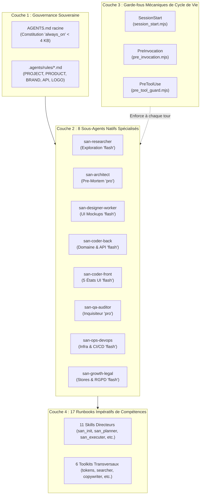
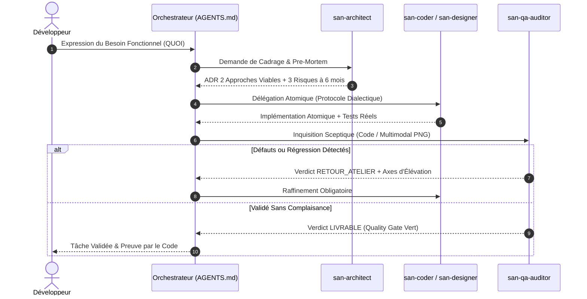

<p align="center">
  
</p>

# FRAMEWORK « GOOGLE ANTIGRAVITY » (`san_*`) — HARNESS AGENTIQUE & GOUVERNANCE COGNITIVE v2.0

> **Langue :** Français | [English version](README.en.md)  
> **Manifeste :** Système d'orchestration agentique déterministe, ingénierie du doute contradictoire et suite de compétences souveraine pour Google Antigravity CLI (AGY), Antigravity 2.0 / IDE et opencode.  
> **Auteur :** Alexsan.pro  
> **Statut :** Architecture Cartésienne en 4 Couches — Spécification Officielle v2.0.0.  
> **Licence :** [MIT License](LICENSE)

---

## 1. VISION, AMBITION & DOCTRINE v2.0

Sur des projets d'envergure, abandonner l'IA à des prompts conversationnels naïfs engendre inévitablement des régressions critiques :
- **Amnésie et dérive de contexte :** Oubli des contrats d'API, des standards d'accessibilité et des invariants d'architecture.
- **Complaisance du premier jet (*First-Draft Sycophancy*) :** Acceptation sans filtre de solutions plates, modèles de domaine anémiques, composants monolithiques de 500 lignes et dégradés pourpres/indigo génériques sans âme (*AI taste*).
- **Simulacre de tests (*Testing Theater*) :** Tâches validées hâtivement, suites de tests exécutées avec des contournements comme `--passWithNoTests`, mocks tautologiques qui testent le mock au lieu du domaine.
- **Fragilité opérationnelle :** Absence d'idempotence sur les transactions, blocages CORS en production, vulnérabilités de dépendances étouffées et non-prise en compte des réseaux dégradés.

La version **2.0.0** de `san_agy_framework` apporte une refonte systémique articulée autour d'une double ambition :

1. **Obéissance Mécanique (Zéro Friction de Prompt) :** L'utilisateur formule uniquement le **QUOI** (intention fonctionnelle, besoin métier, arbitrage stratégique). Le framework impose mécaniquement le **COMMENT** via des garde-fous de cycle de vie (`hooks.json`), des règles normatives chargées nativement et une délégation chirurgicale à des sous-agents atomiques.
2. **Excellence Cognitive & Créative Maximale (Zéro Médiocrité du 1er Jet) :** Implantation de l'**Ingénierie du Doute Contradictoire** (*Pre-Mortem*, *Dialectique 2 Approches*, *Visual Vision Loop sur Pixels Réels*, *Présomption de Défaut QA*) forçant les agents à challenger leurs propres hypothèses et à converger vers le plus haut standard d'ingénierie logicielle.

---

## 2. L'ARCHITECTURE v2.0 EN 4 COUCHES

Le framework structure son exécution sur 4 couches concentriques et étanches, garantissant que chaque décision d'agent est gouvernée, outillée et vérifiée :



### Couche 1 : Gouvernance Souveraine & Règles Normatives
* **Constitution Permanente `<root>/AGENTS.md` :** Déployé à la racine du projet sans frontmatter YAML pour activer le chargement inconditionnel `always_on` par Antigravity et `opencode`. Ce fichier compact (< 4096 octets) fixe les 6 lois d'airain de l'orchestrateur (zéro solo-coding, reconnaissance préalable, délégation atomique, dialectique avant frappe, contrat d'abord, preuve par code) et la table de routage automatique d'intention.
* **Règles Normatives Déclaratives `.agents/rules/*.md` :** 5 documents de référence équipés de frontmatters YAML officiels (`trigger: always_on`, `trigger: model_decision`, ou `trigger: glob`) :
  - [`PROJECT.md`](file://.agents/rules/PROJECT.md) : Profil technique du projet, stack souveraine et matrice d'allocation des modèles.
  - [`PRODUCT.md`](file://.agents/rules/PRODUCT.md) : Vision produit, invariants métier, personas et contraintes de marché.
  - [`BRAND.md`](file://.agents/rules/BRAND.md) : Tokens UI, archétype esthétique, tension typographique, accessibilité WCAG AAA et signature cinétique 60 fps.
  - [`API.md`](file://.agents/rules/API.md) : Contrats d'interfaces, enveloppe JSON standardisée, transactions ACID, idempotence et collections Bruno.
  - [`LOGO.md`](file://.agents/rules/LOGO.md) : Spécifications vectorielles maîtres et déclinaisons d'icônes multi-résolutions.

### Couche 2 : Les 8 Sous-Agents Natifs et Spécialisés
Fini les prompts génériques monolithiques. Le framework formalise 8 sous-agents autonomes déclarés dans `.agents/agents/*.md`, configurés avec les permissions et modèles optimaux :

| Sous-Agent Natif | Modèle Cible | Rôle & Responsabilité Clé | Compétences Attachées | Livrables Principaux |
| :--- | :--- | :--- | :--- | :--- |
| **`san-researcher`** | `flash` | Exploration cartographique, lecture seule, veille technique et documentation sans effet de bord. | `san_searcher` | Fiches de recherche, cartographies de code, synthèses d'APIs tierces. |
| **`san-architect`** | `pro` / `inherit` | Arbitrage d'architecture, modélisation de domaine et **Pre-Mortem** à 6 mois (2 approches viables sans option épouvantail). | `san_planner`, `san_backend_expert` | Architecture Decision Records (ADR), schémas de données, plans d'atténuation. |
| **`san-designer-worker`** | `flash` | Direction artistique code-only, composition HTML/Tailwind, archétypes visuels et rendu Playwright headless PNG. | `san_design_tokens`, `san_copywriter`, `san_exporter` | Maquettes statiques `/design/*.html`, captures PNG `/design/screenshots/*.png`. |
| **`san-coder-back`** | `flash` | Artisan backend atomique, protocoles API, logique métier encapsulée en transactions et tests de domaine réels. | `san_backend_expert` | Contrôleurs, services, migrations, collections Bruno, tests intégrés. |
| **`san-coder-front`** | `flash` | Artisan frontend web & mobile, modularité (< 220 lignes/fichier), accessibilité clavier et **chorégraphie des 5 états UI non-destructifs**. | `san_ux_ui_expert`, `san_copywriter`, `san_design_tokens` | Composants React/React Native, hooks typés, tests d'intégration DOM. |
| **`san-qa-auditor`** | `pro` / `inherit` | Inquisiteur sceptique en lecture seule, audit de substance des tests, **critique visuelle multimodale sur pixels réels PNG**, verdict binaire. | `san_qa_security_expert` | Verdict binaire `LIVRABLE` ou `RETOUR_ATELIER`, audits OWASP, rapports QA. |
| **`san-ops-devops`** | `flash` | Pipelines CI/CD, conteneurs Docker, serveurs web Nginx, CloudPanel, diagnostics d'infrastructure Fail-Closed. | `san_devops_expert` | Workflows GitHub Actions, Dockerfiles, runbooks d'exploitation, audits de santé. |
| **`san-growth-legal`** | `flash` | Conformité légale RGPD/e-Privacy, politiques de confidentialité, fiches stores ASO et instrumentation analytique. | `san_store_legal_expert`, `san_growth_expert` | Politiques de confidentialité, checklists stores, plans de tracking. |

### Couche 3 : Garde-fous Mécaniques du Cycle de Vie
Configurée dans `.agents/hooks.json`, cette couche intercepte les événements du moteur Antigravity pour verrouiller la discipline opérationnelle :
1. **`SessionStart` (`session_start.mjs`) :** Exécuté au lancement d'une session. Analyse le contexte du projet (`roadmaps/`, `PROJECT_PROFILE`), injecte le prompt système d'orchestration v2.0 et active la vigilance des 8 sous-agents.
2. **`PreInvocation` (`pre_invocation.mjs`) :** S'exécute avant chaque tour d'agent. Injecte un rappel éphémère (< 110 tokens, supprimé immédiatement de l'historique) rappelant l'interdiction du solo-coding inline et imposant l'étape de doute contradictoire avant toute validation.
3. **`PreToolUse` (`pre_tool_guard.mjs`) :** Intercepte les écritures et modifications de fichiers (`write_file`, `edit_file`) :
   - Bloque (`decision: "deny"`) tout archivage d'une roadmap dans `/roadmaps/archives/` contenant des tâches incomplètes (`- [ ]`).
   - Bloque (`decision: "deny"`) l'injection de faux-texte (*Lorem ipsum*, *dolor sit amet*) dans les dossiers de code et maquettes.
   - Préserve le contrôle utilisateur (`decision: "ask"`) pour toutes les modifications légitimes.

### Couche 4 : 17 Runbooks Impératifs de Compétences
Chaque module de compétence dans `.agents/skills/*/SKILL.md` a été refondu sous la forme d'un **Runbook impératif condensé ($\le 130$ lignes)**. Les explications verbeuses et encyclopédiques ont été déportées dans des dossiers spécialisés (`references/`, `templates/`, `scripts/`), laissant un en-tête orienté déclenchement d'intention et des instructions directes de délégation.

---

## 3. L'INGÉNIERIE DU DOUTE CONTRADICTOIRE (*DOUBT ENGINEERING*)

Pour éradiquer la médiocrité des solutions générées au premier jet, le framework formalise 4 protocoles cognitifs obligatoires :



### 1. Le Pre-Mortem Systémique (`san-architect`)
Avant de valider une architecture, un schéma de données ou une intégration structurante, `san-architect` simule une projection à 6 mois :
> *« Supposons que nous soyons dans 6 mois et que ce composant / cette API s'effondre en production. Quelles sont les 3 causes systémiques les plus probables de l'échec ? »*
Les 3 causes (concurrence d'écritures, volume de données imprévu, rupture de contrat client) doivent être traitées préventivement dans la conception avant toute écriture de code applicatif.

### 2. La Dialectique Avant Frappe (`san-coder-back`, `san-coder-front`)
Avant tout commit ou édition de code substantielle, le sous-agent d'implémentation doit formuler et confronter **2 approches viables distinctes** (par exemple : approche synchrone directe vs pipeline asynchrone Outbox avec Redis). L'invention d'une option d'épouvantail caricaturale est formellement interdite. Le choix retenu doit être justifié par des critères factuels de maintenabilité, typage et résilience.

### 3. La Boucle Visuelle Multimodale (*Visual Vision Loop*)
Le code CSS/HTML ne peut pas être jugé uniquement sur sa syntaxe textuelle. Le pôle design applique une boucle de rétroaction sur pixels réels :
1. `san-designer-worker` génère la maquette HTML/Tailwind basée sur l'archétype de `BRAND.md`.
2. Le script [`export_png.mjs`](file://src/skills/san_designer/scripts/export_png.mjs) monte un micro-serveur HTTP éphémère Node sur `127.0.0.1:0` et capture le rendu en PNG via Playwright headless sans blocage CORS.
3. **Étape d'Inspection Multimodale :** `san-qa-auditor` (`model: "pro"`) inspecte physiquement l'image PNG via l'outil `read_file`. Il examine l'équilibre des masses, la tension typographique, le contraste et le rythme Gestalt.
4. Au moins **une passe de raffinement esthétique** est exigée avant toute livraison au développeur.

### 4. L'Inquisition QA & Présomption de Défaut (`san-qa-auditor`)
`san-qa-auditor` agit avec une psychologie d'auditeur sceptique :
- **Présomption de vice caché :** Tout premier jet est présumé contenir un défaut de robustesse, un cas d'erreur non couvert ou un test de complaisance.
- **Tolérance Zéro au Testing Theater :** Rejet systématique des tests sans assertions réelles, des tests qui mockent leur propre sujet et des Quality Gates lancés avec des options de complaisance (`--passWithNoTests`, `|| true`).
- **Verdict Binaire Inviolable :** Le rapport se conclut exclusivement par `LIVRABLE` (prêt pour intégration) ou `RETOUR_ATELIER` (détail précis des régressions à corriger par l'artisan).

---

## 4. LES PROFILS CONTEXTUELS DE PROJET (`PROJECT_PROFILE`)

Le framework s'adapte sans friction à la réalité métier de votre projet via la variable `PROJECT_PROFILE` renseignée dans `.agents/rules/PROJECT.md` :

| Profil Contextuel | Cible Typique | Invariants Activés Spécifiquement | Contraintes Réseau & Métier |
| :--- | :--- | :--- | :--- |
| **`emerging_market`** | Fintechs, plateformes panafricaines, e-commerce local | Persistance Outbox locale, file d'attente Redis avec `Idempotency-Key`, gestion asynchrone des paiements Mobile Money (Airtel Money, MTN MoMo, callbacks STK/USSD et polling de réconciliation), repères géographiques urbains, partages WhatsApp. | Résilience réseau 3G/EDGE instable, mode hors-ligne, zéro double-débit. |
| **`global_saas`** | SaaS B2B/B2C international, plateformes cloud | Architecture multi-tenant hermétique, facturation Stripe/Paddle, gestion fine des autorisations (RBAC), haute disponibilité, observabilité et métriques. | Haute concurrence, conformité SOC2 / RGPD, temps de réponse p95 < 150ms. |
| **`mobile_consumer`** | Applications mobiles iOS & Android (React Native, Expo) | Micro-interactions fluides 60 fps, retours haptiques tactiles, stockage chiffré sécurisé (`expo-secure-store`), soumission anti-rejet Play Store et App Store. | Mode hors-ligne premier, consommation batterie minimale, UI tactile optimisée. |
| **`cli_devtools`** | Utilitaires en ligne de commande, SDKs, packages open-source | Codes de retour déterministes (POSIX 0/1), support strict des flux non-TTY, drapeaux `--json`, zéro dépendance inutile, démarrage instantané. | Rapidité d'exécution (< 200ms), compatibilité multi-OS, packaging npm/pip. |
| **`api_platform`** | Backends microservices, APIs publiques ou partenaires | Contrats OpenAPI 3.1 stricts, collections de tests Bruno automatisées, limitation de débit adaptative (Rate Limiting Redis), format JSON uniforme. | Versioning d'API rigoureux, isolation des transactions ACID, contrats immuables. |

---

## 5. CATALOGUE DES 17 RUNBOOKS DE COMPÉTENCES

Les 17 compétences sont réparties en 11 rôles directeurs et 6 toolkits transversaux d'exécution, tous déployés de plain-pied dans `.agents/skills/` :

### A. Les 11 Compétences Directrices

| Compétence | Déclencheur Naturel d'Intention | Rôle Clé | Livrables & Outils Déterminants |
| :--- | :--- | :--- | :--- |
| [**`san_init`**](file://skills/san_init.md) | *"Initialiser le projet"*, *"Configurer les agents"* | Setup, onboarding, isolation Git et génération du contexte | `<root>/AGENTS.md`, `.agents/rules/*.md`, `git_ai_hygiene.sh` |
| [**`san_brainstorming`**](file://skills/san_brainstorming.md) | *"Brainstormer"*, *"Évaluer cette idée"*, *"Cadrer le besoin"* | Triage d'idées, matrice de scoring 40 pts contextuelle | `roadmaps/ideas/*.md`, `score_idea.py` |
| [**`san_planner`**](file://skills/san_planner.md) | *"Créer la roadmap"*, *"Planifier la phase suivante"* | Découpage en phases atomiques et archivage déterministe | `roadmaps/*.md`, `archive_roadmap.sh` |
| [**`san_designer`**](file://skills/san_designer.md) | *"Designer l'écran"*, *"Créer la maquette"*, *"Audit visuel"* | Maquettes HTML/Tailwind statiques, capture headless PNG | `/design/*.html`, `export_png.mjs`, `/ux-scan` |
| [**`san_ux_ui_expert`**](file://skills/san_ux_ui_expert.md) | *"Intégrer le composant UI"*, *"Corriger l'accessibilité"* | Lead Frontend Web & Mobile, chorégraphie 5 états non-destructifs | Composants React/Expo, `front_quality_gate.sh` |
| [**`san_backend_expert`**](file://skills/san_backend_expert.md) | *"Créer l'API"*, *"Ajouter l'endpoint"*, *"Modéliser la BDD"* | Lead Backend, transactions ACID, idempotence et contrats API | Modèles, Services, Bruno `.bru`, `backend_quality_gate.sh` |
| [**`san_executer`**](file://skills/san_executer.md) | *"Exécuter la roadmap"*, *"Livrer le lot N"*, *"Coder la feature"* | Chef d'orchestre d'implémentation Contract-First & E2E | Code synchronisé, `e2e_verification_gate.sh` |
| [**`san_qa_security_expert`**](file://skills/san_qa_security_expert.md) | *"Auditer la sécurité"*, *"Lancer les tests QA"* | Juge de paix QA unifié, audits OWASP, benchmarks et secrets | `qa_security_gate.sh`, `docs/QA_REPORT.md` |
| [**`san_devops_expert`**](file://skills/san_devops_expert.md) | *"Configurer la CI/CD"*, *"Déployer"*, *"Vérifier le serveur"* | Infrastructure CloudPanel, Docker, Nginx, Mailcow, CI/CD | `.github/workflows/*`, `infra_health_check.sh` |
| [**`san_store_legal_expert`**](file://skills/san_store_legal_expert.md) | *"Préparer la mise sur les stores"*, *"Conformité RGPD"* | Conformité Google Play / Apple Store, chartes juridiques | `docs/STORE_CHECKLIST.md`, `PRIVACY_POLICY.md` |
| [**`san_growth_expert`**](file://skills/san_growth_expert.md) | *"Optimiser le SEO"*, *"Plan de tracking"*, *"Fiche ASO"* | Référencement naturel, ASO des stores, tracking analytics | `docs/SEO.md`, `docs/TRACKING_PLAN.md` |

### B. Les 6 Toolkits Transversaux

| Toolkit Transversal | Spécialité Technique | Livrables & Scripts Associés |
| :--- | :--- | :--- |
| [**`san_subagent_manager`**](file://sub-skills/san_subagent_manager.md) | Calibrage et supervision de sous-agents chirurgicaux | Prompts atomiques étanches, clauses 2-approches et présomption de défaut |
| [**`san_searcher`**](file://sub-skills/san_searcher.md) | Veille documentaire de haute précision et extraction propre | `doc_scraper.sh`, `detect_stack_versions.sh`, synthèses `docs/research/*.md` |
| [**`san_copywriter`**](file://sub-skills/san_copywriter.md) | Micro-copies UX réelles, humanisation et linter anti-faux-texte | `check_lorem.sh`, zéro *Lorem Ipsum*, messages d'erreur contextualisés |
| [**`san_design_tokens`**](file://sub-skills/san_design_tokens.md) | Gardien de `BRAND.md` et validation des contrastes WCAG AAA | `build_tokens.mjs`, `audit_magic_values.sh`, CSS variables unifiées |
| [**`san_exporter`**](file://sub-skills/san_exporter.md) | Pipeline de capture Playwright et conversion vectorielle SVG $\rightarrow$ PNG | `export_png.mjs` (serveur HTTP local éphémère), `svg_to_png.mjs` |
| [**`san_doc_keeper`**](file://sub-skills/san_doc_keeper.md) | Gardien de l'intégrité documentaire et du versioning SemVer | Maintien de `README.md`, `CHANGELOG.md` et Fast-Track d'hygiène |

---

## 6. LE GUIDE CLI UNIVERSEL v2.0

Le framework se pilote et se déploie via les commandes officielles `san-framework` (ou son alias `agy-framework`) :

```bash
# Exécution directe via npx (sans installation préalable requise)
npx @alexsan/agy-framework <commande> [options]

# Ou via binaire global si installé
san-framework <commande> [options]
```

### A. Les 4 Commandes Officielles

#### 1. `san-framework init --local`
Déploie l'architecture complète en 4 couches dans l'espace hermétique `./.agents/` de votre projet et génère le fichier `<root>/AGENTS.md` souverain.
- **Smart Merge Normatif :** Analyse les règles existantes dans `.agents/rules/` (`PROJECT.md`, `BRAND.md`, etc.). Si un fichier personnalisé est déjà présent, le CLI injecte automatiquement le frontmatter YAML requis **sans jamais écraser vos spécifications métier**.
- **Sauvegarde Réversible :** Si d'anciens résidus d'outils IA concurrents (`CLAUDE.md`, `.cursorrules`) sont détectés, ils sont déplacés en toute sécurité dans `.agents/backups/legacy-ai-configs/<timestamp>/` au lieu d'être détruits.
- **Verrouillage Git Hermétique :** Isole bidirectionnellement `.agents/` dans `.gitignore` et `.git/info/exclude`.

```bash
# Déploiement local complet non-interactif
san-framework init --local --all

# Déploiement ciblé d'une sélection de skills
san-framework init --local --skills=san_init,san_planner,san_executer,san_qa_security_expert
```

#### 2. `san-framework init --global`
Assemble et installe le package sous forme de **Plugin officiel complet Antigravity** dans le répertoire utilisateur global (`~/.gemini/antigravity-cli/plugins/san-framework/`).
- Package validé à 100 % par la commande officielle Antigravity : `agy plugin validate --strict`.
- Inclut le manifeste `plugin.json`, le logo vectoriel, les 8 sous-agents, les 3 hooks de cycle de vie et les 17 skills exécutables.

```bash
san-framework init --global --all
```

#### 3. `san-framework update`
Effectue une **migration instantanée et non-destructive** de n'importe quel projet v1.x vers l'architecture v2.0 :
- Met à niveau les 17 skills vers leurs runbooks impératifs $\le 130$ lignes.
- Installe les 8 définitions de sous-agents natifs dans `.agents/agents/`.
- Installe le gestionnaire de hooks `.agents/hooks.json` et les 3 scripts de contrôle.
- Injecte les frontmatters YAML officiels dans `.agents/rules/*.md` sans altérer vos textes de configuration existants.
- Régénère `<root>/AGENTS.md` et supprime l'ancien fichier obsolète `.agents/rules.json`.

```bash
san-framework update
```

#### 4. `san-framework doctor`
Exécute un audit déterministe et infalsifiable des **6 piliers de santé** de l'installation sur le projet cible :

```bash
san-framework doctor
```

Le diagnostic vérifie et rapporte avec précision :
1. **Gouvernance Souveraine :** Présence et conformité de `<root>/AGENTS.md` (taille < 4 KB, sans frontmatter).
2. **Règles Normatives :** Présence des 5 fichiers dans `.agents/rules/` avec frontmatters YAML valides.
3. **Sous-Agents Natifs :** Présence des 8 sous-agents dans `.agents/agents/*.md`.
4. **Garde-fous de Cycle de Vie :** Présence de `.agents/hooks.json` et droits d'exécution sur les 3 scripts `.mjs`.
5. **Catalogue des 17 Skills :** Vérification de la compacité de chaque `SKILL.md` ($\le 130$ lignes).
6. **Étanchéité Git :** Vérification de l'isolation hermétique dans `.gitignore` ou `.git/info/exclude`.

*Code retour : `0` si l'ensemble des piliers sont conformes, `1` si des anomalies sont détectées (avec conseils de remédiation automatique).*

### B. Tableau Récapitulatif des Drapeaux CLI

| Drapeau CLI | Rôle & Comportement |
| :--- | :--- |
| `--local` | Déploie le framework dans le projet local (`./.agents/`) [Option par défaut en mode script]. |
| `--global` | Assemble le Plugin global dans le répertoire utilisateur Antigravity CLI. |
| `--all` | Installe l'intégralité des 17 compétences sans confirmation interactive. |
| `--skills=<liste>` | Sélection granulaire de compétences séparées par des virgules. |
| `--dry-run` | Mode simulation complète : affiche les actions prévues sans écrire aucun fichier. |
| `--force` | Force la réécriture et le remplacement des composants existants. |
| `--opencode` | Génère également la configuration et le contexte `opencode.json` à la racine. |
| `--dir=<chemin>` | Spécifie explicitement le répertoire cible d'installation. |
| `--version`, `-v` | Affiche le numéro de version courante (`2.0.0`). |
| `--help`, `-h` | Affiche l'aide complète et la liste des commandes. |

---

## 7. CARTOGRAPHIE DU DÉPÔT

```txt
san_agy_framework/
├── package.json                        # Manifeste npm, binaires CLI (san-framework & agy-framework)
├── LICENSE                             # Licence officielle MIT Alexsan.pro
├── README.md                           # Index maître d'architecture v2.0 (ce fichier)
├── README.en.md                        # Master Architecture Index v2.0 (Version anglaise)
├── CHANGELOG.md                        # Journal des versions (norme Keep a Changelog)
├── CHANGELOG.en.md                     # Release Changelog (Version anglaise)
├── .gitignore                          # Isolation locale et hygiène Git
│
├── logos/                              # Identité visuelle vectorielle
│   ├── LOGO.md                         # Charte graphique et règles d'utilisation
│   ├── san_framework_logo.svg          # Logo officiel (Symbole + Typographie)
│   ├── san_framework_icon.svg          # Icône vectorielle / Favicon
│   └── san_framework_dark.svg          # Variante vectorielle pour fonds sombres
│
├── roadmaps/                           # Pilotage et ordonnancement interne
│   ├── V2_HARNESS_ENFORCEMENT_31102026.md # Roadmap active de développement v2.0
│   └── archives/                       # Roadmaps validées à 100 % et archivées
│
├── src/                                # LE PRODUIT DISTRIBUABLE (Package v2.0)
│   ├── agents/                         # Définitions des 8 sous-agents natifs Antigravity
│   │   ├── san-researcher.md           # Exploration, lecture seule, veille technique
│   │   ├── san-architect.md            # Pre-Mortem à 6 mois, arbitrage 2 approches, ADR
│   │   ├── san-designer-worker.md      # Direction artistique HTML/Tailwind, exports PNG
│   │   ├── san-coder-back.md           # Backend atomique, transactions, tests de domaine
│   │   ├── san-coder-front.md          # Frontend modulaire, 5 états UI, accessibilité
│   │   ├── san-qa-auditor.md           # Inquisiteur QA sceptique, critique vision multimodale
│   │   ├── san-ops-devops.md           # CI/CD, conteneurs, diagnostics d'infrastructure
│   │   └── san-growth-legal.md         # RGPD, conformité des stores, SEO/ASO
│   │
│   ├── hooks/                          # Garde-fous mécaniques de cycle de vie
│   │   ├── hooks.json                  # Déclaration des hooks SessionStart, PreInvocation, PreToolUse
│   │   └── scripts/                    # Scripts exécutables déterministes (session_start, etc.)
│   │
│   ├── plugin/                         # Bundle Plugin officiel Antigravity
│   │   ├── plugin.json                 # Manifeste officiel compatible 'agy plugin validate'
│   │   └── assets/logo.svg             # Logo officiel packagé
│   │
│   ├── cli/                            # Moteur d'installation et de diagnostic universel
│   │   ├── index.js                    # Point d'entrée exécutable (Commandes init, update, doctor)
│   │   └── installer.js                # Logique de copie, Smart Merge, sauvegardes et doctor
│   │
│   └── skills/                         # Les 17 runbooks exécutables packagés (SKILL.md <= 130 lignes)
│       ├── san_init/                   # Initialisation, règles et constitution souveraine
│       ├── san_brainstorming/          # Cadrage d'idées, scoring multicritères 40 pts
│       ├── san_planner/                # Planification de projet, ordonnancement et archivage
│       ├── san_subagent_manager/       # Gestionnaire et calibration de sous-agents
│       ├── san_searcher/               # Veille technique et scraping ciblé
│       ├── san_designer/               # Maquettes statiques et export PNG headless
│       ├── san_copywriter/             # Micro-copies UX réelles et détection de faux-texte
│       ├── san_design_tokens/          # Tokens graphiques et compilation de contrastes
│       ├── san_ux_ui_expert/           # Lead Frontend, accessibilité et 5 états UI
│       ├── san_backend_expert/         # Lead Backend, protocoles API et idempotence
│       ├── san_executer/               # Chef d'orchestre Full-Stack et Contract-First
│       ├── san_qa_security_expert/     # Juge de paix QA E2E, audits OWASP et benchmarks
│       ├── san_exporter/               # Déclinaisons graphiques et pipeline de capture
│       ├── san_devops_expert/          # Runbooks infrastructure, Nginx, Docker, CI/CD
│       ├── san_store_legal_expert/     # Conformité stores Play/App Store et chartes légales
│       ├── san_growth_expert/          # SEO local, fiches stores ASO et tracking plan
│       └── san_doc_keeper/             # Maintenance documentaire et hygiène de versions
│
└── tests/                              # SUITES DE TESTS AUTOMATISÉES DE VALIDATION
    ├── phase3/ à phase9/               # Suites de régression v1.x
    └── v2/                             # Suites de validation déterministes v2.0 (Phases 1 à 6 & E2E)
```

---

## 8. LICENCE

Ce projet est sous licence MIT — voir le fichier [`LICENSE`](LICENSE) pour plus de détails.  
Copyright (c) 2026 Alexsan.pro. Tous droits réservés.
