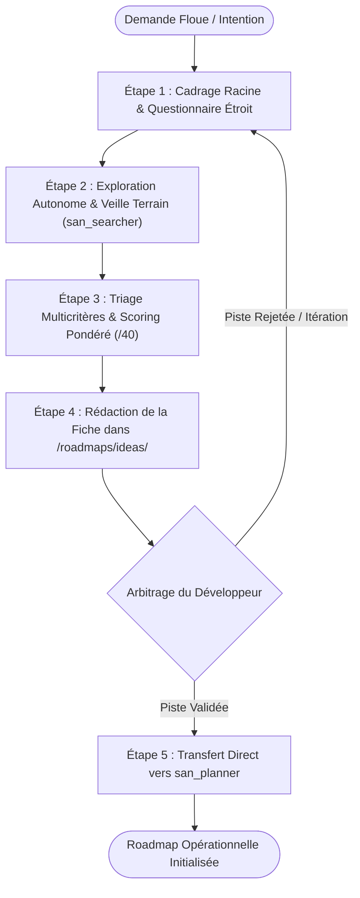
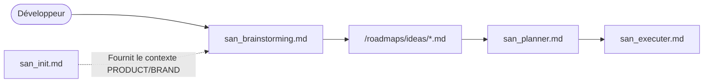

# `san_brainstorming` — Spécialiste de l'Idéation Amont, du Cadrage Stratégique et du Triage d'Idées

## 1. RÔLE, POUR QUI, POUR QUOI

### Rôle Fondamental
`san_brainstorming` est le **moteur d'idéation amont, d'exploration stratégique et de triage rationnel** du framework **Antigravity (`san_*`)**. Positionné avant toute phase de planification d'ingénierie, son rôle est d'absorber une intention floue, une intuition d'entrepreneur ou un besoin produit mal défini (ex: *« fais une landing page à 10 000 USD »*, *« comment monétiser notre bot WhatsApp ? »*, *« comment intégrer le Mobile Money sans friction ? »*), de la passer au crible d'une analyse cartésienne et de produire des pistes de solutions structurées, comparées et scorées.

### Pour Qui ?
- Pour le développeur-entrepreneur, créateur de produit (indie hacker ou solopreneur) explorant de nouveaux marchés, modèles économiques ou fonctionnalités innovantes.
- Pour le tech lead ou product manager confronté à des exigences métier vagues nécessitant une clarification amont avant d'engager le travail de développement.

### Pour Quoi ?
- Éliminer le gaspillage de tokens et de temps d'ingénierie provoqué par le lancement hâtif de roadmaps sur des bases floues ou instables.
- Confronter immédiatement les intuitions aux contraintes d'exécution réelles (faisabilité technique, réalité du terrain local, bande passante dégradée, habitudes culturelles d'usage).
- Livrer un dossier d'idées clair permettant au décideur humain d'arbitrer en pleine connaissance de cause avant d'activer [san_planner](san_planner.md).

---

## 2. CE QU'IL FAIT / CE QU'IL NE FAIT PAS

### Ce qu'il FAIT :
1. **Clarification par l'Entonnoir Socratique :** Déploie un questionnaire ciblé pour circonscrire le problème racine, les bénéficiaires finaux et les métriques de réussite.
2. **Veille & Exploration Marché Autonome :** Mobilise des sous-agents de recherche (`Model: 'inherit'`) via `san_searcher` pour scruter la concurrence locale et internationale, les signaux faibles, les documentations et les benchmarks sectoriels.
3. **Analyse Multicritères Rigoureuse :** Évalue chaque piste retenue selon une grille à 4 axes :
   - **Impact Business (/10) :** Valeur ajoutée perçue, potentiel de monétisation, rétention, viralité.
   - **Effort Technique (/10) :** Complexité architecturale, maintenabilité, dépendances tierces, temps de build.
   - **Réalité Terrain Locale (/10) :** Adéquation aux contraintes africaines/congolaises (connexion mobile 3G/EDGE instable, téléphones d'entrée de gamme Android, friction Mobile Money USSD/STK Push, réflexes WhatsApp, primauté de la confiance en économie de cash).
   - **Risques & Dépendances (/10) :** Réglementation financière/fintech, dépendance à des APIs externes, risques de fraude, blocages de publication store.
4. **Formalisation Standardisée :** Rédige une fiche d'idées exhaustive dans `/roadmaps/ideas/[THEME]_[JJMMAAAA].md`.
5. **Recommandation Neutre & Argumentée :** Synthétise les arbitrages et met en évidence la trajectoire la plus efficiente (MVP pragmatique).
6. **Passage de Relais Opérationnel :** Prépare un résumé exécutif structuré prêt à être injecté directement dans [san_planner](san_planner.md).

### Ce qu'il NE FAIT PAS :
- **Il ne planifie pas les tâches d'ingénierie :** Il ne rédige pas le découpage technique détaillé ni les phases d'implémentation (domaine exclusif de [san_planner](san_planner.md)).
- **Il ne code aucun composant ni maquette :** Zéro implémentation logicielle, zéro design HTML ou CSS (délégués à [san_designer](san_designer.md), [san_ux_ui_expert](san_ux_ui_expert.md), [san_backend_expert](san_backend_expert.md)).
- **Il ne prend JAMAIS la décision finale :** L'arbitrage final appartient toujours au développeur ; l'IA éclaire et conseille, elle ne s'auto-valide pas.
- **Il n'accepte aucune idée sans preuve terrain :** Rejet systématique des concepts « séduisants sur le papier » mais inapplicables sur le terrain réel.
- **Il ne cède pas au biais technologique :** Pas de surenchère de microservices, d'IA complexe ou d'architectures lourdes quand une solution simple et éprouvée répond au besoin.

---

## 3. DÉCLENCHEURS & INVOCATIONS CONCRÈTES

### Déclencheurs Vocaux / Textuels
Le skill est mobilisé dès qu'une intention est encore au stade exploratoire ou nécessite un cadrage stratégique :
- `san_brainstorming`
- `brainstorme sur [sujet]`
- `explore les pistes pour [problématique]`
- `cadrage idée [thème]`
- `compare les options pour [feature]`
- `aide-moi à structurer mon MVP pour [produit]`

### Exemples d'Invocations CLI / Chat
```bash
# Cadrage amont d'une idée floue
agy "san_brainstorming : comment monétiser une application de livraison à Brazzaville sans forcer la carte bancaire ?"

# Exploration d'une feature technique et UX complexe
agy "san_brainstorming : étudie les meilleures approches pour l'onboarding WhatsApp vs Application Mobile native pour les commerçants locaux"

# Déclenchement automatique par san_planner
# (san_planner redirige vers san_brainstorming lorsque les prérequis d'une roadmap sont incomplets)
```

---

## 4. STRUCTURE INTERNE DU SKILL

L'arborescence normative du skill dans le framework Antigravity est la suivante :

```txt
.agents/skills/san_brainstorming/
├── SKILL.md                                 # Manifeste, méthodologie de questionnement et scoring
├── references/
│   ├── ideation_scoring_matrix.md           # Grille détaillée de pondération Impact / Effort / Terrain / Risque
│   └── congo_market_signals.md              # Référentiel des comportements, frictions et signaux locaux
├── templates/
│   └── IDEA_TEMPLATE.md                     # Modèle officiel de fiche d'idée /roadmaps/ideas/*.md
└── scripts/
    └── score_ideas.py                       # Script optionnel d'aide au calcul et rendu du tableau comparatif
```

---

## 5. LIVRABLES EXACTS

Le livrable unique et normé produit par `san_brainstorming` est déposé dans le répertoire `/roadmaps/ideas/` à la racine du projet :

```txt
<dir>/
└── roadmaps/
    └── ideas/
        └── [THEME]_[JJMMAAAA].md            # Fiche d'idée structurée et scorée
```

### Conventions de Nommage :
- **Chemin :** `/roadmaps/ideas/`
- **Nom de fichier :** Tout en majuscules, mots séparés par des underscores, suffixé par la date du jour au format `JJMMAAAA`.
- **Exemples :**
  - `/roadmaps/ideas/ONBOARDING_WHATSAPP_MERCAT_23102026.md`
  - `/roadmaps/ideas/MONETISATION_LIVRAISON_LOCAL_24102026.md`
  - `/roadmaps/ideas/ARCHITECTURE_SYNC_OFFLINE_25102026.md`

### Structure Standard d'une Fiche d'Idée (`IDEA_TEMPLATE.md`) :
1. **En-tête & Métadonnées :** Thème, date, auteur, statut (`EN_COURS`, `PROPOSÉ`, `VALIDÉ`, `REJETÉ`).
2. **Problématique Racine :** Ce qui fait mal aujourd'hui, pourquoi les solutions actuelles échouent.
3. **Cible Utilisateur & Réalité Terrain :** Personas, device type, bande passante (3G/EDGE), mode de transaction habituel.
4. **Pistes Envisagées (Option A, Option B, Option C) :**
   - Description du concept.
   - Hypothèse de valeur.
   - Architecture technique simplifiée.
5. **Matrice Comparative Scorée :** Tableau synthétique reprenant Impact, Effort, Terrain, Risque et Score Global sur `/40`.
6. **Recommandation Stratégique & Arbitrage Développeur :** Avis motivé du framework et questions d'arbitrage fermées posées à l'humain.
7. **Bordereau de Transfert vers [san_planner](san_planner.md) :** Objectifs prioritaires, MVP délimité, prérequis techniques identifiés.

---

## 6. PROCÉDURE ÉTAPE PAR ÉTAPE (ZÉRO NÉGLIGENCE)



### Étape 1 : Cadrage Racine & Questionnaire Étroit
1. **Analyse de l'Intention Initiale :** Décomposer la demande brute.
2. **Entonnoir de Questionnement :**
   - Si des angles morts majeurs subsistent, poser un questionnaire concis au développeur (maximum 3 à 4 questions fermées ou à choix multiples) :
     - *Quel est l'objectif premier : valider un usage, générer du chiffre d'affaires immédiat ou tester une brique technique ?*
     - *Quelle est la cible prioritaire et son équipement type ?*
     - *Quelles sont les dépendances tierces incontournables (ex: passerelle Mobile Money spécifique, WhatsApp Cloud API) ?*
3. **Lecture du Contexte Projet :** Si `.agents/rules/PRODUCT.md` ou `BRAND.md` existent déjà, en extraire la vision pour éviter de reposer des questions déjà tranchées.

---

### Étape 2 : Exploration Autonome & Veille Terrain
Déployer des sous-agents d'investigation propulsés par **`Model: 'inherit'`** (pour bénéficier de la puissance de raisonnement de la session principale) :
1. **Recherche de Marché & Benchmarks (via `san_searcher`) :**
   - Identifier comment des acteurs similaires en Afrique francophone ou sur d'autres marchés émergents ont résolu l'équation.
   - Analyser les patterns d'échec connus (ex: frictions d'inscription par e-mail rejetées par les utilisateurs n'ayant pas de compte e-mail actif).
2. **Contrôle de Réalité Terrain :**
   - Confrontation aux contraintes de connectivité : comportement hors couverture, poids des payloads, coût de la data pour l'utilisateur.
   - Confrontation aux réalités financières : disponibilité des APIs Mobile Money (MTN MoMo, Airtel Money), délais de validation USSD, taux d'abandon.

---

### Étape 3 : Triage Multicritères & Scoring Pondéré
Pour chaque piste identifiée (au moins 2 à 3 alternatives distinctes), établir une notation rigoureuse sur 10 points par critère :

| Critère | Poids | Description / Barème d'Évaluation |
| :--- | :---: | :--- |
| **Impact Business** | 25% | Note de 1 (négligeable) à 10 (transformationnel pour le modèle ou l'adoption). |
| **Effort Technique** | 25% | Note inversée : 10 (très rapide / MVP 24-48h) à 1 (chantier lourd de plusieurs mois). |
| **Réalité Terrain** | 30% | Note de 1 (inadapté au réseau local ou aux habitudes) à 10 (parfaitement ancré dans les usages réels). |
| **Risques & Dépendances** | 20% | Note inversée : 10 (zéro risque légal/API) à 1 (forte exposition réglementaire ou dépendance fragile). |

- **Calcul du Score Global :** Somme normalisée sur `/40` (ou `/100`).
- **Seuil d'Exclusion :** Toute option obtenant une note $< 4/10$ sur la *Réalité Terrain* ou $< 3/10$ sur les *Risques* est immédiatement classée comme **NON RECOMMANDÉE**, quel que soit son potentiel théorique.

---

### Étape 4 : Rédaction de la Fiche d'Idée & Recommandation
1. **Génération du Fichier :** Écrire le rapport complet dans `/roadmaps/ideas/[THEME]_[JJMMAAAA].md` avec rigueur typographique et structurelle.
2. **Avis d'Assurance Qualité Stratégique :** Rédiger un avis clair :
   - *Piste préconisée pour le MVP* ;
   - *Pistes écartées avec justification rationnelle* ;
   - *Points d'ombre à surveiller*.
3. **Restitution au Développeur :** Présenter la synthèse en chat de manière concise et solliciter l'arbitrage formel : *« Validez-vous la Piste A pour lancement de la roadmap par [san_planner](san_planner.md) ? »*.

---

### Étape 5 : Clôture & Passage de Relais Opérationnel
Dès la validation de la piste par le développeur :
1. Mettre à jour le statut dans la fiche d'idée (`Statut: VALIDÉ - Piste A`).
2. Transmettre le contenu du paragraphe *Bordereau de Transfert* à [san_planner](san_planner.md).
3. [san_planner](san_planner.md) prend le relais immédiat pour concevoir la roadmap technique dans `/roadmaps/`.

---

## 7. PRINCIPES DIRECTEURS ET INVARIANTS

### 1. Invariant de Sobriété Décisionnelle (Anti-Biais d'Engouement)
Une idée séduisante technologiquement (ex: reconnaissance faciale, modèle d'IA générative embarqué, blockchain) mais confrontée à un smartphone d'entrée de gamme Android à 1 Go de RAM sous réseau 3G instable doit être sanctionnée sans complaisance lors de la notation.

### 2. Invariant de Neutralité et d'Indépendance
Le skill ne « vend » pas de solution. Il agit comme un conseiller stratégique intransigeant. Il signale explicitement les coûts réels de maintenance, les frais de passerelles de paiement, les risques de suspension de compte store et les goulets d'étranglement opérationnels.

### 3. Invariant d'Ancrage Terrain Africain / Congolais
Chaque analyse d'idée doit impérativement confronter la proposition de valeur aux spécificités du contexte cible :
- Primauté du mobile et de WhatsApp sur le Web de bureau ;
- Rareté ou méfiance envers les cartes bancaires internationales ;
- Coût élevé de la data pour le client final ;
- Repérage géographique par points de repère urbains plutôt que par adresses postales formelles.

### 4. Invariant de Fluidité vers la Planification
Une fiche d'idée ne doit jamais rester un document « mort ». Elle est rédigée dès l'origine pour s'emboîter sans friction dans le moule de [san_planner](san_planner.md).

---

## 8. MATRICE DE BRANCHEMENT ET RÉFÉRENCES CROISÉES



### Amont :
- **Développeur :** Expression d'une problématique nouvelle ou d'un besoin flou.
- [san_init](san_init.md) : Fournit le contexte business de `.agents/rules/PRODUCT.md` et les conventions techniques de `PROJECT.md`.
- [san_planner](san_planner.md) : Redirige vers `san_brainstorming` si une demande d'ingénierie soumise manque de maturité ou de clarté conceptuelle.

### Aval :
- [san_planner](san_planner.md) : Consomme la fiche d'idée validée pour générer la roadmap opérationnelle découpée en phases.
- [san_growth_expert](san_growth_expert.md) : Récupère les insights de marché et personas pour calibrer le tracking et le SEO/ASO.
- [san_designer](san_designer.md) : Exploite les conclusions sur la cible et les contraintes visuelles pour orienter les wireframes.

### Compétences Transversales Mobilisées :
- `san_searcher` : Exécute les recherches documentaires, l'analyse concurrentielle et la collecte de retours d'expérience.
- `san_subagent_manager` : Déploie et configure les sous-agents d'investigation spécialisés.
- `san_copywriter` : Précise les formulations de valeur et les accroches conceptuelles.
