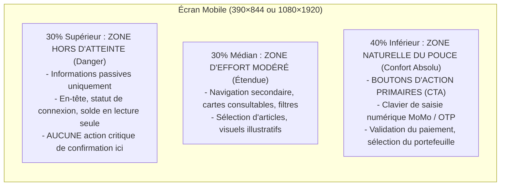
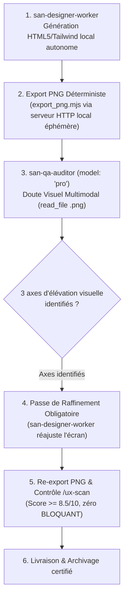
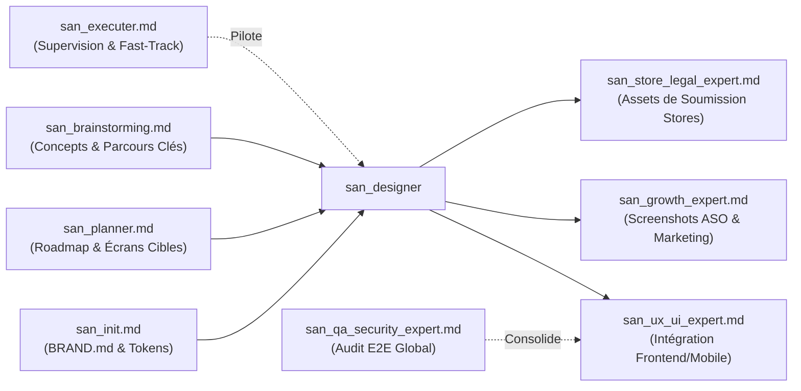

# `san_designer` — Expert Design Visuel Haute Fidélité, UI Mockups 100% Code & Visual Craft

> **Manifeste de l'Artisanat Numérique :** Le design d'interface moderne ne tolère aucun découplage entre la maquette et le code. Les fichiers graphiques propriétaires et statiques s'étiolent dès la première itération. `san_designer` fait d'Antigravity un directeur artistique et concepteur d'élite qui conçoit **100 % de ses maquettes, captures de stores et visuels directement en code HTML sémantique + Tailwind CSS local**, avec zéro dépendance CDN externe et polices locales embarquées. Chaque écran incarne l'âme vivante de marque de `.agents/rules/BRAND.md`, répond aux contraintes physiques du terrain (plein soleil, 3G, ergonomie du pouce) et se soumet à l'entonnoir d'audit d'élite `/ux-scan`.

---

## 1. RÔLE, POUR QUI, POUR QUOI

### Rôle Fondamental
`san_designer` est le maître d'œuvre de la conception visuelle, du prototypage haute fidélité et des assets graphiques du framework **Antigravity (`san_*`)**. Il opère en amont et en symbiose avec l'ingénierie logicielle pour concevoir, prototyper, auditer et figer visuellement tous les écrans, captures de stores et supports de communication d'un produit numérique avant toute phase d'assemblage applicatif.

### Pour Qui ?
- **Pour le développeur full-stack & lead tech :** Qui a besoin de maquettes d'écrans exécutables et fidèles au pixel près en HTML/Tailwind, réutilisables directement pour l'intégration frontend sans friction d'interprétation.
- **Pour l'expert frontend & mobile ([`san_ux_ui_expert`](san_ux_ui_expert.md)) :** Qui reçoit des maquettes éprouvées, structurées et validées ergonomiquement pour les transformer en composants dynamiques React.js et React Native / Expo.
- **Pour le chef d'orchestre ([`san_executer`](san_executer.md)) :** Qui délègue l'assurance visuelle et cognitive amont avant d'engager les chantiers de code lourd.
- **Pour les experts de publication ([`san_store_legal_expert`](san_store_legal_expert.md), [`san_growth_expert`](san_growth_expert.md)) :** Qui reçoivent des captures certifiées aux dimensions exactes des stores (Play Store, App Store, Feature Graphic).

### Pour Quoi ?
- **Éliminer la fracture « Design vs Code » :** Les maquettes étant rédigées avec les classes utilitaires réelles de Tailwind CSS et un balisage HTML sémantique, le design partage rigoureusement les mêmes tokens et la même syntaxe que le code final de production.
- **Bannir l'artifice et les stéréotypes IA (*Anti-AI Taste*) :** Refuser les interfaces prévisibles et génériques (cartes blanches uniformes sur fond grisâtre, dégradés violets fluo non justifiés) pour façonner une identité visuelle vivante, singulière et mémorable dictée par `.agents/rules/BRAND.md`.
- **Intégrer d'emblée la réalité physique du terrain :** Lisibilité en plein soleil à fort éclairage ambiant (contraste élevé), adaptation aux smartphones d'entrée et milieu de gamme, ergonomie à une main dans les transports, et ancrage culturel authentique (paiements Mobile Money, repères urbains, montants réels en FCFA).
- **Industrialiser l'export visuel :** Génération déterministe de fichiers PNG haute résolution en une commande via Playwright, garantissant une reproductibilité absolue en environnement local ou d'intégration continue.

---

## 2. FRONTIÈRES STRICTES : CE QU'IL FAIT / CE QU'IL NE FAIT PAS

| CE QU'IL FAIT STRICTEMENT | CE QU'IL NE FAIT ABSOLUMENT PAS |
| :--- | :--- |
| **Conception visuelle 100 % en code HTML5 sémantique + Tailwind CSS local** (zéro CDN distant, polices locales). | Ne code pas la logique métier, la gestion d'état complexe (Redux, Zustand, Context), ni les hooks React/Expo $\rightarrow$ domaine réservé de [`san_ux_ui_expert`](san_ux_ui_expert.md). |
| **Spécification stricte des 5 formats de canvas normalisés :** Play Store (`1080×1920`), App Store (`1290×2796`), Desktop (`1440×900`), Tablette (`820×1180`), Feature Graphic (`1024×500`). | Ne modifie jamais les contrôleurs backend, les modèles ORM ni les migrations SQL $\rightarrow$ domaine exclusif de [`san_backend_expert`](san_backend_expert.md). |
| **Contrôle mathématique du contraste WCAG AA & AAA :** Ratio $\ge 4.5:1$ en usage standard et seuil renforcé $\ge 7:1$ pour le mode plein soleil. | Ne modifie pas la direction artistique de sa propre initiative sans répercussion préalable dans `.agents/rules/BRAND.md`. |
| **Ergonomie physique du pouce (*Thumb Zone*) :** Cibles tactiles $\ge 44\text{px}$, espacement $\ge 8\text{px}$, actions primaires dans les 40 % inférieurs. | Ne tolère aucun texte *Lorem Ipsum*, nom fictif anglophone générique (*John Doe*) ni prix fantaisiste. |
| **Orchestration de l'entonnoir d'audit `/ux-scan` :** Étage 1 (statique zéro token LLM) puis Étage 2 (3 auditeurs cognitifs parallèles sous `Model: 'inherit'`). | Ne valide jamais un écran comportant un seul constat classé `BLOQUANT` ou une note globale $< 8.5/10$. |
| **Export automatisé haute résolution :** Pipeline Playwright `export_png.mjs` avec attente stricte de `networkidle` et `document.fonts.ready`. | Ne réalise pas les tests d'intrusion de sécurité ni les tests E2E fonctionnels applicatifs $\rightarrow$ rôle de [`san_qa_security_expert`](san_qa_security_expert.md). |

---

## 3. DÉCLENCHEURS & INVOCATIONS CONCRÈTES

### Commandes Directes en Terminal & CLI
```bash
# Lancer l'audit cognitif exhaustif /ux-scan sur une maquette donnée
/ux-scan design/mockup/online-shop/mobile/01-accueil.html

# Exporter une maquette spécifique en PNG haute fidélité (scale 2x ou 3x)
node scripts/export_png.mjs --file=design/mockup/online-shop/mobile/01-accueil.html --scale=3

# Exporter l'intégralité des visuels de stores pour la soumission Android et iOS
node scripts/export_png.mjs --target=design/screenshots/play-store/ --scale=1
node scripts/export_png.mjs --target=design/screenshots/app-store/ --scale=1

# Exporter la bannière obligatoire Google Play Store Feature Graphic (1024x500)
node scripts/export_png.mjs --file=design/screenshots/play-store/feature-graphic.html --out=design/screenshots/play-store/feature-graphic.png
```

### Invocations par Requête Développeur
- *« `san_designer` : Conçois le parcours complet d'achat de crédit d'appel et de forfait internet pour mobile (390×844) avec les 5 états obligatoires et le respect strict de BRAND.md. »*
- *« `san_designer` : Crée les 5 captures d'écran calibrées pour le Play Store (1080×1920) et la Feature Graphic (1024×500) mettant en avant le paiement instantané Mobile Money. »*
- *« `san_designer` : Exécute `/ux-scan` sur la maquette `03-paiement-momo.html` et vérifie la lisibilité en plein soleil et l'ergonomie du pouce. »*
- *Déclenché automatiquement par [`san_executer`](san_executer.md)* dès qu'une tâche de roadmap active `/roadmaps/*.md` requiert une validation de design avant intégration.

---

## 4. STRUCTURE NORMATIVE INTERNE DU SKILL

L'organisation des fichiers de référence, gabarits et outils de capture de `san_designer` répond à l'arborescence standardisée :

```txt
skills/san_designer/
├── SKILL.md                          # Manifeste, gouvernance, protocoles et formules mathématiques
├── references/
│   ├── audit_criteria.md             # Grille exhaustive de notation /10 des 3 auditeurs cognitifs
│   ├── device_canvas_specs.md        # Résolutions, safe areas, viewports et ratios des 5 canvas stricts
│   ├── contrast_mathematics.md       # Formules de luminance relative et matrices WCAG AA/AAA
│   └── terrain_reality_guide.md      # Réalités locales : plein soleil, 3G, navigation 1 main, repères urbains
├── templates/
│   ├── mockup_standalone.html        # Squelette de page HTML autonome avec Tailwind CSS embarqué
│   ├── device_frames.html            # Composants réutilisables (Dynamic Island, encoche, status bars)
│   ├── store_play_screenshot.html    # Gabarit Play Store portrait 1080×1920 avec titrage et mock
│   ├── store_app_screenshot.html     # Gabarit App Store portrait 1290×2796 avec frame iPhone Pro Max
│   └── feature_graphic_template.html # Gabarit Feature Graphic paysage 1024×500 percutant
└── scripts/
    └── export_png.mjs                # Script Playwright complet (attente networkidle & document.fonts.ready)
```

---

## 5. LIVRABLES EXACTS & SPÉCIFICATIONS DES CANVAS

Tous les livrables graphiques et maquettes sont rigoureusement enregistrés à la racine du projet sous l'arborescence `/design/` :

```txt
/design/
├── mockup/
│   └── [usecase]/                    # Ex: delivery, ecommerce, fintech-momo, pos-caisse
│       ├── mobile/                   # 390×844 px (Simulation smartphone standard)
│       │   ├── 01-accueil.html
│       │   ├── 02-selection-panier.html
│       │   └── 03-confirmation-momo.html
│       ├── tablet/                   # 820×1180 px (Simulation tablette / iPad Air)
│       │   └── ...
│       └── desktop/                  # 1440×900 px (Simulation écran large widescreen)
│           └── ...
├── screenshots/
│   ├── play-store/                   # Google Play Store
│   │   ├── feature-graphic.html      # 1024×500 px (Bannière promotionnelle obligatoire)
│   │   ├── feature-graphic.png
│   │   ├── 01-hero-catalogue.html    # 1080×1920 px (Format vertical 9:16)
│   │   ├── 01-hero-catalogue.png
│   │   ├── 02-momo-paiement.html
│   │   └── 02-momo-paiement.png
│   └── app-store/                    # Apple App Store (Écrans 6.7" Super Retina XDR)
│       ├── 01-hero-catalogue.html    # 1290×2796 px (Format vertical 19.5:9)
│       ├── 01-hero-catalogue.png
│       └── ...
└── poster/
    └── [campagne]/                   # Affiches A4, kakemonos, flyers promotionnels
        ├── a4-flyer-commercant.html
        └── a4-flyer-commercant.png
```

### Grille Normative des 5 Formats de Canvas Stricts

| Format Cible | Largeur ($W$) | Hauteur ($H$) | Ratio d'Aspect | Safe Area / Marge Critique | Destination & Contraintes |
| :--- | :--- | :--- | :--- | :--- | :--- |
| **Play Store Screenshot** | `1080 px` | `1920 px` | 9:16 | Marge top `120px`, bas `160px` | Android Phones, pas d'alpha transparent, titre en tiers supérieur. |
| **App Store Screenshot** | `1290 px` | `2796 px` | 19.5:9 | Dynamic Island top `180px`, bas `140px` | iPhone 15/16 Pro Max 6.7", cadre matériel haute définition. |
| **Desktop Canvas** | `1440 px` | `900 px` | 16:10 | Padding latéral `80px`, header `72px` | Web App / Backoffice responsive widescreen standard. |
| **Tablette Canvas** | `820 px` | `1180 px` | 1:1.44 | Padding latéral `48px`, header `64px` | iPad Air / Tablettes Android en orientation portrait. |
| **Feature Graphic** | `1024 px` | `500 px` | ~2.05:1 | Marge périphérique de sécurité `60px` | Google Play Store bannière héroïque. Aucun texte critique collé aux bords. |
| *Prototypage Mobile In-App* | `390 px` | `844 px` | 9:19.5 | Notch/Island `47px`, barre d'accueil `34px` | Canvas de prototypage ergonomique mobile nominal (iPhone standard). |

### Tag Métadonnées Obligatoire en En-tête de Fichier
Chaque fichier HTML sous `/design/` doit déclarer formellement son format via un commentaire de spécification placé sur la première ligne du `<body>` :
```html
<!-- CANVAS_SPEC: width=1080px height=1920px device="Play Store Screenshot" export_scale=1 -->
```

---

## 6. MATHÉMATIQUES DU DESIGN, CONSTRASTE WCAG & ERGONOMIE TERRAIN

### 1. Formule Mathématique du Contraste WCAG AA & AAA
Le contraste entre deux couleurs s'obtient via le calcul de leur **luminance relative** ($L$), normalisée selon l'espace sRGB :

Pour chaque composante $C \in \{R, G, B\}$ normalisée dans $[0, 1]$ :
$$C_{\text{linear}} = \begin{cases} \dfrac{C_{\text{srgb}}}{12.92} & \text{si } C_{\text{srgb}} \le 0.04045 \\ \left(\dfrac{C_{\text{srgb}} + 0.055}{1.055}\right)^{2.4} & \text{sinon} \end{cases}$$

La luminance relative globale est donnée par :
$$L = 0.2126 \cdot R_{\text{linear}} + 0.7152 \cdot G_{\text{linear}} + 0.0722 \cdot B_{\text{linear}}$$

Le **Ratio de Contraste ($CR$)** entre la couleur la plus claire ($L_1$) et la plus sombre ($L_2$) s'énonce :
$$CR = \frac{L_1 + 0.05}{L_2 + 0.05}$$

### 2. Seuils Impératifs d'Acceptation
- **Texte Standard / Corps de page :** $CR \ge 4.5:1$ (Norme WCAG AA obligatoire).
- **Texte Large ($\ge 18\text{pt}$ ou $\ge 14\text{pt}$ gras) :** $CR \ge 3.0:1$.
- **Composants d'Interface Actifs & Icônes critiques :** $CR \ge 3.0:1$.
- **Règle « Plein Soleil » (Éclairage Extérieur $> 10\,000\text{ lux}$) :**
  $$CR_{\text{soleil}} \ge 7.0:1 \quad (\text{Niveau WCAG AAA})$$
  Tout texte explicatif d'un flux financier, tout label d'adresse et tout bouton de confirmation d'opération en extérieur doit respecter ce seuil renforcé. Interdiction totale des gris faibles (`text-gray-400`, `#9ca3af`) sur fond blanc.

### 3. Règle des Zones Tactiles (Loi de Fitts)
- **Dimension minimale absolue de la cible :**
  $$\text{Target}_{\text{min}} = 44 \times 44\text{ px} \quad (\text{classes Tailwind : } \texttt{min-h-[44px] min-w-[44px]})$$
- **Espacement inter-cibles (*Gutters*) :** Au minimum $8\text{px}$ d'espacement franc entre deux cibles interactives adjacentes pour interdire les faux clics involontaires sur petits écrans tactiles.

### 4. Cartographie de la Zone du Pouce (*Thumb Zone*) sur Mobile
Dans l'ergonomie à une main, la surface d'un écran mobile vertical est subdivisée en trois zones d'effort biomécanique :



---

## 7. LA BOUCLE VISUELLE MULTIMODALE & WORKFLOW D'AUDIT `/ux-scan` (v2.0)

Le workflow `/ux-scan` et la génération d'écrans reposent sur la **Boucle Visuelle Multimodale Obligatoire** :



### Étape 1 : Génération Haute Fidélité (`san-designer-worker`)
Le sous-agent `san-designer-worker` produit la maquette HTML/Tailwind :
- **Autonomie Totale :** Absence stricte de références distantes (`fonts.googleapis.com`, `cdnjs.cloudflare.com`, `cdn.tailwindcss.com`).
- **Polices Locales :** Polices déclarées en local ou fontes système pérennes (`.woff2`).
- **Présence du tag de canvas :** `<!-- CANVAS_SPEC: ... -->` présent et dimensions cohérentes.
- **Conformité des Tokens :** Couleurs et typographies strictement fidèles à `.agents/rules/BRAND.md`.
- **Thumb Zone :** Actions primaires dans les 40% inférieurs, cibles $\ge 44\text{px}$.

### Étape 2 : Export PNG via Serveur Éphémère Playwright
Génération déterministe haute résolution via `export_png.mjs`, servant la maquette sur un serveur HTTP éphémère local avec attente de `document.fonts.ready` et `networkidle`.

### Étape 3 : Étape de Doute Visuel Multimodal (`san-qa-auditor`, `model: "pro"`)
L'orchestrateur spawne impérativement `san-qa-auditor` (`Model: 'pro'`) :
1. **Inspection Visuelle Réelle :** L'auditeur lit directement le fichier `.png` généré via `read_file`.
2. **Identification de 3 Axes d'Élévation :**
   - Équilibre des masses & aération spatiale.
   - Contraste typographique et lisibilité plein soleil ($CR \ge 7:1$).
   - Anti-platitude (*Anti-AI Taste*) : destruction des clichés génériques au profit d'un craft singulier.
3. **Passe de Raffinement Immédiate :** `san-designer-worker` applique les ajustements avant la validation finale.

### Étage 2 Approfondi : Critères d'Audit Détaillés (/ux-scan)
Quand l'écran nécessite une revue cognitive exhaustive, l'inquisiteur inspecte 3 domaines :

#### 1. `ux_psychology_auditor` (Psychologie Cognitive & Lois Ergonomiques)
- **Loi de Hick :** Le temps pour prendre une décision augmente logarithmiquement avec le nombre de choix. L'écran minimise-t-il les choix concurrents ?
- **Loi de Fitts :** Les cibles tactiles critiques font-elles $\ge 44\text{px}$ et sont-elles situées au plus près de la position naturelle de repos du doigt ?
- **Loi de Miller :** Les données complexes sont-elles regroupées en morceaux assimilables (*chunks* de 5 à 7 éléments maximum) ?
- **Effet de Restorff :** L'action d'engagement principale (le CTA) ressort-elle visuellement de manière flagrante par rapport aux actions secondaires ?
- **Loi de Jakob :** L'interface réutilise-t-elle des conventions ergonomiques universelles (emplacement du panier, croix de fermeture, icône de profil) pour éviter tout apprentissage inutile ?

#### 2. `ux_context_auditor` (Réalité Terrain & Ancrage Local)
- **Lisibilité en Plein Soleil :** Les textes sont-ils contrastés ($CR \ge 7:1$) pour une lecture sous forte lumière tropicale sans plisser les yeux ?
- **Sobriété Bande Passante (3G/EDGE) :** Le DOM est-il épuré, exempt d'images décoratives lourdes, prêt pour un affichage instantané ?
- **Ergonomie du Pouce :** Les actions majeures sont-elles situées dans les 40 % inférieurs de l'écran ?
- **Ancrage Local & Micro-Copies :** Présence de repères réels (ex: *« Face station Total Mikalou, Brazzaville »* au lieu d'une adresse de rue fantaisiste), montants explicites en FCFA (`2 500 FCFA`), intégration des flux familiers Mobile Money (MTN MoMo, Airtel Money).

#### 3. `ui_design_system_auditor` (Craft Visuel, Identité & Anti-AI Taste)
- **Respect de BRAND.md :** Rigueur absolue des codes couleurs, typographies, hiérarchie de graisses, rayons de courbure (`rounded-*`) et ombres (`shadow-*`).
- **Signature Cinétique :** Micro-interactions prévues (classes d'état `:active`, `:hover`, `active:scale-[0.98]`, transitions fluides).
- **Matrice Anti-AI Taste :** Traque et destruction des stéréotypes IA (cartes uniformes rébarbatives, dégradés violets fluo non contextualisés, icônes sans âme).

### Grille d'Évaluation & Statuts d'Anomalies

Chaque auditeur remplit la grille normée suivante :

```markdown
### Rapport d'Audit : [Nom de l'auditeur]
- **Note Globale :** [X.X / 10]
- **Statut d'approbation :** [APPROUVÉ | REJETÉ]

| Critère Évalué | Note /10 | Constat & Analyse | Statut Anomalie |
| :--- | :--- | :--- | :--- |
| Critère 1 | 9.0/10 | Respect strict des espacements et contrastes. | AUCUNE |
| Critère 2 | 4.0/10 | Bouton de validation situé en zone haute inaccessible. | BLOQUANT |
| Critère 3 | 7.5/10 | Ombre portée légèrement trop diffuse. | MINEUR |
```

#### Classification des Statuts
- **`BLOQUANT` :** Interdiction absolue de livrer. Force une itération immédiate. Exemples : contraste $< 4.5:1$ ou $< 7:1$ en extérieur, zone tactile $< 44\text{px}$, dépendance CDN externe détectée, bouton primaire hors zone du pouce.
- **`MAJEUR` :** Dysfonctionnement ergonomique important. Doit être corrigé avant la transmission au frontend sauf dérogation formelle du lead tech.
- **`MINEUR` :** Retouche cosmétique ou ajustement d'alignement non bloquant.

#### Seuil Mathématique d'Acceptation
$$\text{Livrable Certifié} \iff \begin{cases} \text{Score } (\texttt{ux\_psychology}) \ge 8.5/10 \\ \text{Score } (\texttt{ux\_context}) \ge 8.5/10 \\ \text{Score } (\texttt{ui\_design\_system}) \ge 8.5/10 \\ \sum \texttt{BLOQUANT} = 0 \end{cases}$$

---

## 8. SCRIPT DÉTERMINISTE COMPLET : `export_png.mjs`

Ce script Node.js ESM autonome exploite Playwright pour réaliser les captures haute résolution des maquettes, en attendant impérativement que le réseau soit inactif et que toutes les polices soient rendues.

```javascript
#!/usr/bin/env node
/**
 * scripts/export_png.mjs
 * Pipeline Playwright d'export PNG déterministe haute résolution pour Antigravity san_designer.
 * 
 * Usage:
 *   node scripts/export_png.mjs --file=design/mockup/online-shop/mobile/01-accueil.html --scale=3
 *   node scripts/export_png.mjs --target=design/screenshots/play-store/ --scale=1
 */

import { chromium } from 'playwright';
import { readFileSync, readdirSync, statSync, existsSync, mkdirSync } from 'fs';
import { resolve, dirname, basename, extname, join } from 'path';

// Analyse des arguments en ligne de commande
const args = process.argv.slice(2).reduce((acc, arg) => {
  const [key, value] = arg.replace(/^--/, '').split('=');
  acc[key] = value || true;
  return acc;
}, {});

const TARGET_FILE = args.file;
const TARGET_DIR = args.target;
const SCALE_FACTOR = parseFloat(args.scale || '2');
const CUSTOM_OUT = args.out;

if (!TARGET_FILE && !TARGET_DIR) {
  console.error('\x1b[31m[ERREUR] Vous devez spécifier --file=<chemin.html> ou --target=<dossier/>\x1b[0m');
  process.exit(1);
}

// Extraction du tag CANVAS_SPEC
function parseCanvasSpec(htmlContent) {
  const specRegex = /<!--\s*CANVAS_SPEC:\s*width=(\d+)px\s*height=(\d+)px(?:\s*device="([^"]*)")?(?:\s*export_scale=(\d+))?\s*-->/i;
  const match = htmlContent.match(specRegex);
  if (match) {
    return {
      width: parseInt(match[1], 10),
      height: parseInt(match[2], 10),
      device: match[3] || 'Standard Canvas',
      scale: match[4] ? parseFloat(match[4]) : SCALE_FACTOR
    };
  }
  return null;
}

async function renderHtmlToPng(browser, filePath, outputPath, forcedScale) {
  const startTs = Date.now();
  const absoluteHtmlPath = resolve(filePath);
  const fileContent = readFileSync(absoluteHtmlPath, 'utf-8');
  const spec = parseCanvasSpec(fileContent);

  const width = spec ? spec.width : 390;
  const height = spec ? spec.height : 844;
  const scale = forcedScale || (spec ? spec.scale : SCALE_FACTOR);
  const deviceName = spec ? spec.device : 'Custom Viewport';

  const context = await browser.newContext({
    viewport: { width, height },
    deviceScaleFactor: scale,
  });

  const page = await context.newPage();

  try {
    // Navigation vers le fichier HTML local avec attente réseau
    await page.goto(`file://${absoluteHtmlPath}`, {
      waitUntil: 'networkidle',
      timeout: 30000,
    });

    // Attente impérative de la résolution intégrale des polices
    await page.evaluate(async () => {
      if (document.fonts && document.fonts.ready) {
        await document.fonts.ready;
      }
    });

    // Stabilisation cinétique (fin des transitions CSS initiales)
    await page.waitForTimeout(300);

    const outDir = dirname(outputPath);
    if (!existsSync(outDir)) {
      mkdirSync(outDir, { recursive: true });
    }

    // Capture d'écran fidèle au canvas
    await page.screenshot({
      path: outputPath,
      type: 'png',
      clip: { x: 0, y: 0, width, height },
    });

    const elapsed = Date.now() - startTs;
    const fileSize = (statSync(outputPath).size / 1024).toFixed(1);
    console.log(`\x1b[32m✔ EXPORT RÉUSSI\x1b[0m : ${basename(filePath)} -> ${basename(outputPath)} [${width}x${height} @${scale}x | ${fileSize} Ko | ${elapsed}ms | ${deviceName}]`);
  } catch (err) {
    console.error(`\x1b[31m✖ ÉCHEC EXPORT\x1b[0m sur ${filePath} : ${err.message}`);
    throw err;
  } finally {
    await context.close();
  }
}

async function main() {
  console.log('\x1b[36m=== ANTIGRAVITY SAN_DESIGNER : PIPELINE PLAYWRIGHT EXPORT PNG ===\x1b[0m');
  const browser = await chromium.launch({ headless: true });

  try {
    if (TARGET_FILE) {
      const defaultOut = TARGET_FILE.replace(/\.html$/i, '.png');
      const out = CUSTOM_OUT || defaultOut;
      await renderHtmlToPng(browser, TARGET_FILE, out, SCALE_FACTOR);
    } else if (TARGET_DIR) {
      const dirPath = resolve(TARGET_DIR);
      const files = readdirSync(dirPath).filter(f => f.endsWith('.html'));
      if (files.length === 0) {
        console.warn(`\x1b[33m[AVERTISSEMENT] Aucun fichier .html trouvé dans ${TARGET_DIR}\x1b[0m`);
      }
      for (const file of files) {
        const fullPath = join(dirPath, file);
        const outPath = join(dirPath, file.replace(/\.html$/i, '.png'));
        await renderHtmlToPng(browser, fullPath, outPath, SCALE_FACTOR);
      }
    }
  } finally {
    await browser.close();
    console.log('\x1b[36m=== FIN DU TRAITEMENT D\'EXPORT ===\x1b[0m');
  }
}

main().catch(err => {
  console.error(err);
  process.exit(1);
});
```

---

## 9. MODÈLE TYPE DE MAQUETTE HTML / TAILWIND AUTONOME

Ce gabarit démontre l'autonomie totale (CSS Tailwind localisé, balisage sémantique, zéros CDN, données réalistes en FCFA et micro-interactions tactiles) :

```html
<!DOCTYPE html>
<html lang="fr" class="h-full bg-slate-900">
<head>
  <meta charset="UTF-8">
  <meta name="viewport" content="width=390, height=844, initial-scale=1.0">
  <title>Mockup — Validation Paiement Mobile Money</title>
  <!-- Styles Tailwind compilés en local ou encapsulés sans CDN externe -->
  <link rel="stylesheet" href="../../../../assets/css/tailwind.css">
  <style>
    /* Polices locales pérennes */
    @font-face {
      font-family: 'Plus Jakarta Sans';
      font-style: normal;
      font-weight: 400 800;
      font-display: swap;
      src: url('../../../../assets/fonts/PlusJakartaSans-Variable.woff2') format('woff2');
    }
    body { font-family: 'Plus Jakarta Sans', system-ui, -apple-system, sans-serif; }
  </style>
</head>
<body class="m-0 p-0 h-full w-full flex items-center justify-center bg-slate-950 antialiased select-none">
  <!-- CANVAS_SPEC: width=390px height=844px device="iPhone 15 Pro" export_scale=3 -->
  
  <!-- Cadre Matériel du Device (390x844) -->
  <div id="canvas" class="relative w-[390px] h-[844px] bg-slate-900 text-slate-100 overflow-hidden flex flex-col justify-between shadow-2xl border border-slate-800">
    
    <!-- Zone Haute : Barre d'État & Dynamic Island (Zone Passive) -->
    <header class="pt-3 px-6 flex justify-between items-center text-xs font-semibold text-slate-300 z-10">
      <span>09:41</span>
      <div class="w-24 h-6 bg-black rounded-full flex items-center justify-center">
        <div class="w-2.5 h-2.5 rounded-full bg-emerald-500 animate-pulse mr-2"></div>
        <span class="text-[10px] text-slate-400">Sécurisé</span>
      </div>
      <div class="flex items-center space-x-1.5">
        <span class="text-[10px]">4G</span>
        <div class="w-5 h-2.5 border border-slate-400 rounded-sm p-0.5 flex items-center">
          <div class="h-full w-3.5 bg-slate-200 rounded-2xs"></div>
        </div>
      </div>
    </header>

    <!-- Navigation Supérieure -->
    <nav class="px-6 py-4 flex items-center justify-between border-b border-slate-800/80">
      <button class="min-h-[44px] min-w-[44px] flex items-center justify-center text-slate-300 hover:text-white active:scale-95 transition-transform" aria-label="Retour">
        <svg class="w-6 h-6" fill="none" stroke="currentColor" viewBox="0 0 24 24"><path stroke-linecap="round" stroke-linejoin="round" stroke-width="2" d="M15 19l-7-7 7-7"/></svg>
      </button>
      <h1 class="text-base font-bold tracking-tight text-white">Finaliser la Commande</h1>
      <div class="w-11"></div> <!-- Équilibreur de flexbox -->
    </nav>

    <!-- Zone Médiane : Contenu & Détails de la Transaction -->
    <main class="flex-1 px-6 py-4 overflow-y-auto space-y-5">
      <!-- Récapitulatif Montant (Contraste Plein Soleil garanti) -->
      <section class="bg-slate-800/90 rounded-2xl p-5 border border-slate-700/60 shadow-lg text-center">
        <span class="text-xs font-bold uppercase tracking-wider text-amber-400">Total à régler</span>
        <div class="mt-2 text-3xl font-extrabold tracking-tight text-white">
          25 000 <span class="text-lg font-semibold text-amber-400">FCFA</span>
        </div>
        <p class="mt-1 text-xs text-slate-300">Livraison : Arrêt Total Mikalou, Brazzaville</p>
      </section>

      <!-- Sélection du Portefeuille Mobile Money -->
      <section class="space-y-3">
        <h2 class="text-xs font-bold uppercase tracking-wider text-slate-400">Mode de paiement instantané</h2>
        
        <!-- Option MTN MoMo -->
        <label class="min-h-[44px] flex items-center justify-between p-3.5 bg-slate-800/60 rounded-xl border-2 border-amber-500 cursor-pointer active:scale-[0.99] transition-all">
          <div class="flex items-center space-x-3">
            <div class="w-10 h-10 rounded-lg bg-amber-400 flex items-center justify-center font-black text-slate-950 text-xs shadow-sm">
              MoMo
            </div>
            <div>
              <p class="text-sm font-bold text-white">MTN Mobile Money</p>
              <p class="text-xs text-slate-300">+242 06 912 34 56</p>
            </div>
          </div>
          <input type="radio" name="payment_method" checked class="w-5 h-5 accent-amber-500 cursor-pointer">
        </label>

        <!-- Option Airtel Money -->
        <label class="min-h-[44px] flex items-center justify-between p-3.5 bg-slate-800/40 rounded-xl border border-slate-700 hover:border-slate-600 cursor-pointer active:scale-[0.99] transition-all">
          <div class="flex items-center space-x-3">
            <div class="w-10 h-10 rounded-lg bg-red-600 flex items-center justify-center font-black text-white text-xs shadow-sm">
              Airtel
            </div>
            <div>
              <p class="text-sm font-bold text-white">Airtel Money</p>
              <p class="text-xs text-slate-400">+242 05 511 22 33</p>
            </div>
          </div>
          <input type="radio" name="payment_method" class="w-5 h-5 accent-red-500 cursor-pointer">
        </label>
      </section>
    </main>

    <!-- Zone Basse (40% Inférieur) : Zone Naturelle du Pouce & Action Critique -->
    <footer class="p-6 bg-slate-900 border-t border-slate-800/90 space-y-3 z-10">
      <button type="button" class="w-full min-h-[52px] bg-gradient-to-r from-amber-500 to-amber-600 hover:from-amber-400 hover:to-amber-500 active:scale-[0.98] text-slate-950 font-black text-base rounded-xl shadow-lg shadow-amber-500/20 flex items-center justify-center space-x-2 transition-all cursor-pointer">
        <span>Confirmer et Payer 25 000 FCFA</span>
        <svg class="w-5 h-5" fill="none" stroke="currentColor" viewBox="0 0 24 24"><path stroke-linecap="round" stroke-linejoin="round" stroke-width="2.5" d="M14 5l7 7m0 0l-7 7m7-7H3"/></svg>
      </button>
      <div class="flex items-center justify-center space-x-2 text-[11px] text-slate-400">
        <svg class="w-3.5 h-3.5 text-emerald-400" fill="currentColor" viewBox="0 0 20 20"><path fill-rule="evenodd" d="M10 1a4.5 4.5 0 00-4.5 4.5V9H5a2 2 0 00-2 2v6a2 2 0 002 2h10a2 2 0 002-2v-6a2 2 0 00-2-2h-.5V5.5A4.5 4.5 0 0010 1zm3 8V5.5a3 3 0 10-6 0V9h6z" clip-rule="evenodd"/></svg>
        <span>Paiement chiffré de bout en bout</span>
      </div>
      <!-- Barre d'accueil iOS Home Indicator -->
      <div class="pt-2 flex justify-center">
        <div class="w-32 h-1 bg-slate-600 rounded-full"></div>
      </div>
    </footer>
  </div>
</body>
</html>
```

---

## 10. MATRICE DE BRANCHEMENT & RÉFÉRENCES CROISÉES



### Amont (Ce qui alimente `san_designer`)
- [`san_init.md`](san_init.md) : Fournit le manifeste de marque `.agents/rules/BRAND.md` (tokens, signatures cinétiques, anti-patterns) et le logo vectoriel validé `.agents/rules/LOGO.md`.
- [`san_planner.md`](san_planner.md) : Détermine les écrans prioritaires à prototyper dans la feuille de route active `/roadmaps/*.md`.
- [`san_brainstorming.md`](san_brainstorming.md) : Valide la proposition de valeur et les parcours utilisateurs avant le démarrage du design.

### Aval (Ce qui consomme les livrables de `san_designer`)
- [`san_ux_ui_expert.md`](san_ux_ui_expert.md) : Reçoit le code HTML, les classes Tailwind et les assets graphiques pour les traduire fidèlement en composants React.js et React Native / Expo.
- [`san_growth_expert.md`](san_growth_expert.md) : Exploite les captures d'écran et la Feature Graphic pour habiller les fiches des stores et optimiser les métriques de conversion (ASO).
- [`san_store_legal_expert.md`](san_store_legal_expert.md) : Intègre les captures d'écran certifiées dans les dossiers de soumission officiels Play Store et App Store.

### Supervision & Clôture
- [`san_executer.md`](san_executer.md) : Pilote l'exécution séquentielle, s'assure du franchissement de l'audit `/ux-scan` et réalise le Fast-Track de mise à jour du journal `CHANGELOG.md`.
- [`san_qa_security_expert.md`](san_qa_security_expert.md) : Intervient en bout de chaîne applicative pour certifier l'expérience finale sur de vrais navigateurs et devices physiques.
