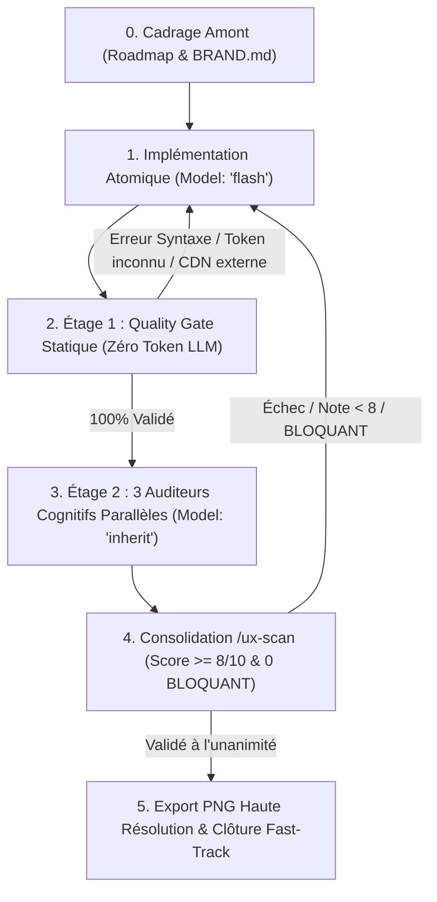
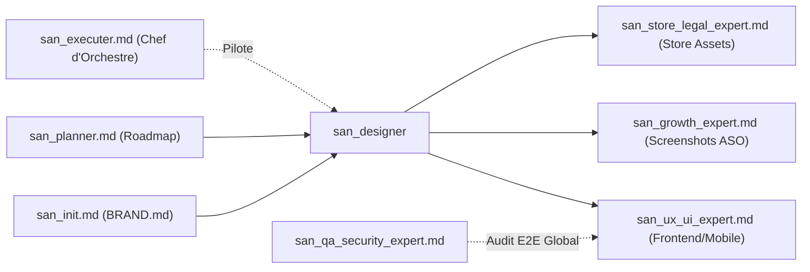

# SKILL : san_designer — Expert Design Visuel Haute Fidélité, UI Mockups & Visual Craft

> **Manifeste Cartésien :** Le design d'interface moderne ne se fige pas dans des maquettes graphiques statiques déconnectées du code. `san_designer` fait d'Antigravity un designer d'élite qui conçoit l'intégralité de ses interfaces directement en **code HTML sémantique + Tailwind CSS autonome**, exportable en PNG haute résolution en une commande reproductible, incarnant l'âme vivante de marque de `.agents/rules/BRAND.md`, et soumis à un entonnoir d'audit rigoureux en 2 étages.

---

## 1. RÔLE, POUR QUI, POUR QUOI

### Rôle
`san_designer` est le concepteur visuel d'interface et d'assets graphiques du framework Antigravity. Il intervient en amont ou en appui de l'ingénierie logicielle pour concevoir, prototyper et valider visuellement tous les écrans, captures de stores et supports de communication d'un produit numérique.

### Pour qui ?
* Pour le **développeur full-stack** ou **lead tech** qui a besoin de maquettes d'écrans haute fidélité avant de coder les composants dynamiques.
* Pour l'**entrepreneur / créateur de produit** qui a besoin de captures d'écran calibrées pour les stores (Google Play Store, Apple App Store) ou d'affiches percutantes pour ses campagnes marketing.
* Pour le chef d'orchestre [`san_executer`](san_executer.md) qui délègue la validation visuelle amont avant l'intégration frontend par [`san_ux_ui_expert`](san_ux_ui_expert.md).

### Pour quoi ?
* Éliminer le fossé classique entre « ce qui a été dessiné » et « ce qui est codé » : les maquettes étant écrites en HTML + classes Tailwind, elles partagent les exacts tokens du code de production.
* Bannir définitivement le style « template IA générique sans âme » grâce au respect strict de la direction artistique définie dans `BRAND.md`.
* Intégrer d'emblée la **réalité terrain africaine et congolaise** (lisibilité sous soleil ardent, téléphones d'entrée de gamme, adresses par repères urbains, paiements Mobile Money, repères familiers inspirés de WhatsApp).
* Garantir une reproductibilité industrielle grâce à des scripts de capture automatisée Playwright/Puppeteer.

---

## 2. FRONTIÈRES STRICTES : CE QU'IL FAIT / CE QU'IL NE FAIT PAS

| CE QU'IL FAIT STRICTEMENT | CE QU'IL NE FAIT ABSOLUMENT PAS |
| :--- | :--- |
| **Conception visuelle 100 % en code HTML + Tailwind CSS** autonome (aucun CDN externe, polices locales). | Ne code pas les composants dynamiques, l'état applicatif ni les frameworks JS (React, Expo, Vue, hooks, stores) $\rightarrow$ rôle exclusif de [`san_ux_ui_expert`](san_ux_ui_expert.md). |
| **Maquettes multi-supports réactives** : Mobile (`390×844`), Tablette (`820×1180`), Desktop (`1440×900`), adaptées à chaque contexte de consultation. | Ne touche jamais aux APIs, aux migrations SQL, ni à la logique serveur $\rightarrow$ domaine de [`san_backend_expert`](san_backend_expert.md). |
| **Screenshots stores haute résolution** : App Store (`1290×2796`), Play Store (`1080×1920`) avec encadrement de device fidèle (Dynamic Island, encoche, status bar). | Ne planifie pas les fonctionnalités globales ni la stratégie de versioning $\rightarrow$ gouverné par [`san_planner`](san_planner.md). |
| **Affiches et supports promotionnels** (`/design/poster/*`) en HTML/CSS dimensionné au millimètre. | Ne réalise pas les tests End-to-End applicatifs ni les pentests de sécurité $\rightarrow$ sous la responsabilité de [`san_qa_security_expert`](san_qa_security_expert.md). |
| **Simulation des 5 états UI** : Idéal, Vide (*Empty State*), Chargement (*Skeleton*), Erreur, Hors-ligne. | N'utilise aucun CDN externe (Google Fonts, cdnjs, scripts non locaux) pouvant casser le rendu hors-ligne ou l'export PNG. |
| **Vérification WCAG AA** (contraste >= 4.5:1 texte, 3:1 interface, zones tactiles >= 44px). | Ne tolère aucun texte *Lorem Ipsum* ni image externe distante non déterministe. |
| **Exécution du workflow `/ux-scan`** et pilotage de l'entonnoir d'audit à 2 étages. | Ne livre jamais d'écran ayant un constat classé `BLOQUANT`. |

---

## 3. DÉCLENCHEURS & INVOCATIONS CONCRÈTES

### Commandes directes
```bash
# Lancer un audit cognitif consolidé en 2 étages sur une maquette
/ux-scan design/mockup/online-shop/mobile/01-accueil.html

# Exporter l'ensemble des maquettes d'un usecase en PNG haute définition
node scripts/export_png.mjs --target=design/mockup/online-shop/mobile/ --scale=2
```

### Invocations par prompt
* *« Conçois les maquettes haute fidélité pour le usecase de commande de taxi-moto (mobile, tablette, desktop) en respectant les tokens de BRAND.md. »*
* *« Prépare les 5 visuels de capture d'écran pour la soumission Play Store de l'application vendeur selon les dimensions 1080x1920. »*
* *« Conçois une affiche promotionnelle pour le lancement du service Mobile Money à destination des commerçants de Brazzaville. »*
* Déclenché automatiquement par [`san_executer`](san_executer.md) dès qu'une tâche de roadmap mentionne une phase de design ou de prototypage d'écran.

---

## 4. STRUCTURE INTERNE DU SKILL

```txt
skills/san_designer/
├── SKILL.md                          # Manifeste, gouvernance, procédure et principes directeurs
├── references/
│   ├── audit_criteria.md             # Grille détaillée de notation /10 des 3 auditeurs cognitifs
│   ├── device_specs.md               # Résolutions, safe areas, viewports et ratios des supports cibles
│   └── congo_ux_reality.md           # Réalités ergonomiques locales (3G, plein soleil, cash, repères)
├── templates/
│   ├── device_frames.html            # Composants réutilisables (Dynamic Island, encoches, status bars)
│   ├── mockup_page_template.html     # Squelette de page HTML autonome avec Tailwind CSS embarqué
│   └── store_screenshot_template.html # Gabarit pour captures Play Store / App Store avec titrage
└── scripts/
    └── export_png.mjs                # Pipeline Playwright / Puppeteer pour export PNG déterministe
```

---

## 5. LIVRABLES EXACTS

Tous les livrables sont stockés à la racine du projet sous l'arborescence standardisée `/design/` :

```txt
/design/
├── mockup/
│   └── [usecase]/                    # Ex: online-shop, courier-delivery, pos-retail
│       ├── mobile/                   # 390×844 px (simulation smartphone)
│       │   ├── 01-accueil.html
│       │   ├── 02-panier.html
│       │   └── 03-paiement-momo.html
│       ├── tablet/                   # 820×1180 px (simulation tablette / iPad Air)
│       │   └── ...
│       └── desktop/                  # 1440×900 px (simulation écran large)
│           └── ...
├── screenshots/
│   ├── play-store/                   # 1080×1920 px (ratio 16:9 standard Android)
│   │   ├── 01-hero-catalogue.html (+ .png généré)
│   │   ├── 02-momo-paiement.html  (+ .png généré)
│   │   └── 03-suivi-commande.html (+ .png généré)
│   └── app-store/                    # 1290×2796 px (iPhone 15/16 Pro Max 6.7")
│       └── ...
└── poster/
    └── [campagne]/                   # Affiches, bannières publicitaires, kakemonos
        ├── a4-flyer.html (+ .png)
        └── social-story.html (+ .png)
```

### Conventions de nommage strictes
1. Noms de dossiers et fichiers en minuscules et `kebab-case`.
2. Numérotation ordonnée séquentielle à deux chiffres (`01-`, `02-`, `03-`) reflétant le parcours utilisateur naturel.
3. Chaque fichier HTML inclut en commentaire d'en-tête ses dimensions cibles fixes :
   ```html
   <!-- CANVAS_SPEC: width=390px height=844px device="iPhone 15" export_scale=3 -->
   ```

---

## 6. PROCÉDURE « ZÉRO NÉGLIGENCE » & ENTONNOIR D'AUDIT EN 2 ÉTAGES



### Étape 0 : Cadrage Amont & Direction Artistique
1. Consulter la feuille de route active dans `/roadmaps/*.md` (pilotée par [`san_planner`](san_planner.md)).
2. Ingestion obligatoire de `.agents/rules/BRAND.md` :
   * **Direction Artistique & Âme :** Archétype de la marque, textures, intentions émotionnelles, anti-patterns esthétiques interdits.
   * **Signature Cinétique :** Courbes d'accélération (`cubic-bezier`), durées standard (`fast: 150ms`, `normal: 250ms`, `slow: 400ms`), réactions au contact.
   * **Design Tokens :** Palette hexadécimale stricte, typographies locales, échelle de rayons (`rounded-*`) et élévations (`shadow-*`).
3. Vérification des assets : utilisation exclusive du logo validé dans `.agents/rules/LOGO.md`.

### Étape 1 : Implémentation Atomique (Sous-Agent `Model: 'flash'`)
1. Instancier via `san_subagent_manager` un sous-agent d'exécution atomique propulsé par **`Model: 'flash'`** (`gemini-3.8-flash-high` ou dernier modèle Flash disponible).
2. Rédiger le code HTML autonome à partir de `templates/mockup_page_template.html` :
   * Canvas à taille fixe encadré par le device frame adéquat (`templates/device_frames.html`).
   * Zéro *Lorem Ipsum* : rédaction de micro-copies réalistes, noms congolais authentiques, montants en FCFA (`2 500 FCFA`), numéros d'urgence ou de contact conformes (`+242 06 ... / +242 05 ...`).
   * Représentation soignée des états UI indispensables (état nominal, badge d'état réseau, bouton avec état `:active`).

### Étape 2 : Entonnoir d'Audit — Étage 1 (Contrôle Technique Statique & Zéro Token LLM)
Avant tout appel à un modèle d'audit qualitatif, le script de validation statique vérifie :
* [ ] **Autonomie absolue :** Présence d'aucun lien vers un CDN externe (`cdn.jsdelivr.net`, `fonts.googleapis.com`, etc.).
* [ ] **Conformité stricte aux Tokens :** Aucune couleur arbitraire inline (ex: `style="color: #4a12c3"` interdit) ni classe Tailwind non déclarée dans `BRAND.md`.
* [ ] **Syntaxe et Sémantique :** Balisage HTML5 valide, accessibilité des balises d'images (`alt`), balises de formulaires étiquetées (`aria-label`).
* [ ] **Canvas dimensionné :** Présence du tag de spécification `<!-- CANVAS_SPEC ... -->`.
> **Règle d'arrêt strict anti-gaspillage :** Si l'Étage 1 détecte une seule non-conformité, la chaîne s'interrompt immédiatement. L'erreur est corrigée par le sous-agent d'exécution (`Model: 'flash'`). **Aucun token de raisonnement n'est dépensé sur du code techniquement invalide.**

### Étape 3 : Entonnoir d'Audit — Étage 2 (Audits Spécialisés Cognitifs — `Model: 'inherit'`)
Une fois l'Étage 1 validé à 100 %, l'orchestrateur déploie simultanément trois sous-agents auditeurs configurés avec **`Model: 'inherit'`** (bénéficiant de la puissance maximale du modèle maître de session Argon ou Pro) :

#### 1. `ux_psychology_auditor` (Psychologie Cognitive & Ergonomie)
* **Loi de Hick :** Minimisation du nombre de choix concurrents par écran.
* **Loi de Fitts :** Dimensionnement des cibles tactiles (`>= 44px`) et positionnement des actions critiques à portée immédiate du pouce.
* **Loi de Norman & Feedback :** Visibilité claire de l'état du système, affordance des composants cliquables, feedback perceptible immédiat.
* **Charge mentale :** Hiérarchie visuelle comprise en moins de 3 secondes, moment de succès gratifiant.

#### 2. `ux_context_auditor` (Réalité Terrain & Ancrage Local)
* **Plein soleil :** Contraste renforcé des textes et boutons, interdiction des gris pâles sur fond blanc.
* **Usage à une main :** Actions principales (validation, sélection MoMo) placées dans le tiers inférieur de l'écran.
* **Contexte réseau 3G/EDGE & Économie de data :** Absence de médias lourds, composants légers, prévoyance visuelle du mode déconnecté.
* **Codes locaux familiers :** Formulation en français simple et accessible, adresses formulées par repères familiers (*« Arrêt Total Mikalou, face Pharmacie »* au lieu d'une adresse de rue inexistante), intégration naturelle des réflexes WhatsApp et des paiements Mobile Money (Airtel Money, MTN MoMo).

#### 3. `ui_design_system_auditor` (Conformité Marque & Craft Visuel)
* **Fidélité au Design System :** Respect scrupuleux des tokens de `.agents/rules/BRAND.md`.
* **Signature Cinétique :** Présence des micro-interactions, états d'appui `:active` visibles, transitions prêtes pour la capture.
* **Anti-AI Taste :** Traque et élimination des stéréotypes visuels génériques d'IA (cartes uniformes de 3 colonnes, dégradés violets fluo sur fond sombre, icônes circulaires sans âme).

### Étape 4 : Consolidation `/ux-scan` & Boucle d'Itération
* Chaque auditeur consigne sa notation détaillée sur `/10` critère par critère avec constats hiérarchisés :
  * `BLOQUANT` : Interdiction formelle de livrer (ex: contraste illisible en plein soleil, bouton MoMo hors zone du pouce, couleur hors palette).
  * `MAJEUR` : À corriger immédiatement sauf dérogation explicite motivée.
  * `MINEUR` : Recommandation d'optimisation cosmétique.
* **Seuil d'acceptation :**
  $$\text{Score de chaque auditeur} \ge 8.0/10 \quad \text{ET} \quad \text{Nombre de BLOQUANT} = 0$$
* En cas d'échec, le sous-agent d'implémentation (`flash`) corrige les points signalés. Plafond strict de **5 itérations maximales** avant arbitrage formel du développeur.

### Étape 5 : Export Haute Résolution & Clôture Fast-Track
1. Exécution du script `scripts/export_png.mjs` via Playwright :
   ```bash
   node scripts/export_png.mjs --file=design/mockup/online-shop/mobile/01-accueil.html --out=design/mockup/online-shop/mobile/01-accueil.png
   ```
2. **Fast-Track d'hygiène par l'orchestrateur :** Cocher la tâche correspondante `- [x]` dans la roadmap active de [`san_planner`](san_planner.md) et consigner l'avancement dans `CHANGELOG.md`.

---

## 7. PRINCIPES DIRECTEURS & INVARIANTS VISUELS

### 1. Invariant de l'Âme Visuelle & « Anti-AI Taste »
Chaque écran doit respirer une identité singulière. L'IA a tendance à reproduire mécaniquement les mêmes canevas :
* **PROSCRIT :** Le trio monotone de cartes blanches sur fond grisâtre avec icône dans un cercle teinté et texte non différencié.
* **PROSCRIT :** Les dégradés violets/bleutés artificiels plaqués sur des interfaces sombres.
* **EXIGÉ :** Une tension visuelle maîtrisée, une échelle typographique assumée (titres expressifs, labels compacts à fort contraste), des bordures fines élégantes, et des éléments d'ancrage visuel reflétant l'univers propre du produit décrit dans `BRAND.md`.

### 2. Invariant de Réalisme et d'Humanité des Données
* Zéro texte de remplissage : interdiction absolue de toute mention *Lorem Ipsum*, *John Doe*, ou prix fantaisistes en dollars pour des produits locaux.
* Utilisation de noms, prénoms et toponymes authentiques (ex: *« M. Ngoma »*, *« Marché Total »*, *« Avenue de la Paix, Poto-Poto »*).
* Produits et services réalistes : sacs de ciment, recharges de crédit d'appel, courses urbaines, pagnes wax, paniers maraîchers.

### 3. Invariant d'Autonomie & Zéro Dépendance Externe
* Les maquettes HTML doivent s'ouvrir instantanément et fidèlement sans connexion Internet active.
* Les styles CSS Tailwind sont générés en local ou embarqués dans une balise `<style>` dédiée.
* Les polices typographiques sont stockées dans le projet (`.woff2`) ou encodées en base64 pour garantir la stabilité pérenne des exports.

### 4. Invariant de Séparation des Pouvoirs (Regard Neuf)
* Le sous-agent chargé de l'implémentation de l'écran (`Model: 'flash'`) n'est **JAMAIS** celui qui réalise l'audit cognitif Étage 2 (`Model: 'inherit'`). Un œil neuf est indispensable pour déceler les failles ergonomiques et les biais d'implémentation.

---

## 8. MATRICE DE BRANCHEMENT & RÉFÉRENCES CROISÉES



### Amont (Ce qui alimente `san_designer`)
* [`san_init.md`](san_init.md) : Fournit la source unique de vérité esthétique `.agents/rules/BRAND.md` et le logo validé `.agents/rules/LOGO.md`.
* [`san_planner.md`](san_planner.md) : Définit les écrans prioritaires à prototyper au sein de la roadmap active `/roadmaps/*.md`.
* [`san_brainstorming.md`](san_brainstorming.md) : Clarifie le concept produit et les parcours clés avant tout dessin.

### Aval (Ce qui consomme les livrables de `san_designer`)
* [`san_ux_ui_expert.md`](san_ux_ui_expert.md) : Reçoit les fichiers HTML et les tokens Tailwind pour les convertir en composants de production React.js et React Native / Expo.
* [`san_growth_expert.md`](san_growth_expert.md) : Exploite les captures générées (`/design/screenshots/*`) pour habiller les fiches Play Store et App Store (ASO) et optimiser les taux de conversion.
* [`san_store_legal_expert.md`](san_store_legal_expert.md) : Utilise les captures d'écran certifiées pour constituer le dossier de soumission officiel des stores.

### Pilotage Transversal
* [`san_executer.md`](san_executer.md) : Déclenche `san_designer` lors des phases visuelles, vérifie la complétion des scores `/ux-scan` et coordonne la transition vers l'implémentation logicielle.
* [`san_qa_security_expert.md`](san_qa_security_expert.md) : Intervient plus tard dans la chaîne pour l'audit E2E fonctionnel et de sécurité des applications dynamiques finales.
