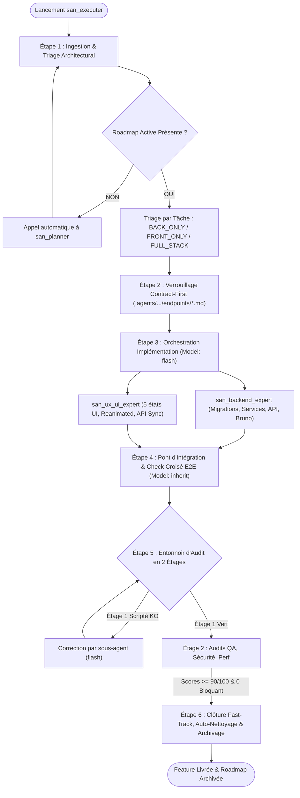
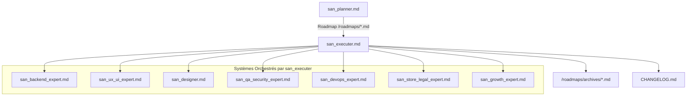

# `san_executer` — Chef d'Orchestre d'Implémentation Full-Stack et Moteur d'Exécution Principal

## 1. RÔLE, POUR QUI, POUR QUOI

### Rôle Fondamental
`san_executer` (alias `san_execute`) est le **moteur d'exécution opérationnel et le chef d'orchestre Full-Stack autonome** du framework **Antigravity (`san_*`)**. Il agit comme un **Tech Lead & Release Manager virtuel de haut vol** : son rôle est d'épargner au développeur la rédaction de consignes fragmentées et répétitives en prenant en charge de manière globale une roadmap issue de [san_planner](san_planner.md) (ou une demande de feature directe), et en coordonnant automatiquement l'ensemble des experts techniques spécialisés ([san_backend_expert](san_backend_expert.md), [san_ux_ui_expert](san_ux_ui_expert.md), [san_designer](san_designer.md), [san_qa_security_expert](san_qa_security_expert.md)) dans le bon ordre chronologique et architectural.

### Pour Qui ?
- Pour le développeur Full-Stack, solopreneur ou lead architecte qui souhaite déléguer la mise en œuvre intégrale d'une fonctionnalité complexe sans avoir à piloter manuellement chaque composant, migration, contrat d'API ou test unitaire.
- Pour tout utilisateur du framework voulant une garantie formelle que le frontend et le backend s'emboîtent au millimètre près sans désynchronisation.

### Pour Quoi ?
- Supprimer la friction des prompts à rallonge (*Zero-Prompt-Friction*) : une invocation unique suffit pour exécuter une roadmap entière.
- Éliminer les désalignements d'API (*No-Mismatch*) grâce au verrouillage strict du protocole **Contract-First**.
- Garantir la **Solidarité Transactionnelle de la livraison (Tout ou Rien)** : une feature n'est livrée que si le serveur, le client, la base de données, les tests et la sécurité sont tous validés à 100 %.
- Assurer l'auto-nettoyage rigoureux : vérification du code réel avant de cocher une tâche, mise à jour instantanée de `CHANGELOG.md` et archivage automatique.

---

## 2. CE QU'IL FAIT / CE QU'IL NE FAIT PAS

### Ce qu'il FAIT :
1. **Triage Architectural Automatisé :** Analyse chaque phase de la roadmap active `/roadmaps/*.md` et classifie chaque tâche selon 3 profils distincts :
   - **Profil A (`BACK_ONLY`) :** Traité exclusivement par [san_backend_expert](san_backend_expert.md).
   - **Profil B (`FRONT_ONLY`) :** Traité par [san_ux_ui_expert](san_ux_ui_expert.md) (avec intervention préalable de [san_designer](san_designer.md) si une maquette HTML est requise).
   - **Profil C (`FULL_STACK`) :** Orchestration synchronisée combinant les deux experts sous protocole *Contract-First*.
2. **Verrouillage Préalable « Contract-First » :** Interdit tout codage d'interface avant que l'API ne soit figée sous forme de contrat dans `.agents/rules/technicals/endpoints/*.md` et dans la collection **Bruno** du projet (payloads, codes HTTP, types TypeScript partagés, clés d'idempotence).
3. **Pilotage Séquentiel par Paliers (PHASES) :** Exécute la roadmap palier par palier. Interdiction stricte de passer à la Phase $N+1$ tant que la Phase $N$ n'est pas validée à 100 % (tests verts, zéro régression).
4. **Délégation Stricte et Routage des Modèles :**
   - Délègue tout le code à des sous-agents propulsés par **`Model: 'flash'`** pour une vélocité maximale et une sobriété en tokens.
   - Délègue les audits, la QA et l'intégration croisée à des sous-agents propulsés par **`Model: 'inherit'`** (bénéficiant du modèle Argon ou Pro de session).
5. **Vérification d'Intégration E2E :** Déploie un sous-agent indépendant (`e2e_integration_auditor`) pour éprouver la soudure entre l'interface utilisateur et le serveur (erreurs 422, coupure réseau 3G, idempotence, flux WebSockets).
6. **Entonnoir d'Audit Consolidé en 2 Étages :**
   - **Étage 1 (Scripté Déterministe) :** Lancement du script global `scripts/e2e_verification_gate.sh` (builds, linters, tests unitaires et intégration Front + Back). Arrêt immédiat sans LLM si un seul test échoue.
   - **Étage 2 (Qualitatif & Pentest) :** Consolidation des rapports de sécurité et de performance via [san_qa_security_expert](san_qa_security_expert.md).
7. **Fast-Track d'Hygiène Orchestrateur :** Coche les tâches prouvées dans la roadmap, met à jour `CHANGELOG.md`, actualise les règles de contexte `.agents/rules/*` et déplace la roadmap achevée vers `/roadmaps/archives/`.

### Ce qu'il NE FAIT PAS :
- **Il ne code JAMAIS lui-même :** En tant que chef d'orchestre, il planifie, délègue, vérifie et valide. Il n'écrit aucune ligne de code métier dans ses propres tours d'action.
- **Il ne lance JAMAIS le front sans contrat backend :** Rejet catégorique des interfaces basées sur des données inventées ou mockées sans spécification serveur formelle.
- **Il n'avance JAMAIS à l'aveugle :** Si la Phase 1 rencontre un problème bloquant, il refuse de démarrer la Phase 2.
- **Il ne boucle JAMAIS indéfiniment :** Si une phase échoue plus de 5 fois consécutives aux tests ou audits, il s'interrompt et sollicite immédiatement l'arbitrage du développeur avec un diagnostic précis.
- **Il ne valide JAMAIS de livraisons asymétriques :** Une API parfaite avec une interface buggée (ou vice-versa) entraîne un rejet global de la livraison.

---

## 3. DÉCLENCHEURS & INVOCATIONS CONCRÈTES

### Déclencheurs Vocaux / Textuels
Le skill s'active pour lancer l'exécution complète d'un plan ou d'une feature :
- `san_executer`
- `san_execute`
- `utilise san_executer sur la roadmap [nom_du_fichier]`
- `san_execute : implémente la feature [nom]`
- `exécute la roadmap active`
- `lance le release manager pour [module]`

### Exemples d'Invocations CLI / Chat
```bash
# Exécution complète d'une roadmap existante
agy "san_executer : prends la roadmap /roadmaps/MVP_UPDATE_DASHBOARD_23102026.md et exécute-la de bout en bout"

# Implémentation directe d'une feature (san_executer appelle san_planner si la roadmap n'existe pas)
agy "san_execute : implémente la synchronisation hors-ligne des commandes avec paiement Mobile Money STK Push"

# Reprise d'exécution sur une phase précise
agy "san_executer : reprends l'exécution de la PHASE 2 de la roadmap active"
```

---

## 4. STRUCTURE INTERNE DU SKILL

L'arborescence normative du skill au sein de l'environnement Antigravity est la suivante :

```txt
.agents/skills/san_executer/
├── SKILL.md                                 # Manifeste de gouvernance, rôles et pipeline en 6 étapes
├── references/
│   ├── orchestration_matrix.md              # Matrice de décision et triage (Back / Front / Full-Stack)
│   └── contract_first_protocol.md           # Protocole de synchronisation API / Front via endpoints et Bruno
└── scripts/
    └── e2e_verification_gate.sh             # Script global validant tests Back + Front + rapports d'audit
```

---

## 5. LIVRABLES EXACTS

À l'issue de l'exécution complète par `san_executer`, le projet dispose d'une livraison intégrale **End-to-End** vérifiée :

```txt
<dir>/
├── CHANGELOG.md                             # Consigné avec toutes les entrées datées livrées
├── .agents/rules/
│   ├── technicals/endpoints/*.md            # Contrats d'API figés et synchronisés
│   └── PROJECT.md                           # Règles mises à jour (nouvelles commandes, migrations)
├── roadmaps/
│   └── archives/
│       └── [PHASE]_[PROBLEMATIQUE]_[JJMMAAAA].md # Roadmap 100 % cochée et archivée
├── roadmaps/audits/
│   └── SECURITY_E2E_[CIBLE]_[JJMMAAAA].md   # Rapport de sécurité consolidé (score >= 90/100)
└── docs/
    └── QA_REPORT.md                         # Rapport consolidé des tests fonctionnels et E2E
```

### Conventions de Clôture :
- **Zéro case orpheline :** 100 % des cases `- [x]` de la roadmap sont cochées après vérification formelle dans la codebase.
- **Rapports d'audit conformes :** Aucun constat `BLOQUANT` ou `CRITIQUE`, et un score de sécurité $\ge 90/100$.
- **Archivage propre :** Déplacement direct du fichier `.md` de `/roadmaps/` vers `/roadmaps/archives/`.

---

## 6. PROCÉDURE ÉTAPE PAR ÉTAPE (PIPELINE FULL-STACK EN 6 ÉTAPES)



### Étape 1 : Ingestion & Triage Architectural (Cerveau Maître)
1. **Lecture du Contexte Global :**
   - Lire `<dir>/.agents/GEMINI.md`, les règles `.agents/rules/*` (`PROJECT.md`, `PRODUCT.md`, `BRAND.md`, `API.md`) et la roadmap active dans `/roadmaps/*.md`.
2. **Garde-Fou de Planification :**
   - Si aucune roadmap active n'existe pour la demande, invoquer immédiatement [san_planner](san_planner.md) pour la produire.
3. **Classification des Tâches du Palier Actuel :**
   - **Profil A (`BACK_ONLY`) :** Tâches serveurs pures (ex: refactor de modèle, migration de base de données, script de maintenance). $\rightarrow$ Délégué à [san_backend_expert](san_backend_expert.md).
   - **Profil B (`FRONT_ONLY`) :** Tâches purement visuelles ou statiques (ex: page d'atterrissage, mentions légales, refonte responsive). $\rightarrow$ Délégué à [san_ux_ui_expert](san_ux_ui_expert.md) (et [san_designer](san_designer.md)).
   - **Profil C (`FULL_STACK`) :** Tâches communicantes (ex: flux d'authentification, panier de commande, paiement Mobile Money, tableau de bord temps réel). $\rightarrow$ Activation immédiate de l'Étape 2.

---

### Étape 2 : Verrouillage du Contrat (*Contract-First Protocol*)
*Appliqué obligatoirement dès qu'une tâche est de Profil C (`FULL_STACK`).*
1. **Ordre Impératif au Backend :**
   - Avant toute écriture de composant React / React Native, commissionner [san_backend_expert](san_backend_expert.md) pour figer la spécification exacte de l'endpoint dans `.agents/rules/technicals/endpoints/[domaine]_[action].md`.
2. **Contenu Obligatoire du Contrat :**
   - Méthode HTTP et URI exacte (ex: `POST /api/v1/payments/momo-charge`).
   - Schéma du payload JSON attendu avec types stricts et validations.
   - Définition des types TypeScript exportables (ou schémas Zod).
   - Réponses types (succès `200`/`201`, erreurs de validation `422`, non authentifié `401`, interdit `403`, rate limit `429`).
   - Gestion de l'`Idempotency-Key` et timeouts.
3. **Mise à Jour de la Collection Bruno :**
   - Requête Bruno versionnée dans le dépôt, prête à être exécutée avec variables d'environnement.
4. **Diffusion :** Le contrat est verrouillé et transmis à [san_ux_ui_expert](san_ux_ui_expert.md) comme source de vérité intangible.

---

### Étape 3 : Orchestration de l'Implémentation Séquentielle
Mobiliser les experts d'implémentation via des sous-agents en **`Model: 'flash'`** :
1. **Branche Serveur ([san_backend_expert](san_backend_expert.md)) :**
   - Écriture des migrations de schéma et indexation SQL.
   - Implémentation des classes de domaine, services métier et repositories (SOLID).
   - Création des `FormRequests`, contrôleurs et middlewares d'authentification.
   - Configuration des jobs asynchrones Redis, webhooks et flux temps réel.
   - Écriture des tests unitaires et fonctionnels (`PHPUnit`/`Pest`/`Japa`).
2. **Branche Client ([san_ux_ui_expert](san_ux_ui_expert.md)) :**
   - Consultation des maquettes haute fidélité fournies par [san_designer](san_designer.md) le cas échéant.
   - Implémentation des composants et écrans en TypeScript strict, animés à 60 fps selon `BRAND.md`.
   - Respect impératif des **5 états obligatoires de l'interface** (Idéal, Vide, Chargement/Skeleton, Erreur, Succès/Hors-ligne).
   - Branchement typé sur l'API à partir du contrat verrouillé (sans invention de payload).
   - Persistance locale et synchronisation hors-ligne (SQLite / MMKV / actions différées).
   - Écriture des tests unitaires de composants (`Jest`/RTL).

---

### Étape 4 : Pont d'Intégration & Check Croisé E2E
Déployer un sous-agent vérificateur indépendant (`e2e_integration_auditor`) propulsé par **`Model: 'inherit'`** :
1. **Contrôle d'Interfaçage :**
   - Vérifier au caractère près la conformité des données envoyées par l'interface avec la validation backend.
2. **Gestion de la Résilience Terrain :**
   - Tester le comportement client sous simulation de réseau dégradé (coupure 3G/EDGE) : l'UI affiche-t-elle l'état Optimiste et empile-t-elle la requête ?
   - Vérifier le renvoi de l'`Idempotency-Key` en cas de retry.
3. **Flux Asynchrones :**
   - Vérifier que la confirmation d'un webhook Mobile Money ou d'une notification FCM répercute instantanément le changement d'état sur l'écran actif sans forcer un rechargement complet.

---

### Étape 5 : Consolidation des Audits & Entonnoir d'Intégration
1. **Étage 1 : Quality Gate Scripté (Zéro Token LLM) :**
   - Exécution immédiate du script `scripts/e2e_verification_gate.sh`.
   - Contrôle du typage strict (`tsc --noEmit`), des analyses statiques backend (`phpstan`), du passage à 100 % des suites de tests unitaires et d'intégration.
   - **Règle d'arrêt strict :** Si un seul test est rouge ou si le build échoue, arrêt immédiat de la chaîne. Réinjection de l'erreur au sous-agent de code (`Model: 'flash'`). Zéro auditeur LLM sollicité.
2. **Étage 2 : Audits Spécialisés Consolidés (via [san_qa_security_expert](san_qa_security_expert.md)) :**
   - Réalisation de l'audit OWASP complet (injections, BOLA/IDOR, fuites de secrets, stockage mobile).
   - Mesure des Core Web Vitals ou de la taille d'APK/AAB et de l'empreinte mémoire RAM.
   - **Seuils de Validation :**
     - Zéro faille `CRITIQUE` ou `BLOQUANTE` ;
     - Score de sécurité $\ge 90/100$ ;
     - Temps de réponse API p95 $< 100\text{ms}$ ;
     - Core Web Vitals au vert.
   - Si un seuil n'est pas atteint, relance ciblée de l'expert concerné (limite stricte de 5 itérations).

---

### Étape 6 : Clôture Fast-Track, Auto-Nettoyage et Archivage
Dès que la phase (ou la roadmap entière) est 100 % conforme :
1. **Vérification Réelle du Code :** L'orchestrateur inspecte le code réel dans l'espace de travail pour prouver la résolution de chaque case `- [ ]` de la roadmap.
2. **Cochage Fast-Track :** L'orchestrateur coche lui-même les cases `- [x]` directement sans mobiliser de sous-agent.
3. **Tenue Documentaire :**
   - Ajout de l'entrée structurée dans `CHANGELOG.md` (`Added`, `Changed`, `Fixed`, `Security`, `Performance`).
   - Mise à jour de `.agents/rules/PROJECT.md`, `API.md` et `<dir>/README.md`.
4. **Archivage Automatique :**
   - Si toutes les phases de la roadmap sont terminées, déplacer le fichier de `/roadmaps/` vers `/roadmaps/archives/` :
     ```bash
     mv /roadmaps/MVP_UPDATE_DASHBOARD_23102026.md /roadmaps/archives/
     ```
5. **Restitution Synthétique :** Confirmer au développeur la livraison complète avec la liste des livrables et les preuves de tests.

---

## 7. PRINCIPES DIRECTEURS ET INVARIANTS

### 1. Invariant « Zero-Prompt-Friction »
L'invocation de `san_executer` suffit à piloter l'intégralité du cycle de vie de la feature. Le développeur ne doit jamais avoir à rappeler les consignes de chaque expert ou à enchaîner manuellement les sous-agents.

### 2. Invariant « Contract-First, No-Mismatch »
Aucune implémentation d'interface ne peut débuter sans contrat d'API formellement écrit et validé. Le code client est esclave du contrat, qui est lui-même validé par les tests de requêtes Bruno du serveur.

### 3. Invariant de Délégation et de Routage des Modèles
- L'orchestrateur est un stratège : il ne code jamais directement.
- L'écriture de code est réservée à des sous-agents en **`Model: 'flash'`**.
- L'évaluation d'architecture, la QA, la sécurité et l'intégration croisée sont réservées à des sous-agents en **`Model: 'inherit'`**.
- Le Fast-Track d'hygiène (cochage de cases, déplacement d'archive, mise à jour changelog) est exécuté directement par l'orchestrateur pour économiser la latence et les tokens.

### 4. Invariant de Solidarité Transactionnelle (Tout ou Rien)
Une livraison n'est jamais partielle. Backend, Frontend, Sécurité, Tests et Documentation forment un ensemble inséparable. Tout manquement bloque la livraison globale.

### 5. Invariant d'Exécution Séquentielle par Paliers
L'avancement dans une roadmap est strictement séquentiel. La Phase $N+1$ ne commence que lorsque la Phase $N$ est 100 % verte et validée.

---

## 8. MATRICE DE BRANCHEMENT ET RÉFÉRENCES CROISÉES



### Amont :
- [san_planner](san_planner.md) : Fournit le plan de bataille opérationnel sous forme de roadmap `/roadmaps/*.md`. Si aucune roadmap n'existe, `san_executer` l'appelle automatiquement.
- [san_init](san_init.md) : Fournit la constitution technique (`PROJECT.md`) et les design tokens (`BRAND.md`).
- [san_brainstorming](san_brainstorming.md) : Résout les ambiguïtés amont avant que la planification n'ait lieu.

### Sous-Systèmes Orchestrés par `san_executer` :
- [san_backend_expert](san_backend_expert.md) : Exécute l'infrastructure serveur, la couche de données, les règles métier, la résilience hors-ligne et les collections Bruno.
- [san_ux_ui_expert](san_ux_ui_expert.md) : Exécute l'implémentation client Web & Mobile, l'intégration des 5 états UI, la synchronisation API et la fluidité cinétique.
- [san_designer](san_designer.md) : Conçoit ou adapte les maquettes HTML haute fidélité (`/design/*`) avant l'intégration frontend.
- [san_qa_security_expert](san_qa_security_expert.md) : Réalise les pentests OWASP, les tests de non-régression E2E et certifie le verdict `LIVRABLE` ou `NON LIVRABLE`.
- [san_devops_expert](san_devops_expert.md) : Appelé pour déployer les configurations d'infrastructure, de CI/CD et de serveurs nécessaires à la feature.
- [san_store_legal_expert](san_store_legal_expert.md) : Mobilisé si la feature touche aux conditions générales, politiques de confidentialité ou permissions mobiles stores.
- [san_growth_expert](san_growth_expert.md) : Mobilisé pour tagger les nouveaux événements business dans le plan de tracking et optimiser le SEO/ASO.

### Compétences Transversales Mobilisées :
- `san_subagent_manager` : Configure et instancie tous les sous-agents d'exécution (`flash`) et d'audit (`inherit`).
- `san_searcher` : Déployé en cas de blocage d'intégration pour consulter les documentations officielles les plus récentes.
