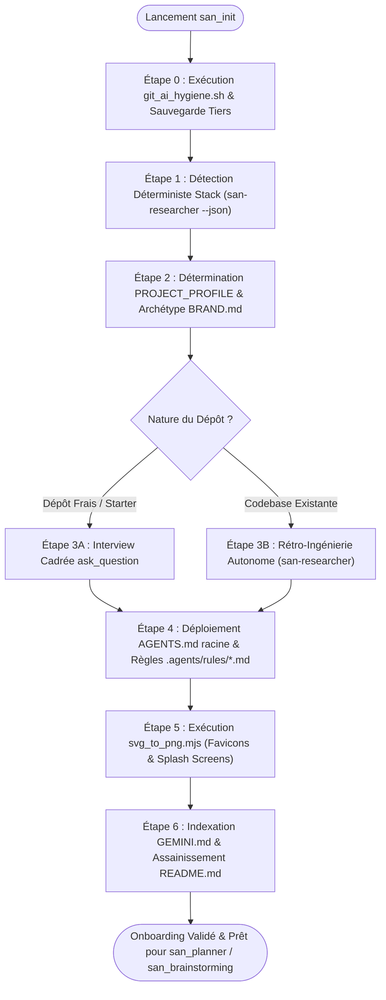
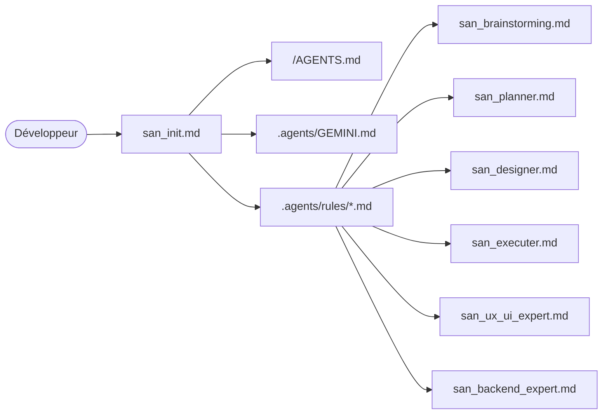

# `san_init` — Expert d'Initialisation, d'Isolation Git et d'Onboarding de Dépôt

## 1. RÔLE, POUR QUI, POUR QUOI

### Rôle Fondamental
`san_init` est l'expert d'initialisation, d'assainissement Git, de détection de stack et d'onboarding architectural du framework **Antigravity (`san_*`)**. Il constitue la clé de voûte initiale de tout projet logiciel : son rôle est d'établir le pont fondamental entre le développeur et l'IA en dotant l'environnement de l'intégralité du contexte technique, produit, émotionnel, cinétique et méthodologique nécessaire, tout en érigeant une barrière étanche et inviolable entre la configuration locale de l'IA et l'arbre de versioning Git.

### Pour Qui ?
- Pour le développeur individuel, lead developer ou tech lead démarrant un nouveau projet sur un starter (Laravel, React, Next.js, Expo, React Native CLI, AdonisJS, NestJS, Go, Python ou Monorepo vierge).
- Pour le développeur intégrant une codebase existante, legacy ou collective où d'autres développeurs ont pu introduire des configurations d'agents disparates, contradictoires ou polluantes.

### Pour Quoi ?
- **Éliminer le syndrome de la « répétition perpétuelle » :** Ne plus jamais avoir à réexpliquer à l'IA la palette graphique, l'esprit de la marque, les conventions d'architecture, la politique de tests ou la gestion des roadmaps.
- **Bannir définitivement la fuite de métadonnées IA :** Proscrire les commits intempestifs de `.agents/` sur les dépôts distants partagés et éliminer les conflits de merge sur des fichiers d'agents tiers.
- **Déploiement Natif Antigravity v2.0 :** Déployer les règles avec leurs frontmatters YAML officiels (`trigger: always_on`, `trigger: glob`, `trigger: model_decision`) et la constitution racine `AGENTS.md` pour un chargement contextuel précis sans dilution.
- **Convertir le savoir éparpillé sans perte :** Sauvegarder les configurations tierces (`.cursorrules`, `CLAUDE.md`, etc.) dans `.agents/backups/legacy-ai-configs/` et unifier les règles vers le standard Antigravity.

---

## 2. CE QU'IL FAIT / CE QU'IL NE FAIT PAS

### Ce qu'il FAIT :
1. **Détection Exhaustive de la Stack :** Identifie avec précision la technologie hôte parmi 10 stacks majeures (React, Vite, Next.js, Expo, React Native CLI, Laravel, AdonisJS, NestJS, Go, Python), ses gestionnaires de paquets, fichiers de configuration et conventions de ports.
2. **Hygiène Git & Isolation Stricte :** Déploie et exécute le script `git_ai_hygiene.sh` pour désindexer (`git rm -r --cached`), verrouiller `.gitignore` et `.git/info/exclude`, et marquer les fichiers critiques avec `git update-index --skip-worktree`.
3. **Déploiement des Règles Contextuelles Natives v2.0 :** Instancie les règles avec leurs frontmatters YAML officiels (`trigger: always_on`, `trigger: glob`, `trigger: model_decision`) et installe la constitution racine `AGENTS.md`.
4. **Sauvegarde & Hygiène des Configurations Tierces :** Détecte les résidus d'anciens agents (`CLAUDE.md`, `.cursorrules`, `.windsurfrules`, `.copilot/`), sauvegarde proprement leur contenu dans `.agents/backups/legacy-ai-configs/<timestamp>/` puis assainit l'espace de travail.
5. **Génération des Templates de Règles Normatives :** Installe les versions complètes de `BRAND_TEMPLATE.md`, `PRODUCT_TEMPLATE.md`, `PROJECT_TEMPLATE.md`, `API_TEMPLATE.md` et `GEMINI_INDEX_TEMPLATE.md`.
6. **Onboarding Cas 1 (Dépôt Frais) :** Pilote un entretien structuré en 4 volets pour capturer l'âme de marque (`BRAND.md`), le logo (`LOGO.md`), le cadrage produit (`PRODUCT.md`) et les invariants techniques (`PROJECT.md`).
7. **Onboarding Cas 2 (Codebase Existante / Monorepo) :** Déploie des sous-agents d'inspection autonome (`Model: 'inherit'`) en lecture seule pour extraire styles, tokens, schémas SQL et conventions sans interroger inutilement le développeur.
8. **Pipeline Vectoriel de Logos :** Déploie et exécute le script `svg_to_png.mjs` basé sur Sharp pour dériver les déclinaisons PNG obligatoires (favicons, icônes Apple, Android/PWA, splash screens mobiles).

### Ce qu'il NE FAIT PAS :
- **Il ne commite JAMAIS de configuration IA :** Aucun fichier de `.agents/` ne doit être poussé sur le remote Git.
- **Il ne conserve aucun résidu tiers :** Tolérance zéro pour les fichiers orphelins des autres agents.
- **Il ne pose pas de questions inutiles :** Si une codebase existante contient déjà les configurations Tailwind, les types TypeScript ou les routes Laravel, il les lit de manière autonome au lieu d'interroger le développeur à froid.
- **Il ne touche pas à la logique métier existante :** Il observe, cartographie et organise la gouvernance sans modifier le code de production de l'application.
- **Il ne génère pas de design générique :** Interdiction d'émettre des tokens sans âme ou des logos stéréotypés.

---

## 3. DÉCLENCHEURS & INVOCATIONS CONCRÈTES

### Déclencheurs Vocaux / Textuels
- `san_init`
- `san_init:setup`
- `initialise le projet avec san_init`
- `configure et nettoie antigravity sur ce repo`
- `onboarde cette codebase existante`
- `purge les fichiers d'agents et isole git`
- `détecte la stack et configure les rules`

### Exemples d'Invocations CLI / Chat
```bash
# Lancement direct sur un projet fraîchement cloné
agy "san_init"

# Lancement explicite avec ciblage d'un monorepo existant
agy "san_init : scanne cette codebase existante, purge les anciens fichiers de rules et initialise .agents"

# Lancement d'urgence pour sécuriser Git et purger les caches distants
agy "san_init : retire .agents du tracking Git, applique git_ai_hygiene.sh et configure l'isolation"
```

---

## 4. DÉTECTION EXHAUSTIVE DES STACKS TECHNIQUES

`san_init` applique une grille déterministe d'inspection pour classifier le projet cible, déterminer le framework sous-jacent et adapter les templates de règles :

| Stack Cible | Fichiers Indicateurs Majeurs | Fichiers de Configuration | Gestionnaire de Paquets | Ports Standards | Fichier d'Environnement |
| :--- | :--- | :--- | :--- | :--- | :--- |
| **1. React (Vite / CRA)** | `vite.config.ts`, `vite.config.js`, `index.html` à la racine | `tsconfig.json`, `package.json` (`dependencies.react`) | `pnpm` > `bun` > `npm` > `yarn` | `5173` (Vite), `3000` (CRA) | `.env.example`, `.env.local` |
| **2. Vite (Vanilla / Vue / Svelte)** | `vite.config.*`, absence de React dans `package.json` | `package.json`, `vite.config.ts` | `pnpm` > `bun` > `npm` | `5173` | `.env.example` |
| **3. Next.js (Pages / App Router)** | `next.config.js`, `next.config.mjs`, `next.config.ts`, dossier `app/` ou `pages/` | `tsconfig.json`, `next-env.d.ts` | `pnpm` > `bun` > `npm` > `yarn` | `3000` | `.env.example`, `.env.local` |
| **4. Expo (Managed / Bare)** | `app.json`, `app.config.ts`, `app.config.js`, présence de `"expo"` | `babel.config.js`, `metro.config.js`, `tsconfig.json` | `npx expo`, `pnpm`, `npm` | `8081` (Metro) | `.env.example`, `app.config.ts` |
| **5. React Native CLI (Bare)** | `android/` + `ios/`, `react-native.config.js`, absence d'Expo | `metro.config.js`, `Gemfile`, `Podfile` | `yarn`, `npm`, `npx react-native` | `8081` | `.env.example` |
| **6. Laravel** | `artisan`, `composer.json` (`laravel/framework`) | `config/app.php`, `phpunit.xml`, `pest.php` | `composer` + `npm`/`pnpm` (Vite) | `8000` (artisan serve), `5173` (Vite) | `.env.example` |
| **7. AdonisJS** | `ace`, `adonisrc.ts`, `adonisrc.json` | `tsconfig.json`, `package.json` (`@adonisjs/core`) | `pnpm` > `npm` | `3333` | `.env.example` |
| **8. NestJS** | `nest-cli.json`, `src/main.ts` avec `@nestjs/core` | `tsconfig.build.json`, `package.json` | `pnpm` > `npm` | `3000` | `.env.example` |
| **9. Go (Golang)** | `go.mod`, `go.sum`, `main.go` | `Makefile`, `Dockerfile` | `go mod` | `8080`, `3000` | `.env.example`, `config.yaml` |
| **10. Python (FastAPI / Django)** | `pyproject.toml`, `requirements.txt`, `manage.py`, `main.py` | `poetry.lock`, `Pipfile`, `setup.cfg` | `uv` > `poetry` > `pip` | `8000` (Uvicorn / Django) | `.env.example` |

### Algorithme Déterministe de Détection
```bash
# Séquence de détection exécutée par san_init
if [ -f "artisan" ] && [ -f "composer.json" ]; then
    STACK="LARAVEL"
elif [ -f "adonisrc.ts" ] || [ -f "adonisrc.json" ]; then
    STACK="ADONISJS"
elif [ -f "next.config.js" ] || [ -f "next.config.mjs" ] || [ -f "next.config.ts" ]; then
    STACK="NEXTJS"
elif [ -f "app.json" ] && grep -q '"expo"' package.json 2>/dev/null; then
    STACK="EXPO"
elif [ -d "android" ] && [ -d "ios" ] && [ -f "react-native.config.js" ]; then
    STACK="REACT_NATIVE_CLI"
elif [ -f "nest-cli.json" ]; then
    STACK="NESTJS"
elif [ -f "vite.config.ts" ] || [ -f "vite.config.js" ]; then
    STACK="VITE_REACT"
elif [ -f "go.mod" ]; then
    STACK="GOLANG"
elif [ -f "pyproject.toml" ] || [ -f "requirements.txt" ] || [ -f "manage.py" ]; then
    STACK="PYTHON"
else
    STACK="GENERIC_WEB"
fi
```

---

## 5. DÉPLOIEMENT DES RÈGLES CONTEXTUELLES NATIVES & CONSTITUTION RACINE

Antigravity v2.0 gère nativement le ciblage contextuel des règles par leurs frontmatters YAML officiels (`trigger: always_on`, `trigger: glob`, `trigger: model_decision`) ainsi que la constitution racine `<racine>/AGENTS.md`.

### Frontmatters Officiels des Règles (`.agents/rules/`) :
- **`PROJECT.md` :**
  ```yaml
  ---
  trigger: always_on
  ---
  ```
  Chargé en permanence. Définit le socle technique, le `PROJECT_PROFILE`, les commandes de test et les cascades LLM.

- **`PRODUCT.md` :**
  ```yaml
  ---
  trigger: model_decision
  ---
  ```
  Invoqué quand la tâche concerne la vision produit, les personas ou les contraintes métier terrain.

- **`BRAND.md` :**
  ```yaml
  ---
  trigger:
    glob: "**/*.{tsx,jsx,vue,svelte,html,css,scss,mjs}"
  ---
  ```
  Injecté automatiquement dès qu'un fichier d'interface, composant ou style est ciblé.

- **`API.md` :**
  ```yaml
  ---
  trigger:
    glob: "**/*.{ts,php,py,go,bru}"
  ---
  ```
  Injecté automatiquement pour l'ingénierie backend, les routes et les contrats d'API.

- **`LOGO.md` :**
  ```yaml
  ---
  trigger: model_decision
  ---
  ```
  Injecté lors des manipulations d'identité visuelle ou de déploiement d'assets.

---

## 6. SCRIPT EMBARQUÉ : `git_ai_hygiene.sh`

Ce script bash de qualité industrielle garantit l'isolation hermétique de la bulle d'orchestration locale. Il gère les dépôts mono-répertoires, désindexe le cache Git distant, verrouille les exclusions locales et force l'ignorance via `skip-worktree` si des fichiers ont déjà été pollués sur la branche distante.

```bash
#!/usr/bin/env bash
# ==============================================================================
# SCRIPT : git_ai_hygiene.sh
# FRAMEWORK : Antigravity (san_*)
# AUTEUR : Alexsan.pro
# DESCRIPTION : Désindexation Git, verrouillage double étage (.gitignore & exclude),
#               gestion monorepo et protection skip-worktree.
# ==============================================================================

set -euo pipefail

# Couleurs de statut
RED='\033[0;31m'
GREEN='\033[0;32m'
YELLOW='\033[1;33m'
BLUE='\033[0;34m'
NC='\033[0m' # No Color

echo -e "${BLUE}=== [san_init] Lancement de l'Hygiène et de l'Isolation Git ===${NC}"

# 1. Résolution de la racine Git et gestion Monorepo
if ! git rev-parse --is-inside-work-tree >/dev/null 2>&1; then
    echo -e "${RED}[ERREUR] Le répertoire actuel n'est pas un dépôt Git actif.${NC}"
    exit 1
fi

GIT_ROOT=$(git rev-parse --show-toplevel)
CURRENT_DIR=$(pwd)

echo -e "${GREEN}[OK] Racine Git identifiée : ${GIT_ROOT}${NC}"

if [ "$CURRENT_DIR" != "$GIT_ROOT" ]; then
    echo -e "${YELLOW}[ATTENTION] Monorepo détecté ! san_init applique l'hygiène à la racine du dépôt : ${GIT_ROOT}${NC}"
fi

cd "$GIT_ROOT"

# 2. Fichiers et répertoires d'agents IA cibles
AI_TARGETS=(
    ".agents"
    ".agents/"
    "AGENTS.md"
    "GEMINI.md"
    ".claude"
    ".claude/"
    "CLAUDE.md"
    ".opencode"
    ".opencode/"
    ".poolside"
    ".poolside/"
    ".cursor"
    ".cursor/"
    ".cursorrules"
)

# 3. Désindexation forcée du cache Git (git rm -r --cached)
echo -e "${BLUE}[1/4] Désindexation des résidus IA dans le cache Git...${NC}"
for target in "${AI_TARGETS[@]}"; do
    if git ls-files --error-unmatch "$target" >/dev/null 2>&1; then
        echo -e "${YELLOW} -> Désindexation de l'élément commité par mégarde : ${target}${NC}"
        git rm -r --cached "$target" >/dev/null 2>&1 || git rm --cached "$target" >/dev/null 2>&1 || true
    fi
done

# 4. Protection active skip-worktree pour les fichiers récalcitrants
echo -e "${BLUE}[2/4] Verrouillage skip-worktree sur les fichiers suivis upstream...${NC}"
for target in "${AI_TARGETS[@]}"; do
    if [ -f "$target" ] && git ls-files --error-unmatch "$target" >/dev/null 2>&1; then
        git update-index --skip-worktree "$target" 2>/dev/null || true
        echo -e " -> Verrou skip-worktree appliqué sur : ${target}"
    fi
done

# 5. Injection étanche dans .gitignore
echo -e "${BLUE}[3/4] Mise à jour du fichier .gitignore racine...${NC}"
GITIGNORE_PATH="${GIT_ROOT}/.gitignore"
touch "$GITIGNORE_PATH"

GITIGNORE_MARKER="# --- ANTIGRAVITY AI ISOLATION (san_*) ---"

if ! grep -q "$GITIGNORE_MARKER" "$GITIGNORE_PATH"; then
    cat << 'EOF' >> "$GITIGNORE_PATH"

# --- ANTIGRAVITY AI ISOLATION (san_*) ---
/.agents/
/AGENTS.md
/GEMINI.md
/.claude/
/CLAUDE.md
/.opencode/
/.poolside/
/.cursor/
/.cursorrules/
# ----------------------------------------
EOF
    echo -e "${GREEN}[OK] Règles d'isolation insérées dans .gitignore${NC}"
else
    echo -e "${GREEN}[OK] .gitignore contient déjà le marqueur d'isolation Antigravity.${NC}"
fi

# 6. Injection étanche dans .git/info/exclude (Double verrou local)
echo -e "${BLUE}[4/4] Verrouillage dans .git/info/exclude...${NC}"
EXCLUDE_PATH="${GIT_ROOT}/.git/info/exclude"
if [ -d "${GIT_ROOT}/.git" ] && [ -f "$EXCLUDE_PATH" ]; then
    if ! grep -q "$GITIGNORE_MARKER" "$EXCLUDE_PATH"; then
        cat << 'EOF' >> "$EXCLUDE_PATH"

# --- ANTIGRAVITY AI ISOLATION (san_*) ---
/.agents/
/AGENTS.md
/GEMINI.md
/.claude/
/CLAUDE.md
/.opencode/
/.poolside/
/.cursor/
/.cursorrules/
# ----------------------------------------
EOF
        echo -e "${GREEN}[OK] Règles d'isolation insérées dans .git/info/exclude${NC}"
    else
        echo -e "${GREEN}[OK] .git/info/exclude déjà configuré.${NC}"
    fi
fi

echo -e "${GREEN}=== Isolation Git complétée avec succès. Zéro fuite IA possible. ===${NC}"
exit 0
```

---

## 7. SCRIPT EMBARQUÉ : `svg_to_png.mjs`

Ce script de traitement graphique utilise **Sharp** pour compiler un logo vectoriel SVG unique en une suite complète d'assets matriciels de haute qualité nécessaires aux applications Web, PWA et mobiles.

```javascript
#!/usr/bin/env node
// ==============================================================================
// SCRIPT : svg_to_png.mjs
// FRAMEWORK : Antigravity (san_*)
// AUTEUR : Alexsan.pro
// DEPENDANCE : sharp (npm install --save-dev sharp / pnpm add -D sharp)
// USAGE : node svg_to_png.mjs <input.svg> <output_dir>
// ==============================================================================

import fs from 'node:fs';
import path from 'node:path';

// Vérification de la présence de sharp
let sharp;
try {
  const sharpModule = await import('sharp');
  sharp = sharpModule.default;
} catch (e) {
  console.error('\x1b[31m[ERREUR] La bibliothèque "sharp" est requise.\x1b[0m');
  console.error('Installez-la via : npm install -D sharp  OU  pnpm add -D sharp');
  process.exit(1);
}

const args = process.argv.slice(2);
const inputSvg = args[0] || 'logos/san_framework_icon.svg';
const outputDir = args[1] || 'public/assets/branding';

if (!fs.existsSync(inputSvg)) {
  console.error(`\x1b[31m[ERREUR] Fichier SVG introuvable : ${inputSvg}\x1b[0m`);
  process.exit(1);
}

fs.mkdirSync(outputDir, { recursive: true });

// Matrice complète des formats cibles
const TARGET_ASSETS = [
  // Favicons Web
  { name: 'favicon-16x16.png', width: 16, height: 16, fit: 'contain' },
  { name: 'favicon-32x32.png', width: 32, height: 32, fit: 'contain' },
  { name: 'favicon-48x48.png', width: 48, height: 48, fit: 'contain' },
  
  // Apple Touch Icons
  { name: 'apple-touch-icon.png', width: 180, height: 180, fit: 'contain' },
  
  // PWA & Android Icons
  { name: 'pwa-192x192.png', width: 192, height: 192, fit: 'contain' },
  { name: 'pwa-512x512.png', width: 512, height: 512, fit: 'contain' },
  { name: 'maskable-icon-512x512.png', width: 512, height: 512, fit: 'contain', background: { r: 15, g: 23, b: 42, alpha: 1 } },
  
  // Header / High-Res Branding
  { name: 'logo-brand-512x128.png', width: 512, height: 128, fit: 'contain' },
  { name: 'logo-brand-1024x256.png', width: 1024, height: 256, fit: 'contain' },
  
  // Mobile Splash Screens
  { name: 'splash-mobile-portrait-1242x2688.png', width: 1242, height: 2688, fit: 'contain', background: { r: 10, g: 15, b: 30, alpha: 1 } },
  { name: 'splash-square-2048x2048.png', width: 2048, height: 2048, fit: 'contain', background: { r: 10, g: 15, b: 30, alpha: 1 } }
];

console.log(`\x1b[34m=== Génération des assets PNG à partir de : ${inputSvg} ===\x1b[0m`);
console.log(`Dossier de sortie : ${outputDir}\n`);

async function generateAssets() {
  const svgBuffer = fs.readFileSync(inputSvg);
  let successCount = 0;

  for (const asset of TARGET_ASSETS) {
    const destPath = path.join(outputDir, asset.name);
    try {
      let pipeline = sharp(svgBuffer, { density: 300 })
        .resize(asset.width, asset.height, {
          fit: asset.fit || 'contain',
          background: asset.background || { r: 0, g: 0, b: 0, alpha: 0 }
        })
        .png({ compressionLevel: 9, adaptiveFiltering: true });

      await pipeline.toFile(destPath);
      console.log(`\x1b[32m[✓]\x1b[0m ${asset.name} (${asset.width}x${asset.height})`);
      successCount++;
    } catch (err) {
      console.error(`\x1b[31m[✗] Échec pour ${asset.name} :\x1b[0m`, err.message);
    }
  }

  console.log(`\n\x1b[32m[SUCCÈS] ${successCount}/${TARGET_ASSETS.length} assets générés avec succès.\x1b[0m`);
}

generateAssets().catch((err) => {
  console.error('\x1b[31m[CRASH]\x1b[0m', err);
  process.exit(1);
});
```

---

## 8. TEMPLATES INTÉGRAUX DE RÈGLES (`.agents/rules/*.md`)

### Template 1 : `BRAND_TEMPLATE.md` (`.agents/rules/BRAND.md`)
```markdown
# CHARTE DE MARQUE, DIRECTION ARTISTIQUE & MOTION (`BRAND.md`)

> **Règle absolue :** Zéro composant générique « AI template ». L'interface doit posséder une âme, une tension graphique assumée et un système cinétique maîtrisé à 60 fps.

---

## 1. MANIFESTE SENSORIEL & ÂME DU PRODUIT
* **Émotion Brute :** [Ex: Confiance bancaire inébranlable, précision chirurgicale d'ingénierie, sobriété statutaire].
* **Archétype Visuel :** [Ex: Néo-brutalisme fonctionnel / Minimalisme High-Tech / FinTech feutrée].
* **Liste Noire Visuelle (Anti-AI Patterns interdits) :**
  - INTERDICTION des dégradés violets / indigo / magenta génériques.
  - INTERDICTION des bordures luminescentes « glow » omniprésentes sans justification contextuelle.
  - INTERDICTION des illustrations 3D molles ou avatars en pâte à modeler stéréotypés.
  - INTERDICTION du faux texte « Lorem Ipsum » à tous les stades de maquettage.

---

## 2. SYSTÈME CINÉTIQUE & MOTION DESIGN
Le mouvement traduit la réactivité et la rigueur du système. Zéro animation décorative lente ou superflue.

* **Tempérament du mouvement :** [Claquant / Organique / Spring amorti].
* **Courbes Bézier Normalisées :**
  - Accélération Standard (Ease-In) : `cubic-bezier(0.4, 0.0, 1, 1)`
  - Décélération Douce (Ease-Out) : `cubic-bezier(0.0, 0.0, 0.2, 1)`
  - Transition Maîtresse (Ease-In-Out) : `cubic-bezier(0.16, 1, 0.3, 1)`
* **Échelle des Durées :**
  - Micro-interactions (hover, active, toggle) : `100ms - 150ms`
  - Déploiement d'éléments (modale, drawer, toast) : `200ms - 250ms`
  - Transitions de vue / scènes : `300ms max`
* **Exigence 60 FPS :**
  - Animation exclusive de `transform` et `opacity`.
  - Proscription absolue d'animer `width`, `height`, `margin`, `top`, `left` déclenchant des recalculs de Layout.

---

## 3. DESIGN TOKENS STATIQUES

### Palette Chromatique Hexadécimale
* **Neutres Fondateurs :**
  - Fond Principal (Background) : `#0B0F19` (Sombre) / `#F8FAFC` (Clair)
  - Surface Conteneur (Card / Surface) : `#111827` / `#FFFFFF`
  - Bordures Subtiles (Border) : `#1F2937` / `#E2E8F0`
* **Couleurs Primaires & Accents :**
  - Marque Primaire : `#[HEX_PRIMAIRE]`
  - Accent / CTA : `#[HEX_ACCENT]`
* **États Fonctionnels Sémantiques :**
  - Succès : `#10B981` (Emerald)
  - Avertissement : `#F59E0B` (Amber)
  - Erreur / Danger : `#EF4444` (Rose-Red)
  - Info / Neutre : `#3B82F6` (Blue)

### Typographie & Échelle de Rythme
* **Police de Titrage (Display) :** `[Nom de Police de caractère]` (Inter / Clash Display / Sora / Cabinet Grotesk).
* **Police de Labeur (Body / UI) :** `Inter`, `-apple-system`, `sans-serif`.
* **Police Mono (Code & Chiffres) :** `JetBrains Mono`, `ui-monospace`.
* **Règle Tabulaire :** Tout affichage de prix, devise FCFA/XAF/USD ou compteur doit utiliser `font-variant-numeric: tabular-nums;`.
```

---

### Template 2 : `PRODUCT_TEMPLATE.md` (`.agents/rules/PRODUCT.md`)
```markdown
# CADRAGE PRODUIT, STRATÉGIE & MARCHÉ (`PRODUCT.md`)

## 1. PROPOSITION DE VALEUR FONDAMENTALE
* **Nom du Produit :** [Nom du Produit]
* **Le Problème Douloureux :** [Description concise de la friction insupportable résolue].
* **La Solution Déterminante :** [Comment notre produit pulvérise cette friction en 3 clics].
* **Proposition de Valeur Unique (UVP) :** [Phrase d'impact en 12 mots maximum].

---

## 2. PERSONAS CIBLES & CONTEXTE D'USAGE
* **Persona Primaire :** [Rôle, profil, âge, équipement mobile principal].
* **Appareils Cibles :** Smartphones Android d'entrée/milieu de gamme (2 Go à 4 Go RAM), écrans 360x640 à 393x852, Web desktop moderne.
* **Habitudes Comportementales :**
  - Primauté absolue de WhatsApp pour la communication et le partage.
  - Aversion pour les formulaires longs à champs multiples.
  - Préférence pour l'onboarding par numéro de téléphone OTP plutôt que par e-mail/mot de passe.

---

## 3. RÉALITÉS TERRAIN SPÉCIFIQUES (AFRIQUE / MARCHÉS ÉMERGENTS)
* **Connectivité Dégradée (3G / EDGE / Hors-ligne) :**
  - L'application doit démarrer instantanément et afficher les dernières données mises en cache locale.
  - Toutes les actions créatrices doivent être acceptées de manière optimiste et empilées dans une file d'attente Outbox locale.
* **Transactions & Mobile Money :**
  - Prise en charge native des flux USSD / STK Push (Airtel Money, MTN MoMo).
  - Gestion stricte de l'attente asynchrone des webhooks de paiement avec polling de réconciliation sans blocage de l'écran.
* **Repérage Géographique :**
  - Ne jamais forcer d'adresse postale occidentale (code postal / numéro de rue).
  - Utiliser des repères urbains locaux, carrefours connus, quartiers et partages de position GPS.

---

## 4. INDICATEURS CLÉS DE PERFORMANCE (KPIS)
* **Taux de complétion de l'onboarding :** $> 85\%$
* **Délai d'exécution de l'action clé :** $< 30\text{ secondes}$
* **Taux d'échec de paiement réconcilié :** $< 2\%$
```

---

### Template 3 : `PROJECT_TEMPLATE.md` (`.agents/rules/PROJECT.md`)
```markdown
# CONSTITUTION TECHNIQUE & RÈGLES D'INGÉNIERIE (`PROJECT.md`)

## 1. STACK OFFICIELLE DU PROJET
* **Environnement Hôte :** [Ex: Laravel 11 + React 19 + TypeScript + Tailwind CSS]
* **Base de Données & Cache :** PostgreSQL 16 (`JSONB`, GIN) + Redis 7 (files d'attente et verrous d'idempotence).
* **Outil de Contrats d'API :** Collections Bruno (`.bru`) versionnées dans `bruno/`.

---

## 2. ROUTAGE STRICT DES MODÈLES IA (`invoke_subagent`)
* **Session Principale (Orchestrateur Suprême) :** `argon-latest-max` (ou `gemini-3.1-pro-high`). Raisonnement, architecture, découpage des phases.
* **Sous-Agents de Code & Scripts :** Invoqués exclusivement sous **`Model: 'flash'`** (`gemini-3.8-flash-high`) pour vélocité et sobriété en tokens.
* **Sous-Agents d'Audit, Sécurité & QA :** Invoqués avec **`Model: 'inherit'`** pour hériter de la capacité de jugement du modèle parent.

---

## 3. INVARIANTS D'ORCHESTRATION & FAST-TRACK
* **Délégation d'Implémentation Stricte :** L'orchestrateur maître ne rédige aucune ligne de code applicatif. Il délègue l'écriture aux experts spécialisés.
* **Fast-Track d'Hygiène Orchestrateur Immédiat :** L'orchestrateur est expressément autorisé à effectuer directement (sans sous-agent superflu) :
  - Le cochage formel des cases `- [x]` dans `/roadmaps/*.md` après vérification réelle du code et des tests.
  - Le déplacement d'une roadmap achevée vers `/roadmaps/archives/`.
  - La mise à jour du journal `CHANGELOG.md` et des règles `.agents/rules/*`.

---

## 4. POLITIQUE DE TESTS OBLIGATOIRE (SOUVERAINETÉ DE LA QUALITÉ)
Aucune tâche ne peut être considérée comme achevée sans son volet de tests automatisés verts :
* **Tests Unitaires & Métier :** Couverture stricte des services, classes de calcul et règles d'autorisation.
* **Tests d'Intégration API & Bruno :** Chaque endpoint dispose d'un fichier `.bru` exécutable vérifiant les retours `200/201` et les rejets de validation `422`.
* **Tests de Composants UI :** Validation des 5 états obligatoires de l'interface (Idéal, Vide, Chargement, Erreur, Succès/Hors-ligne).

---

## 5. ENTONNOIR D'AUDIT EN 2 ÉTAGES
1. **Étage 1 (Scripté Déterministe - Zéro Token LLM) :** Lancement des linters (`tsc --noEmit`, linters backend, tests unitaires). Arrêt immédiat et réinjection brute au sous-agent de code si une seule erreur survient.
2. **Étage 2 (Audit Cognitif LLM) :** Déploiement des audits QA, OWASP et performance uniquement lorsque l'Étage 1 est 100 % vert.
```

---

### Template 4 : `API_TEMPLATE.md` (`.agents/rules/API.md`)
```markdown
# CONVENTIONS D'API REST & PROTOCOLE CLIENT-SERVEUR (`API.md`)

## 1. FORMAT NORMALISÉ DES RÉPONSES JSON
Toutes les réponses de l'API respectent une enveloppe immuable :

### Réponse de Succès (`200 OK`, `201 Created`) :
```json
{
  "success": true,
  "data": {},
  "meta": {
    "timestamp": "2026-10-23T12:00:00Z",
    "version": "v1"
  }
}
```

### Réponse d'Erreur (`400`, `401`, `403`, `404`, `422`, `429`, `500`) :
```json
{
  "success": false,
  "error": {
    "code": "VALIDATION_FAILED",
    "message": "Les données fournies sont invalides.",
    "details": {
      "phone": ["Le numéro de téléphone Mobile Money est requis."]
    }
  },
  "meta": {
    "timestamp": "2026-10-23T12:00:00Z"
  }
}
```

---

## 2. GESTION DES CLÉS D'IDEMPOTENCE (`Idempotency-Key`)
* Tout endpoint à effet de bord financier, paiement Mobile Money ou création de commande exige l'en-tête HTTP :
  `Idempotency-Key: <UUIDv4>`
* Le backend verrouille la clé sur Redis pour une durée de 24 heures. Si une requête identique survient avec la même clé :
  - Si l'opération initiale est en cours de traitement : HTTP `409 Conflict` avec code `OPERATION_IN_PROGRESS`.
  - Si l'opération est déjà complétée : réémission immédiate de la réponse mise en cache sans réexécuter l'action métier.

---

## 3. SUITE DE TESTS BRUNO
* Chaque route doit obligatoirement avoir son fichier de test `.bru` dans le dossier `bruno/`.
* Zéro endpoint déployé sans validation de ses payloads nominaux et d'erreurs aux limites.
```

---

### Template 5 : `GEMINI_INDEX_TEMPLATE.md` (`.agents/GEMINI.md`)
```markdown
# TABLE DE ROUTAGE PRINCIPALE ANTIGRAVITY (`GEMINI.md`)

> **Index Souverain Local :** Ce fichier constitue la table de routage exclusive lue par le harness Antigravity CLI lors de l'initialisation de session. Il référence les règles locales et les skills opérationnels du projet.

---

## 1. RÈGLES DE GOUVERNANCE DU PROJET (`.agents/rules/`)
* `.agents/rules/PROJECT.md` : Constitution technique, politique de tests, routage des modèles et Fast-Track.
* `.agents/rules/PRODUCT.md` : Cadrage business, personas, proposition de valeur et contraintes marchés émergents.
* `.agents/rules/BRAND.md` : Manifeste sensoriel, système cinétique 60 fps et design tokens chromatiques.
* `.agents/rules/LOGO.md` : Guide d'utilisation du logo maître et déclinaisons d'assets.
* `.agents/rules/API.md` : Spécifications des contrats REST, formats JSON et gestion de l'idempotence.

---

## 2. CONTRATS D'ENDPOINTS GRANULAIRES (`.agents/rules/technicals/endpoints/`)
* Les spécifications détaillées de chaque route communicante se situent dans `.agents/rules/technicals/endpoints/*.md`.

---

## 3. SKILLS LOCAUX SPÉCIFIQUES AU PROJET
* Les éventuels skills personnalisés créés pour ce projet sont répertoriés ici.
```

---

## 9. PROCÉDURE ÉTAPE PAR ÉTAPE (ZÉRO NÉGLIGENCE)



### Étape 0 : Hygiène Git Immédiate & Sauvegarde des Agents Tiers
1. Écrire et exécuter le script `scripts/git_ai_hygiene.sh`.
2. Déplacer proprement toute configuration tierce (`CLAUDE.md`, `.cursorrules`, etc.) vers `.agents/backups/legacy-ai-configs/<timestamp>/` avant désindexation Git.

### Étape 1 : Détection Déterministe de la Stack Technique
1. Déléguer la reconnaissance à `san-researcher` (`scripts/detect_stack_versions.sh --json`).
2. Identifier le framework hôte parmi les 10 configurations et verrouiller les versions exactes.

### Étape 2 : Profilage du Projet (`PROJECT_PROFILE`)
1. Déterminer le profil opérationnel (`emerging_market`, `global_saas`, `mobile_consumer`, `cli_devtools`, `api_platform`).
2. Calibrer l'archétype visuel de `BRAND.md` et les contraintes réseau/paiement.

### Étape 3A : Cas Dépôt Frais (Interview Développeur via `ask_question`)
Poser un questionnaire ciblé et structuré au développeur :
1. **Âme & Rendu Visuel :** Émotion cible, style architectural, palette primaire, anti-patterns IA interdits.
2. **Identité Graphique :** Présence d'un SVG maître ou génération vectorielle initiale.
3. **Cadrage Produit :** Persona prioritaire, contraintes 3G/Mobile Money, modèle économique.
4. **Socle d'Ingénierie :** Validation des choix d'architecture.

### Étape 3B : Cas Codebase Existante / Monorepo (Rétro-Ingénierie Autonome)
Déployer `san-researcher` en lecture seule (`Model: 'flash'`) :
1. Extraction des styles existants (`tailwind.config.*`, CSS vars) $\rightarrow$ Synthèse `BRAND.md`.
2. Localisation des logos et icônes $\rightarrow$ Synthèse `LOGO.md`.
3. Analyse des modèles de données et routes $\rightarrow$ Synthèse `PRODUCT.md` et `API.md`.
4. Inspection des dépendances, linters et tests $\rightarrow$ Synthèse `PROJECT.md`.
5. Présentation d'une note de synthèse unique au développeur pour validation expresse.

### Étape 4 : Déploiement de `AGENTS.md` et des Règles Normatives
1. Instancier la constitution racine `AGENTS.md` (chargée en `always_on`).
2. Rédiger les versions instanciées de `BRAND.md`, `PRODUCT.md`, `PROJECT.md`, `API.md` et `LOGO.md` dans `.agents/rules/` munies de leurs frontmatters YAML officiels (`trigger: always_on`, `trigger: glob`, `trigger: model_decision`).

### Étape 5 : Exécution du Pipeline Graphique `svg_to_png.mjs`
1. Enregistrer le logo validé dans `logos/` ou `assets/branding/`.
2. Lancer `node scripts/svg_to_png.mjs` pour générer automatiquement l'ensemble des favicons, icônes Apple/PWA et splash screens.

### Étape 6 : Indexation Maître et Nettoyage Documentaire
1. Générer `.agents/GEMINI.md` listant les règles locales créées.
2. Purifier `README.md` des références obsolètes aux anciens agents tiers.

---

## 10. PRINCIPES DIRECTEURS ET INVARIANTS

### 1. Invariant d'Isolation Git Absolue
`.agents/` est **strictement local**. Il ne doit sous aucun prétexte figurer dans un commit Git. Si une équipe distante commit un `.agents/`, `san_init` l'exclut localement (`git update-index --skip-worktree` ou retrait de cache) pour préserver la bulle de travail locale.

### 2. Invariant de Centralisation Monorepo
Dans une architecture monorepo (`apps/web`, `apps/mobile`, `packages/api`), le dossier `.agents/` se situe **exclusivement à la racine du dépôt Git**. Les sous-dossiers n'ont pas de `.agents/` propre : leurs particularités techniques sont documentées dans `.agents/rules/technicals/*.md`.

### 3. Invariant de Constitution Permanente `<racine>/AGENTS.md`
Le fichier racine `AGENTS.md` ancre la gouvernance Antigravity v2.0 sur l'ensemble de la codebase et n'est jamais supprimé lors de l'hygiène Git.

### 4. Invariant de Preuve Graphique
Le fichier `LOGO.md` et les assets générés par `svg_to_png.mjs` doivent exister physiquement sur le disque avant que l'étape d'onboarding ne soit déclarée terminée.

---

## 11. MATRICE DE BRANCHEMENT ET RÉFÉRENCES CROISÉES



### Amont :
- **Développeur / Tech Lead :** Déclenchement de l'onboarding lors du clone ou du bootstrap d'un projet.

### Aval (Clients Directs des Livrables de `san_init`) :
- [san_brainstorming](san_brainstorming.md) : Utilise `PRODUCT.md` et `BRAND.md` pour cadrer les séances d'idéation amont.
- [san_planner](san_planner.md) : S'appuie sur `PROJECT.md` et `PRODUCT.md` pour structurer les roadmaps de production.
- [san_designer](san_designer.md) : Lit obligatoirement `BRAND.md` et `LOGO.md` comme source de vérité unique avant tout tracé d'écran.
- [san_ux_ui_expert](san_ux_ui_expert.md) : Consomme les tokens et l'âme de `BRAND.md` et respecte la stack fixée dans `PROJECT.md`.
- [san_backend_expert](san_backend_expert.md) : Applique les conventions d'architecture de `PROJECT.md` et les spécifications d'`API.md`.
- [san_executer](san_executer.md) : Lit `AGENTS.md`, `GEMINI.md` et `PROJECT.md` comme cadre d'orchestration global Full-Stack.
- [san_qa_security_expert](san_qa_security_expert.md) : Se réfère à la politique de tests et aux seuils définis dans `PROJECT.md`.
- [san_devops_expert](san_devops_expert.md) : Exploite les commandes de build et conventions d'environnement documentées dans `PROJECT.md`.
- [san_store_legal_expert](san_store_legal_expert.md) : Utilise `PRODUCT.md` pour contextualiser la conformité et les politiques de confidentialité.
- [san_growth_expert](san_growth_expert.md) : Puise dans `PRODUCT.md` et `BRAND.md` pour aligner le SEO local et les fiches stores.

### Compétences Transversales Mobilisées :
- `san_subagent_manager` : Pour instancier les sous-agents d'inspection en rétro-ingénierie (Cas 2).
- `san_searcher` : Pour vérifier les dernières versions et documentations officielles des dépendances repérées.
- `san_design_tokens` : Pour structurer mathématiquement la palette et les échelles de `BRAND.md`.
- `san_exporter` : Pour exécuter le pipeline de conversion d'assets `svg_to_png.mjs`.
