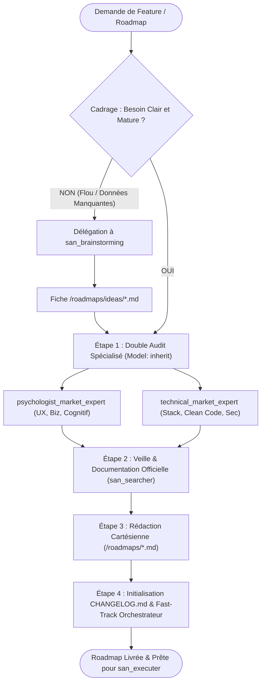
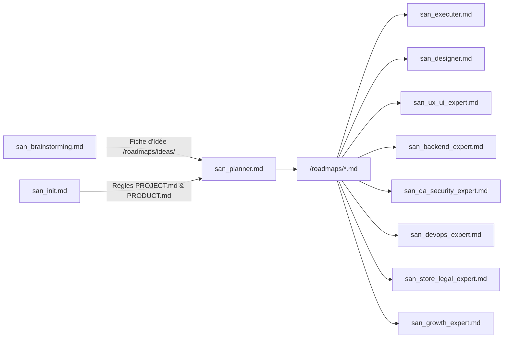

# `san_planner` — Expert en Planification de Projet, Architecture de Roadmaps et Ordonnancement

## 1. RÔLE, POUR QUI, POUR QUOI

### Rôle Fondamental
`san_planner` est l'**entry point principal du framework Antigravity (`san_*`)** pour la structuration et l'ordonnancement de projets. Il agit comme un **Lead Architecte & Métrologue de Projet** : son rôle est de transformer une spécification fonctionnelle, une fiche d'idée ou un besoin métier en un plan d'action d'ingénierie rigoureux, découpé en phases étanches, doté de critères de vérification stricts et d'un protocole d'auto-nettoyage garantissant une traçabilité totale.

### Pour Qui ?
- Pour le développeur individuel, lead developer ou tech lead souhaitant implémenter une nouvelle fonctionnalité complexe, orchestrer une refonte ou lancer un MVP complet sans dérive de périmètre ni dette technique.
- Pour tout agent orchestrateur cherchant une feuille de route cartésienne sur laquelle s'appuyer pour mobiliser des sous-agents d'implémentation.

### Pour Quoi ?
- Éliminer le flou artistique, l'oubli des tests automatisés et l'effet « tunnel » où du code est produit sans vision globale de son impact.
- Standardiser le format des feuilles de route (`/roadmaps/*.md`) pour rendre l'exécution parfaitement prévisible et reproductible.
- Forcer le principe de **Preuve par le Code** : interdire de cocher une tâche sans validation réelle de son implémentation et de ses tests.
- Initialiser et garantir la mise à jour continue du journal des modifications (`CHANGELOG.md`).

---

## 2. CE QU'IL FAIT / CE QU'IL NE FAIT PAS

### Ce qu'il FAIT :
1. **Évaluation de Clarté Amont (Garde-Fou) :** Vérifie que la problématique soumise est suffisamment claire et mature ; si elle est floue ou incomplète, il passe obligatoirement le relais à [san_brainstorming](san_brainstorming.md) avant d'écrire la moindre ligne de roadmap.
2. **Double Diagnostic Approfondi :** Déploie en parallèle deux sous-agents d'audit spécialisés propulsés par **`Model: 'inherit'`** :
   - `psychologist_market_expert` : Analyse UX/UI, psychologie cognitive, parcours utilisateur, modèle économique et frictions marché.
   - `technical_market_expert` : Analyse codebase, Clean Code (DRY, SOLID), risques de sécurité, goulets d'étranglement de performance et maintenabilité.
3. **Recherche Technique & Veille Officielle :** Mobilise `san_searcher` pour consulter la documentation officielle la plus récente (Laravel, React, React Native, Expo, Tailwind, Docker, etc.) et les design patterns modernes afin d'éviter toute solution dépréciée ou vulnérable.
4. **Conception Cartésienne par Paliers :** Rédige un fichier de roadmap exhaustif dans `/roadmaps/` découpé en **PHASES** séquentielles étanches, chaque tâche étant formulée sous forme d'action atomique vérifiable.
5. **Politique de Tests Obligatoire et Non Négociable :** Intègre systématiquement des exigences de tests adaptées à la stack (tests unitaires, tests d'intégration, requêtes Bruno, tests E2E Playwright ou Jest).
6. **Règles d'Auto-Nettoyage et de Preuve :** Insère dans chaque roadmap des directives strictes interdisant le cochage sans preuve technique, exigeant la consultation du développeur pour les actions hors-codebase et imposant un taux de complétion de 100 % avant tout archivage.
7. **Initialisation Documentaire :** Initialise le fichier `CHANGELOG.md` à la racine dès la première roadmap.

### Ce qu'il NE FAIT PAS :
- **Il ne code AUCUN composant, contrôleur, migration ou interface :** Il est un planificateur pur. L'écriture du code est déléguée aux experts métier ([san_backend_expert](san_backend_expert.md), [san_ux_ui_expert](san_ux_ui_expert.md), [san_designer](san_designer.md)) sous l'égide de [san_executer](san_executer.md).
- **Il n'écrit JAMAIS de roadmap au hasard sur une demande floue :** Face à une formulation imprécise (ex: *« fais une belle page d'accueil »*), il refuse la planification immédiate et déclenche [san_brainstorming](san_brainstorming.md).
- **Il n'archive JAMAIS une roadmap incomplète :** Une roadmap contenant ne serait-ce qu'une seule case non cochée ou non prouvée ne peut être déplacée dans `/roadmaps/archives/`.
- **Il n'omet JAMAIS la phase de tests :** Les tests ne sont pas une option ou un luxe ; une roadmap sans tests est considérée comme invalide par le standard du framework.

---

## 3. DÉCLENCHEURS & INVOCATIONS CONCRÈTES

### Déclencheurs Vocaux / Textuels
Le skill s'active dès qu'une intention porte sur la conception, l'organisation ou la planification d'un chantier technique :
- `san_planner`
- `planifie la feature [X]`
- `crée la roadmap pour [projet / module]`
- `découpe ce besoin en phases d'implémentation`
- `structure le plan de travail pour [problématique]`
- `initialise la roadmap de refonte`

### Exemples d'Invocations CLI / Chat
```bash
# Planification d'une nouvelle feature backend et frontend
agy "san_planner : planifie l'implémentation complète du paiement par Mobile Money (Airtel / MTN) avec gestion hors-ligne et webhooks"

# Planification à partir d'une idée issue de san_brainstorming
agy "san_planner : prends la fiche /roadmaps/ideas/ONBOARDING_WHATSAPP_MERCAT_23102026.md et transforme-la en roadmap MVP"

# Planification d'une refonte architecturale
agy "san_planner : établis la roadmap de migration de nos états Redux vers Context API et React Query"
```

---

## 4. STRUCTURE INTERNE DU SKILL

L'arborescence normative du skill au sein de l'environnement Antigravity est la suivante :

```txt
.agents/skills/san_planner/
├── SKILL.md                                 # Manifeste, méthodologie d'analyse, protocoles et principes
├── templates/
│   ├── ROADMAP_TEMPLATE.md                  # Squelette standardisé d'une roadmap avec phases et tests
│   └── CHANGELOG_TEMPLATE.md                # Structure initiale du fichier CHANGELOG.md racine
└── scripts/
    └── archive_roadmap.sh                   # Script vérifiant que 100 % des cases sont cochées avant archivage
```

---

## 5. LIVRABLES EXACTS

`san_planner` produit et maintient les artefacts suivants au sein du projet :

```txt
<dir>/
├── CHANGELOG.md                             # Initialisé ou mis à jour à la racine
└── roadmaps/
    ├── [PHASE]_[PROBLEMATIQUE]_[JJMMAAAA].md # Roadmap active en cours d'exécution
    └── archives/
        └── [PHASE]_[PROBLEMATIQUE]_[JJMMAAAA].md # Roadmaps complétées à 100 % et archivées
```

### Conventions de Nommage Strictes :
- **Répertoire actif :** `/roadmaps/`
- **Répertoire archivé :** `/roadmaps/archives/`
- **Format du nom de fichier :** `[PHASE_DE_PROJET]_[PROBLEMATIQUE]_[DATE].md`
  - Tout en majuscules d'imprimerie.
  - Séparateur : underscore (`_`).
  - Date : 8 chiffres au format jour-mois-année (`JJMMAAAA`).
- **Exemples :**
  - `MVP_UPDATE_DASHBOARD_23102026.md`
  - `V1_ENHANCE_LANDINGPAGE_20102026.md`
  - `REFACTORING_AUTH_SESSION_24102026.md`
  - `INFRA_SETUP_CLOUDPANEL_MAILCOW_25102026.md`

### Structure Standard d'une Roadmap (`ROADMAP_TEMPLATE.md`) :
```markdown
# ROADMAP : [PHASE_DE_PROJET] — [PROBLEMATIQUE]

> **Fichier :** `/roadmaps/[NOM_DU_FICHIER].md`  
> **Date de création :** JJ/MM/AAAA  
> **Statut :** EN COURS (Auto-nettoyage actif)  
> **Objectif :** Résumé clair et mesurable en 2 phrases.

---

## CONTEXTE & AUDIT AMONT
* Synthèse du diagnostic `psychologist_market_expert` (UX, conversion, terrain).
* Synthèse du diagnostic `technical_market_expert` (stack, sécurité, perf, Clean Code).

---

## RÈGLES D'AUTO-NETTOYAGE & D'EXÉCUTION
- [ ] Vérifier le code avant de cocher une tâche `- [x]`. Si un doute subsiste, refuser de cocher.
- [ ] Poser directement la question au développeur pour toute tâche hors-codebase.
- [ ] Exécuter les tests obligatoires à chaque étape.
- [ ] Ne déplacer le fichier dans `/roadmaps/archives/` que si 100 % des tâches sont cochées et prouvées.
- [ ] Mettre à jour `CHANGELOG.md` lors de la clôture.

---

## PHASE 1 : [FONDATIONS / CONTRATS / MODÉLISATION]
- [ ] Tâche 1.1 : Spécification des endpoints dans `.agents/rules/technicals/endpoints/*.md`.
- [ ] Tâche 1.2 : Migrations de base de données et index SQL.
- [ ] Tâche 1.3 : Tests unitaires de modélisation et validation Bruno.

## PHASE 2 : [LOGIQUE MÉTIER & IMPLÉMENTATION COEUR]
- [ ] Tâche 2.1 : Services applicatifs et Jobs asynchrones (Redis).
- [ ] Tâche 2.2 : Composants d'interface (5 états obligatoires) et animations `BRAND.md`.
- [ ] Tâche 2.3 : Branchement API typé et gestion des erreurs 422/401/429.

## PHASE 3 : [TESTS, SÉCURITÉ & AUDITS DE SORTIE]
- [ ] Tâche 3.1 : Exécution du Quality Gate scripté (Étage 1).
- [ ] Tâche 3.2 : Audit OWASP et Pentest de sécurité (Étage 2).
- [ ] Tâche 3.3 : Mesure de performance (temps p95, Core Web Vitals, poids bundle/APK).

## PHASE 4 : [FAST-TRACK DOCUMENTAIRE & CLÔTURE]
- [ ] Tâche 4.1 : Scénario de QA Manuel rédigé pour le développeur.
- [ ] Tâche 4.2 : Mise à jour de `CHANGELOG.md` et `.agents/rules/*`.
- [ ] Tâche 4.3 : Archivage du fichier dans `/roadmaps/archives/`.
```

---

## 6. PROCÉDURE ÉTAPE PAR ÉTAPE (ZÉRO NÉGLIGENCE)



### Étape 0 : Cadrage Préalable & Aiguillage
Avant toute chose, évaluer la précision de la demande :
- Si la demande est vague, non délimitée ou porte sur un concept non chiffré (ex: *« ajoute une fonction d'IA »*, *« rend le site plus vendeur »*), interrompre la planification directe et basculer sur [san_brainstorming](san_brainstorming.md).
- Dès que [san_brainstorming](san_brainstorming.md) produit sa fiche dans `/roadmaps/ideas/` et que le développeur a tranché, reprendre ici avec ces éléments consolidés.

---

### Étape 1 : Double Audit Spécialisé en Profondeur
Déployer simultanément deux sous-agents d'analyse configurés avec **`Model: 'inherit'`** pour hériter du modèle de session parent (Argon / Pro) :

1. **`psychologist_market_expert` :**
   - Analyse d'un point de vue UX/UI et psychologie cognitive (Norman, Hick, Fitts).
   - Analyse du modèle économique et de l'incitation à la conversion.
   - Analyse comportementale de la cible (habitudes culturelles, usage à une main, réflexes WhatsApp, aversion au risque en économie cash).
2. **`technical_market_expert` :**
   - Analyse de la codebase et de l'arborescence existante.
   - Respect des principes Clean Code (DRY, SOLID, séparation stricte des responsabilités).
   - Détection des contraintes de sécurité (OWASP, protection des données) et de performance (temps de réponse, requêtes N+1, poids des bundles).

---

### Étape 2 : Recherche & Consultation des Sources Officielles
Mobiliser `san_searcher` pour interroger les documentations officielles et les design patterns à jour :
- Éviter d'utiliser des bibliothèques obsolètes ou dépréciées (ex. vieilles versions d'Expo, packages non maintenus).
- Vérifier les Breaking Changes récents des dépendances majeures du projet.
- Établir une synthèse concise des prérequis techniques indispensables.

---

### Étape 3 : Rédaction Cartésienne de la Roadmap
Rédiger le fichier standardisé dans `/roadmaps/[PHASE]_[PROBLEMATIQUE]_[JJMMAAAA].md` en respectant les impératifs suivants :
1. **Découpage en Paliers (PHASES) Séquentiels :** Chaque phase représente une étape logique franchie.
2. **Atomicité des Tâches :** Chaque tâche est formulée sous la forme d'une case à cocher `- [ ]` claire, non équivoque et mesurable.
3. **Tests Non Négociables :** Intégrer obligatoirement dans chaque phase les tests appropriés :
   - Côté Backend : tests unitaires/fonctionnels (`PHPUnit`/`Pest`/`Japa`) et collections Bruno.
   - Côté Frontend : tests de composants (`Jest`/RTL) et gestion des 5 états UI.
   - Côté Release : Quality Gate scripté et pentest OWASP.
4. **Protocole de Sortie :** Insérer les consignes d'archivage et de vérification.

---

### Étape 4 : Initialisation Documentaire & Règles de Fast-Track
1. **Initialisation de `CHANGELOG.md` :** Si le fichier est absent à la racine, le créer immédiatement en se basant sur `templates/CHANGELOG_TEMPLATE.md`.
2. **Rappel des Règles de Fast-Track pour l'Orchestrateur :**
   - **Interdiction de coder soi-même :** L'orchestrateur maître ne code jamais et délègue l'exécution à [san_executer](san_executer.md) (et ses sous-agents en `Model: 'flash'`).
   - **Autorisation du Fast-Track d'hygiène :** L'orchestrateur effectue directement et sans sous-agent superflu les opérations ménagères immédiates : cocher les cases `- [x]` après validation, exécuter le déplacement d'archivage (`mv`) et consigner les entrées dans `CHANGELOG.md`.

---

## 7. PRINCIPES DIRECTEURS ET INVARIANTS

### 1. Invariant d'Arborescence et de Nommage
- Les roadmaps actives résident **uniquement** dans `/roadmaps/`.
- Les roadmaps terminées résident **uniquement** dans `/roadmaps/archives/`.
- La convention de nommage `[PHASE]_[PROBLEMATIQUE]_[JJMMAAAA].md` en majuscules strictes est inviolable.

### 2. Invariant de Preuve et d'Auto-Nettoyage (Zéro Coche de Complaisance)
- Interdiction formelle de cocher une tâche `- [x]` sans avoir vérifié le code réel dans l'éditeur ou obtenu la confirmation d'exécution des tests.
- Si une tâche semble cochée sans être implémentée, l'agent la décoche immédiatement ou interroge le développeur.
- Pour les tâches externes au code (ex: création d'un compte développeur Google Play, obtention de clés marchandes MTN/Airtel), poser directement la question au développeur avant de cocher.

### 3. Invariant d'Archivage à 100 % (Tout ou Rien)
Seul un document dont **100 % des cases sont cochées et vérifiées** a le droit d'être déplacé dans `/roadmaps/archives/`. Le script `scripts/archive_roadmap.sh` bloque tout archivage prématuré.

### 4. Invariant de Souveraineté des Tests
Une fonctionnalité sans test n'existe pas dans le cadre du framework. Tout palier de roadmap inclut obligatoirement son volet d'assurance qualité automatisé.

---

## 8. MATRICE DE BRANCHEMENT ET RÉFÉRENCES CROISÉES



### Amont :
- [san_brainstorming](san_brainstorming.md) : Fournit les concepts mûris et comparés depuis `/roadmaps/ideas/`.
- [san_init](san_init.md) : Établit la constitution technique (`PROJECT.md`) et le cadre stratégique (`PRODUCT.md`).

### Aval (Clients Directs de la Roadmap) :
- [san_executer](san_executer.md) : Chef d'orchestre Full-Stack qui ingère la roadmap et pilote l'exécution bout-en-bout.
- [san_designer](san_designer.md) : Déclenche la création des maquettes HTML statiques planifiées.
- [san_ux_ui_expert](san_ux_ui_expert.md) : Exécute le développement des composants et écrans prévus dans les phases Frontend/Mobile.
- [san_backend_expert](san_backend_expert.md) : Exécute les migrations, modèles et APIs planifiés dans les phases Serveur.
- [san_qa_security_expert](san_qa_security_expert.md) : Réalise les campagnes de pentest et de tests E2E planifiées dans les phases d'audit.
- [san_devops_expert](san_devops_expert.md) : Exécute les jalons d'infrastructure, CI/CD et déploiement.
- [san_store_legal_expert](san_store_legal_expert.md) : Prend en charge les jalons de conformité juridique et de publication store.
- [san_growth_expert](san_growth_expert.md) : Active les phases d'ASO, SEO local et tracking d'analytics.

### Compétences Transversales Mobilisées :
- `san_searcher` : Explore la documentation officielle et les design patterns à jour.
- `san_subagent_manager` : Déploie et configure les sous-agents d'audit `psychologist_market_expert` et `technical_market_expert`.
