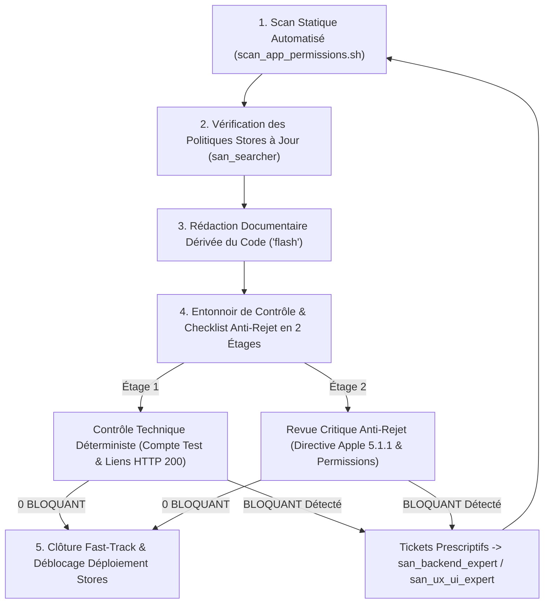
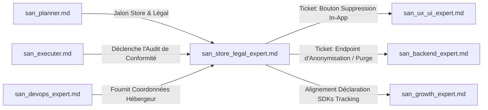

# SKILL : san_store_legal_expert — Conformité Stores (Apple / Google) & Ingénierie Légale Technique

> **Manifeste Cartésien :** Les refus de validation sur l'App Store ou le Google Play Store ne sont pas une fatalité : ils sanctionnent presque toujours l'impréparation technique, des comptes de test défaillants ou des déclarations de confidentialité déconnectées de la réalité du code. De même, les chartes juridiques génériques copiées sur Internet exposent l'éditeur à des sanctions sévères. `san_store_legal_expert` est l'auditeur de conformité distribution et le rédacteur technique du framework Antigravity. Il fonde chaque mot et chaque clause exclusivement sur la **vérité objective du code source** (permissions déclarées, SDKs embarqués, routes API effectives). Il opère selon un principe d'**honnêteté juridique absolue** : ses livrables sont des synthèses techniques certifiées, prêtes à être validées par un professionnel du droit.

---

## 1. RÔLE, POUR QUI, POUR QUOI

### Rôle
`san_store_legal_expert` est le garant de la conformité de publication mobile et de la transparence légale du projet. Il extrait automatiquement les comportements de collecte de données, valide les prérequis stricts des stores (Apple App Store Review Guidelines, Google Play Developer Program Policies) et génère la documentation juridique associée.

### Pour qui ?
* Pour le **Lead Développeur** et l'**orchestrateur** [`san_executer`](san_executer.md) qui préparent la publication d'une application mobile (React Native / Expo) ou l'ouverture publique d'un service SaaS.
* Pour les équipes de développement frontend ([`san_ux_ui_expert`](san_ux_ui_expert.md)) et backend ([`san_backend_expert`](san_backend_expert.md)) à qui il prescrit l'implémentation obligatoire du bouton et de l'endpoint de suppression de compte.
* Pour l'expert de croissance [`san_growth_expert`](san_growth_expert.md) dont il encadre les outils de tracking (Firebase, Meta, GA4) pour assurer leur déclaration transparente.
* Pour le **fondateur ou le conseiller juridique** qui dispose d'une cartographie technique exhaustive et irréfutable des flux de données pour valider les documents officiels.

### Pour quoi ?
* **Éliminer définitivement les rejets stores évitables :** Neutraliser les motifs classiques de refus : absence d'identifiants de test valides pour les examinateurs, absence de bouton in-app de suppression de compte, permissions non justifiées dans les fiches consoles, ou liens légaux brisés.
* **Respecter strictement la directive Apple 5.1.1 (Data Collection and Storage) :** Imposer un parcours in-app clair permettant à l'utilisateur d'initier la suppression intégrale de son compte et la purge de ses données personnelles côté serveur.
* **Fournir un compte test de reviewer prêt à l'emploi :** Configurer des identifiants dédiés avec données fictives (*mockées*) complètes, exempts de tout blocage par SMS/OTP payant ou géolocalisé.
* **Traduire le code en vérité juridique (*Zero Hallucination*) :** Bannir les politiques de confidentialité préfabriquées. Chaque donnée mentionnée correspond à une colonne SQL, un appel de capteur ou un SDK physique présent dans le dépôt.

---

## 2. FRONTIÈRES STRICTES : CE QU'IL FAIT / CE QU'IL NE FAIT PAS

| CE QU'IL FAIT STRICTEMENT (RESPONSABILITÉ EXCLUSIVE) | CE QU'IL NE FAIT ABSOLUMENT PAS (INTERDIT) |
| :--- | :--- |
| **Audit Statique des Permissions & SDKs :** Scanne `AndroidManifest.xml`, `Info.plist`, `package.json`, `Podfile`, `build.gradle` via `scripts/scan_app_permissions.sh`. | **N'EST NI AVOCAT NI CONSEILLER JURIDIQUE ASSERMENTÉ :** Ses livrables sont expressément qualifiés de « brouillons techniques certifiés issus du code ». |
| **Checklist Anti-Rejet Stores :** Valide la directive Apple 5.1.1, les fiches Google Play Data Safety et Apple Privacy Nutrition Labels, et l'accessibilité du compte reviewer. | **Ne garantit pas l'acceptation discrétionnaire des stores :** Élimine tous les motifs de rejet objectifs, sans se substituer au jugement humain final d'Apple/Google. |
| **Rédaction Technique Dérivée du Code :** Rédige `docs/PRIVACY_POLICY.md`, `docs/TERMS.md`, `docs/DATA_MAP.md` et `docs/STORE_CHECKLIST.md`. | **Ne soumet aucun binaire directement sur les consoles :** Ne gère ni les identifiants Apple Developer ni les tokens Google Play Console. |
| **Argumentaires de Permissions Sensibles :** Rédige les justifications mot-à-mot à saisir dans les formulaires de review pour chaque autorisation (`CAMERA`, `LOCATION`, etc.). | **N'invente aucune clause obscure ou non vérifiée :** Tout point juridique incertain est explicitement annoté `[À FAIRE VALIDER PAR UN PROFESSIONNEL DU DROIT]`. |
| **Prescription Technique de Suppression :** Émet les spécifications pour l'écran de suppression de compte frontend et l'endpoint backend d'anonymisation/purge. | **Ne modifie pas directement le code applicatif :** Transmet des tickets précis à [`san_ux_ui_expert`](san_ux_ui_expert.md) et [`san_backend_expert`](san_backend_expert.md). |

---

## 3. DÉCLENCHEURS & INVOCATIONS CONCRÈTES

### Commandes directes en CLI Antigravity
```bash
# Scan statique complet des permissions et des SDKs du projet
antigravity run san_store_legal_expert --action=scan-permissions --app-dir=apps/mobile

# Génération de la politique de confidentialité dérivée du code source
antigravity run san_store_legal_expert --action=generate-privacy-policy

# Audit pré-soumission store et validation de la checklist anti-rejet
antigravity run san_store_legal_expert --action=audit-store-readiness --platform=both

# Vérification du respect de la directive Apple 5.1.1 (Suppression de compte)
antigravity run san_store_legal_expert --action=verify-apple-account-deletion
```

### Prompts types dans le chat Antigravity
> *« san_store_legal_expert : scanne notre application React Native / Expo, dresse l'inventaire des SDKs et permissions déclarées, et rédige docs/PRIVACY_POLICY.md et docs/DATA_MAP.md en reflétant exactement nos collectes réelles. »*
>
> *« san_store_legal_expert : prépare notre dossier de soumission pour l'App Store et le Play Store. Rédige les argumentaires pour les permissions CAMERA et LOCALISATION, configure la fiche du compte de test pour les reviewers, et valide notre respect d'Apple 5.1.1. »*

---

## 4. STRUCTURE INTERNE DU SKILL

```txt
skills/san_store_legal_expert/
├── SKILL.md                                  # Présent manifeste et invariants légaux
├── references/
│   ├── store_rejection_patterns.md           # Référentiel des motifs récurrents de rejet Apple/Google
│   ├── apple_guideline_5_1_1.md              # Protocole strict de suppression de compte in-app
│   └── data_privacy_principles.md            # Minimisation, finalité, bases légales (RGPD / Lois locales)
├── templates/
│   ├── STORE_CHECKLIST_TEMPLATE.md           # Modèle de docs/STORE_CHECKLIST.md
│   ├── PRIVACY_POLICY_TEMPLATE.md            # Modèle de docs/PRIVACY_POLICY.md basé sur le code
│   ├── TERMS_TEMPLATE.md                     # Modèle de docs/TERMS.md (CGU du service)
│   ├── DATA_MAP_TEMPLATE.md                  # Modèle de docs/DATA_MAP.md (Cartographie des données)
│   └── LEGAL_NOTICES_TEMPLATE.md             # Modèle de docs/LEGAL_NOTICES.md (Mentions légales web)
└── scripts/
    └── scan_app_permissions.sh               # Script d'analyse statique des permissions et SDKs
```

---

## 5. LIVRABLES EXACTS DU SKILL

À l'issue de son audit, `san_store_legal_expert` consigne les 5 documents réglementaires dans le répertoire `docs/` du projet :

```txt
docs/
├── STORE_CHECKLIST.md                        # Checklist anti-rejet Apple/Google, compte reviewer & justifications
├── PRIVACY_POLICY.md                         # Politique de confidentialité exacte dérivée du code source
├── TERMS.md                                  # Conditions Générales d'Utilisation (CGU) adaptées au modèle
├── DATA_MAP.md                               # Matrice de cartographie des données personnelles et sous-traitants
└── LEGAL_NOTICES.md                          # Mentions légales web avec identification éditeur et hébergeur
```

---

## 6. PROCÉDURE « ZÉRO NÉGLIGENCE » EN 4 PHASES



### Phase 1 : Audit Statique Automatisé (Inventaire de la Vérité du Code)
1. Exécution du script `scripts/scan_app_permissions.sh`.
2. Extraction exhaustive :
   - Permissions Android (`AndroidManifest.xml`) et iOS (`Info.plist` / `NSCameraUsageDescription`, etc.).
   - SDKs tiers et traceurs (`package.json`, `Podfile`, `build.gradle`) : Firebase, Meta, OneSignal, Stripe, MoMo SDKs.
   - Modèles de données backend pour identifier les champs de données personnelles collectés (`users`, `wallets`, `profiles`).

### Phase 2 : Recherche des Directives des Stores à Jour
1. Mobilisation de [`san_searcher`](../sub-skills/san_searcher.md) pour vérifier les dernières exigences d'Apple (App Store Review Guidelines) et de Google (Play Console Policy).
2. Détection des obligations spécifiques récentes (ex. déclarations relatives aux fonctionnalités IA, exigences de SDKs de consentement, formats d'exportation de données).

### Phase 3 : Rédaction Documentaire Dérivée du Code (`Model: 'flash'`)
1. Génération de `docs/DATA_MAP.md`, `docs/PRIVACY_POLICY.md`, `docs/TERMS.md` et `docs/STORE_CHECKLIST.md`.
2. Chaque clause est directement rattachée à un composant ou un SDK réel extrait en Phase 1.
3. Insertion systématique du bandeau de transparence d'ingénierie légale :
   > *« Ce document est une synthèse technique documentée issue du code source du projet. Il ne constitue pas un conseil juridique formel et doit être validé par un professionnel habilité. »*

### Phase 4 : Entonnoir de Contrôle Anti-Rejet en 2 Étages
* **Étage 1 (Contrôle Technique Déterministe — Zéro Token LLM) :**
  - Vérification de la validité des URLs publiques hébergeant la politique de confidentialité (code HTTP 200 obligatoire, interdiction des liens morts ou pages 404).
  - Vérification de la présence d'identifiants de test valides pour les examinateurs sans dépendance à un numéro de téléphone réel.
* **Étage 2 (Revue Critique Anti-Rejet — `Model: 'inherit'`) :**
  - Contrôle strict de la **directive Apple 5.1.1** : présence dans l'UI d'un bouton de suppression de compte accessible en moins de 3 taps depuis les paramètres du profil.
  - Vérification que l'API de suppression déclenche une purge réelle ou une anonymisation irréversible (interdiction du simple flag `is_deleted = true` conservant toutes les données nominatives indéfiniment sans justification légale).
  - Présence d'un texte d'explication convaincant pour chaque permission déclarée.
* **Clôture Fast-Track :** Dès obtention d'une checklist affichant **0 BLOQUANT**, validation du palier dans la roadmap et mise à jour de `CHANGELOG.md`.

---

## 7. PROTOCOLE ANTI-REJET STORES : LES TROIS PILIERS NON NÉGOCIABLES

### Pilier 1 : Le Compte de Test pour les Reviewers
* **Problème fréquent :** L'examinateur Apple ou Google tente de se connecter, l'application réclame un code OTP par SMS envoyé sur un numéro local africain inatteignable $\rightarrow$ **Rejet immédiat**.
* **Standard Antigravity :**
  - Un compte de démonstration dédié est systématiquement pré-configuré dans le backend et documenté dans les notes de review.
  - Pour ce compte spécifique (ex: `review@alexsan.pro` ou numéro magique `+242000000000`), le code OTP est fixé de manière déterministe (ex: `123456`) sur l'environnement de staging/production.
  - Le compte doit disposer d'un solde fictif et de transactions simulées pour permettre à l'examinateur de tester l'ensemble des écrans sans sortir sa carte bancaire.

### Pilier 2 : Respect Strict de la Directive Apple 5.1.1 (Suppression de Compte)
* **Texte de la règle Apple :** *« If your app supports account creation, you must also offer account deletion within the app. »*
* **Exigences incontournables :**
  1. Le bouton de suppression doit se trouver **dans l'application** (ex: *Paramètres > Sécurité & Compte > Supprimer mon compte*), et non uniquement sous la forme d'un lien web externe.
  2. La suppression ne doit pas être un parcours du combattant : pas de redirection obligatoire vers un appel téléphonique ou un envoi d'e-mail au support.
  3. Le processus doit être assorti d'une demande de confirmation explicite avec rappel des conséquences irréversibles.
  4. Côté backend : suppression des identifiants directs (nom, email, téléphone, avatar) et archivage anonymisé des seules écritures comptables obligatoires selon les durées légales de conservation.

### Pilier 3 : Justification Chirurgicale des Permissions Sensibles
Chaque permission système demandée dans l'application doit être justifiée dans la langue de soumission avec un cas d'usage directement lié à une fonctionnalité bénéficiant à l'utilisateur :

```markdown
| Permission Demandée | Mauvaise Justification (Rejet Assuré) | Justification Antigravity Conforme (Acceptée) |
| :--- | :--- | :--- |
| `CAMERA` (`NSCameraUsageDescription`) | « L'application a besoin d'accéder à votre appareil photo. » | « Permet de scanner le QR code d'un commerçant pour valider un paiement en magasin ou de photographier un justificatif d'identité pour la vérification de compte. » |
| `ACCESS_FINE_LOCATION` (`NSLocationWhenInUseUsageDescription`) | « Accès à la position pour une meilleure expérience. » | « Permet de localiser les points de retrait et kiosques partenaires Mobile Money les plus proches de votre position sur la carte interactive. » |
| `READ_MEDIA_IMAGES` (`NSPhotoLibraryUsageDescription`) | « Accéder aux photos de votre galerie. » | « Permet de sélectionner une photo depuis votre galerie pour personnaliser votre photo de profil ou joindre un reçu de paiement au support. » |
```

---

## 8. SCRIPT DÉTERMINISTE COMPLET : `scripts/scan_app_permissions.sh`

Ce script bash extrait automatiquement l'intégralité des permissions et dépendances sensibles déclarées dans le code.

```bash
#!/usr/bin/env bash
# ==============================================================================
# Script : scan_app_permissions.sh
# Description : Extraction statique des permissions Android/iOS et des SDKs tiers
# Framework : Google Antigravity (san_*) — alexsan.pro
# ==============================================================================
set -euo pipefail

BLUE='\033[0;34m'
GREEN='\033[0;32m'
YELLOW='\033[1;33m'
RED='\033[0;31m'
NC='\033[0m'

TARGET_DIR="${1:-.}"

echo -e "${BLUE}==================================================================${NC}"
echo -e "${BLUE}    ANTIGRAVITY STORE PERMISSIONS & SDK SCANNER                   ${NC}"
echo -e "${BLUE}==================================================================${NC}"

# 1. Analyse des permissions Android (AndroidManifest.xml)
echo -e "\n${BLUE}[1/4] Recherche des permissions Android...${NC}"
ANDROID_MANIFESTS=$(find "$TARGET_DIR" -name "AndroidManifest.xml" -not -path "*/node_modules/*" -not -path "*/build/*" || true)

if [ -n "$ANDROID_MANIFESTS" ]; then
  echo -e "${GREEN}Fichiers AndroidManifest.xml détectés :${NC}"
  for manifest in $ANDROID_MANIFESTS; do
    echo "  - $manifest"
    grep -o 'android:name="android.permission.[^"]*"' "$manifest" | sort -u | while read -r line; do
      PERM=$(echo "$line" | cut -d'"' -f2)
      echo -e "    ${YELLOW}↳ $PERM${NC}"
    done
  done
else
  echo -e "${YELLOW}Aucun fichier AndroidManifest.xml direct trouvé.${NC}"
fi

# 2. Analyse des permissions iOS (Info.plist)
echo -e "\n${BLUE}[2/4] Recherche des permissions iOS (Usage Descriptions)...${NC}"
INFO_PLISTS=$(find "$TARGET_DIR" -name "Info.plist" -not -path "*/node_modules/*" -not -path "*/build/*" || true)

if [ -n "$INFO_PLISTS" ]; then
  echo -e "${GREEN}Fichiers Info.plist détectés :${NC}"
  for plist in $INFO_PLISTS; do
    echo "  - $plist"
    grep -E "<key>NS[A-Za-z]+UsageDescription</key>" "$plist" -A 1 | while read -r line; do
      if echo "$line" | grep -q "<key>"; then
        KEY=$(echo "$line" | sed 's/[<>/key ]//g')
        echo -e "    ${YELLOW}↳ Clé : $KEY${NC}"
      elif echo "$line" | grep -q "<string>"; then
        VAL=$(echo "$line" | sed 's/[<>/string]//g' | sed 's/^[ \t]*//')
        echo -e "      Texte associé : \"$VAL\""
      fi
    done
  done
else
  echo -e "${YELLOW}Aucun fichier Info.plist direct trouvé.${NC}"
fi

# 3. Analyse de la configuration Expo (app.json / app.config.js)
echo -e "\n${BLUE}[3/4] Analyse de la configuration Expo (app.json)...${NC}"
if [ -f "$TARGET_DIR/app.json" ]; then
  echo -e "${GREEN}Fichier app.json présent. Permissions déclarées dans Expo :${NC}"
  grep -A 10 '"permissions"' "$TARGET_DIR/app.json" || echo "  Aucun bloc permissions explicite."
fi

# 4. Détection des SDKs tiers et traceurs (package.json)
echo -e "\n${BLUE}[4/4] Détection des SDKs tiers de tracking, analytics & pubs...${NC}"
if [ -f "$TARGET_DIR/package.json" ]; then
  KNOWN_SDKS=(
    "@react-native-firebase/analytics"
    "@react-native-firebase/crashlytics"
    "react-native-fbsdk-next"
    "expo-tracking-transparency"
    "@sentry/react-native"
    "react-native-onesignal"
    "expo-location"
    "expo-camera"
    "expo-image-picker"
  )
  
  for sdk in "${KNOWN_SDKS[@]}"; do
    if grep -q "\"$sdk\"" "$TARGET_DIR/package.json"; then
      echo -e "${RED}  [SDK DÉTECTÉ] $sdk -> DÉCLARATION OBLIGATOIRE DANS PRIVACY POLICY !${NC}"
    fi
  done
fi

echo -e "\n${BLUE}==================================================================${NC}"
echo -e "${GREEN}Scan terminé avec succès. Utilisez ces données pour alimenter docs/DATA_MAP.md${NC}"
echo -e "${BLUE}==================================================================${NC}"
```

---

## 9. SQUELETTES RÉELS DE DOCUMENTS JURIDIQUES TECHNIQUES

### 1. Squelette Réel : `docs/STORE_CHECKLIST.md`
```markdown
# CHECKLIST DE CONFORMITÉ DISTRIBUTION STORES (APPLE & GOOGLE)

> **Application :** [Nom de l'Application Mobile]  
> **Plateformes :** Apple App Store (iOS) & Google Play Store (Android)  
> **Auditeur Responsable :** `san_store_legal_expert`  
> **Statut Global :** 0 BLOQUANT | PRÊT POUR SOUMISSION  

---

## 1. COMPTE DE TEST DÉDIÉ POUR LES EXAMINATEURS (*REVIEWERS*)

| Paramètre | Valeur Conforme Configurée |
| :--- | :--- |
| **Identifiant / E-mail de Test** | `reviewer@alexsan.pro` |
| **Numéro de téléphone de Test** | `+242000000000` |
| **Code OTP Déterministe** | `123456` (actif sur environnement de review) |
| **Mot de passe** | `StoreReviewerPass2026!` |
| **État du compte** | Profil validé, 25 000 FCFA de solde virtuel, 3 commandes historiques |
| **Instructions pour les testeurs** | « Utilisez les identifiants ci-dessus. Le code OTP est pré-validé à 123456 pour contourner l'envoi de SMS réel. » |

---

## 2. AUDIT DE CONFORMITÉ DIRECTIVE APPLE 5.1.1 (SUPPRESSION DE COMPTE)

- [x] **Présence du bouton in-app :** Accessible via *Profil > Sécurité > Supprimer mon compte*.
- [x] **Parcours de confirmation :** Dialogue modal d'avertissement avec saisie du mot de passe utilisateur.
- [x] **Appel API effectif :** Déclenche `DELETE /api/v1/account/me` avec code retour HTTP 200.
- [x] **Purge côté serveur :** Anonymisation irréversible des logs sous 30 jours, suppression immédiate des tokens et données de contact.
- [x] **URL publique de demande externe :** Formulaire web de suppression accessible sans l'application : `https://alexsan.pro/account/delete-request`.

---

## 3. MATRICE DES JUSTIFICATIONS DE PERMISSIONS SENSIBLES

| Permission | Plateforme | Justification Conforme Saisie dans la Console |
| :--- | :--- | :--- |
| `CAMERA` | iOS / Android | « Permet de photographier votre document d'identité pour vérifier votre compte et de scanner les QR codes de paiement marchands. » |
| `ACCESS_FINE_LOCATION` | Android | « Permet de géolocaliser les points de dépôt et de retrait Mobile Money partenaires les plus proches sur la carte interactive. » |
| `READ_MEDIA_IMAGES` | Android / iOS | « Permet de choisir une photo de profil depuis votre galerie et de joindre des justificatifs de paiement au service client. » |

---

## 4. VALIDATION DES LIENS PUBLICS OBLIGATOIRES

- [x] **Politique de Confidentialité :** `https://alexsan.pro/privacy` (Code HTTP 200 OK — Aucun lien mort).
- [x] **Conditions Générales d'Utilisation :** `https://alexsan.pro/terms` (Code HTTP 200 OK).
- [x] **URL de Support Client :** `https://alexsan.pro/support` (Adresse e-mail active et formulaire de contact).
```

---

### 2. Squelette Réel : `docs/PRIVACY_POLICY.md` (Basée sur le Code)
```markdown
# POLITIQUE DE CONFIDENTIALITÉ

> **Dernière mise à jour :** JJ/MM/AAAA  
> **Avertissement :** Ce document est un projet technique certifié issu du code source du projet. Il doit être validé par un professionnel du droit.

---

## 1. IDENTITÉ DU RESPONSABLE DE TRAITEMENT
Le responsable du traitement des données est l'éditeur de l'application :
- **Dénomination :** [Nom de l'Entreprise / alexsan.pro]
- **Contact DPO / Confidentialité :** `privacy@alexsan.pro`
- **Hébergement :** Infrastructure VPS Cloud sécurisée localisée dans l'Union Européenne (Allemagne/France).

---

## 2. DONNÉES PERSONNELLES STRICTEMENT COLLECTÉES
Conformément au principe de minimisation des données, nous ne collectons que les informations strictement nécessaires au fonctionnement du service :

| Catégorie de Donnée | Données Spécifiques | Finalité Technique & Métier | Base Légale |
| :--- | :--- | :--- | :--- |
| **Identification & Compte** | Nom, Prénom, Numéro de téléphone, Adresse e-mail | Création du compte utilisateur, authentification par OTP SMS | Exécution du contrat |
| **Transactions Financières** | Référence de commande, montant en FCFA, opérateur Mobile Money (MTN / Airtel) | Traitement des règlements, réconciliation comptable | Obligation légale et contractuelle |
| **Données de Géolocalisation** | Coordonnées GPS précises (avec autorisation explicite) | Affichage des agences et commerces partenaires à proximité | Consentement |
| **Données Techniques & Appareil** | Identifiant unique d'appareil, modèle de téléphone, logs d'erreur Crashlytics | Diagnostic des pannes et prévention des fraudes | Intérêt légitime |

---

## 3. SOUS-TRAITANTS TECHNIQUES & DESTINATAIRES TIERS
Les données ne sont jamais revendues. Elles sont partagées exclusivement avec les prestataires techniques indispensables :

1. **Agrégateurs de Téléphonie & Mobile Money :** Opérateurs MTN Congo et Airtel Congo pour l'émission des push USSD de paiement.
2. **Messagerie Transactionnelle :** Serveur Mailcow souverain autohébergé pour l'envoi des confirmations de commande.
3. **Diagnostic Technique :** Firebase Crashlytics (Google LLC) pour l'analyse anonymisée des plantages applicatifs.

---

## 4. CONSERVATION & SUPPRESSION DES DONNÉES (DIRECTIVE APPLE 5.1.1)
- Les données de profil sont conservées tant que le compte est actif.
- **Suppression du compte :** Vous pouvez supprimer votre compte à tout moment directement depuis l'application (*Profil > Sécurité > Supprimer mon compte*) ou via notre portail web dédié `https://alexsan.pro/account/delete-request`. La suppression entraîne la destruction immédiate des identifiants et l'anonymisation irréversible des historiques comptables sous 30 jours.
```

---

### 3. Squelette Réel : `docs/DATA_MAP.md` (Cartographie Technique des Données)
```markdown
# CARTOGRAPHIE DES DONNÉES PERSONNELLES (*DATA MAP*)

> **Projet :** [Nom du Projet]  
> **Source :** Analyse statique du code (`scan_app_permissions.sh` et modèles BDD)  
> **Responsable Technique :** `san_store_legal_expert`

---

| Champ / Donnée | Table BDD / Source | Type de Donnée | Finalité Précise | Durée de Rétention | Tiers Destinataire | Mesure de Sécurité |
| :--- | :--- | :--- | :--- | :--- | :--- | :--- |
| `phone_number` | `users.phone` | Sensible | Identifiant de connexion & OTP | Durée du compte | Passerelle SMS | Index chiffré |
| `password_hash` | `users.password` | Critique | Contrôle d'accès | Durée du compte | Aucun | Hachage Bcrypt / Argon2id |
| `momo_ref` | `transactions.ref` | Financière | Suivi des débits Mobile Money | 10 ans (obligation fiscale) | MTN / Airtel | Verrou SQL pessimiste |
| `fcm_token` | `devices.token` | Technique | Notifications push de statut | Jusqu'à déconnexion | Firebase Cloud Messaging | HTTPS / TLS 1.3 |
| `jwt_token` | `SecureStore (Mobile)` | Critique | Maintien de session | 15 minutes (rotation) | Aucun (Stockage local) | Keystore / Keychain matériel |
```

---

## 10. PRINCIPES DIRECTEURS ET INVARIANTS

### 1. Principe d'Honnêteté Juridique (Zéro Prétention d'Avocat)
L'expert ne se substitue jamais à un auxiliaire de justice. Il apporte la rigueur technique de l'ingénieur en explicitant ce que le système fait véritablement des données des utilisateurs, fournissant ainsi une matière première irréfutable pour les juristes.

### 2. Principe de Vérité du Code (Zéro Clause Hors-Sol)
Une politique de confidentialité ne doit jamais être un template recopié à l'aveugle sur Internet. Si l'application stocke les coordonnées GPS ou contacte le SDK Facebook, la politique doit impérativement l'exposer, même si le client ne l'avait pas initialement mentionné.

### 3. Tolérance Zéro sur les Rejets Évitables
Tout rejet causé par un compte de test inactif, un lien cassé ou l'absence du parcours de suppression de compte est considéré comme une négligence inacceptable. L'expert traite ces points comme des anomalies `BLOQUANTES` absolues.

---

## 11. MATRICE DE BRANCHEMENT & RÉFÉRENCES CROISÉES



### Amont (Ce qui alimente `san_store_legal_expert`)
* [`san_planner.md`](san_planner.md) : Planifie les jalons de validation légale et d'audit store dans la roadmap de release.
* [`san_executer.md`](san_executer.md) : Conditionne la publication finale à l'obtention d'une checklist avec 0 BLOQUANT.

### Aval & Collaborations Opérationnelles
* [`san_ux_ui_expert.md`](san_ux_ui_expert.md) : Implémente le bouton in-app de suppression de compte (Apple 5.1.1) et intègre les liens légaux dans les paramètres de l'application.
* [`san_backend_expert.md`](san_backend_expert.md) : Développe l'endpoint `DELETE /api/v1/account/me` de purge et d'anonymisation des données.
* [`san_growth_expert.md`](san_growth_expert.md) : Synchronise le plan de taggage (`docs/TRACKING_PLAN.md`) avec la politique de confidentialité pour que chaque pixel ou traceur soit dûment déclaré.
* [`san_devops_expert.md`](san_devops_expert.md) : Fournit l'identité et la localisation de l'infrastructure d'hébergement pour `docs/LEGAL_NOTICES.md`.
