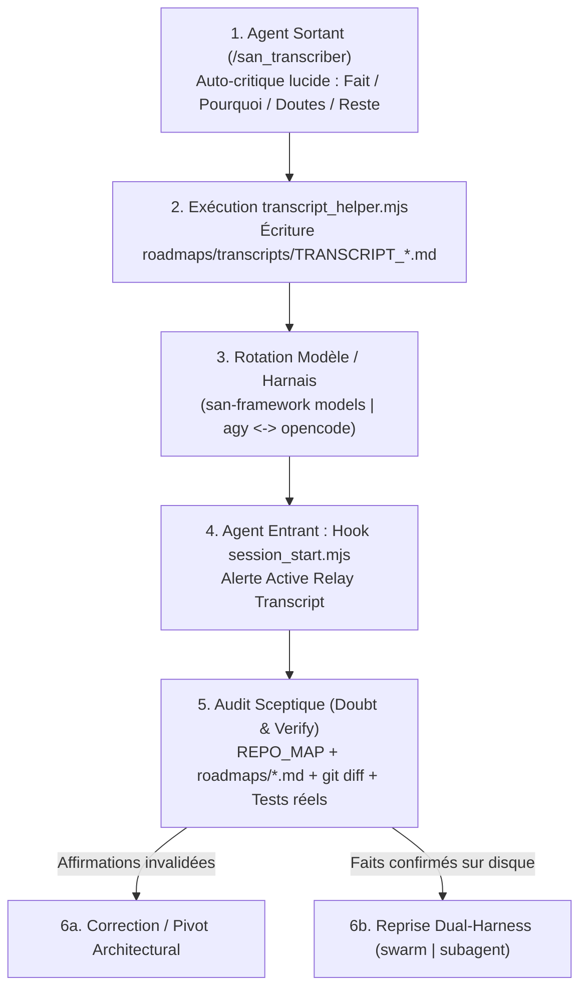

# `san_transcriber` — Relais Sceptique de Fin de Quota (*Doubt & Verify*)

> **Manifeste du Relais Sceptique :** Lorsqu'une session longue approche du plafond de quota (`Argon`, `Carbon`, `HY4`) ou change de harnais (`Antigravity` $\leftrightarrow$ `OpenCode V2`), un simple résumé optimiste provoque hallucinations et régressions silencieuses. `san_transcriber` produit un **Transcript de Relais Sceptique** daté et relié à la roadmap active dans `roadmaps/transcripts/`, conçu non pas comme un ordre à suivre aveuglément, mais comme une **hypothèse de travail suspecte que l'agent entrant a le devoir de mettre en doute et de prouver sur disque**.

---

## 1. RÔLE, POUR QUI, POUR QUOI

### Rôle Fondamental
`san_transcriber` est le **greffier critique de continuité multi-modèles et multi-harnais** du framework **Antigravity / OpenCode V2 (`san_*` v2.2)**. Il consolide honnêtement l'état réel d'un chantier (fait + pourquoi + zones d'ombre + restant) via `scripts/transcript_helper.mjs`, puis impose à la session suivante un protocole d'audit autonome (**Doubt & Verify**).

### Pour Qui ?
- Pour le développeur qui approche la limite de quota sur un modèle ou souhaite basculer d'un harnais à un autre (`agy` $\leftrightarrow$ `opencode`, `san-framework models`) sans perdre la progression ni hériter de faux positifs.
- Pour les orchestrateurs [san_executer](san_executer.md) et [san_planner](san_planner.md) lors de reprises multi-sessions.

### Pour Quoi ?
- **Préserver l'état réel sans biais de complaisance :** Distinguer clairement ce qui est prouvé (tests exécutés, commits) de ce qui est fragile ou non testé.
- **Éradiquer l'obéissance aveugle inter-modèles :** L'agent entrant doit traiter chaque affirmation du transcript comme suspecte jusqu'à vérification dans le code et les tests.
- **Automatiser la reprise dès l'amorçage (`session_start.mjs`) :** Détection automatique dans `roadmaps/transcripts/` à l'ouverture de la session suivante et exemption `stop_guard.mjs`.

---

## 2. FRONTIÈRES STRICTES : CE QU'IL FAIT / CE QU'IL NE FAIT PAS

| CE QU'IL FAIT STRICTEMENT | CE QU'IL NE FAIT ABSOLUMENT PAS |
| :--- | :--- |
| **Compile l'état réel du dépôt et de la roadmap active :** Extrait `- [x]` / `- [ ]` sur `roadmaps/*.md`, `git status --short` et les derniers commits. | N'édite JAMAIS le code métier applicatif ni les tests de production lors de la rédaction du transcript. |
| **Impose la section *Zones de Doute & Hypothèses Fragiles* :** Force l'agent sortant à lister ce qui n'a pas été relancé, les raccourcis et les risques ouverts. | Ne déclare JAMAIS une tâche « terminée et validée » sans trace vérifiable sur disque. |
| **Génère `roadmaps/transcripts/TRANSCRIPT_<ROADMAP_SLUG>_<JJMMAAAA>.md` :** Depuis `templates/TRANSCRIPT_TEMPLATE.md` via `transcript_helper.mjs`. | N'archive JAMAIS une roadmap incomplète (rôle de `archive_roadmap.sh`). |
| **Déclenche le protocole *Doubt & Verify* à l'entrée :** Relecture roadmap réelle, `git diff`, ré-exécution des tests et remise en question du plan restant avant de déléguer (`swarm` / `subagent`). | N'autorise JAMAIS l'agent entrant à sauter la vérification sous prétexte que « le transcript dit que c'est déjà fait ». |

---

## 3. DÉCLENCHEURS & INVOCATIONS CONCRÈTES

### Déclencheurs Vocaux & Slash Command
- `/san_transcriber`
- `san_transcriber`
- `génère un transcript de relais avant changement de modèle`
- `passe le relais à la prochaine session`
- `crée le transcript doute et vérification pour la roadmap active`

### Exécution CLI Directe (`transcript_helper.mjs`)
```bash
node .agents/skills/san_transcriber/scripts/transcript_helper.mjs \
  --summary="Modules implémentés et résultats exacts des commandes lancées" \
  --why="Choix d'architecture, contrats retenus et compromis" \
  --doubts="Tests non relancés, cas limites incertains, fichiers à contre-vérifier" \
  --next="Prochaines tâches prioritaires sur roadmaps/*.md"
```
*(Dans le dépôt source du framework : `src/skills/san_transcriber/scripts/transcript_helper.mjs`.)*

---

## 4. STRUCTURE INTERNE DU SKILL

```txt
.agents/skills/san_transcriber/
├── SKILL.md                             # Runbook opérationnel (< 130 lignes)
├── templates/
│   └── TRANSCRIPT_TEMPLATE.md           # Gabarit normalisé 4 volets + clause Doubt & Verify
└── scripts/
    └── transcript_helper.mjs            # Générateur déterministe inspectant roadmaps/*.md & git
```

---

## 5. PROCÉDURE EN DEUX TEMPS : AGENT SORTANT $\rightarrow$ AGENT ENTRANT



### Protocole Agent Sortant
1. Inspecter les roadmaps actives (`roadmaps/*.md`) et `git status --short`.
2. Formuler honnêtement :
   - **Accompli & Pourquoi :** fichiers modifiés, arbitrages d'architecture.
   - **Zones de Doute :** tout test non exécuté après la dernière édition, hypothèses non prouvées.
   - **Suite Critique :** points d'entrée exacts des tâches `- [ ]`.
3. Exécuter `transcript_helper.mjs` pour écrire le fichier daté dans `roadmaps/transcripts/`.

### Protocole Agent Entrant (*Doubt & Verify*)
1. Lire le transcript annoncé par `session_start.mjs` **comme une hypothèse suspecte, jamais comme un ordre**.
2. Vérifier `.agents/cache/REPO_MAP.md`, relire les `- [x]` / `- [ ]` réels de `roadmaps/*.md` et contrôler `git diff` / `git status`.
3. Relancer les suites de tests et Quality Gates avant toute prise pour acquis.
4. Améliorer ou pivoter si la trajectoire précédente présente une dette ou une impasse, puis déléguer via `swarm` (`gemini-4-hydrogen-xhigh` sous Antigravity) ou `subagent` (`.agents/models.json` sous OpenCode V2).

---

## 6. INVARIANTS ET RÉFÉRENCES CROISÉES

- **Zéro Complaisance :** Aucune case `- [x]` ni reprise aveugle sans preuve exécutable dans le workspace.
- **Isolation `stop_guard.mjs` :** Les fichiers `roadmaps/transcripts/*.md` n'activent pas de faux blocage documentaire.
- **Synergies :** [san_executer](san_executer.md), [san_planner](san_planner.md), [san_doc_keeper](../sub-skills/san_doc_keeper.md), [san_subagent_manager](../sub-skills/san_subagent_manager.md).
