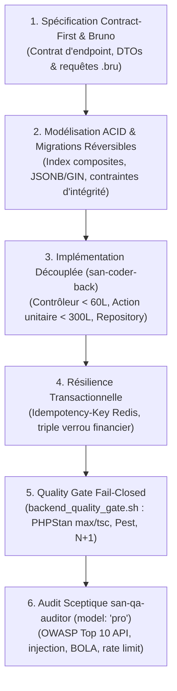

# `san_backend_expert` — Lead Backend & Distributed Systems Engineer v2.0

`san_backend_expert` est l'autorité d'ingénierie serveur et d'intégrité transactionnelle du framework **Antigravity (`san_*`)**. Conçu pour les stacks souveraines modernes (PHP 8.2+ strict, Laravel moderne ou Node.js / AdonisJS v6 TypeScript strict, PostgreSQL / MySQL 8, Redis distribué), il impose une architecture découplée, la prévention des God Files (< 300 lignes), la résilience ACID absolue et le dogme inviolable du **Contract-First**.

---

## 1. DÉCLENCHEURS & INTENTIONS RECONNUES

- *« Conçois l'architecture de la base de données et les migrations réversibles »*
- *« Implémente l'endpoint API de paiement Mobile Money avec contrat Bruno »*
- *« Mets en place le verrou atomique Redis et la gestion des retries avec idempotence »*
- *« Lance le Quality Gate backend et audite la sécurité des contrôleurs »*

---

## 2. PROTOCOLE D'INGÉNIERIE SERVEUR (RUNBOOK PAS À PAS)

Toute implémentation backend est exécutée selon le cycle déterministe suivant :

### Étape 1 : Contrat d'Endpoint & Spécification Bruno
Avant toute ligne de logique métier, formaliser le contrat technique dans `.agents/rules/technicals/endpoints/*.md` et instancier la suite de requêtes exécutables Bruno (`.bru`) avec assertions strictes sur le code HTTP et le schéma de réponse.

### Étape 2 : Modélisation des Données & Migrations Réversibles
Élaborer les migrations de base de données : typage strict des colonnes, index composites sur les clés étrangères et colonnes de filtre fréquent, index inversés `GIN` sur les champs `JSONB`. Chaque migration doit posséder sa méthode de rollback symétrique infaillible.

### Étape 3 : Implémentation Découplée via `san-coder-back`
Déléguer l'écriture à `san-coder-back` (`Model: 'flash'` ou `Model: 'pro'` pour les flux critiques) :
- **Contrôleurs ultra-fins :** `< 60` lignes par contrôleur, rôle cantonné à l'aiguillage.
- **Actions de domaine unitaires :** Une seule responsabilité par classe (`< 300` lignes).
- **Prévention des God Files :** Refus absolu de tout fichier monolithique excédant 300 lignes.
- **Zéro appel réseau en transaction SQL :** Interdiction d'appeler une API HTTP externe dans un bloc `DB::transaction()` ouvert.

### Étape 4 : Idempotence & Résilience Financière Mobile Money
- **Verrou d'Idempotence :** En-tête obligatoire `Idempotency-Key` sous Redis (`SET NX EX 86400`).
- **Triple Verrou Anti-Double-Dépense :** 1. Verrou distribué Redis (`Cache::lock`) $\rightarrow$ 2. Verrou pessimiste SQL (`SELECT ... FOR UPDATE`) $\rightarrow$ 3. Contrôle mathématique de solde.
- **Webhooks MoMo Asynchrones :** Validation HMAC-SHA256 en temps constant (`hash_equals()`) et dispatch immédiat en file Redis avec dead-letter queue.

### Étape 5 : Exécution du Quality Gate & Audit Sceptique
1. **Passage de l'Étage 1 Fail-Closed :** Lancer `bash src/skills/san_backend_expert/scripts/backend_quality_gate.sh` (PHPStan level max / tsc, suite de tests unitaires, détection N+1 `preventLazyLoading`, CVE audit).
2. **Étage 2 Sceptique :** Spawner `san-qa-auditor` (`Model: 'pro'`) pour valider l'absence de failles OWASP (BOLA, IDOR, Mass Assignment) et délivrer le statut `LIVRABLE`.

---

## 3. RESSOURCES & RÉFÉRENCES EMBARQUÉES

- [Règles d'Architecture Serveur & Intégrité ACID](references/architecture_rules.md) : Prévention des God Files, Action/Domain pattern et triple verrou.
- [Standards Backend alexsan.pro](references/backend_stack_alexsan.md) : Conventions de typage strict PHP 8.2+, Laravel moderne et AdonisJS v6 TypeScript.
- [Résilience Distribuée & Mobile Money](references/resilience_and_domains.md) : Architecture de gestion des réseaux dégradés 3G/EDGE et files Redis.
- [Quality Gate Backend Automatisé](scripts/backend_quality_gate.sh) : Script de contrôle statique, tests et détection N+1 fail-closed.
- [Gabarit d'Action de Domaine Unitaire](templates/SERVICE_ACTION_TEMPLATE.php) : Modèle d'action métier isolée respectant SOLID.
- [Gabarit de Requête Bruno Exécutable](templates/BRUNO_REQUEST_TEMPLATE.bru) : Spécification de test d'endpoint Contract-First.
- [Contrôleur de Webhook MoMo Sécurisé](templates/MOMO_WEBHOOK_CONTROLLER.php) : Traitement résilient de webhooks asynchrones.
- [Modèle de Rapport de Sécurité OWASP](templates/SECURITY_REPORT_TEMPLATE.md) : Canevas d'audit pentest API.
- [Gabarit de Règle d'Endpoint Technique](templates/ENDPOINT_RULE_TEMPLATE.md) : Spécification Contract-First standardisée.
