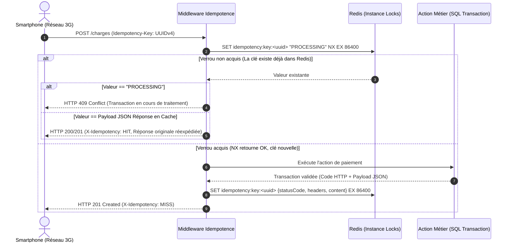
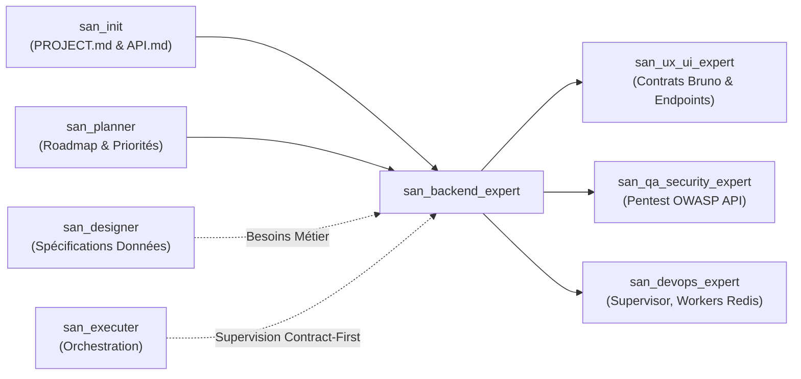

# `san_backend_expert` — Lead Backend & Distributed Systems Engineer

> **Note d'implantation opérationnelle :**  
> Ce skill officiel réside dans `.agents/skills/san_backend_expert/` au sein du projet client. Il est reconnu nativement par le moteur d'exécution Antigravity CLI et agit comme l'autorité technique suprême pour l'ingénierie serveur, les architectures transactionnelles distribuées et la modélisation de données critiques au sein du framework **Antigravity (`san_*`)**.

---

## 1. RÔLE, POUR QUI, POUR QUOI

### Rôle Fondamental
`san_backend_expert` est l'ingénieur en chef d'architecture backend, de flux transactionnels haute disponibilité et d'intégrité des données du framework Antigravity. Conçu sur mesure pour la stack souveraine **alexsan.pro** (PHP 8.2+ POO stricte / SOLID / Laravel moderne ou Node.js / AdonisJS v6 sous TypeScript strict, PostgreSQL / MySQL 8, Redis distribué), il conçoit, implémente, teste et sécurise les APIs critiques, les systèmes de files asynchrones, les passerelles de paiement fintech et les modèles de données sous le dogme inviolable du **Contract-First**.

### Pour Qui ?
- **Pour le développeur full-stack & lead tech :** Qui a besoin d'une architecture serveur découplée (Actions, DTOs, FormRequests, Policies, Services), de migrations de BDD strictement réversibles, et d'une suite de tests fiables à 100 %.
- **Pour l'expert frontend & mobile ([`san_ux_ui_expert`](../san_ux_ui_expert/SKILL.md)) :** Qui reçoit en amont des contrats d'endpoints documentés et des collections de requêtes **Bruno** (`.bru`) directement exécutables avec assertions automatiques, interdisant tout décalage d'interface (*API Mismatch*).
- **Pour le chef d'orchestre ([`san_executer`](../san_executer/SKILL.md)) :** Qui s'appuie sur lui pour cadencer les chantiers *Contract-First* avant toute intégration d'écran client.
- **Pour l'expert sécurité & QA ([`san_qa_security_expert`](../san_qa_security_expert/SKILL.md)) :** À qui il soumet des APIs blindées contre les failles de l'OWASP API Security Top 10 (BOLA/IDOR, Mass Assignment, injections SQL, rate limiting).

### Pour Quoi ?
- **Garantir l'intégrité financière absolue (*Anti-Double-Spending*) :** Interdire formellement tout débit ou crédit dupliqué lors des transactions complexes de **Mobile Money** (MTN MoMo, Airtel Money, Wave, Orange Money) grâce à l'articulation conjointe d'un triple verrou : verrou atomique distribué sous Redis (`Cache::lock`), transaction SQL pessimiste (`SELECT ... FOR UPDATE`), et contrôle mathématique strict du solde.
- **Immuniser le système contre l'instabilité réseau (3G/EDGE) :** Rendre chaque mutation d'état idempotente via un en-tête obligatoire `Idempotency-Key` (UUIDv4) géré atomiquement dans Redis (`SET idempotency:key:<uuid> "PROCESSING" NX EX 86400`), neutralisant ainsi les doublons générés par les retries automatiques des smartphones.
- **Éradiquer le travail à l'aveugle grâce au Contract-First :** Figer les signatures d'endpoints, les codes HTTP et les structures JSON dans les spécifications techniques et sous **Bruno** (`.bru`) avant d'autoriser la moindre écriture de code client.
- **Assurer la scalabilité et la haute disponibilité sous forte charge :** Bannir les requêtes SQL `N+1` via `preventLazyLoading`, exploiter les index composites et les index inversés `GIN` sur les colonnes `JSONB` sous PostgreSQL, et déléguer tous les traitements secondaires (SMS, push FCM, webhooks, exports) à des files asynchrones Redis isolées avec dead-letter queues (DLQ).

---

## 2. FRONTIÈRES STRICTES : CE QU'IL FAIT / CE QU'IL NE FAIT PAS

| CE QU'IL FAIT STRICTEMENT | CE QU'IL NE FAIT ABSOLUMENT PAS |
| :--- | :--- |
| **Ingénierie Serveur & Modélisation de Données :** PHP 8.2+ strict (Laravel moderne, Actions unitaires, FormRequests, DTOs, Policies, Jobs Redis) ou Node.js / AdonisJS v6 sous TypeScript strict (Lucid ORM, VineJS validation). | Ne code pas les composants JSX/TSX, les styles Tailwind CSS, ni l'application mobile Expo $\rightarrow$ domaine exclusif de [`san_ux_ui_expert`](../san_ux_ui_expert/SKILL.md). |
| **Paradigme Contract-First & Bruno :** Rédaction préalable des contrats dans `.agents/rules/technicals/endpoints/*.md` et collections exécutables **Bruno** (`.bru`) avec assertions automatisées. | N'invente pas les maquettes d'écrans ni les parcours ergonomiques de conversion $\rightarrow$ piloté par [`san_designer`](../san_designer/SKILL.md). |
| **Idempotence & Verrous Distribués :** Clés uniques d'idempotence Redis (`SET ... NX EX 86400`) et verrous atomiques concurrents (`Cache::lock`) sur les portefeuilles financiers. | N'administre pas directement les infrastructures cloud, DNS, reverse proxies Nginx ou serveurs Mailcow $\rightarrow$ rôle de [`san_devops_expert`](../san_devops_expert/SKILL.md). |
| **Sécurité Financière & Webhooks Mobile Money :** Vérification cryptographique des signatures HMAC-SHA256 en temps constant (`hash_equals()`), réconciliation asynchrone par cron des transactions `PENDING`. | Ne stocke JAMAIS de secrets, clés d'API ou certificats en clair dans le code source ou dans les dépôts Git. |
| **Exécution du Quality Gate Backend (Étage 1) :** Analyse statique au niveau maximal (`phpstan` level max ou `tsc --noEmit`), passage à 100 % des tests (`Pest` / `PHPUnit` / `Japa`), détection N+1, audit sécurité dépendances. | Ne livre jamais un endpoint dépourvu de son rate limiting (*Throttle*) ou sans validation stricte des entrées (`FormRequest` ou VineJS). |
| **Interface avec `san_qa_security_expert` :** Soumission des endpoints pour pentests OWASP API Top 10 (BOLA, IDOR, injection, rate limit bypass) via rapport d'audit normé. | Ne délivre pas le verdict de conformité E2E final de l'application globale $\rightarrow$ mandat de [`san_qa_security_expert`](../san_qa_security_expert/SKILL.md). |

---

## 3. DÉCLENCHEURS & INVOCATIONS CONCRÈTES

### Commandes Directes & Scripts CLI
```bash
# 1. Exécuter le Quality Gate Backend complet (PHPStan max, Pest, détection N+1, audit sécurité)
bash .agents/skills/san_backend_expert/scripts/backend_quality_gate.sh

# 2. Exécution manuelle de l'analyse statique Laravel PHP (niveau maximal exigé)
vendor/bin/phpstan analyse --level=max --memory-limit=1G

# 3. Lancer la suite de tests unitaires et d'intégration avec Pest
vendor/bin/pest --bail --stop-on-failure

# 4. Exécuter les requêtes de test de collection Bruno en mode headless
bru run bruno/wallet/ --env local

# 5. Lancer les tests fonctionnels sous AdonisJS v6
node ace test
```

### Invocations par Requête Développeur
- *« `san_backend_expert` : Implémente le module de paiement Mobile Money MTN/Airtel sous Laravel avec idempotence par en-tête `Idempotency-Key`, triple verrou Redis/SQL et contrat Bruno associé. »*
- *« `san_backend_expert` : Conçois la migration PostgreSQL avec une colonne `metadata` de type `JSONB` indexée par `GIN` et la géolocalisation PostGIS des points de vente. »*
- *« `san_backend_expert` : Crée la commande console de réconciliation asynchrone interrogeant les passerelles télécoms pour les transactions restées au statut PENDING depuis plus de 5 minutes. »*
- *« `san_backend_expert` : Exécute le backend quality gate et audite la conformité OWASP API Security Top 10 du contrôleur de transfert. »*

---

## 4. STRUCTURE NORMATIVE DU SKILL

L'organisation des fichiers de référence, gabarits et outils de test de `san_backend_expert` répond à l'arborescence standardisée :

```txt
.agents/skills/san_backend_expert/
├── SKILL.md                                  # Manifeste, architecture serveur, protocoles transactionnels et sécurité
├── references/
│   ├── backend_stack_alexsan.md              # Conventions Laravel (Actions, FormRequests, DTOs) et AdonisJS v6
│   └── resilience_and_domains.md             # Résilience Mobile Money, retry exponential backoff et Redis DLQ
├── templates/
│   ├── SECURITY_REPORT_TEMPLATE.md           # Modèle d'audit pentest OWASP API Security Top 10
│   ├── ENDPOINT_RULE_TEMPLATE.md             # Spécification Contract-First d'endpoint technique
│   ├── BRUNO_REQUEST_TEMPLATE.bru            # Gabarit officiel de requête Bruno avec assertions
│   ├── SERVICE_ACTION_TEMPLATE.php           # Gabarit d'Action unitaire PHP 8.2+ respectant SOLID
│   └── MOMO_WEBHOOK_CONTROLLER.php           # Contrôleur modèle de webhook sécurisé par HMAC et file Redis
└── scripts/
    └── backend_quality_gate.sh               # Quality Gate automatisé (PHPStan max / tsc, tests, audit CVE)
```

---

## 5. LIVRABLES EXACTS & ARCHITECTURE SERVEUR

Toute contribution de `san_backend_expert` s'intègre rigoureusement dans la structure du dépôt selon les standards suivants :

### Architecture Laravel Moderne (PHP 8.2+)
```txt
app/
├── Actions/
│   └── [Domaine]/                    # Ex: Wallet/ProcessMoMoPaymentAction.php (SRP unitaire, DTO en entrée)
├── DTOs/
│   └── [Domaine]/                    # Ex: Wallet/PaymentPayloadDTO.php (readonly class immutable typée)
├── Services/
│   └── [Domaine]/                    # Services d'infrastructure (SMS, Passerelles MoMo, Storage S3)
├── Http/
│   ├── Controllers/
│   │   └── Api/V1/[Domaine]Controller.php # Contrôleurs ultra-fins (délégation immédiate aux Actions)
│   ├── Requests/
│   │   └── [Domaine]/[Action]Request.php  # Validation stricte et autorisation Policy intégrée
│   └── Middleware/
│       └── EnsureIdempotency.php     # Middleware Redis interceptant l'en-tête Idempotency-Key
├── Models/
│   └── [Entite].php                  # Modèles Eloquent stricts (strictMode actif, $fillable strict)
├── Policies/
│   └── [Entite]Policy.php            # Contrôle d'accès objet (anti-BOLA/IDOR)
├── Jobs/
│   └── [Domaine]/                    # Ex: ProcessWebhookJob.php (ShouldQueue, Redis, backoff exponentiel)
└── Console/Commands/
    └── ReconcilePendingPayments.php  # Cron de réconciliation planifié (toutes les 5 minutes)

bruno/
└── [domaine]/                        # Collections de requêtes Bruno versionnées dans Git
    ├── 01_initiate_payment.bru       # Requête avec variables, en-têtes et assertions de test
    └── 02_check_status.bru

.agents/rules/technicals/endpoints/
└── [domaine]_[action].md             # Spécification Contract-First de l'interface d'API
```

### Architecture AdonisJS v6 (Node.js / TypeScript Strict)
```txt
app/
├── controllers/
│   └── [domaine]_controller.ts       # Contrôleur fin avec validation VineJS
├── services/
│   └── [domaine]_service.ts          # Logique métier et orchestration transactionnelle
├── validators/
│   └── [domaine]_validator.ts        # Schémas VineJS compilés statiquement
├── middleware/
│   └── idempotency_middleware.ts     # Middleware Redis interceptant l'Idempotency-Key
├── models/
│   └── [entite].ts                   # Modèles Lucid avec typage TypeScript strict
└── abilities/
    └── [entite]_ability.ts           # Politiques Bouncer de contrôle d'accès
```

---

## 6. LE PROTOCOLE CONTRACT-FIRST & LES COLLECTIONS BRUNO

Dans le framework Antigravity, **aucun code client ne peut être écrit tant que le contrat technique d'API n'est pas rédigé et que la requête Bruno n'est pas versionnée**.

### Règle 1 : La Spécification d'Endpoint (`.agents/rules/technicals/endpoints/*.md`)
Chaque endpoint est consigné préalablement selon le modèle [ENDPOINT_RULE_TEMPLATE.md](templates/ENDPOINT_RULE_TEMPLATE.md) décrivant :
- **Méthode HTTP & URL :** Ex: `POST /api/v1/wallet/charges`
- **En-têtes obligatoires :** `Authorization: Bearer <token>`, `Idempotency-Key: <UUIDv4>`, `Content-Type: application/json`.
- **Schéma JSON d'entrée :** Types stricts, contraintes min/max, format regex.
- **Réponses HTTP normalisées :** `201 Created` (succès), `400 Bad Request` (payload invalide), `401 Unauthorized` (token absent/expiré), `403 Forbidden` (accès refusé), `409 Conflict` (opération identique en cours), `422 Unprocessable Entity` (règle métier violée), `500 Server Error`.

### Règle 2 : Le Fichier Bruno Versionné (`.bru`)
Chaque endpoint dispose obligatoirement d'une requête Bruno versionnée dans Git sous `bruno/[domaine]/[action].bru` selon le standard [BRUNO_REQUEST_TEMPLATE.bru](templates/BRUNO_REQUEST_TEMPLATE.bru) :

```bru
meta {
  name: Initier un Paiement Mobile Money
  type: http
  seq: 1
}

post {
  url: {{base_url}}/api/v1/wallet/charges
  body: json
  auth: bearer
}

headers {
  Content-Type: application/json
  Accept: application/json
  Idempotency-Key: 9b1deb4d-3b7d-4bad-9bdd-2b0d7b3dcb6d
}

auth:bearer {
  token: {{auth_token}}
}

body:json {
  {
    "amount": 25000,
    "currency": "XAF",
    "provider": "MTN_MOMO",
    "phone_number": "+242069123456",
    "reference": "CMD-2026-10-8842",
    "metadata": {
      "order_id": "ORD-9912",
      "customer_name": "M. Ngoma"
    }
  }
}

assert {
  res.status: eq 201
  res.body.success: eq true
  res.body.data.transaction_id: isDefined
  res.body.data.status: in ["PENDING", "COMPLETED"]
  res.responseTime: lt 800
}

tests {
  test("La transaction contient un montant et une devise valides", function() {
    const data = res.getBody().data;
    expect(data.amount).to.equal(25000);
    expect(data.currency).to.equal("XAF");
  });
}
```

---

## 7. LE DOGME DE L'IDEMPOTENCE ET LA RÉSILIENCE 3G/EDGE

Sur les réseaux mobiles instables (3G/EDGE), la latence et les coupures entraînent de fréquents timeouts de requêtes HTTP. Les clients mobiles réémettent alors la requête. Sans idempotence au niveau du serveur, ces retries provoquent des débits dupliqués.

### Diagramme de Séquence de l'Idempotence Redis



### Code Complet du Middleware d'Idempotence (Laravel / PHP 8.2+)

```php
<?php

declare(strict_types=1);

namespace App\Http\Middleware;

use Closure;
use Illuminate\Http\Request;
use Illuminate\Support\Facades\Redis;
use Symfony\Component\HttpFoundation\Response;

class EnsureIdempotency
{
    /**
     * Durée de rétention de l'idempotence : 24 heures (86400 secondes).
     */
    private const TTL_SECONDS = 86400;

    /**
     * Regex de validation stricte d'un UUIDv4 standard.
     */
    private const UUIDV4_PATTERN = '/^[0-9a-f]{8}-[0-9a-f]{4}-4[0-9a-f]{3}-[89ab][0-9a-f]{3}-[0-9a-f]{12}$/i';

    public function handle(Request $request, Closure $next): Response
    {
        // Seules les mutations d'état nécessitent une protection par clé d'idempotence
        if (!in_array($request->method(), ['POST', 'PUT', 'PATCH', 'DELETE'], true)) {
            return $next($request);
        }

        $idempotencyKey = $request->header('Idempotency-Key');

        // 1. Contrôle de présence et de format UUIDv4
        if (empty($idempotencyKey) || !is_string($idempotencyKey) || !preg_match(self::UUIDV4_PATTERN, $idempotencyKey)) {
            return response()->json([
                'success' => false,
                'error' => [
                    'code' => 'INVALID_OR_MISSING_IDEMPOTENCY_KEY',
                    'message' => "L'en-tête HTTP 'Idempotency-Key' doit contenir un UUIDv4 valide pour toute opération de mutation.",
                ],
            ], Response::HTTP_BAD_REQUEST);
        }

        // Connexion Redis dédiée à l'idempotence (évite la contention sur le cache général)
        $redis = Redis::connection('idempotency');
        $cacheKey = "idempotency:key:{$idempotencyKey}";

        // 2. Acquisition atomique du verrou : SET ... NX EX
        $lockAcquired = $redis->set(
            $cacheKey,
            json_encode(['status' => 'PROCESSING', 'timestamp' => now()->timestamp], JSON_THROW_ON_ERROR),
            'EX',
            self::TTL_SECONDS,
            'NX'
        );

        if (!$lockAcquired) {
            $cachedRecord = $redis->get($cacheKey);

            if ($cachedRecord) {
                /** @var array{status?: string, statusCode?: int, headers?: array<string, string>, content?: string} $decoded */
                $decoded = json_decode((string) $cachedRecord, true, 512, JSON_THROW_ON_ERROR);

                // Cas A : La transaction initiale est toujours en cours de calcul
                if (isset($decoded['status']) && $decoded['status'] === 'PROCESSING') {
                    return response()->json([
                        'success' => false,
                        'error' => [
                            'code' => 'TRANSACTION_IN_PROGRESS',
                            'message' => 'Une transaction identique est actuellement en cours de traitement. Veuillez ne pas renouveler immédiatement votre requête.',
                        ],
                    ], Response::HTTP_CONFLICT);
                }

                // Cas B : HIT - La réponse a déjà été produite, on la réexpédie à l'identique
                if (isset($decoded['content'], $decoded['statusCode'])) {
                    $headers = $decoded['headers'] ?? ['Content-Type' => 'application/json'];
                    $headers['X-Idempotency'] = 'HIT';

                    return response($decoded['content'], $decoded['statusCode'], $headers);
                }
            }
        }

        // 3. Exécution de la requête métier
        try {
            $response = $next($request);
        } catch (\Throwable $exception) {
            // En cas d'exception non interceptée, lever immédiatement le verrou pour autoriser une réémission
            $redis->del($cacheKey);
            throw $exception;
        }

        // 4. Mise en cache de la réponse finale si le statut HTTP est inférieur à 500
        if ($response->getStatusCode() < Response::HTTP_INTERNAL_SERVER_ERROR) {
            $payloadToCache = [
                'statusCode' => $response->getStatusCode(),
                'headers' => [
                    'Content-Type' => (string) $response->headers->get('Content-Type', 'application/json'),
                ],
                'content' => (string) $response->getContent(),
            ];

            $redis->set($cacheKey, json_encode($payloadToCache, JSON_THROW_ON_ERROR), 'EX', self::TTL_SECONDS);
        } else {
            // Les erreurs 5xx sont transitoires côté infrastructure : suppression du verrou pour permettre le retry client
            $redis->del($cacheKey);
        }

        $response->headers->set('X-Idempotency', 'MISS');

        return $response;
    }
}
```

---

## 8. SÉCURITÉ FINANCIÈRE MOBILE MONEY DE FER

### 1. Le Triple Verrou Anti-Double-Dépense (*Anti-Double-Spending*)
Toute opération débitrice ou créditrice sur un portefeuille électronique applique obligatoirement trois strates de verrouillage simultanées :
1. **Verrou Atomique Distribué Redis :** `Cache::lock("lock:wallet:{$walletId}", 10)` bloque toute requête concurrente au niveau du cluster de serveurs web pendant 10 secondes maximum.
2. **Transaction SQL ACID avec Verrou Pessimiste :** `SELECT ... FOR UPDATE` verrouille physiquement la ligne de la table `wallets` au niveau du moteur de stockage SQL jusqu'à l'instruction `COMMIT`.
3. **Contrôle Mathématique Inviolable du Solde :** Vérification stricte que le solde disponible couvre le débit majoré des éventuels frais avant d'exécuter la décrémentation.

```php
<?php

declare(strict_types=1);

namespace App\Actions\Wallet;

use App\Exceptions\InsufficientFundsException;
use App\Exceptions\WalletLockException;
use App\Models\Wallet;
use App\Models\WalletTransaction;
use Illuminate\Support\Facades\Cache;
use Illuminate\Support\Facades\DB;

final class DebitWalletAction
{
    /**
     * Débite un portefeuille électronique sous triple verrou sécurisé.
     *
     * @param string $walletId Identifiant UUID du portefeuille
     * @param int $amountInCents Montant en sous-unités (centimes/FCFA entiers)
     * @param string $reference Référence unique de commande
     * @return WalletTransaction
     *
     * @throws InsufficientFundsException
     * @throws WalletLockException
     */
    public function execute(string $walletId, int $amountInCents, string $reference): WalletTransaction
    {
        if ($amountInCents <= 0) {
            throw new \InvalidArgumentException('Le montant à débiter doit être strictement positif.');
        }

        $lockKey = "lock:wallet:{$walletId}";
        $lock = Cache::lock($lockKey, 10); // Verrou distribué de 10 secondes

        // Acquisition du verrou distribué avec attente maximale de 5 secondes
        return $lock->block(5, function () use ($walletId, $amountInCents, $reference): WalletTransaction {
            return DB::transaction(function () use ($walletId, $amountInCents, $reference): WalletTransaction {
                // Strate 2 : Verrouillage pessimiste de la ligne en base relationnelle
                /** @var Wallet|null $wallet */
                $wallet = Wallet::query()
                    ->where('id', $walletId)
                    ->lockForUpdate()
                    ->first();

                if (!$wallet) {
                    throw new \DomainException("Le portefeuille [{$walletId}] est introuvable.");
                }

                // Strate 3 : Contrôle mathématique strict du solde
                if ($wallet->balance < $amountInCents) {
                    throw new InsufficientFundsException(
                        "Solde insuffisant : requis={$amountInCents}, disponible={$wallet->balance}."
                    );
                }

                // Décrémentation atomique
                $wallet->decrement('balance', $amountInCents);

                // Enregistrement de la trace comptable immuable
                return WalletTransaction::create([
                    'wallet_id' => $wallet->id,
                    'reference' => $reference,
                    'amount' => -$amountInCents,
                    'balance_after' => $wallet->balance,
                    'type' => 'DEBIT',
                    'status' => 'COMPLETED',
                ]);
            });
        });
    }
}
```

### 2. Validation Cryptographique HMAC-SHA256 des Webhooks
Les passerelles télécoms (MTN MoMo, Airtel Money, Orange Money) notifient les dénouements de transactions via des requêtes HTTP POST (webhooks).
- Le secret partagé est lu depuis les variables d'environnement chiffrées (`config('services.momo.webhook_secret')`).
- La signature fournie dans l'en-tête (ex: `X-Callback-Signature`) est comparée en **temps constant** à l'aide de la fonction native `hash_equals()` afin de neutraliser toute attaque temporelle (*Timing Attack*).
- **Règle d'or de réactivité :** Dès la signature validée, l'événement est poussé dans une file Redis (`dispatch()->onQueue('payments')`) et le contrôleur renvoie immédiatement `HTTP 200 OK`. **Aucun traitement lourd n'est exécuté de manière synchrone durant la requête webhook**.

```php
<?php

declare(strict_types=1);

namespace App\Http\Controllers\Api\V1\Webhooks;

use App\Jobs\Payments\ProcessMoMoWebhookJob;
use Illuminate\Http\JsonResponse;
use Illuminate\Http\Request;
use Symfony\Component\HttpFoundation\Response;

final class MoMoWebhookController
{
    public function handle(Request $request): JsonResponse
    {
        $signature = $request->header('X-Callback-Signature');
        $secret = (string) config('services.momo.webhook_secret');

        if (empty($signature) || empty($secret)) {
            return response()->json(['error' => 'Signature ou configuration absente.'], Response::HTTP_FORBIDDEN);
        }

        // Calcul du hash HMAC-SHA256 sur le payload brut
        $rawPayload = (string) $request->getContent();
        $expectedSignature = hash_hmac('sha256', $rawPayload, $secret);

        // Comparaison en temps constant anti-Timing Attack
        if (!hash_equals($expectedSignature, (string) $signature)) {
            return response()->json(['error' => 'Signature cryptographique invalide.'], Response::HTTP_FORBIDDEN);
        }

        /** @var array<string, mixed> $payload */
        $payload = $request->json()->all();

        // Enfilement asynchrone dans Redis pour traitement différé
        ProcessMoMoWebhookJob::dispatch($payload)->onQueue('payments');

        return response()->json(['received' => true, 'queued_at' => now()->toIso8601String()], Response::HTTP_OK);
    }
}
```

### 3. Réconciliation Asynchrone Proactive des Transactions `PENDING`
Les réseaux télécoms perdent parfois les webhooks lors de congestions. Un worker planifié (*Cron*) s'exécute automatiquement **toutes les 5 minutes** pour réconcilier les transactions orphelines :

```php
<?php

declare(strict_types=1);

namespace App\Console\Commands;

use App\Models\Payment;
use App\Services\Payments\MoMoGatewayManager;
use Illuminate\Console\Command;

final class ReconcilePendingPaymentsCommand extends Command
{
    protected $signature = 'payments:reconcile-pending';
    protected $description = 'Interroge les passerelles télécoms pour réconcilier les paiements PENDING de plus de 5 minutes';

    public function handle(MoMoGatewayManager $gatewayManager): int
    {
        $cutoff = now()->subMinutes(5);
        $oldest = now()->subHours(24);

        $this->info("Démarrage de la réconciliation des paiements PENDING entre {$oldest->toDateTimeString()} et {$cutoff->toDateTimeString()}...");

        Payment::query()
            ->where('status', 'PENDING')
            ->where('created_at', '<=', $cutoff)
            ->where('created_at', '>=', $oldest)
            ->chunkById(50, function ($payments) use ($gatewayManager): void {
                foreach ($payments as $payment) {
                    $remoteStatus = $gatewayManager->queryRemoteTransactionStatus($payment);

                    if ($remoteStatus === 'SUCCESS') {
                        $payment->markAsSuccessful();
                        $this->info("Paiement réconcilié avec SUCCÈS : ID={$payment->id}");
                    } elseif ($remoteStatus === 'FAILED') {
                        $payment->markAsFailed();
                        $this->warn("Paiement réconcilié en ÉCHEC : ID={$payment->id}");
                    }
                }
            });

        $this->info('Réconciliation terminée avec succès.');

        return Command::SUCCESS;
    }
}
```

---

## 9. SCRIPT DÉTERMINISTE : `backend_quality_gate.sh`

Le script [backend_quality_gate.sh](scripts/backend_quality_gate.sh) est l'arbitre absolu avant tout merge ou déploiement. Il exécute les 4 piliers du Quality Gate Étage 1 :
1. **Auto-détection de la stack :** Laravel PHP (`composer.json`) ou AdonisJS TypeScript (`package.json`).
2. **Analyse statique rigoureuse :** `phpstan analyse --level=max` (PHP) ou `tsc --noEmit` (TypeScript).
3. **Tests automatisés stricts :** Pest / PHPUnit (`--bail`) ou Japa (`node ace test`).
4. **Contrôle préventif anti-N+1 :** Scan statique de `preventLazyLoading` et détection des chargements paresseux en boucle.
5. **Audit des vulnérabilités de dépendances :** `composer audit` ou `npm audit --audit-level=high`.

Pour exécuter :
```bash
bash .agents/skills/san_backend_expert/scripts/backend_quality_gate.sh
```

---

## 10. INTERFACE QA AVEC OWASP API SECURITY TOP 10

Tout endpoint produit est systématiquement confronté aux 10 vulnérabilités de référence de l'**OWASP API Security Top 10** via le template d'audit [SECURITY_REPORT_TEMPLATE.md](templates/SECURITY_REPORT_TEMPLATE.md) :

| Vulnérabilité OWASP API | Mesure de Protection Native Obligatoire |
| :--- | :--- |
| **API1:2023 Broken Object Level Authorization (BOLA / IDOR)** | Utilisation systématique de `Policy` (ex: `$this->authorize('view', $order)`). Interdiction formelle de se fier uniquement à l'identifiant présent dans l'URI. |
| **API2:2023 Broken Authentication** | Tokens révocables Sanctum ou JWT RS256 éphémères avec stockage de la liste noire de révocation dans Redis lors du logout. |
| **API3:2023 Broken Object Property Level Authorization (Mass Assignment)** | Modèles Eloquent configurés avec `$fillable` strict ou `Model::preventSilentlyDiscardingAttributes()`. Seules les données de `$request->validated()` ou DTO sont affectées. |
| **API4:2023 Unrestricted Resource Consumption (Rate Limiting)** | Throttling Redis par adresse IP et par identifiant utilisateur (`throttle:60,1` = max 60 req/min). |
| **API5:2023 Broken Function Level Authorization (BFLA)** | Cloisonnement strict des routes d'administration via middleware d'autorisation de rôle (`role:superadmin`). |
| **API7:2023 Server Side Request Forgery (SSRF)** | Validation stricte par liste blanche (*Allowlist*) des domaines et IPs des serveurs webhook distants autorisés. Blocage des plages IP privées (10.0.0.0/8, 127.0.0.0/8, 192.168.0.0/16). |
| **API8:2023 Security Misconfiguration** | `APP_DEBUG=false` obligatoire en production, masquage total des stacktraces sous une réponse JSON standardisée avec correlation ID. |

---

## 11. MATRICE DE BRANCHEMENT & RÉFÉRENCES CROISÉES



### Amont (Ce qui alimente `san_backend_expert`)
- [`san_init`](../san_init/SKILL.md) : Cadre d'ingénierie `.agents/rules/PROJECT.md` et conventions d'API `.agents/rules/API.md`.
- [`san_planner`](../san_planner/SKILL.md) : Définition des lots fonctionnels et séquençage dans `/roadmaps/*.md`.
- [`san_designer`](../san_designer/SKILL.md) : Données exigées par les interfaces visuelles.

### Aval (Ce qui consomme les livrables de `san_backend_expert`)
- [`san_ux_ui_expert`](../san_ux_ui_expert/SKILL.md) : Consomme les spécifications Contract-First et les collections Bruno pour intégrer les écrans sans aucun blocage.
- [`san_qa_security_expert`](../san_qa_security_expert/SKILL.md) : Exécute les pentests d'intrusion OWASP et valide la robustesse aux charges concurrentes.
- [`san_devops_expert`](../san_devops_expert/SKILL.md) : Déploie les workers Redis Supervisor, configure les crons et surveille les files d'attente.
- [`san_executer`](../san_executer/SKILL.md) : Valide la conformité globale et met à jour le journal de bord `CHANGELOG.md`.

---

## 12. INDEX DES RESSOURCES DU SKILL

- **Références d'ingénierie :**
  - [backend_stack_alexsan.md](references/backend_stack_alexsan.md) : Normes et architecture PHP 8 / Laravel moderne & AdonisJS v6 TypeScript strict.
  - [resilience_and_domains.md](references/resilience_and_domains.md) : Guide de résilience Mobile Money, backoff exponentiel et Redis Dead-Letter Queues (DLQ).
- **Scripts opérationnels :**
  - [backend_quality_gate.sh](scripts/backend_quality_gate.sh) : Script exécutable de validation qualité (PHPStan max / tsc, tests, anti-N+1, audit sécurité).
- **Modèles & Gabarits de code :**
  - [SECURITY_REPORT_TEMPLATE.md](templates/SECURITY_REPORT_TEMPLATE.md) : Modèle officiel d'audit pentest OWASP API Security Top 10.
  - [ENDPOINT_RULE_TEMPLATE.md](templates/ENDPOINT_RULE_TEMPLATE.md) : Fiche de spécification d'un endpoint technique Contract-First.
  - [BRUNO_REQUEST_TEMPLATE.bru](templates/BRUNO_REQUEST_TEMPLATE.bru) : Fichier de requête Bruno officiel avec assertions.
  - [SERVICE_ACTION_TEMPLATE.php](templates/SERVICE_ACTION_TEMPLATE.php) : Gabarit d'Action unitaire PHP 8.2+ conforme SOLID.
  - [MOMO_WEBHOOK_CONTROLLER.php](templates/MOMO_WEBHOOK_CONTROLLER.php) : Contrôleur type de webhook sécurisé par HMAC-SHA256 et file Redis.
