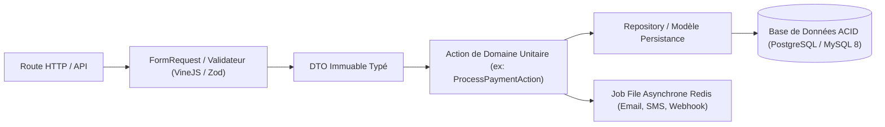

# Règles d'Architecture Backend, Intégrité ACID & Prévention des God Files

Ce document consigne les règles d'ingénierie logicielle non négociables régissant l'architecture serveur sous `san_backend_expert`.

---

## 1. PRÉVENTION DES GOD FILES & CONTRAINTES DE TAILLE (< 300 LIGNES)

Afin de garantir la maintenabilité, la testabilité et la scannabilité par les agents et développeurs :
- **Taille Maximale par Fichier :** Aucun fichier de code serveur (contrôleur, action, service, repository, modèle) ne doit excéder **300 lignes**.
- **Contrôleurs Ultra-Fins (*Skinny Controllers*) :** Moins de 60 lignes par contrôleur. Le contrôleur se borne à :
  1. Injecter la `FormRequest` ou le validateur typé.
  2. Mapper l'entrée vers un DTO immuable.
  3. Déléguer l'exécution métier à une Action unitaire unique.
  4. Renvoyer une ressource formatée ou un statut HTTP normé.
- **Principe de Responsabilité Unique (SRP) :** Une classe = une seule raison de changer. Bannir les classes "Manager" ou "Helper" monolithiques fourre-tout.

---

## 2. PATRON ACTION / DOMAINE / REPOSITORY

L'organisation des couches serveur garantit un découplage absolu :



### Directives d'Implémentation :
1. **Actions Unitaires :** Chaque cas d'usage métier possède sa propre classe `Action` dotée d'une seule méthode publique (`execute()` ou `handle()`).
2. **DTOs Immuables :** Les données entrantes et sortantes entre couches transitent exclusivement via des DTOs strictement typés, interdisant le passage de tableaux associatifs génériques non vérifiés.
3. **Repository Pattern :** Les requêtes complexes d'accès aux données sont isolées dans des Repositories dédiés, évitant la dispersion de requêtes SQL brutes ou de scopes Eloquent complexes au cœur du domaine métier.

---

## 3. RÉSILIENCE TRANSACTIONNELLE ACID & TRIPLE VERROU FINANCIER

Dans les transactions critiques (flux financiers, Mobile Money, transferts de portefeuilles, commandes) :

### Le Triple Verrou Inviolable :
1. **Verrou Distribué Redis (`Cache::lock`) :** Prévient la concurrence inter-serveurs ou inter-processus (Bail 10s, timeout d'attente 5s).
2. **Verrou Pessimiste SQL (`SELECT ... FOR UPDATE`) :** Isole la ligne dans le moteur transactionnel relationnel, garantissant l'atomicité et l'isolation ACID absolue.
3. **Contrôle Mathématique Strict :** Vérification formelle du solde et calcul déterministe avant tout engagement de débit.

### Règle d'Or Inviolable :
> **AUCUN appel réseau HTTP externe (API opérateur télécom, passerelle distante) ne doit JAMAIS être exécuté à l'intérieur d'une transaction SQL active.**  
> Tout appel externe dans une transaction ouverte monopolise les connexions du pool BDD (*Connection Pool Starvation*) et risque d'entraîner l'effondrement en cascade du serveur en cas de latence opérateur. L'appel externe doit être réalisé en amont ou de manière asynchrone via une file d'attente Redis avec réconciliation.

---

## 4. IDEMPOTENCE ABSOLUE PAR EN-TÊTE `Idempotency-Key`

Pour neutraliser les retries automatiques induits par les coupures réseau 3G/EDGE :
- Toute mutation d'état critique (`POST`, `PUT`, `PATCH`) exige un en-tête `Idempotency-Key: <UUIDv4>`.
- Clé enregistrée de manière atomique sous Redis :
  ```text
  SET idempotency:key:<uuid> "PROCESSING" NX EX 86400
  ```
- Si la clé existe déjà avec le statut `PROCESSING`, la requête concurrente est immédiatement rejetée avec le statut `409 Conflict`.
- Lorsque le traitement est achevé, la réponse finale mise en cache est immédiatement retournée en cas de nouvel appel identique.

---

## 5. QUALITY GATE FAIL-CLOSED & TESTS STUDS

Avant toute mise en production ou validation de livraison :
- **Analyse Statique Maximale :** `phpstan analyse --level=max` ou `tsc --noEmit` avec zéro avertissement toléré.
- **Suite de Tests Déterministes :** Tests unitaires d'actions et tests d'intégration avec base de données dédiée (Pest, PHPUnit, Japa) avec exécution fail-closed.
- **Validation Contract-First :** Exécution automatisée des collections de requêtes Bruno headless (`bru run bruno/`).
- **Prévention du N+1 Query Problem :** Activation systématique de `Model::preventLazyLoading(!app()->isProduction())`.
