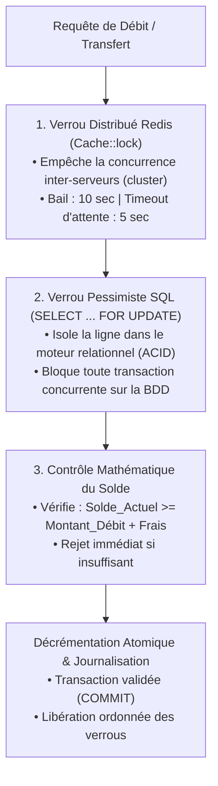
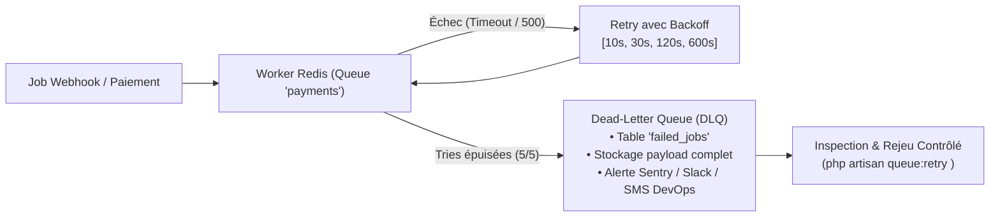

# Résilience Distribuée, Passerelles Mobile Money & Files Redis

> Ce document constitue la référence d'architecture pour les flux financiers distribués à haute résilience, la gestion des coupures réseau (3G/EDGE/instabilité télécom) et le traitement asynchrone sécurisé sous Redis dans le framework Antigravity (`san_*`).

---

## 1. LE CONTEXTE DES ÉCOSYSTÈMES MOBILE MONEY

En Afrique subsaharienne et dans les marchés émergents, le paiement mobile (**MTN Mobile Money**, **Airtel Money**, **Orange Money**, **Wave**) présente des contraintes techniques fondamentales radicalement différentes de celles des cartes bancaires traditionnelles (Visa/Mastercard) :

1. **Réseau mobile dégradé (Edge/3G/4G instable) :** Déconnexions fréquentes du smartphone de l'utilisateur pendant l'envoi de la commande ou de la validation USSD.
2. **Latence asynchrone extrême :** Entre le moment où le serveur marchand initie une requête de débit (*Push USSD*) et le moment où l'opérateur envoie le webhook, il peut s'écouler entre 3 secondes et 15 minutes.
3. **Perte ou duplication de webhooks :** Les passerelles télécoms peuvent soit omettre d'envoyer le webhook de confirmation en cas de surcharge de leurs serveurs, soit le réexpédier jusqu'à 5 fois de suite à quelques millisecondes d'intervalle.
4. **Instabilité des passerelles d'API des opérateurs :** Taux d'erreurs 502/504 temporaires fréquents lors des pics de charge de fin de mois.

---

## 2. LE TRIPLE VERROU ANTI-DOUBLE-DÉPENSE (*ANTI-DOUBLE-SPENDING*)

Pour interdire formellement tout débit multiple ou tout dépassement de solde (y compris lors de requêtes concurrentes à la milliseconde près), l'architecture met en place une triple ligne de défense :



### Règles Non Négociables :
1. **L'identifiant du portefeuille (`wallet_id`)** est toujours le descripteur du verrou.
2. **Aucun appel réseau externe (API HTTP externe)** ne doit JAMAIS être effectué à l'intérieur d'une transaction SQL active avec verrou pessimiste, sous peine de monopoliser les connexions de la base de données et de provoquer un écroulement par famine (*Connection Pool Starvation*).
3. **L'ordre chronologique strict :**
   - Étape A : Valider le format de la requête et acquérir le verrou Redis.
   - Étape B : Ouvrir la transaction SQL, sélectionner la ligne avec `FOR UPDATE`, vérifier le solde.
   - Étape C : Décrémenter le solde, insérer l'entrée comptable au statut `PENDING` ou `RESERVED`, committer la transaction.
   - Étape D : Libérer le verrou Redis.
   - Étape E : Appeler l'API de la passerelle télécom (hors verrou SQL).

---

## 3. GESTION DES DÉCONNEXIONS RÉSEAU & RETRY POLICY AVEC EXPONENTIAL BACKOFF

Lorsqu'un appel sortant vers une passerelle télécom échoue avec une erreur transitoire (HTTP 408 Request Timeout, 429 Too Many Requests, 502 Bad Gateway, 503 Service Unavailable, 504 Gateway Timeout, ou erreur de connexion TCP/TLS), le système ne doit pas abandonner immédiatement, mais appliquer une politique de réessai déterministe.

### 3.1 Algorithme : Exponential Backoff avec Full Jitter
Pour éviter le phénomène de **résonance en meute** (*Thundering Herd Problem* ou onde de choc où des centaines de serveurs rejouent leur appel exactement à la même milliseconde), un délai aléatoire (*Jitter*) est impérativement ajouté :

$$\text{Backoff}(n) = \min\left(T_{\text{max}}, T_{\text{base}} \times 2^n\right)$$
$$\text{Délai Effectif} = \text{random}\left(0, \text{Backoff}(n)\right)$$

Où :
- $n$ est l'indice de la tentative (0, 1, 2, ...).
- $T_{\text{base}}$ = 1 seconde.
- $T_{\text{max}}$ = 60 secondes.

### 3.2 Exemple d'Implémentation PHP 8.2 (Service Gateway Résilient)

```php
<?php

declare(strict_types=1);

namespace App\Services\Payments;

use Illuminate\Http\Client\ConnectionException;
use Illuminate\Http\Client\Response;
use Illuminate\Support\Facades\Http;
use Illuminate\Support\Facades\Log;

final class ResilientMoMoClient
{
    private const MAX_RETRIES = 4;
    private const BASE_DELAY_MS = 1000;
    private const MAX_DELAY_MS = 30000;

    /**
     * @param string $endpoint URL complète de l'API opérateur
     * @param array<string, mixed> $payload Corps de la requête
     * @param array<string, string> $headers En-têtes HTTP
     * @return Response
     * @throws ConnectionException
     */
    public function postWithRetry(string $endpoint, array $payload, array $headers): Response
    {
        $attempt = 0;

        while (true) {
            try {
                $response = Http::withHeaders($headers)
                    ->timeout(15) // Timeout strict de socket
                    ->post($endpoint, $payload);

                // Si le serveur distant répond avec un statut transitoire
                if ($this->isTransientStatus($response->status()) && $attempt < self::MAX_RETRIES) {
                    $this->sleepWithJitter($attempt);
                    $attempt++;
                    continue;
                }

                return $response;
            } catch (ConnectionException $exception) {
                if ($attempt >= self::MAX_RETRIES) {
                    Log::error("Échec définitif de connexion télécom après {$attempt} retries.", [
                        'endpoint' => $endpoint,
                        'exception' => $exception->getMessage(),
                    ]);
                    throw $exception;
                }

                $this->sleepWithJitter($attempt);
                $attempt++;
            }
        }
    }

    private function isTransientStatus(int $status): bool
    {
        return in_array($status, [408, 429, 502, 503, 504], true);
    }

    private function sleepWithJitter(int $attempt): void
    {
        // Calcul du délai exponentiel borné
        $exponential = min(self::MAX_DELAY_MS, self::BASE_DELAY_MS * (2 ** $attempt));
        // Injection d'un jitter complet uniforme entre 100ms et la borne calculée
        $sleepTimeMs = random_int(100, $exponential);

        Log::warning("Passerelle télécom instable. Tentative #{$attempt} dans {$sleepTimeMs} ms.");
        usleep($sleepTimeMs * 1000);
    }
}
```

---

## 4. ARCHITECTURE DES FILES REDIS & DEAD-LETTER QUEUES (DLQ)

Toutes les opérations d'arrière-plan sont ségréguées dans des files d'attente Redis indépendantes afin d'empêcher qu'une vague de notifications n'engorge les transactions financières.

### 4.1 Ségrégation des Files d'Attente
| Nom de la File | Priorité | Concurrency (Workers) | Usage Exclusif |
| :--- | :--- | :--- | :--- |
| `payments-high` | 1 (Urgent) | 10 | Dénouement immédiat des transactions Mobile Money (appels de débits). |
| `webhooks` | 2 (Élevée) | 15 | Dépouillement des callbacks télécoms entrants pour libérer les contrôleurs HTTP. |
| `reconciliation` | 3 (Moyenne) | 4 | Tâches de fond de synchronisation des états `PENDING`. |
| `notifications` | 4 (Basse) | 8 | Envois de SMS d'alerte, e-mails de facturation, push FCM. |

---

### 4.2 Mécanisme de Dead-Letter Queue (DLQ)
Lorsqu'un traitement asynchrone épuise toutes ses tentatives de retry (défini par `$tries = 5`), il ne doit jamais disparaître silencieusement.



#### Enregistrement des Défaillances Critiques
Chaque job gérant un flux financier doit implémenter la méthode `failed(\Throwable $exception)` pour enregistrer le contexte immuable dans une table d'audit `payment_incident_logs` :

```php
public function failed(\Throwable $exception): void
{
    DB::table('payment_incident_logs')->insert([
        'id' => (string) \Illuminate\Support\Str::uuid(),
        'job_name' => static::class,
        'queue' => $this->queue ?? 'default',
        'payload' => json_encode($this->webhookPayload, JSON_THROW_ON_ERROR),
        'exception_class' => get_class($exception),
        'error_message' => $exception->getMessage(),
        'stack_trace' => $exception->getTraceAsString(),
        'failed_at' => now(),
    ]);

    // Envoi d'une alerte immédiate au monitoring DevOps
    Log::critical("ALERTE SÉCURITÉ PAIEMENT : Incident acheminé en DLQ.", [
        'reference' => $this->webhookPayload['reference'] ?? 'INCONNUE',
        'error' => $exception->getMessage(),
    ]);
}
```

---

## 5. SPÉCIFICITÉS D'INTÉGRATION PAR OPÉRATEUR

### 5.1 MTN Mobile Money (MoMo API)
- **Environnement :** Sandbox (`sandbox.momodeveloper.mtn.com`) / Production (`proxy.momoapi.mtn.com`).
- **Authentification :** Génération d'une `API Key` liée à un UUID utilisateur `X-Reference-Id`. Échange contre un token OAuth2 Bearer valable 3600 secondes.
- **En-tête Spécifique :** `X-Target-Environment: mtncongo` (ou `mtncameroon`, `mtnuganda`, etc.).
- **Flux RequestToPay :**
  - POST `/collection/v1_0/requesttopay`
  - La réponse initiale renvoie `HTTP 202 Accepted` sans corps.
  - Le serveur doit sonder `GET /collection/v1_0/requesttopay/{X-Reference-Id}` si aucun webhook n'est parvenu sous 60 secondes.
  - Statuts finaux : `SUCCESSFUL`, `FAILED`.

### 5.2 Airtel Money
- **Authentification :** OAuth 2.0 via `client_id` et `client_secret` envoyés en JSON sur `/auth/oauth2/token`.
- **En-têtes Obligatoires :**
  - `X-Country: CG` (Code pays ISO-3166 à deux lettres).
  - `X-Currency: XAF`.
  - `Authorization: Bearer <token>`.
- **Signature Webhook :** Validation cryptographique avec clé publique RSA ou HMAC-SHA256 selon la version de l'API de l'opérateur local.

### 5.3 Orange Money
- **Authentification :** Bearer token issu de l'API OAuth d'Orange Developer.
- **Flux Web Payment :** Redirection web ou USSD Push direct.
- **Vérification du statut :** Requête obligatoire de confirmation d'état avec l'identifiant `pay_token`.

---

## 6. PROTOCOLE DE RÉCONCILIATION PROACTIVE (CRON TOUTES LES 5 MIN)

Le worker planifié de réconciliation proactive inspecte la base de données pour identifier les paiements restés au statut `PENDING` depuis plus de 5 minutes et moins de 24 heures.

### Algorithme de la Commande de Réconciliation :
1. Extraire les paiements orphelins par lots de 50 enregistrements ordonnés (`chunkById`).
2. Pour chaque enregistrement :
   - Interroger l'API officielle de l'opérateur avec la référence unique (`GET /status/{ref}`).
   - Si statut distant == `SUCCESSFUL` : appliquer le dénouement via l'Action métier appropriée (créditer le compte marchand, valider la commande, notifier le client).
   - Si statut distant == `FAILED` ou `REJECTED` : marquer la transaction comme échouée et libérer les réservations d'articles éventuelles.
   - Si statut distant == toujours `PENDING` et `created_at > 30 minutes` : clore d'office la transaction comme `EXPIRED` pour éviter les blocages indéfinis.
