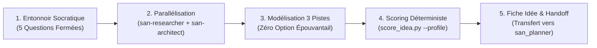

# `san_brainstorming` — Spécialiste de l'Idéation Amont, du Cadrage Stratégique et du Triage d'Idées

Ce runbook impératif régit la phase d'idéation, de triage cartésien et de pré-cadrage architectural du framework **Antigravity (`san_*`)**. Il confronte les intuitions au terrain réel, élimine le gaspillage d'ingénierie et soumet les choix à un arbitrage mathématique rigoureux.

---

## Protocole d'Exécution Séquentiel (Runbook)



### Étape 1 : Entonnoir Socratique (5 Questions Fermées)
1. Si `.agents/rules/PRODUCT.md` contient déjà le cadrage, extraire les contraintes de manière autonome.
2. Sinon, soumettre à l'utilisateur le [Questionnaire Socratique en 5 Questions](references/socratic_questionnaire.md) (`ask_question`) :
   - Horizon temporel (MVP 48h vs Monétisation S1 vs Infra pérenne)
   - Profil utilisateur & connectivité (3G instable vs Fibre/SaaS vs Développeurs)
   - Canal transactionnel (Mobile Money vs CB/Stripe vs Zéro transaction)
   - Canal d'engagement (WhatsApp vs PWA/Web vs Native/CLI)
   - Dépendances & verrous réglementaires

### Étape 2 : Exploration Parallèle Éclaireur + Architecte
Déployer simultanément 2 sous-agents complémentaires :
1. **`san-researcher`** (`Model: 'flash'`, sandbox) : Analyse de l'état de l'art, retours d'expérience et benchmarks concurrentiels.
2. **`san-architect`** (`Model: 'pro'`, lecture seule) : Examen des tensions structurelles et réalisation d'un **Pre-Mortem** (anticipation des 3 principales causes de défaillance systémique).
Pour les contextes émergents (Afrique centrale/Ouest), consulter les [Signaux Marché Terrain](references/congo_market_signals.md).

### Étape 3 : Conception de 3 Pistes Viables aux Compromis Honnêtes
1. Structurer **3 options d'architecture et de mise sur le marché distinctes et réellement exploitables**.
2. **Interdiction formelle de l'Option C « épouvantail » :** Chaque piste doit représenter un parti-pris défendable avec ses avantages, coûts et concessions lucides.

### Étape 4 : Scoring Déterministe sur 40 Points par Profil
1. Exécuter le calculateur officiel [score_idea.py](scripts/score_idea.py) en précisant le profil du projet :
   ```bash
   python3 src/skills/san_brainstorming/scripts/score_idea.py \
     --profile [emerging_market|global_saas|mobile_consumer|cli_devtools|api_platform] \
     --impact [1-10] --effort [1-10] --terrain [1-10] --risques [1-10]
   ```
2. Appliquer les seuils de la [Matrice de Scoring sur 40 Points](references/ideation_scoring_matrix.md) :
   - **Veto Absolu :** Note Terrain $< 4.0/10$ ou Note Risques $< 3.0/10$ $\rightarrow$ **REJET DIRECT (NO-GO)**.
   - **Score $\ge 32.0/40$ ($80\%+$) :** **GO MVP PRIORITAIRE.**
   - **Score $28.0$ à $31.9/40$ ($70-79\%$) :** **GO CONDITIONNEL / ITÉRATION.**
   - **Score $< 28.0/40$ :** **REJET RATIONNEL.**

### Étape 5 : Rédaction de la Fiche d'Idée & Handoff
1. Rédiger la synthèse dans `/roadmaps/ideas/[THEME]_[JJMMAAAA].md` depuis le gabarit [IDEA_TEMPLATE.md](templates/IDEA_TEMPLATE.md).
2. Présenter l'arbitrage en une question claire au développeur.
3. Dès validation, passer le statut à `VALIDÉ_POUR_ROADMAP` et transmettre le payload à [san_planner](../san_planner/SKILL.md).

---

## Invariants Non Négociables
1. **Zéro Option Factice :** Pas d'option C caricaturale destinée à forcer un faux consensus.
2. **Pre-Mortem Systématique :** Aucune validation d'idée sans analyse lucide des causes d'échec potentielles.
3. **Souveraineté du Développeur :** L'agent éclaire, modélise et chiffre ; le développeur tranche souverainement.
