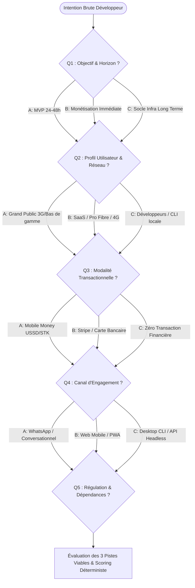

# Guide de l'Entonnoir Socratique & Cadrage d'Idées

Ce document décrit l'entonnoir d'investigation en 5 questions fermées employé par `san_brainstorming` pour extraire rapidement les contraintes non négociables d'un projet avant modélisation.

---

## 1. Arbre Décisionnel des 5 Questions Fermées

---

## 2. Formulation Didactique des Questions

1. **Question 1 (Objectif racine & Horizon temporel) :**
   - `[A]` **Validation d'usage ultra-rapide (MVP 24h-48h) :** Tester l'appétence avec un investissement technique minimal.
   - `[B]` **Génération de revenus immédiate (Semaine 1) :** Monétisation transactionnelle dès les premiers jours.
   - `[C]` **Socle d'infrastructure pérenne :** Plateforme évolutive destinée à supporter des flux massifs.

2. **Question 2 (Profil utilisateur & Environnement) :**
   - `[A]` **Grand public émergent :** Smartphones Android d'entrée de gamme (1-2 Go RAM), réseau 3G/EDGE instable.
   - `[B]` **Cadres, Entreprises & SaaS Global :** Web desktop et smartphones récents, connexion haut débit permanente.
   - `[C]` **Équipes techniques / Développeurs :** Terminal, CLI, pipelines CI/CD, performance locale.

3. **Question 3 (Modalité transactionnelle & Paiement) :**
   - `[A]` **Mobile Money pur :** Push USSD / STK (MTN MoMo, Airtel Money) avec confirmation asynchrone par webhook.
   - `[B]` **Cartes bancaires / Wallets :** Visa, Mastercard, Stripe.
   - `[C]` **Gratuit / Open-Source / Zéro encaissement direct.**

4. **Question 4 (Canal d'engagement maître) :**
   - `[A]` **WhatsApp First :** Bot automatisé (Cloud API), notifications directes.
   - `[B]` **Web Responsive / PWA légère :** Zéro friction store, chargement rapide.
   - `[C]` **CLI / Outil Développeur / Application Native.**

5. **Question 5 (Verrous réglementaires & Dépendances tierces) :**
   - `[A]` **Zéro friction réglementaire :** Hébergement indépendant, aucune conservation de fonds tiers.
   - `[B]` **Agrégateur tiers déclaré :** Passerelle de paiement agréée, conformité standard.
   - `[C]` **Forte contrainte fintech ou bancaire :** Régulation stricte (BEAC / BCEAO / RGPD).
