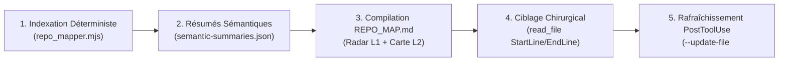

# `san_cartographer` — Moteur Hybride de Cartographie & Cache du Repo

Ce runbook régit l'indexation déterministe locale, la génération du cache hybride et l'exploration économique de la codebase au sein du framework **Antigravity (`san_*`)**. Il élimine l'aveuglement architectural et protège le contexte contre l'ingestion massive de code source superflu.

---

## Protocole d'Exécution Séquentiel (Runbook)



### Étape 1 : Cartographie Initiale & Radar Niveau 1
1. Lancer l'indexation déterministe locale sans LLM (< 80ms) via le script [repo_mapper.mjs](scripts/repo_mapper.mjs) :
   ```bash
   node scripts/repo_mapper.mjs --json
   ```
2. Pour n'afficher que l'aperçu synthétique prêt pour injection contextuelle (< 1.2 KB) :
   ```bash
   node scripts/repo_mapper.mjs --radar
   ```
3. Consulter l'[Architecture du Cache Hybride](references/hybrid_cache_architecture.md) pour la répartition des 3 couches de persistance dans `.agents/cache/`.

### Étape 2 : Enrichissement Sémantique par Dossier
1. Identifier les répertoires sans synthèse IA signalés par l'indicateur `⚠️ [Non résumé]`.
2. Définir le résumé métier concis (1 à 2 phrases) pour chaque dossier clé :
   ```bash
   node scripts/repo_mapper.mjs --set-summary "src/services/billing=Gestion des transactions MoMo et facturation"
   ```
3. Possibilité d'importer un dictionnaire JSON complet via le gabarit [SEMANTIC_SUMMARIES_TEMPLATE.json](templates/SEMANTIC_SUMMARIES_TEMPLATE.json) :
   ```bash
   node scripts/repo_mapper.mjs --summaries-file .agents/cache/semantic-summaries.json
   ```

### Étape 3 : Exploration Chirurgicale & Localisation de Symboles
1. Rechercher une fonction, une classe ou une route dans l'index sans ouvrir les fichiers :
   ```bash
   node scripts/repo_mapper.mjs --query "handlePayment"
   ```
2. Le moteur renvoie l'emplacement exact : `src/services/billing.ts#L45-L78`.
3. Consulter les [Règles d'Extraction de Symboles](references/symbol_extraction_rules.md) pour les détails par langage (TypeScript, PHP, Python, Go, Prisma, SQL, Bruno).
4. Utiliser l'outil natif de lecture ciblée :
   ```json
   read_file(Path: "src/services/billing.ts", StartLine: 45, EndLine: 78)
   ```
5. Vérifier la conformité du rendu global avec le gabarit [REPO_MAP_TEMPLATE.md](templates/REPO_MAP_TEMPLATE.md).

### Étape 4 : Rafraîchissement Incrémental Temps Réel (`PostToolUse`)
1. Après toute modification de fichier par `write_file` ou `edit_file`, exécuter en moins de 25ms :
   ```bash
   node scripts/repo_mapper.mjs --update-file "chemin/du/fichier.ts"
   ```
2. Le cache technique `.agents/cache/repo-index.json` et la cartographie `.agents/cache/REPO_MAP.md` sont immédiatement actualisés sans reparsing complet du dépôt.

---

## Invariants Non Négociables
1. **Économie Radicale de Tokens :** Ne jamais charger un fichier volumineux entier quand une lecture chirurgicale `StartLine`/`EndLine` via `REPO_MAP.md` suffit.
2. **Autonomie Pure & Déterminisme :** Zéro dépendance npm externe ; le script [repo_mapper.mjs](scripts/repo_mapper.mjs) s'exécute exclusivement avec les modules natifs Node.js (`fs`, `path`, `crypto`).
3. **Synchronisation Permanente :** Toute modification de code source en vol doit être propagée via `--update-file` pour garantir la véracité des numéros de lignes.
