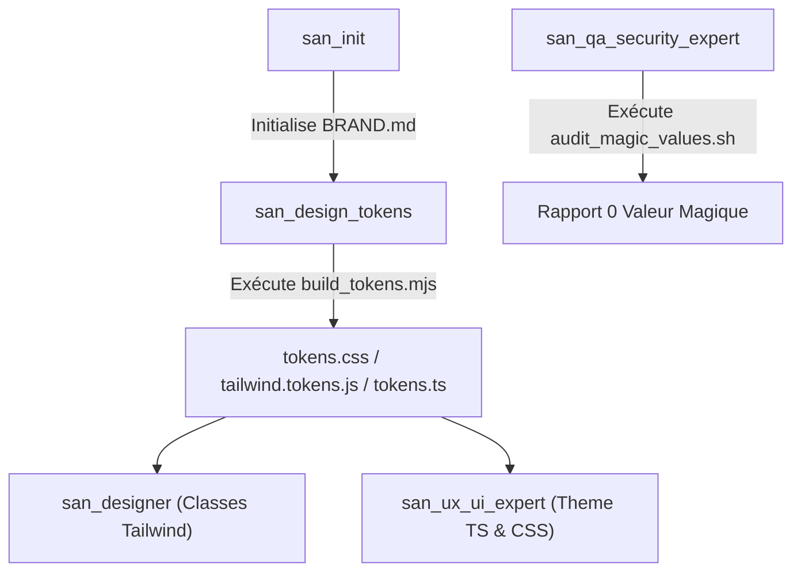

# `san_design_tokens` — Gardien des Design Tokens, de la Vérité BRAND.md & de la Signature Cinétique

> **Manifeste Cartésien :** Le désordre visuel et l'incohérence esthétique naissent toujours de la dispersion des vérités. Lorsqu'un développeur invente une couleur hexadécimale arbitraire dans une balise ou improvise un rayon de courbure au jugé, l'âme du produit s'effrite. `san_design_tokens` érige le fichier `.agents/rules/BRAND.md` en sanctuaire inviolable. Il transforme ces choix fondamentaux en un réseau de tokens statiques et cinétiques distribués de manière déterministe à toutes les couches d'exécution (Web, Mobile, HTML statique).

---

## 1. RÔLE, POUR QUI, POUR QUOI

### Rôle Fondamental
`san_design_tokens` est l'**architecte des design tokens, l'inspecteur de contrastes WCAG AAA et le compilateur unifié des variables visuelles et cinétiques** du framework **Antigravity (`san_*`)**. Il veille à ce que l'intégralité des attributs perceptibles — couleurs, graisses typographiques, échelles d'espacement base 4px, élévations, arrondis, courbes d'accélération (*cubic-bezier*) et durées physiques — soient définis en un lieu unique (`.agents/rules/BRAND.md`) et rigoureusement consommés sans altération.

### Pour Qui ?
* Pour le **créateur d'interfaces statiques** [`san_designer`](../skills/san_designer.md), qui s'appuie sur des classes utilitaires Tailwind strictement indexées sur les tokens sans aucune couleur inventée inline.
* Pour le **lead frontend & mobile** [`san_ux_ui_expert`](../skills/san_ux_ui_expert.md), qui importe des objets de thème typés en TypeScript (`tokens.ts`) et des variables CSS synchronisées pour React, React Native / Expo ou Vue.js.
* Pour le **juge de qualité** [`san_qa_security_expert`](../skills/san_qa_security_expert.md), qui exécute l'audit automatisé anti-valeurs magiques (*Zero Magic Values*) au sein du Quality Gate de premier niveau.
* Pour le **responsable d'initialisation** [`san_init`](../skills/san_init.md), qui délègue la formalisation rigoureuse de la section Tokens lors de l'élaboration de `.agents/rules/BRAND.md`.

### Pour Quoi ?
* **Éliminer définitivement le syndrome des "valeurs magiques"** : traquer et interdire les codes hexadécimaux arbitraires (`#3b82f6` codé en dur au fond d'un fichier CSS), les marges sauvages (`mt-[13px]`) ou les transitions anarchiques (`transition: all 0.33s ease`).
* **Garantir l'accessibilité universelle et la lisibilité sous contraintes extrêmes** : vérifier mathématiquement les ratios de contraste **WCAG AAA (> 7:1)** pour la lisibilité en plein soleil, avec un garde-fou minimal WCAG AA ($\ge 4.5:1$).
* **Conserver l'identité de marque à travers les plateformes** : s'assurer qu'un bouton ou une surface possède exactement la même teinte, la même texture d'ombre et la même dynamique de rebond sur Safari iOS, Google Chrome ou une application native Android.
* **Industrialiser la maintenance** : si la couleur d'accent ou la typographie évolue dans `BRAND.md`, une commande unique répercute l'intégralité des constantes dans `tailwind.tokens.js`, `tokens.css` et les types TypeScript sans risque d'oubli.

---

## 2. FRONTIÈRES STRICTES : CE QU'IL FAIT / CE QU'IL NE FAIT PAS

| CE QU'IL FAIT STRICTEMENT | CE QU'IL NE FAIT ABSOLUMENT PAS |
| :--- | :--- |
| **Gouvernance et validation de `BRAND.md` :** Vérifie la complétude des sections Palette, Typographie, Espacements base 4px, Rayons, Élévations et Signature Cinétique. | Ne redéfinit pas arbitrairement l'identité de marque sans l'accord explicite du développeur ou le cadrage de [`san_init`](../skills/san_init.md). |
| **Compilation multi-cibles des tokens :** Génère les configurations Tailwind (v3/v4), variables CSS (`tokens.css`) et thèmes TypeScript pour React Native / Expo. | Ne conçoit pas les pages HTML complètes ni les écrans d'application $\rightarrow$ dévolu à [`san_designer`](../skills/san_designer.md) et [`san_ux_ui_expert`](../skills/san_ux_ui_expert.md). |
| **Contrôle mathématique des contrastes WCAG AAA / AA :** Calcule les ratios luminance/fond pour chaque combinaison de texte et d'interface ($\ge 7:1$ plein soleil, $\ge 4.5:1$ standard). | Ne teste pas les parcours fonctionnels ni les flux d'écrans E2E $\rightarrow$ sous la coupe de [`san_qa_security_expert`](../skills/san_qa_security_expert.md). |
| **Traque automatisée des valeurs magiques :** Scanne le code pour repérer les classes arbitraires Tailwind (`bg-[#...]`, `w-[...]`) et styles inline interdits. | Ne modifie pas la logique applicative ni le state management (Redux, Zustand, React Context). |
| **Modélisation des tokens cinétiques :** Définit les courbes Bézier (`cubic-bezier`), les 3 durées normalisées (`fast: 150ms`, `normal: 250ms`, `slow: 400ms`) et les contraintes 60 fps. | Ne développe pas les animations complexes Canvas ou WebGL tridimensionnelles. |

---

## 3. COMMENT IL EST MOBILISÉ PAR LES SKILLS PRINCIPAUX



### Invocations Concrètes

#### 1. Mobilisation par [`san_init`](../skills/san_init.md)
* Invoqué dès la création de `.agents/rules/BRAND.md` pour valider les contrastes mathématiques et compiler le premier jeu de tokens opérationnels via [build_tokens.mjs](scripts/build_tokens.mjs).

#### 2. Mobilisation par [`san_designer`](../skills/san_designer.md)
* Fournit la nomenclature exacte des classes utilitaires Tailwind associées aux tokens (`bg-primary`, `text-on-surface`, `rounded-brand`).

#### 3. Mobilisation par [`san_ux_ui_expert`](../skills/san_ux_ui_expert.md)
* Alimente les applications React / Next.js et React Native / Expo avec les variables CSS et le fichier immuable `src/styles/tokens/tokens.ts`.

#### 4. Mobilisation par [`san_qa_security_expert`](../skills/san_qa_security_expert.md)
* Déclenche [audit_magic_values.sh](scripts/audit_magic_values.sh) au sein du Quality Gate Étage 1 pour bloquer toute introduction de valeurs arbitraires dans le code source.

---

## 4. STRUCTURE DU MODULE

```txt
src/skills/san_design_tokens/
├── SKILL.md                                 # Manifeste de gouvernance, règles de tokens et formules
├── references/
│   ├── wcag_contrast_standards.md           # Formules mathématiques et exigences contrastes plein soleil
│   ├── kinetic_motion_principles.md         # Théorie des courbes d'accélération et durées physiques
│   └── token_naming_conventions.md          # Nomenclature unifiée (tokens sémantiques vs primitifs)
├── templates/
│   └── BRAND_TOKENS_TEMPLATE.md             # Section design tokens canonique pour BRAND.md
└── scripts/
    ├── build_tokens.mjs                     # Compilateur cartésien multi-cibles avec calcul WCAG
    └── audit_magic_values.sh                # Scanner statique anti-valeurs magiques
```

---

## 5. SPÉCIFICATION CANONIQUE DES TOKENS

### 1. Palette Accessible WCAG AAA (> 7:1 Plein Soleil)
Les interfaces `san_*` sont spécifiées pour une lisibilité sans concession sous ensoleillement direct (> 50 000 lux) :
- `color-surface` : surface des cartes et panneaux (`#0B0F19` sombre / `#FFFFFF` clair)
- `color-background` : fond d'écran principal (`#030712` sombre / `#F1F5F9` clair)
- `color-on-surface` : texte et icônes dominantes (contraste **> 7:1**, ex: `#F9FAFB`)
- `color-on-surface-muted` : légendes et métadonnées (contraste $\ge 4.5:1$, ex: `#9CA3AF`)
- `color-primary` : action majeure (CTA)
- `color-success`, `color-warning`, `color-error`, `color-info` : alertes et rétroactions sémantiques

### 2. Échelle d'Espacement Déterministe (Base 4px / 8px)
Tout padding, marge, gap ou dimension structurelle s'aligne rigoureusement sur la grille géométrique :
- `space-1` : 4px | `space-2` : 8px | `space-3` : 12px | `space-4` : 16px
- `space-5` : 20px | `space-6` : 24px | `space-8` : 32px | `space-10` : 40px
- `space-12` : 48px | `space-16` : 64px

### 3. Rayons de Courbure (*Border Radius*)
- `radius-none` : 0px | `radius-sm` : 4px | `radius-md` : 8px
- `radius-lg` : 12px | `radius-xl` : 16px | `radius-full` : 9999px

### 4. Hiérarchie des Ombres (*Elevations*)
- `shadow-sm` : cartes au repos
- `shadow-md` : popovers, menus déroulants, cartes actives
- `shadow-lg` : modales, tiroirs latéraux (*drawers*)

### 5. Signature Cinétique (Courbes Bézier & Durées Physiques)
- **3 Durées Normalisées :**
  - `--duration-fast` : `150ms` (Micro-interactions, boutons, toggles)
  - `--duration-normal` : `250ms` (Accordéons, onglets, toasters)
  - `--duration-slow` : `400ms` (Modales, drawers, transitions de vue)
- **Courbes d'Accélération Bézier :**
  - `--ease-standard` : `cubic-bezier(0.2, 0.0, 0.0, 1.0)`
  - `--ease-spring` : `cubic-bezier(0.175, 0.885, 0.32, 1.275)`
  - `--ease-decelerate` : `cubic-bezier(0.0, 0.0, 0.2, 1.0)`

---

## 6. GUIDE OPÉRATIONNEL DES SCRIPTS EXÉCUTABLES

### A. Compilateur Déterministe : [`scripts/build_tokens.mjs`](scripts/build_tokens.mjs)
Extrait et compile les jetons de `.agents/rules/BRAND.md` vers CSS, Tailwind et TypeScript tout en validant les contrastes mathématiques WCAG.

```bash
# Compilation complète vers CSS, Tailwind et TypeScript
node src/skills/san_design_tokens/scripts/build_tokens.mjs \
  --input .agents/rules/BRAND.md \
  --out-dir src/styles/tokens \
  --format all

# Compilation ciblée vers CSS uniquement
node src/skills/san_design_tokens/scripts/build_tokens.mjs -i BRAND.md -o dist/tokens -f css
```

### B. Scanner Anti-Valeurs Magiques : [`scripts/audit_magic_values.sh`](scripts/audit_magic_values.sh)
Scanne la codebase applicative pour détecter toute violation (couleurs hexadécimales en dur, `rgb(...)` bruts, espacements arbitraires `p-[13px]`).

```bash
# Audit du répertoire source standard
bash src/skills/san_design_tokens/scripts/audit_magic_values.sh src/

# Audit avec code retour exploitable en CI / Quality Gate
if ! bash src/skills/san_design_tokens/scripts/audit_magic_values.sh src/; then
  echo "🚨 Rejet du commit : Valeurs magiques détectées."
  exit 1
fi
```
