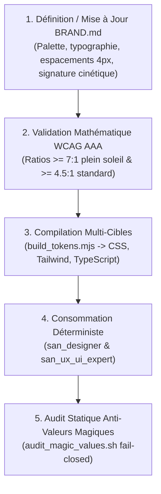

# `san_design_tokens` — Gardien des Design Tokens & Vérité de Marque v2.0

`san_design_tokens` est le compilateur et le vérificateur déterministe des attributs perceptibles du framework **Antigravity (`san_*`)**. Il érige `.agents/rules/BRAND.md` en source unique de vérité absolue, compile les variables multi-cibles (CSS Variables, Tailwind v3/v4, TypeScript) et traque impitoyablement les valeurs magiques (*Zero Magic Values*).

---

## 1. DÉCLENCHEURS & INTENTIONS RECONNUES

- *« Compile les tokens de BRAND.md vers CSS et Tailwind »*
- *« Vérifie les ratios de contraste WCAG AAA pour le mode plein soleil »*
- *« Lance l'audit des valeurs magiques dans le code source »*
- *« Génère le fichier TypeScript tokens.ts pour l'application mobile »*

---

## 2. PROTOCOLE OPÉRATIONNEL (RUNBOOK PAS À PAS)

Le cycle de gouvernance et de déploiement des tokens s'exécute selon l'enchaînement suivant :



### Étape 1 : Vérification de la Source Unique `BRAND.md`
Contrôler que `.agents/rules/BRAND.md` comporte les 5 blocs indispensables :
- **Palette sémantique :** `color-background`, `color-surface`, `color-on-surface`, `color-primary`, teintes de statut.
- **Échelle d'espacement base 4px/8px :** `space-1` (4px) à `space-16` (64px).
- **Rayons & Ombres :** Échelle d'arrondis (`radius-none` à `radius-full`) et élévations (`shadow-sm`, `shadow-md`, `shadow-lg`).
- **Signature cinétique 60 fps :** 3 durées physiques (`150ms`, `250ms`, `400ms`) et courbes Bézier (`--ease-standard`, `--ease-spring`).

### Étape 2 : Compilation Multi-Cibles Déterministe
Exécuter le script de compilation Node.js ESM pour projeter les tokens vers toutes les cibles :
```bash
node src/skills/san_design_tokens/scripts/build_tokens.mjs \
  --input .agents/rules/BRAND.md \
  --out-dir src/styles/tokens \
  --format all
```
Génère de manière synchrone `tokens.css`, `tailwind.tokens.js` et `tokens.ts`.

### Étape 3 : Audit Statique Anti-Valeurs Magiques (*Fail-Closed*)
Avant tout commit ou livraison dans une roadmap active, exécuter le scanner de conformité :
```bash
bash src/skills/san_design_tokens/scripts/audit_magic_values.sh src/
```
Le script traque les classes arbitraires Tailwind (`bg-[#...]`, `w-[...]`) et styles CSS bruts non répertoriés. Tout constat lève une erreur bloquante (code retour `1`).

---

## 3. RESSOURCES & RÉFÉRENCES EMBARQUÉES

- [Normes de Contraste WCAG AAA & Plein Soleil](references/wcag_contrast_standards.md) : Calculs photométriques et seuils $\ge 7:1$.
- [Principes Cinétiques & Micro-Interactions 60 fps](references/kinetic_motion_principles.md) : Théorie des courbes d'accélération et durées physiques.
- [Nomenclature des Tokens de Design](references/token_naming_conventions.md) : Convention des tokens sémantiques vs primitifs.
- [Compilateur Déterministe build_tokens.mjs](scripts/build_tokens.mjs) : Extracteur cartésien multi-formats avec validation WCAG.
- [Scanner Anti-Valeurs Magiques audit_magic_values.sh](scripts/audit_magic_values.sh) : Audit de pureté du code sans token LLM.
- [Gabarit Canonique BRAND.md](templates/BRAND_TOKENS_TEMPLATE.md) : Structure de référence pour les design tokens.
