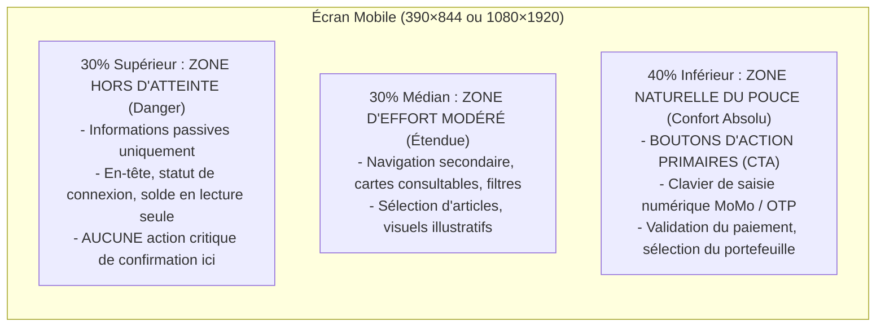
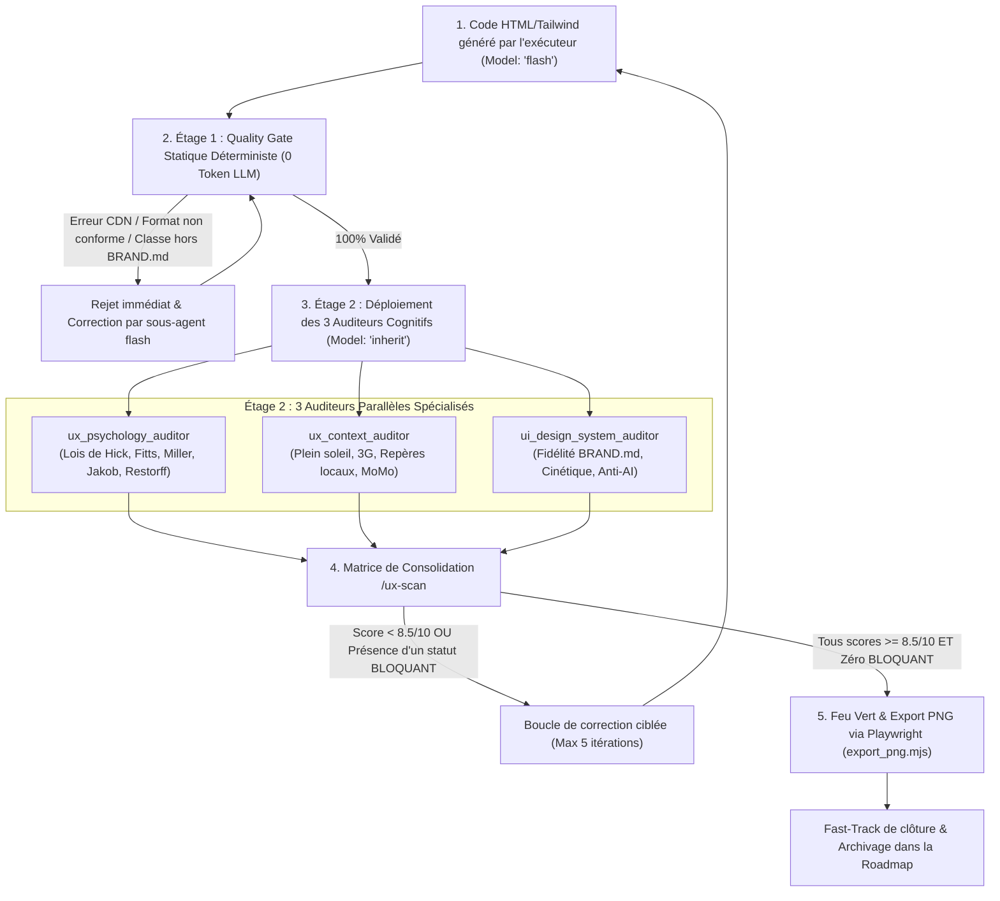
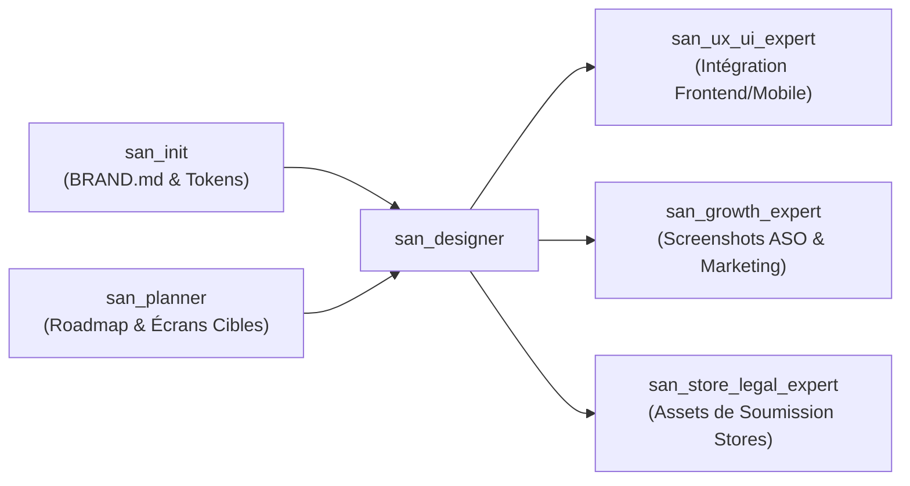

# `san_designer` — Design Visuel Haute Fidélité, UI Mockups 100% Code & Visual Craft

> **Manifeste de l'Artisanat Numérique :** Le design d'interface moderne ne tolère aucun découplage entre la maquette et le code. Les fichiers graphiques propriétaires et statiques s'étiolent dès la première itération. `san_designer` conçoit **100 % de ses maquettes, captures de stores et visuels directement en code HTML sémantique + Tailwind CSS local**, avec zéro dépendance CDN externe et polices locales embarquées. Chaque écran incarne l'âme vivante de marque de `.agents/rules/BRAND.md`, répond aux contraintes physiques du terrain (plein soleil, 3G, ergonomie du pouce) et se soumet à l'entonnoir d'audit d'élite `/ux-scan`.

---

## 1. RÔLE, POUR QUI, POUR QUOI

### Rôle Fondamental
`san_designer` est le maître d'œuvre de la conception visuelle, du prototypage haute fidélité et des assets graphiques du framework **Antigravity (`san_*`)**. Il opère en amont et en symbiose avec l'ingénierie logicielle pour concevoir, prototyper, auditer et figer visuellement tous les écrans, captures de stores et supports de communication d'un produit numérique avant toute phase d'assemblage applicatif.

### Pour Qui ?
* **Pour le développeur full-stack & lead tech :** Qui a besoin de maquettes d'écrans exécutables et fidèles au pixel près en HTML/Tailwind, réutilisables directement pour l'intégration frontend sans friction d'interprétation.
* **Pour l'expert frontend & mobile ([`san_ux_ui_expert`](../san_ux_ui_expert/SKILL.md)) :** Qui reçoit des maquettes éprouvées, structurées et validées ergonomiquement pour les transformer en composants dynamiques React.js et React Native / Expo.
* **Pour le chef d'orchestre ([`san_executer`](../../skills/san_executer.md)) :** Qui délègue l'assurance visuelle et cognitive amont avant d'engager les chantiers de code lourd.
* **Pour les experts de publication ([`san_store_legal_expert`](../../skills/san_store_legal_expert.md), [`san_growth_expert`](../../skills/san_growth_expert.md)) :** Qui reçoivent des captures certifiées aux dimensions exactes des stores (Play Store, App Store, Feature Graphic).

### Pour Quoi ?
* **Éliminer la fracture « Design vs Code » :** Les maquettes étant rédigées avec les classes utilitaires réelles de Tailwind CSS et un balisage HTML sémantique, le design partage rigoureusement les mêmes tokens et la même syntaxe que le code final de production.
* **Bannir l'artifice et les stéréotypes IA (*Anti-AI Taste*) :** Refuser les interfaces prévisibles et génériques (cartes blanches uniformes sur fond grisâtre, dégradés violets fluo non justifiés) pour façonner une identité visuelle vivante, singulière et mémorable dictée par `.agents/rules/BRAND.md`.
* **Intégrer d'emblée la réalité physique du terrain :** Lisibilité en plein soleil à fort éclairage ambiant (contraste élevé), adaptation aux smartphones d'entrée et milieu de gamme, ergonomie à une main dans les transports, et ancrage culturel authentique (paiements Mobile Money, repères urbains, montants réels en FCFA).
* **Industrialiser l'export visuel :** Génération déterministe de fichiers PNG haute résolution en une commande via Playwright, garantissant une reproductibilité absolue en environnement local ou d'intégration continue.

---

## 2. FRONTIÈRES STRICTES : CE QU'IL FAIT / CE QU'IL NE FAIT PAS

| CE QU'IL FAIT STRICTEMENT | CE QU'IL NE FAIT ABSOLUMENT PAS |
| :--- | :--- |
| **Conception visuelle 100 % en code HTML5 sémantique + Tailwind CSS local** (zéro CDN distant, polices locales). | Ne code pas la logique métier, la gestion d'état complexe (Redux, Zustand, Context), ni les hooks React/Expo $\rightarrow$ domaine réservé de [`san_ux_ui_expert`](../san_ux_ui_expert/SKILL.md). |
| **Spécification stricte des 5 formats de canvas normalisés :** Play Store (`1080×1920`), App Store (`1290×2796`), Desktop (`1440×900`), Tablette (`820×1180`), Feature Graphic (`1024×500`). | Ne modifie jamais les contrôleurs backend, les modèles ORM ni les migrations SQL $\rightarrow$ domaine exclusif de [`san_backend_expert`](../../skills/san_backend_expert.md). |
| **Contrôle mathématique du contraste WCAG AA & AAA :** Ratio $\ge 4.5:1$ en usage standard et seuil renforcé $\ge 7:1$ pour le mode plein soleil (> 10 000 lux). | Ne modifie pas la direction artistique de sa propre initiative sans répercussion préalable dans `.agents/rules/BRAND.md`. |
| **Ergonomie physique du pouce (*Thumb Zone*) :** Cibles tactiles $\ge 44\text{px}$, espacement $\ge 8\text{px}$, actions primaires dans les 40 % inférieurs. | Ne tolère aucun texte *Lorem Ipsum*, nom fictif anglophone générique (*John Doe*) ni prix fantaisiste. |
| **Orchestration de l'entonnoir d'audit `/ux-scan` :** Étage 1 (statique zéro token LLM) puis Étage 2 (3 auditeurs cognitifs parallèles sous `Model: 'inherit'`). | Ne valide jamais un écran comportant un seul constat classé `BLOQUANT` ou une note globale $< 8.5/10$. |
| **Export automatisé haute résolution :** Pipeline Playwright `export_png.mjs` avec attente stricte de `networkidle` et `document.fonts.ready`. | Ne réalise pas les tests d'intrusion de sécurité ni les tests E2E fonctionnels applicatifs $\rightarrow$ rôle de [`san_qa_security_expert`](../../skills/san_qa_security_expert.md). |

---

## 3. GRILLE NORMATIVE DES 5 FORMATS DE CANVAS STRICTS

Chaque maquette ou capture de store produite doit se conformer rigoureusement aux dimensions officielles suivantes :

| Format Cible | Largeur ($W$) | Hauteur ($H$) | Ratio d'Aspect | Safe Area / Marge Critique | Destination & Contraintes |
| :--- | :--- | :--- | :--- | :--- | :--- |
| **Play Store Screenshot** | `1080 px` | `1920 px` | 9:16 | Marge top `120px`, bas `160px` | Android Phones, pas d'alpha transparent, titre en tiers supérieur. |
| **App Store Screenshot** | `1290 px` | `2796 px` | 19.5:9 | Dynamic Island top `180px`, bas `140px` | iPhone 15/16 Pro Max 6.7", cadre matériel haute définition. |
| **Desktop Canvas** | `1440 px` | `900 px` | 16:10 | Padding latéral `80px`, header `72px` | Web App / Backoffice responsive widescreen standard. |
| **Tablette Canvas** | `820 px` | `1180 px` | 1:1.44 | Padding latéral `48px`, header `64px` | iPad Air / Tablettes Android en orientation portrait. |
| **Feature Graphic** | `1024 px` | `500 px` | ~2.05:1 | Marge périphérique de sécurité `60px` | Google Play Store bannière héroïque. Aucun texte critique collé aux bords. |
| *Prototypage Mobile In-App* | `390 px` | `844 px` | 9:19.5 | Notch/Island `47px`, barre d'accueil `34px` | Canvas de prototypage ergonomique mobile nominal (iPhone standard). |

### Tag Métadonnées Obligatoire en En-tête de Fichier
Chaque fichier HTML sous `/design/` doit déclarer formellement son format via un commentaire de spécification placé sur la première ligne du `<body>` :
```html
<!-- CANVAS_SPEC: width=1080px height=1920px device="Play Store Screenshot" export_scale=1 -->
```

---

## 4. FORMULES DU CONTRASTE ET ERGONOMIE DU POUCE

### 1. Formule Mathématique du Contraste WCAG AA & AAA
Le contraste entre deux couleurs s'obtient via le calcul de leur **luminance relative** ($L$), normalisée selon l'espace sRGB :

Pour chaque composante $C \in \{R, G, B\}$ normalisée dans $[0, 1]$ :
$$C_{\text{linear}} = \begin{cases} \dfrac{C_{\text{srgb}}}{12.92} & \text{si } C_{\text{srgb}} \le 0.04045 \\ \left(\dfrac{C_{\text{srgb}} + 0.055}{1.055}\right)^{2.4} & \text{sinon} \end{cases}$$

La luminance relative globale est donnée par :
$$L = 0.2126 \cdot R_{\text{linear}} + 0.7152 \cdot G_{\text{linear}} + 0.0722 \cdot B_{\text{linear}}$$

Le **Ratio de Contraste ($CR$)** entre la couleur la plus claire ($L_1$) et la plus sombre ($L_2$) s'énonce :
$$CR = \frac{L_1 + 0.05}{L_2 + 0.05}$$

### 2. Seuils Impératifs d'Acceptation
* **Texte Standard / Corps de page :** $CR \ge 4.5:1$ (Norme WCAG AA obligatoire).
* **Texte Large ($\ge 18\text{pt}$ ou $\ge 14\text{pt}$ gras) :** $CR \ge 3.0:1$.
* **Composants d'Interface Actifs & Icônes critiques :** $CR \ge 3.0:1$.
* **Règle « Plein Soleil » (Éclairage Extérieur $> 10\,000\text{ lux}$) :**
  $$CR_{\text{soleil}} \ge 7.0:1 \quad (\text{Niveau WCAG AAA})$$
  Tout texte explicatif d'un flux financier, tout label d'adresse et tout bouton de confirmation d'opération en extérieur doit respecter ce seuil renforcé. Interdiction totale des gris faibles (`text-gray-400`, `#9ca3af`) sur fond blanc.

### 3. Règle des Zones Tactiles (Loi de Fitts)
* **Dimension minimale absolue de la cible :**
  $$\text{Target}_{\text{min}} = 44 \times 44\text{ px} \quad (\text{classes Tailwind : } \texttt{min-h-[44px] min-w-[44px]})$$
* **Espacement inter-cibles (*Gutters*) :** Au minimum $8\text{px}$ d'espacement franc entre deux cibles interactives adjacentes pour interdire les faux clics involontaires sur petits écrans tactiles.

### 4. Cartographie de la Zone du Pouce (*Thumb Zone*) sur Mobile
Dans l'ergonomie à une main, la surface d'un écran mobile vertical est subdivisée en trois zones d'effort biomécanique :



---

## 5. LE WORKFLOW D'AUDIT CONSOLIDÉ `/ux-scan`

Le workflow `/ux-scan` est un protocole d'assurance qualité visuelle et cognitive opérant en entonnoir étanche à deux étages :



### Étage 1 : Contrôle Technique Statique Déterministe (0 Token LLM)
Avant d'engager le moindre token d'audit qualitatif, une vérification programmatique immédiate valide :
1. **Autonomie Totale :** Absence stricte de références distantes (`fonts.googleapis.com`, `cdnjs.cloudflare.com`, `cdn.tailwindcss.com`).
2. **Polices Locales :** Polices déclarées en local (`@font-face` avec formats `.woff2`) ou fontes système pérennes (`system-ui`, `-apple-system`, `sans-serif`).
3. **Présence du tag de canvas :** `<!-- CANVAS_SPEC: ... -->` présent et dimensions strictement conformes.
4. **Conformité des Tokens :** Vérification que les couleurs utilisées correspondent aux hexadécimaux arrêtés dans `.agents/rules/BRAND.md`.

> **Garde-fou anti-gaspillage :** Si l'Étage 1 relève une anomalie, la chaîne s'interrompt instantanément. Le sous-agent de code (`Model: 'flash'`) corrige. Aucun token de modèle de raisonnement n'est gaspillé sur un fichier syntaxiquement ou structurellement invalide.

### Étage 2 : Déploiement des 3 Auditeurs Parallèles (`Model: 'inherit'`)
Propulsés par le modèle maître Argon/Pro via **`Model: 'inherit'`**, trois spécialistes indépendants inspectent le mockup sous trois angles distincts :

#### 1. `ux_psychology_auditor` (Psychologie Cognitive & Lois Ergonomiques)
* **Loi de Hick :** Le temps pour prendre une décision augmente logarithmiquement avec le nombre de choix. L'écran minimise-t-il les choix concurrents ?
* **Loi de Fitts :** Les cibles tactiles critiques font-elles $\ge 44\text{px}$ et sont-elles situées au plus près de la position naturelle de repos du doigt ?
* **Loi de Miller :** Les données complexes sont-elles regroupées en morceaux assimilables (*chunks* de 5 à 7 éléments maximum) ?
* **Effet de Restorff :** L'action d'engagement principale (le CTA) ressort-elle visuellement de manière flagrante par rapport aux actions secondaires ?
* **Loi de Jakob :** L'interface réutilise-t-elle des conventions ergonomiques universelles (emplacement du panier, croix de fermeture, icône de profil) pour éviter tout apprentissage inutile ?

#### 2. `ux_context_auditor` (Réalité Terrain & Ancrage Local)
* **Lisibilité en Plein Soleil :** Les textes sont-ils contrastés ($CR \ge 7:1$) pour une lecture sous forte lumière tropicale ($> 10\,000\text{ lux}$) sans plisser les yeux ?
* **Sobriété Bande Passante (3G/EDGE) :** Le DOM est-il épuré, exempt d'images décoratives lourdes, prêt pour un affichage instantané ?
* **Ergonomie du Pouce :** Les actions majeures sont-elles situées dans les 40 % inférieurs de l'écran ?
* **Ancrage Local & Micro-Copies :** Présence de repères réels (ex: *« Face station Total Mikalou, Brazzaville »* au lieu d'une adresse de rue fantaisiste), montants explicites en FCFA (`25 000 FCFA`), intégration des flux familiers Mobile Money (MTN MoMo, Airtel Money).

#### 3. `ui_design_system_auditor` (Craft Visuel, Identité & Anti-AI Taste)
* **Respect de BRAND.md :** Rigueur absolue des codes couleurs, typographies, hiérarchie de graisses, rayons de courbure (`rounded-*`) et ombres (`shadow-*`).
* **Signature Cinétique :** Micro-interactions prévues (classes d'état `:active`, `:hover`, `active:scale-[0.98]`, transitions fluides).
* **Matrice Anti-AI Taste :** Traque et destruction des stéréotypes IA (cartes uniformes rébarbatives, dégradés violets fluo non contextualisés, icônes sans âme).

### Grille d'Évaluation & Statuts d'Anomalies
Chaque auditeur remplit la grille normée suivante :

```markdown
### Rapport d'Audit : [Nom de l'auditeur]
- **Note Globale :** [X.X / 10]
- **Statut d'approbation :** [APPROUVÉ | REJETÉ]

| Critère Évalué | Note /10 | Constat & Analyse | Statut Anomalie |
| :--- | :--- | :--- | :--- |
| Critère 1 | 9.0/10 | Respect strict des espacements et contrastes. | AUCUNE |
| Critère 2 | 4.0/10 | Bouton de validation situé en zone haute inaccessible. | BLOQUANT |
| Critère 3 | 7.5/10 | Ombre portée légèrement trop diffuse. | MINEUR |
```

#### Classification des Statuts
* **`BLOQUANT` :** Interdiction absolue de livrer. Force une itération immédiate. Exemples : contraste $< 4.5:1$ ou $< 7:1$ en extérieur, zone tactile $< 44\text{px}$, dépendance CDN externe détectée, bouton primaire hors zone du pouce.
* **`MAJEUR` :** Dysfonctionnement ergonomique important. Doit être corrigé avant la transmission au frontend sauf dérogation formelle du lead tech.
* **`MINEUR` :** Retouche cosmétique ou ajustement d'alignement non bloquant.

#### Seuil Mathématique d'Acceptation
$$\text{Livrable Certifié} \iff \begin{cases} \text{Score } (\texttt{ux\_psychology}) \ge 8.5/10 \\ \text{Score } (\texttt{ux\_context}) \ge 8.5/10 \\ \text{Score } (\texttt{ui\_design\_system}) \ge 8.5/10 \\ \sum \texttt{BLOQUANT} = 0 \end{cases}$$

---

## 6. SCRIPT DÉTERMINISTE D'EXPORT : `export_png.mjs`

Ce script Node.js ESM autonome exploite Playwright pour réaliser les captures haute résolution des maquettes, en attendant impérativement que le réseau soit inactif et que toutes les polices soient rendues.

```bash
# Exporter une maquette spécifique (scale 2x ou 3x)
node scripts/export_png.mjs --file=design/mockup/online-shop/mobile/01-accueil.html --scale=3

# Exporter l'intégralité d'un dossier store
node scripts/export_png.mjs --target=design/screenshots/play-store/ --scale=1
```

---

## 7. MODÈLE TYPE DE MAQUETTE HTML / TAILWIND AUTONOME

```html
<!DOCTYPE html>
<html lang="fr" class="h-full bg-slate-900">
<head>
  <meta charset="UTF-8">
  <meta name="viewport" content="width=390, height=844, initial-scale=1.0">
  <title>Mockup — Validation Paiement Mobile Money</title>
  <!-- Styles Tailwind compilés en local ou classes inline autonomes -->
  <link rel="stylesheet" href="../../../../assets/css/tailwind.css">
  <style>
    @font-face {
      font-family: 'Plus Jakarta Sans';
      font-style: normal;
      font-weight: 400 800;
      font-display: swap;
      src: url('../../../../assets/fonts/PlusJakartaSans-Variable.woff2') format('woff2');
    }
    body { font-family: 'Plus Jakarta Sans', system-ui, -apple-system, sans-serif; }
  </style>
</head>
<body class="m-0 p-0 h-full w-full flex items-center justify-center bg-slate-950 antialiased select-none">
  <!-- CANVAS_SPEC: width=390px height=844px device="iPhone 15 Pro" export_scale=3 -->
  
  <div id="canvas" class="relative w-[390px] h-[844px] bg-slate-900 text-slate-100 overflow-hidden flex flex-col justify-between shadow-2xl border border-slate-800">
    <!-- Zone Haute : Barre d'État & Dynamic Island (Zone Passive) -->
    <header class="pt-3 px-6 flex justify-between items-center text-xs font-semibold text-slate-300 z-10">
      <span>09:41</span>
      <div class="w-24 h-6 bg-black rounded-full flex items-center justify-center">
        <div class="w-2.5 h-2.5 rounded-full bg-emerald-500 animate-pulse mr-2"></div>
        <span class="text-[10px] text-slate-400">Sécurisé</span>
      </div>
      <div class="flex items-center space-x-1.5">
        <span class="text-[10px]">4G</span>
        <div class="w-5 h-2.5 border border-slate-400 rounded-sm p-0.5 flex items-center">
          <div class="h-full w-3.5 bg-slate-200 rounded-2xs"></div>
        </div>
      </div>
    </header>

    <!-- Navigation Supérieure -->
    <nav class="px-6 py-4 flex items-center justify-between border-b border-slate-800/80">
      <button class="min-h-[44px] min-w-[44px] flex items-center justify-center text-slate-300 hover:text-white active:scale-95 transition-transform" aria-label="Retour">
        <svg class="w-6 h-6" fill="none" stroke="currentColor" viewBox="0 0 24 24"><path stroke-linecap="round" stroke-linejoin="round" stroke-width="2" d="M15 19l-7-7 7-7"/></svg>
      </button>
      <h1 class="text-base font-bold tracking-tight text-white">Finaliser la Commande</h1>
      <div class="w-11"></div>
    </nav>

    <!-- Zone Médiane : Détails de la Transaction -->
    <main class="flex-1 px-6 py-4 overflow-y-auto space-y-5">
      <section class="bg-slate-800/90 rounded-2xl p-5 border border-slate-700/60 shadow-lg text-center">
        <span class="text-xs font-bold uppercase tracking-wider text-amber-400">Total à régler</span>
        <div class="mt-2 text-3xl font-extrabold tracking-tight text-white">
          25 000 <span class="text-lg font-semibold text-amber-400">FCFA</span>
        </div>
        <p class="mt-1 text-xs text-slate-300">Livraison : Arrêt Total Mikalou, Brazzaville</p>
      </section>

      <!-- Sélection du Portefeuille Mobile Money -->
      <section class="space-y-3">
        <h2 class="text-xs font-bold uppercase tracking-wider text-slate-400">Mode de paiement instantané</h2>
        
        <label class="min-h-[44px] flex items-center justify-between p-3.5 bg-slate-800/60 rounded-xl border-2 border-amber-500 cursor-pointer active:scale-[0.99] transition-all">
          <div class="flex items-center space-x-3">
            <div class="w-10 h-10 rounded-lg bg-amber-400 flex items-center justify-center font-black text-slate-950 text-xs shadow-sm">
              MoMo
            </div>
            <div>
              <p class="text-sm font-bold text-white">MTN Mobile Money</p>
              <p class="text-xs text-slate-300">+242 06 912 34 56</p>
            </div>
          </div>
          <input type="radio" name="payment_method" checked class="w-5 h-5 accent-amber-500 cursor-pointer">
        </label>

        <label class="min-h-[44px] flex items-center justify-between p-3.5 bg-slate-800/40 rounded-xl border border-slate-700 hover:border-slate-600 cursor-pointer active:scale-[0.99] transition-all">
          <div class="flex items-center space-x-3">
            <div class="w-10 h-10 rounded-lg bg-red-600 flex items-center justify-center font-black text-white text-xs shadow-sm">
              Airtel
            </div>
            <div>
              <p class="text-sm font-bold text-white">Airtel Money</p>
              <p class="text-xs text-slate-400">+242 05 511 22 33</p>
            </div>
          </div>
          <input type="radio" name="payment_method" class="w-5 h-5 accent-red-500 cursor-pointer">
        </label>
      </section>
    </main>

    <!-- Zone Basse (40% Inférieur) : Zone Naturelle du Pouce & Action Critique -->
    <footer class="p-6 bg-slate-900 border-t border-slate-800/90 space-y-3 z-10">
      <button type="button" class="w-full min-h-[52px] bg-gradient-to-r from-amber-500 to-amber-600 hover:from-amber-400 hover:to-amber-500 active:scale-[0.98] text-slate-950 font-black text-base rounded-xl shadow-lg shadow-amber-500/20 flex items-center justify-center space-x-2 transition-all cursor-pointer">
        <span>Confirmer et Payer 25 000 FCFA</span>
        <svg class="w-5 h-5" fill="none" stroke="currentColor" viewBox="0 0 24 24"><path stroke-linecap="round" stroke-linejoin="round" stroke-width="2.5" d="M14 5l7 7m0 0l-7 7m7-7H3"/></svg>
      </button>
      <div class="flex items-center justify-center space-x-2 text-[11px] text-slate-400">
        <svg class="w-3.5 h-3.5 text-emerald-400" fill="currentColor" viewBox="0 0 20 20"><path fill-rule="evenodd" d="M10 1a4.5 4.5 0 00-4.5 4.5V9H5a2 2 0 00-2 2v6a2 2 0 002 2h10a2 2 0 002-2v-6a2 2 0 00-2-2h-.5V5.5A4.5 4.5 0 0010 1zm3 8V5.5a3 3 0 10-6 0V9h6z" clip-rule="evenodd"/></svg>
        <span>Paiement chiffré de bout en bout</span>
      </div>
      <div class="pt-2 flex justify-center">
        <div class="w-32 h-1 bg-slate-600 rounded-full"></div>
      </div>
    </footer>
  </div>
</body>
</html>
```

---

## 8. MATRICE DE BRANCHEMENT & RÉFÉRENCES CROISÉES


