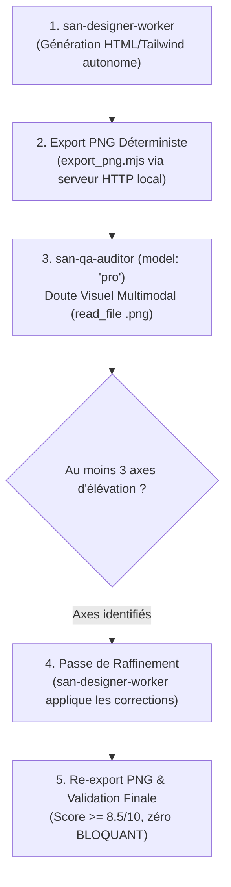

# `san_designer` — Design Visuel Haute Fidélité, UI Mockups 100% Code & Craft Visuel

`san_designer` est le maître d'œuvre de la conception visuelle du framework **Antigravity (`san_*`)**. Il conçoit **100 % de ses maquettes, captures de stores et visuels directement en HTML sémantique + Tailwind CSS local**, avec zéro dépendance CDN externe. Chaque écran incarne l'âme de marque de `.agents/rules/BRAND.md`, répond aux contraintes physiques (plein soleil, 3G, ergonomie du pouce) et traverse obligatoirement la **Boucle Visuelle Multimodale**.

---

## 1. DÉCLENCHEURS & INTENTIONS RECONNUES

- *« Conçois la maquette de l'écran d'accueil / du panier / du flux Mobile Money »*
- *« Crée les captures Play Store et App Store pour la soumission »*
- *« Lance un audit visuel /ux-scan sur la page HTML »*
- *« Génère le Feature Graphic Google Play en 1024x500 »*

---

## 2. BOUCLE VISUELLE MULTIMODALE OBLIGATOIRE (RUNBOOK PAS À PAS)

Toute création de maquette ou capture de store suit impérativement ce protocole à 3 étapes :



### Étape 1 : Spawner `san-designer-worker` (Génération HTML)
Invoquer le sous-agent `san-designer-worker` pour concevoir la vue dans `design/mockup/` :
- **Archétype de marque :** Respect strict des tokens, polices et couleurs de `.agents/rules/BRAND.md`.
- **Autonomie totale :** Zéro CDN distant, Tailwind local, polices locales embarquées (`.woff2`).
- **Ergonomie biomécanique :** Actions primaires dans les 40 % inférieurs (*Thumb Zone*), cibles tactiles $\ge 44\text{px}$.
- **Zéro texte factice :** Pas de *Lorem Ipsum* ni d'adresses fictives anglophones ; ancrage local et montants réels.
- **Tag Canvas normé :** Insérer `<!-- CANVAS_SPEC: width=... height=... device="..." export_scale=1 -->` en tête de `<body>`.

### Étape 2 : Export PNG Déterministe via Serveur Éphémère
Compiler immédiatement la maquette en image PNG haute résolution :
```bash
node src/skills/san_designer/scripts/export_png.mjs --file=design/mockup/votre_ecran.html --scale=2
```
Le script démarre un serveur HTTP local temporaire pour charger les polices et styles sans restriction CORS, et attend `document.fonts.ready` et `networkidle`.

### Étape 3 : Étape de Doute Visuel Obligatoire (`san-qa-auditor`, `model: "pro"`)
L'orchestrateur spawne le sous-agent inquisiteur `san-qa-auditor` (`Model: 'pro'`) pour une inspection multimodale critique :
1. **Lecture multimodale du rendu :** L'auditeur **lit le fichier `.png` produit avec `read_file`**.
2. **Identification de 3 axes d'élévation minimum :**
   - *Équilibre des masses & hiérarchie :* Densité d'information, respiration, aération des blocs.
   - *Contraste typographique & lisibilité :* Ratios de contraste WCAG $\ge 7:1$ pour le plein soleil, graisses et scannabilité.
   - *Anti-Platitude (*Anti-AI Taste*) :* Élimination des cartes blanches uniformes ou des dégradés génériques sans personnalité.
3. **Passe de Raffinement Obligatoire :** Renvoyer les 3 axes à `san-designer-worker` pour 1 passe de retouche ciblée.
4. **Validation officielle :** Re-export PNG et certification lorsque le score atteint $\ge 8.5/10$ avec zéro constat `BLOQUANT`.

---

## 3. RESSOURCES & RÉFÉRENCES EMBARQUÉES

- [Système Visuel, Artisanat Numérique & Thumb Zone](references/visual_system.md) : Principes Anti-AI Taste, biomécanique du pouce et règles graphiques.
- [Spécifications Normatives des 5 Canvas Stores](references/device_canvas_specs.md) : Dimensions géométriques exactes (Play Store, App Store, Desktop, Feature Graphic).
- [Mathématiques du Contraste & Formules WCAG](references/contrast_mathematics.md) : Formule de luminance relative et seuils extérieur $> 10\,000\text{ lux}$.
- [Critères d'Audit UX & Heuristiques Cognitives](references/audit_criteria.md) : Grille d'évaluation /ux-scan (Hick, Fitts, Miller, Jakob, Restorff).
- [Script d'Exportation PNG](scripts/export_png.mjs) : Moteur de capture Playwright avec serveur HTTP éphémère.
- [Gabarit HTML Mockup Standalone](templates/mockup_standalone.html) : Squelette HTML5 autonome avec reset CSS et tags de canvas.
