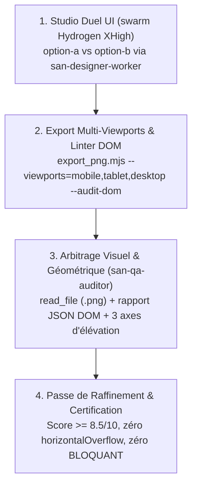

# `san_designer` — Studio UI, Design 100% Code & Boucle Visuelle v2.1

`san_designer` pilote la conception visuelle haute fidélité du framework **Antigravity (`san_*`)**. Chaque écran est produit **100 % en HTML sémantique + Tailwind CSS local** (zéro CDN externe), aligné sur `.agents/rules/BRAND.md`, optimisé pour le terrain (plein soleil, *Thumb Zone*) et validé par la **Boucle Visuelle & Géométrique**.

---

## 1. DÉCLENCHEURS & INTENTIONS RECONNUES

- *« Conçois la maquette de l'écran d'accueil / du tableau de bord / du flux Mobile Money »*
- *« Lance un Studio Duel UI (option-a vs option-b) sur l'écran clé »*
- *« Exporte la maquette en multi-viewports et audite la géométrie DOM »*
- *« Crée les captures Play Store / App Store / Feature Graphic (1024x500) »*

---

## 2. MODE STUDIO DUEL UI & BOUCLE VISUELLE (`swarm` HYDROGEN XHIGH)

> [!IMPORTANT]
> **Doctrine Orchestrateur Souverain (`Argon`/`Carbon`) :** Déléguez systématiquement en parallèle via `swarm(action: "add", model: "gemini-4-hydrogen-xhigh")` (interdiction de `invoke_subagent(Model: "inherit")` pour sanctuariser le quota hebdomadaire).



### Étape 1 : Studio Duel UI (`option-a` vs `option-b` en parallèle)
Pour tout écran clé (accueil, checkout, dashboard), spawnez **2 workers `san-designer-worker` en parallèle** via `swarm(action: "add", model: "gemini-4-hydrogen-xhigh")` avec deux directions artistiques distinctes :
- **Variante A (`design/mockup/<ecran>-option-a.html`)** et **Variante B (`design/mockup/<ecran>-option-b.html`)** : compositions contrastées respectant `.agents/rules/BRAND.md`, zéro CDN, zéro *Lorem Ipsum* et tag `<!-- CANVAS_SPEC: width=... height=... device="..." export_scale=1 -->`.

### Étape 2 : Export Multi-Viewports & Linter Géométrique DOM (`export_png.mjs` v2.1)
Exécutez le rendu sur **instance Chromium unique** (`mobile 390x844`, `tablet 820x1180`, `desktop 1440x900`) avec audit DOM `page.evaluate()` :
```bash
node src/skills/san_designer/scripts/export_png.mjs \
  --input=design/mockup/<ecran>-option-a.html \
  --viewports=mobile,tablet,desktop \
  --audit-dom --report=design/audit-option-a.json --strict-dom
```
Le linter vérifie mathématiquement : `horizontalOverflow` (`scrollWidth > clientWidth`), `smallTouchTargets` (`< 44x44px`), `boxCollisions` (chevauchement sur même `z-index`) et `missingTabularNums` (chiffres sans `font-variant-numeric: tabular-nums`).

### Étape 3 : Arbitrage Multimodal & Raffinement (`san-qa-auditor`)
Spawnez `san-qa-auditor` via `swarm(action: "add", model: "gemini-4-hydrogen-xhigh")` pour inspecter les PNG (`read_file`) et les rapports JSON DOM :
1. **Confrontation `option-a` vs `option-b` :** Éliminer le gagnant par défaut sur hiérarchie des masses, contraste WCAG ($\ge 7:1$ plein soleil) et craft *Anti-AI Taste*.
2. **3 axes d'élévation minimum :** Corriger toute collision, cible `< 44px` ou faiblesse visuelle via 1 passe ciblée avant certification finale ($\ge 8.5/10$, zéro `BLOQUANT`).

---

## 3. STANDARD UI 5 ÉTATS NON-DESTRUCTIFS & MOTION SYSTEM

Toute maquette ou vue interactive intègre explicitement les **5 états non-destructifs** et le **Motion System** :
1. **Empty :** État initial clair avec illustration sobre et CTA primaire actionnable.
2. **Skeleton Cold-Start :** Gabarit géométrique fidèle (anti-CLS) uniquement au tout premier chargement à froid.
3. **Populated :** Rendu nominal structuré en 3 plans (Héros, Données, Silencieux), métriques en `font-variant-numeric: tabular-nums` (`tabular-nums`).
4. **Stale-While-Revalidate :** Rafraîchissement non-destructif conservant les données visibles avec indicateur discret (interdiction d'écraser l'écran par un skeleton).
5. **Error :** Diagnostic explicite et action « Réessayer » sans perte de saisie.

### Motion System & Ergonomie Biomécanique
- **Courbes physiques :** `transition: transform 220ms cubic-bezier(0.22, 1, 0.36, 1), opacity 180ms cubic-bezier(0.22, 1, 0.36, 1)` (entrées sobres, zéro effet gadget).
- **Accessibilité motrice obligatoire :** `@media (prefers-reduced-motion: reduce) { *, *::before, *::after { animation-duration: 0.01ms !important; transition-duration: 0.01ms !important; } }`.
- **Biométrie & Tactile :** Actions primaires dans les 40 % inférieurs (*Thumb Zone*), cibles interactives $\ge 44\times44\text{px}$, `tabular-nums` sur tout nombre/prix/pourcentage.

---

## 4. RESSOURCES & RÉFÉRENCES EMBARQUÉES

- [Système Visuel, Artisanat Numérique & Thumb Zone](references/visual_system.md) : Anti-AI Taste, biomécanique du pouce et règles graphiques.
- [Spécifications Normatives des 5 Canvas Stores](references/device_canvas_specs.md) : Dimensions Play Store, App Store, Desktop, Tablette et Feature Graphic.
- [Mathématiques du Contraste & Formules WCAG](references/contrast_mathematics.md) : Formule de luminance et seuils extérieur $> 10\,000\text{ lux}$.
- [Critères d'Audit UX & Heuristiques Cognitives](references/audit_criteria.md) : Grille `/ux-scan` (Hick, Fitts, Miller, Jakob, Restorff).
- [Script d'Exportation PNG & Linter DOM](scripts/export_png.mjs) : Pipeline Playwright multi-viewports, serveur HTTP anti-CORS et audit JSON.
- [Gabarit HTML Mockup Standalone](templates/mockup_standalone.html) : Squelette HTML5 autonome avec tokens et `CANVAS_SPEC`.
