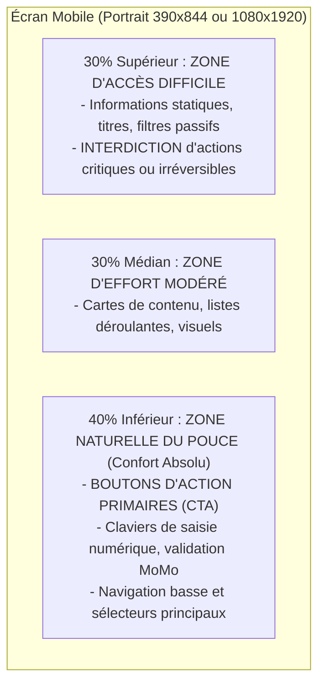

# Système Visuel, Artisanat Numérique & Ergonomie du Pouce

Ce document formalise les principes directeurs de conception visuelle, les règles anti-stéréotypes IA et la biomécanique ergonomique régissant l'artisanat d'interface sous `san_designer`.

---

## 1. MANIFESTE DE L'ARTISANAT NUMÉRIQUE & ANTI-AI TASTE

Le design moderne sous le framework Antigravity refuse tout compromis de facilité :
1. **Zéro Découplage Design/Code :** 100 % des maquettes sont écrites en HTML5 sémantique et Tailwind CSS local. Pas de fichiers graphiques propriétaires désynchronisés du code réel.
2. **Autonomie Statique Absolue :** Zéro appel CDN (`fonts.googleapis.com`, `cdnjs`, etc.). Polices locales embarquées (`@font-face` en `.woff2`) ou polices système pérennes.
3. **Éradication des Clichés IA (*Anti-AI Taste*) :**
   - Bannir les cartes blanches uniformes flottant sur fond gris pâle sans hiérarchie.
   - Bannir les dégradés violets fluo génériques non justifiés par `.agents/rules/BRAND.md`.
   - Bannir les textes d'attente (*Lorem Ipsum*, *John Doe*, montants à 0 $). Utiliser des copies réelles, ancrées et contextualisées.
   - Soigner le contraste typographique, les graisses contrastées et le rythme visuel asymétrique maîtrisé.

---

## 2. BIOMÉCANIQUE DE LA ZONE DU POUCE (*THUMB ZONE*)

Sur écran mobile (orientation portrait à une main), la mobilité physique du pouce divise l'écran en 3 zones distinctes :



### Règles Non Négociables :
- **Cible Tactile Minimale :** $\ge 44 \times 44\text{ px}$ (`min-h-[44px] min-w-[44px]`).
- **Gutter Inter-Cibles :** $\ge 8\text{ px}$ pour prévenir les frappes erronées.
- **CTA Principal :** Toujours positionné dans les 40 % inférieurs de l'écran.

---

## 3. FORMATS DE CANVAS NORMALISÉS

Chaque maquette HTML doit déclarer en première ligne de `<body>` :
```html
<!-- CANVAS_SPEC: width=1080px height=1920px device="Play Store Screenshot" export_scale=1 -->
```
Formats officiels :
- **Play Store Screenshot :** `1080×1920 px` (9:16 portrait, 100% opaque, sans alpha).
- **App Store Screenshot :** `1290×2796 px` (19.5:9 portrait, Dynamic Island 180px).
- **Desktop Canvas :** `1440×900 px` (16:10 paysage).
- **Tablette Canvas :** `820×1180 px` (portrait iPad Air).
- **Feature Graphic :** `1024×500 px` (bannière Google Play, marge sécurité 60px).
- **Prototypage Mobile In-App :** `390×844 px` (ratio iPhone standard).
