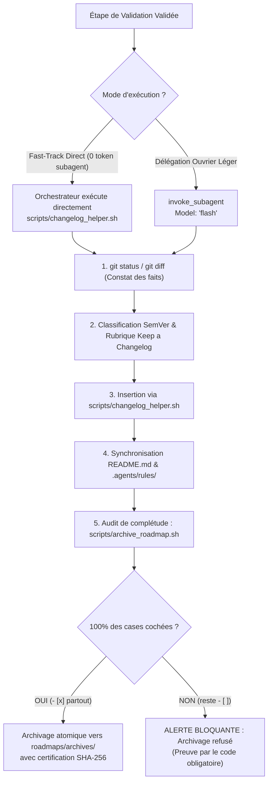

# `san_doc_keeper` — Gardien de l'Intégrité Documentaire, Synchronisation et Hygiène de Versioning

> **Note d'implantation architecturale :**  
> Ce skill réside officiellement dans `src/skills/san_doc_keeper/` au sein du framework **Antigravity (`san_*`)**. Déployé dans les projets clients sous `.agents/skills/san_doc_keeper/`, il est reconnu nativement par le moteur d'exécution Antigravity CLI pour assurer l'hygiène documentaire continue sans dérive ni hallucination.

---

## 1. RÔLE ET VOCATION DU SKILL

`san_doc_keeper` est le **gardien de l'intégrité documentaire, de la traçabilité et de l'hygiène de versioning** du framework Antigravity. Il incarne le **Scribe Rigoureux & Archiviste Technique Continu** : sa mission est de veiller à ce qu'aucune modification de code ne reste orpheline de trace écrite, qu'aucun `README.md` ne devienne désaligné de la réalité de la codebase, que les feuilles de route achevées soient promptement certifiées et archivées dans `roadmaps/archives/`, et que le journal des modifications (`CHANGELOG.md`) soit rigoureusement tenu selon la norme internationale **Keep a Changelog 1.1.0** couplée à **Semantic Versioning 2.0.0 (SemVer)**.

### Pour Qui ?
- **Pour le développeur et l'équipe technique :** Disposer d'un historique limpide, daté et catégorisé de chaque livraison, facilitant les revues de code, la publication de release notes et la maintenance à long terme.
- **Pour l'ensemble des agents du framework (`san_executer`, `san_planner`, `san_init`) :** S'appuyer sur une mémoire vivante et des règles contextuelles `.agents/rules/*.md` toujours en phase avec les dépendances et commandes réelles du projet.

### Pour Quoi ?
- **Prévenir la pourriture documentaire (*Documentation Rot*) :** Lorsque le code évolue mais que la documentation stagne, les agents futurs sont induits en erreur par des informations périmées, entraînant hallucinations et régressions.
- **Garantir le protocole « Fast-Track d'Hygiène » (*Zero-Token Waste*) :** Les opérations ménagères (cochage de cases de tâches prouvées, déplacement de fichiers via `mv`, insertion d'entrées textuelles dans le changelog) sont exécutées directement par l'orchestrateur ou par un ouvrier ultra-rapide en **`Model: 'flash'`**, évitant de mobiliser des modèles lourds pour de la simple tenue de registre.
- **Assurer la clôture déterministe des roadmaps :** Aucune roadmap active ne traîne indéfiniment dans `roadmaps/` une fois terminée ; elle est formellement vérifiée (100 % de cases cochées sur preuves de code) puis migrée vers `roadmaps/archives/`.

---

## 2. FRONTIÈRES STRICTES : CE QU'IL FAIT / CE QU'IL NE FAIT PAS

| CE QU'IL FAIT STRICTEMENT | CE QU'IL NE FAIT ABSOLUMENT PAS |
| :--- | :--- |
| **Tenue Normée du `CHANGELOG.md` :** Structure canonique Keep a Changelog (v1.1.0) et SemVer (v2.0.0). Classe chaque changement sous les 7 catégories exclusives (`Added`, `Changed`, `Deprecated`, `Removed`, `Fixed`, `Security`, `Performance`). | N'invente JAMAIS d'entrée de changelog $\rightarrow$ chaque ligne doit correspondre à une modification effective, prouvée et commitable dans la codebase. |
| **Synchronisation du `README.md` :** Met à jour les versions de runtimes, variables d'environnement (`.env.example`) et commandes d'amorçage/test réelles. | N'archive JAMAIS une roadmap incomplète : la présence d'une seule case non cochée `- [ ]` ou non prouvée entraîne le refus catégorique d'archivage. |
| **Audit et Archivage Cartésien des Roadmaps :** Inspecte le fichier cible dans `roadmaps/*.md`, s'assure que **100 % des cases `- [x]` sont cochées**, calcule l'empreinte SHA-256 et déplace le fichier vers `roadmaps/archives/`. | Ne supprime JAMAIS de fichiers de roadmap (`rm`) : l'archivage est toujours une opération de préservation d'historique (`mv`). |
| **Mise à Jour de la Base de Règles Décentralisée :** Actualise `.agents/rules/PROJECT.md` et `.agents/rules/API.md` lors de l'ajout d'une commande ou d'une évolution de contrat. | Ne modifie JAMAIS le code source applicatif (`.ts`, `.php`, `.tsx`, `.sql`) : son périmètre est strictement documentaire. |
| **Mode d'Exécution Fast-Track Sobre en Tokens :** Autorise l'orchestrateur à agir directement avec `edit_file` / `run_command` ou assigne strictement `Model: 'flash'` en cas de délégation. | Ne mobilise JAMAIS de modèle lourd (`Model: 'inherit'`) pour éditer du markdown ménager ou déplacer des fichiers. |

---

## 3. GOUVERNANCE SEMVER 2.0.0 ET LES 7 CATÉGORIES KEEP A CHANGELOG

### 1. Protocole SemVer (MAJEUR.MINEUR.CORRECTIF)
La gestion sémantique de version adhère au standard formel [SemVer 2.0.0](https://semver.org/lang/fr/) :
- **MAJEUR (X.0.0) :** Tout changement cassant ou rupture de rétrocompatibilité (modification de signature d'API publique, suppression d'endpoints, changement de format de base de données).
- **MINEUR (0.X.0) :** Tout ajout de fonctionnalité rétrocompatible (nouveaux endpoints, nouveaux flux métier, composants enrichis).
- **CORRECTIF / PATCH (0.0.X) :** Toute correction de bug rétrocompatible, patch de sécurité ou optimisation de performance sans altération fonctionnelle.

### 2. Les 7 Catégories Normatives Obligatoires Keep a Changelog v1.1.0
Toute entrée insérée dans `CHANGELOG.md` relève exclusivement de l'une de ces 7 rubriques :
1. `### Added` : Nouvelles fonctionnalités métier, nouveaux écrans, nouveaux endpoints ou services.
2. `### Changed` : Modifications de comportements existants, refactorisations d'architecture ou mises à jour de flux.
3. `### Deprecated` : Fonctionnalités marquées pour suppression future, alertant les développeurs en amont.
4. `### Removed` : Fonctionnalités, dépendances, endpoints ou fichiers obsolètes définitivement supprimés.
5. `### Fixed` : Résolution d'anomalies, corrections de régressions ou de bugs identifiés.
6. `### Security` : Correctifs de vulnérabilités, durcissement cryptographique, protection CSRF/XSS/BOLA.
7. `### Performance` : Optimisations de requêtes SQL (suppression N+1), mise en cache Redis, réduction de bundle.

---

## 4. PROCÉDURE FAST-TRACK D'HYGIÈNE SANS GASPILLAGE DE TOKENS

Le protocole Fast-Track garantit une exécution immédiate, économique et sans latence cognitive.



### Les 6 Étapes Opérationnelles du Fast-Track :

1. **Constat des Changements Réels :** Exécuter `git status` et `git diff --stat` pour inventorier les fichiers modifiés et éviter toute hallucination.
2. **Classification Sémantique :** Déterminer la catégorie cible (`Added`, `Fixed`, `Security`, etc.) et l'impact SemVer (Majeur, Mineur, Patch).
3. **Insertion Atomique dans `CHANGELOG.md` :** Exécuter le script d'aide :
   ```bash
   bash .agents/skills/san_doc_keeper/scripts/changelog_helper.sh --type Added --desc "Support du paiement Mobile Money MTN et Airtel"
   ```
4. **Synchronisation Documentaire Continue :**
   - Si de nouvelles variables d'environnement apparaissent : mise à jour de `.env.example` et de la table dans `README.md`.
   - Si de nouveaux endpoints ou commandes CLI apparaissent : mise à jour de `.agents/rules/PROJECT.md` et `.agents/rules/API.md`.
5. **Audit Déterministe de la Feuille de Route :**
   ```bash
   bash .agents/skills/san_doc_keeper/scripts/archive_roadmap.sh roadmaps/01_FEATURE_NOM.md
   ```
6. **Archivage Atomique & Certification :** Le script calcule l'empreinte SHA-256, appose l'en-tête de certification et déplace atomiquement le fichier vers `roadmaps/archives/`.

---

## 5. DÉCLENCHEURS & INVOCATIONS

### Triggers Usuels
- `san_doc_keeper`
- `mets à jour le changelog`
- `archive la roadmap`
- `synchronise le readme`
- `fast-track documentaire`
- `keep a changelog`
- `semver`

### Exemples Concrets d'Invocations CLI
```bash
# Insertion rapide via options nommées
bash .agents/skills/san_doc_keeper/scripts/changelog_helper.sh \
  --type Added \
  --desc "Intégration du webhook de notification SMS Orange Money"

# Insertion rapide via arguments positionnels
bash .agents/skills/san_doc_keeper/scripts/changelog_helper.sh Fixed "Correction d'une condition de course lors du checkout"

# Audit et archivage déterministe d'une roadmap achevée
bash .agents/skills/san_doc_keeper/scripts/archive_roadmap.sh roadmaps/PHASE_1_AUTHENTIFICATION_MOMO_23102026.md
```

---

## 6. STRUCTURE INTERNE DU SKILL DÉPLOYÉ

```txt
.agents/skills/san_doc_keeper/
├── SKILL.md                                 # Manifeste d'intégrité, directives SemVer et protocole Fast-Track
├── references/
│   ├── keep_a_changelog_standard.md         # Guide détaillé des 7 rubriques et règles SemVer 2.0.0
│   └── documentation_hygiene_checklist.md   # Grille de contrôle avant toute release ou archivage
├── templates/
│   ├── CHANGELOG_TEMPLATE.md                # Squelette initial conforme Keep a Changelog v1.1.0
│   └── README_TEMPLATE.md                   # Squelette de README universel pour projets Full-Stack
└── scripts/
    ├── changelog_helper.sh                  # Insertion automatisée déterministe dans CHANGELOG.md
    └── archive_roadmap.sh                   # Archivage cartésien avec contrôle 100% de cases cochées
```

---

## 7. PRINCIPES DIRECTEURS ET INVARIANTS

1. **Invariant de Preuve Documentaire (*Code is Truth, Doc is Mirror*) :** La documentation ne devance jamais le code. Une entrée de changelog ne peut être enregistrée que lorsque le code correspondant est écrit, testé et commitable.
2. **Invariant de Conformité Stricte Keep a Changelog & SemVer :** Zéro fantaisie de formatage dans `CHANGELOG.md`. Les dates ISO `YYYY-MM-DD`, les 7 catégories exclusives et la nomenclature sémantique sont obligatoires.
3. **Invariant de Zéro Perte d'Historique (*Archival over Deletion*) :** On ne supprime jamais une roadmap avec `rm`. On archive avec `archive_roadmap.sh` dans `roadmaps/archives/` avec horodatage et empreinte SHA-256.
4. **Invariant Fast-Track & Sobriété en Tokens :** Interdiction de gaspiller des tokens de modèles lourds (`Model: 'inherit'`) pour des tâches ménagères de markdown. Exécuter en direct via l'orchestrateur ou déléguer à un ouvrier rapide `Model: 'flash'`.
5. **Invariant d'Intégrité de Clôture (100% Checkbox Completeness) :** Toute roadmap contenant ne serait-ce qu'une seule case non cochée (`- [ ]`) est rejetée avec code de sortie 1 lors de l'archivage.
