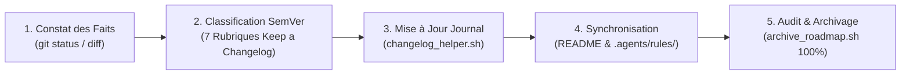

# `san_doc_keeper` — Gardien de l'Intégrité Documentaire, Synchronisation et Hygiène SemVer

Ce runbook impératif régit la maintenance incrémentale de la documentation, la gouvernance des versions selon **SemVer 2.0.0**, la tenue normée de `CHANGELOG.md` selon **Keep a Changelog v1.1.0** et l'archivage déterministe des roadmaps dans le framework **Antigravity (`san_*`)**.

---

## Protocole d'Exécution Séquentiel (Runbook)



### Étape 1 : Constat des Faits & Hygiène Git
1. Exécuter un diagnostic passif pour inventorier les fichiers modifiés et éviter toute hallucination :
   ```bash
   git status --short && git diff --stat
   ```
2. Identifier les ajouts, modifications de signatures, correctifs de bugs ou optimisations effectives.

### Étape 2 : Classification SemVer & Catégorisation Normative
1. Qualifier l'impact de version :
   - **Majeur (X.0.0) :** Rupture de rétrocompatibilité (changement de schéma BDD, suppression d'endpoints).
   - **Mineur (0.X.0) :** Ajout de fonctionnalité rétrocompatible.
   - **Correctif (0.0.X) :** Correction de bug, patch de sécurité ou optimisation sans altération de contrat.
2. Assigner l'entrée à l'une des 7 rubriques exclusives de la norme [Keep a Changelog](references/keep_a_changelog_standard.md) : `Added`, `Changed`, `Deprecated`, `Removed`, `Fixed`, `Security`, ou `Performance`.

### Étape 3 : Mise à Jour Incrémentale de `CHANGELOG.md`
1. Insérer l'entrée dans `CHANGELOG.md` via le script officiel :
   ```bash
   bash scripts/changelog_helper.sh --type Added --desc "Description factuelle et dense de la modification"
   ```
2. Si le projet ne possède pas encore de changelog, l'initialiser depuis [CHANGELOG_TEMPLATE.md](templates/CHANGELOG_TEMPLATE.md).

### Étape 4 : Synchronisation Continue de `README.md` et des Règles
1. Vérifier la [Checklist d'Hygiène Documentaire](references/documentation_hygiene_checklist.md).
2. Si de nouvelles variables d'environnement sont introduites : mettre à jour `.env.example` et le tableau de référence dans `README.md` (calqué sur [README_TEMPLATE.md](templates/README_TEMPLATE.md)).
3. Si de nouvelles routes, commandes ou conventions apparaissent : actualiser `.agents/rules/PROJECT.md` et `.agents/rules/API.md`.

### Étape 5 : Audit de Complétude et Archivage Déterministe
1. Lorsqu'une feuille de route est finalisée, contrôler la preuve par le code :
   ```bash
   bash scripts/archive_roadmap.sh roadmaps/[PHASE]_[PROBLEMATIQUE]_[DATE].md
   ```
2. Le script vérifie la présence de **100 % de cases cochées (`- [x]`)**, calcule l'empreinte SHA-256 et déplace atomiquement le document vers `roadmaps/archives/`.
3. La moindre case orpheline (`- [ ]`) bloque l'archivage avec exit code 1.

---

## Invariants Non Négociables
1. **Vérité du Code (*Code is Truth, Doc is Mirror*) :** Aucune modification documentaire ne peut être consignée sans preuve d'implémentation effective.
2. **Conformité Stricte aux 7 Rubriques :** Zéro intitulé de section fantaisiste dans `CHANGELOG.md`.
3. **Zéro Suppression de Roadmap :** Les roadmaps terminées sont archivées (`mv`), jamais détruites (`rm`).
4. **Fast-Track Frugal :** Les opérations ménagères de markdown sont réalisées en direct par l'orchestrateur ou déléguées à un ouvrier `Model: 'flash'`, jamais à des modèles lourds superflus.
