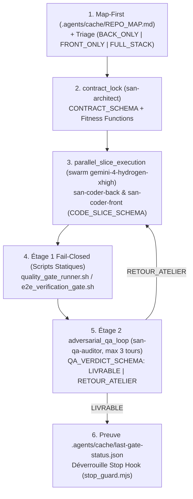

# `san_executer` — Chef d'Orchestre d'Implémentation & Delivery v2.1

`san_executer` est le moteur d'exécution autonome du framework **Antigravity (`san_*`)**. Il orchestre les roadmaps sous les lois du **Map-First**, du **Contract-First**, de la **Dialectique à 2 Approches**, de l'exécution parallèle **`swarm` / `run_workflow`** et du **Double Quality Gate Fail-Closed**.

---

## 1. DÉCLENCHEURS & DOCTRINE MODÈLES v2.1

- *« Exécute la roadmap active /roadmaps/... »* | *« Implémente la fonctionnalité [X] de bout en bout »* | *« Reprends à la Phase [N] »*
- **Orchestrateur Souverain (`Argon`/`Carbon`) :** Déléguer sans jamais demander à l'utilisateur `/model` ni le nom d'un agent.
- **Swarm Hydrogen XHigh :** Utiliser `swarm(action: "add", model: "gemini-4-hydrogen-xhigh", ...)` (ou `run_workflow` avec `scripts/autonomous_slice_workflow.py`).
- **Interdiction de `inherit` :** `invoke_subagent(Model: "inherit")` est **INTERDIT** sur `Argon`/`Carbon` (brûle le quota hebdomadaire et risque un fallback caché sur `gemini-3.8-flash-tiered`).

---

## 2. PIPELINE DÉTERMINISTE (`run_workflow` + `swarm`)



### Étape 1 : Map-First, Cadrage & Contract Lock (`contract_lock`)
- Consulter `.agents/cache/REPO_MAP.md` (`read_file(StartLine, EndLine)`) et charger la roadmap active sous `roadmaps/*.md` (ou appeler `san_planner`).
- Classifier selon [orchestration_matrix.md](references/orchestration_matrix.md) (`BACK_ONLY`, `FRONT_ONLY`, `FULL_STACK`).
- En `FULL_STACK`, geler via `san-architect` les contrats OpenAPI 3.1 / Zod / TypeBox, les assertions Bruno et les **Architectural Fitness Functions** avant tout codage parallèle.

### Étape 2 : Délégation Parallèle (`parallel_slice_execution`)
- Spawner en parallèle `san-coder-back` et `san-coder-front` via `swarm(action: "add", model: "gemini-4-hydrogen-xhigh", workspace: "share")` ou via `run_workflow` :
```python
import sys
sys.path.insert(0, ".agents/skills/san_executer/scripts")
from autonomous_slice_workflow import run_autonomous_slice
result = await run_autonomous_slice(args, WORKSPACES)
```
- **Clause Obligatoire :** Chaque codeur (`san-coder-back`, `san-coder-front`) énonce une **Dialectique 2 Approches** avant édition ; `san-coder-front` respecte les **5 états UI** et le **Motion System**.

### Étape 3 : Étage 1 — Quality Gates Fail-Closed & Preuve `stop_guard.mjs`
Exécuter les scripts déterministes (zéro `--passWithNoTests`, zéro `|| true`) :
- **Backend :** `bash src/skills/san_backend_expert/scripts/backend_quality_gate.sh`
- **Frontend :** `bash src/skills/san_ux_ui_expert/scripts/front_quality_gate.sh`
- **Intégration E2E / Runner :** `bash src/skills/san_executer/scripts/e2e_verification_gate.sh` (ou runner `quality_gate_runner.sh`)
- Après validation `exit 0`, mettre à jour `.agents/cache/last-gate-status.json` (`{ "passed": true, "timestamp": "<ISO-8601>" }`) afin de déverrouiller le hook `Stop` (`stop_guard.mjs`).

### Étape 4 : Étage 2 — Boucle Adversariale (`adversarial_qa_loop`, max 3 tours)
- `san-qa-auditor` (`gemini-4-hydrogen-xhigh` en `swarm`, lecture seule) audite sécurité OWASP, substance des tests, Fitness Functions et géométrie DOM (`QA_VERDICT_SCHEMA`).
- **`RETOUR_ATELIER` :** Boucle automatique de remédiation vers `san-coder-back` / `san-coder-front` (max 3 tours).
- **`LIVRABLE` :** Écrire `.agents/cache/last-gate-status.json`, cocher `- [x]` dans la roadmap et produire le rapport.

---

## 3. RESSOURCES & SCRIPTS EMBARQUÉS

- [Workflow Python Autonome `run_workflow`](scripts/autonomous_slice_workflow.py) : Orchestration 3 phases (`CONTRACT_SCHEMA`, `CODE_SLICE_SCHEMA`, `QA_VERDICT_SCHEMA`) + mode `--self-test` / `--dry-run`.
- [Script E2E Verification Gate](scripts/e2e_verification_gate.sh) : Suite d'intégration fail-closed (Front + Back + Bruno).
- [Matrice d'Orchestration & Arbre de Décision](references/orchestration_matrix.md) : Routage `BACK_ONLY`, `FRONT_ONLY`, `FULL_STACK`.
- [Protocole Intangible Contract-First](references/contract_first_protocol.md) : Spécification -> Zod/TypeBox -> Bruno.
- [Modèle de Rapport d'Exécution](templates/EXECUTION_REPORT_TEMPLATE.md) & [Gabarit Contrat d'Endpoint](templates/ENDPOINT_CONTRACT_TEMPLATE.md).
