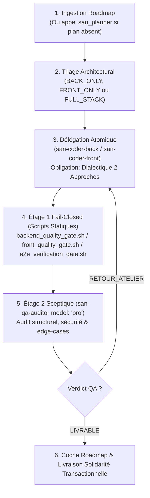

# `san_executer` — Chef d'Orchestre d'Implémentation Full-Stack & Delivery v2.0

`san_executer` est le moteur d'exécution et le release manager autonome du framework **Antigravity (`san_*`)**. Il orchestre l'implémentation industrielle des roadmaps actives en coordonnant les sous-agents atomiques sous les règles intangibles du **Contract-First**, de la **Dialectique à 2 Approches** et du **Double Quality Gate Fail-Closed**.

---

## 1. DÉCLENCHEURS & INTENTIONS RECONNUES

- *« Exécute la roadmap active /roadmaps/... »*
- *« Implémente la fonctionnalité [X] de bout en bout »*
- *« Lance san_executer pour livrer le module de paiement »*
- *« Reprends l'exécution à partir de la Phase [N] »*

---

## 2. BOUCLE DIALECTIQUE & INQUISITEUR QA (RUNBOOK D'EXÉCUTION PAS À PAS)

Toute tâche d'implémentation est pilotée selon le protocole séquentiel rigoureux suivant :

### Étape 1 : Cadrage & Triage Architectural
- Charger la roadmap active sous `roadmaps/*.md`. Si la demande est complexe et dépourvue de plan, invoquer d'abord `san_planner`.
- Classifier chaque tâche selon 3 profils exclusifs ([Matrice d'orchestration](references/orchestration_matrix.md)) :
  - **`BACK_ONLY` :** Migrations, modèles, actions de domaine, requêtes Bruno, tests serveur.
  - **`FRONT_ONLY` :** Composants UI, 5 états obligatoires, écrans, hooks clients.
  - **`FULL_STACK` :** Séquencement strict **Contract-First** : verrouillage préalable du contrat d'endpoint et validation des tests Bruno côté serveur avant la moindre ligne de code frontend.

### Étape 2 : Délégation Atomique & Dialectique des 2 Approches
Pour chaque tâche, invoquer le sous-agent dédié (`san-coder-back` ou `san-coder-front`) :
- **Modèle :** Par défaut `Model: 'flash'`. Pour les modèles de domaine complexes, l'architecture transactionnelle sensible ou les migrations critiques, l'orchestrateur peut invoquer `Model: 'pro'` ou `Model: 'inherit'`.
- **Clause Obligatoire dans le Prompt :** Exiger formellement du codeur d'énoncer une **Dialectique 2 Approches** (Approche A conservatrice vs Approche B optimale/performante avec analyse coûts/bénéfices) avant de produire le code.

### Étape 3 : Étage 1 — Quality Gates Fail-Closed (Zéro Token LLM)
Exécuter immédiatement les scripts d'assurance qualité déterministes :
- **Backend :** `bash src/skills/san_backend_expert/scripts/backend_quality_gate.sh` (typage strict, PHPStan max / tsc, tests unitaires, N+1, audit CVE).
- **Frontend :** `bash src/skills/san_ux_ui_expert/scripts/front_quality_gate.sh` (compilation tsc stricte, linters, tests Vitest/Jest).
- **Intégration E2E :** `bash src/skills/san_executer/scripts/e2e_verification_gate.sh` ([Script Gate E2E](scripts/e2e_verification_gate.sh)).
En cas d'échec (code retour $\ne 0$), retour immédiat au codeur pour correction sans dépenser de tokens d'audit.

### Étape 4 : Étage 2 — Inquisiteur Sceptique (`san-qa-auditor`, `model: "pro"`)
Invoquer `san-qa-auditor` (`Model: 'pro'`) doté d'une posture de *Présomption d'Anomalies* :
- Analyse critique : failles de logique, BOLA/IDOR, fuite d'état, résilience 3G dégradée, gestion des cas limites.
- **Si `RETOUR_ATELIER` :** Renvoyer les constats au codeur atomique et réitérer jusqu'à résolution complète.
- **Si `LIVRABLE` :** Valider l'étape, cocher `- [x]` dans la roadmap et documenter le rapport.

---

## 3. RESSOURCES & RÉFÉRENCES EMBARQUÉES

- [Matrice d'Orchestration & Arbre de Décision](references/orchestration_matrix.md) : Règles de routage architectural (BACK_ONLY, FRONT_ONLY, FULL_STACK).
- [Protocole Intangible Contract-First](references/contract_first_protocol.md) : Cycle de vie spécification -> Zod/TypeScript -> Bruno -> implémentation.
- [Script E2E Verification Gate](scripts/e2e_verification_gate.sh) : Suite de tests d'intégration automatisée fail-closed.
- [Modèle de Rapport d'Exécution](templates/EXECUTION_REPORT_TEMPLATE.md) : Synthèse formelle de livraison par phase.
- [Gabarit de Contrat d'Endpoint](templates/ENDPOINT_CONTRACT_TEMPLATE.md) : Spécification technique d'API normative.
