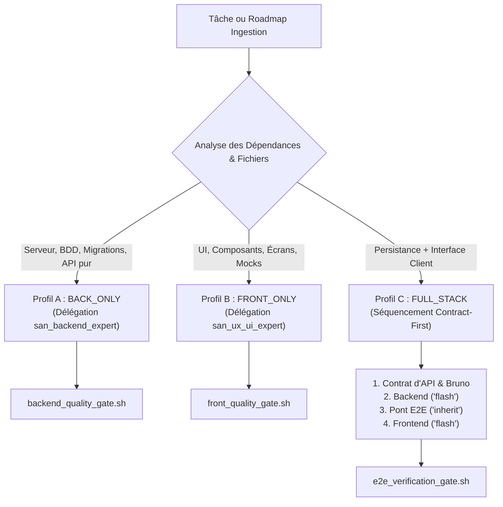
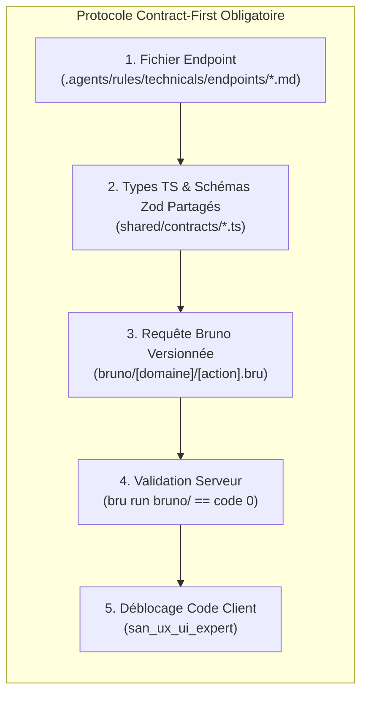
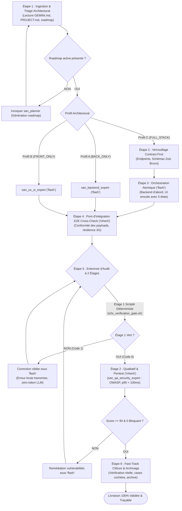

# `san_executer` — Chef d'Orchestre d'Implémentation Full-Stack et Moteur de Delivery

> **Note d'implantation opérationnelle :**  
> Ce skill officiel réside dans `.agents/skills/san_executer/` au sein du projet client (et dans `src/skills/san_executer/` au sein du framework de référence).  
> Il est reconnu nativement par le moteur d'exécution Antigravity CLI et agit comme le **Tech Lead & Release Manager virtuel autonome** de l'ensemble du framework Antigravity (`san_*`).

---

## 1. RÔLE FONDAMENTAL, POUR QUI, POUR QUOI

### Rôle Fondamental
`san_executer` (alias reconnus : `san_execute`, `/execute`) est le **moteur d'exécution opérationnel et le chef d'orchestre Full-Stack autonome** du framework **Antigravity (`san_*`)**. Il prend en charge de bout en bout l'exécution industrielle d'une roadmap active issue de [san_planner](../san_planner/SKILL.md) (ou d'une demande directe de fonctionnalité), en coordonnant automatiquement l'ensemble des experts techniques spécialisés (`san_backend_expert`, `san_ux_ui_expert`, `san_designer`, `san_qa_security_expert`, `san_devops_expert`) dans le respect absolu du protocole **Contract-First**, de la résilience réseau en conditions dégradées et de l'entonnoir d'audit en 2 étages.

### Pour Qui ?
- **Pour le développeur Full-Stack, solopreneur ou lead architecte :** qui souhaite déléguer la mise en œuvre intégrale d'une fonctionnalité complexe sans avoir à piloter manuellement chaque composant, migration, contrat d'API ou test unitaire.
- **Pour tout utilisateur du framework :** exigeant une garantie formelle que le frontend et le backend s'emboîtent au millimètre près sans la moindre désynchronisation de schéma de données (*No-Mismatch*).

### Pour Quoi ?
- **Supprimer la friction des consignes fragmentées (*Zero-Prompt-Friction*) :** Une invocation unique suffit pour exécuter une roadmap entière de bout en bout sans nécessiter d'intervention humaine intermédiaire.
- **Éliminer les désalignements d'API (*No-Mismatch*) :** Verrouiller obligatoirement les schémas Zod, types TypeScript et requêtes Bruno avant d'autoriser la moindre ligne de code d'interface.
- **Garantir la résilience terrain en conditions hostiles :** Intégrer nativement la gestion des réseaux dégradés (3G/EDGE instables, retries exponentiels avec dispersion aléatoire *jitter*, file d'attente hors-ligne *Offline Outbox* et verrous d'idempotence Redis 24h pour les transactions financières).
- **Assurer la Solidarité Transactionnelle (Tout ou Rien) :** Une fonctionnalité n'est déclarée livrée que si le serveur, le client, les tests, la sécurité et la documentation sont validés à 100 %.

---

## 2. FRONTIÈRES STRICTES : CE QU'IL FAIT / CE QU'IL NE FAIT PAS

| CE QU'IL FAIT STRICTEMENT | CE QU'IL NE FAIT ABSOLUMENT PAS |
| :--- | :--- |
| **Triage Architectural Automatisé :** Analyse chaque tâche et la classe selon 3 profils d'exécution : `BACK_ONLY`, `FRONT_ONLY` ou `FULL_STACK`. | **Il ne code JAMAIS lui-même :** En tant que chef d'orchestre, il planifie, délègue, vérifie et valide. Il n'écrit aucune ligne de code applicatif dans son contexte hôte. |
| **Verrouillage Absolu « Contract-First » :** Interdit tout codage d'interface avant que le contrat d'endpoint, les types partagés et la collection Bruno ne soient testés au vert. | **Il ne lance JAMAIS le front sans contrat validé :** Rejet catégorique des interfaces basées sur des données fictives sans spécification serveur formelle. |
| **Délégation et Routage des Modèles :** Assigne `Model: 'flash'` aux sous-agents de code/tests, et `Model: 'inherit'` aux sous-agents d'audit, de sécurité et d'intégration croisée. | **Il n'avance JAMAIS à l'aveugle :** Si la Phase $N$ rencontre un problème bloquant, il refuse strictement d'entamer la Phase $N+1$. |
| **Entonnoir d'Audit à 2 Étages :** Exécute l'Étage 1 scripté déterministe (`e2e_verification_gate.sh`) avant tout engagement de tokens LLM à l'Étage 2 (OWASP & latence). | **Il ne boucle JAMAIS indéfiniment :** Si une phase échoue plus de 5 fois consécutives aux tests, il s'interrompt et sollicite l'arbitrage du développeur avec diagnostic. |
| **Fast-Track d'Hygiène Orchestrateur :** Vérifie physiquement les fichiers produits, coche les cases `- [x]`, actualise `CHANGELOG.md` et archive la roadmap. | **Il ne valide JAMAIS de livraisons asymétriques :** Une API parfaite avec une interface buggée (ou vice-versa) entraîne un rejet global immédiat. |

---

## 3. DÉCLENCHEURS ET ALIAS RECONNUS

### Déclencheurs Vocaux et Textuels
- `san_executer`
- `san_execute`
- `/execute`
- `exécute la roadmap active`
- `utilise san_executer sur la roadmap [chemin_fichier]`
- `san_execute : implémente la feature [nom]`
- `lance le release manager pour [module]`

### Exemples Concrets d'Invocations CLI et Chat
```bash
# Exécution complète d'une feuille de route active
agy "san_executer : prends la roadmap /roadmaps/MVP_UPDATE_DASHBOARD_23102026.md et exécute-la de bout en bout"

# Implémentation directe via slash command (appelle san_planner si la roadmap est absente)
/execute implémente la synchronisation hors-ligne des commandes avec paiement Mobile Money STK Push

# Reprise ciblée d'exécution après remédiation
agy "san_execute : reprends l'exécution à partir de la PHASE 3 de la roadmap active"
```

---

## 4. MOTEUR DE TRIAGE ARCHITECTURAL EN 3 PROFILS

Chaque lot de travail ingéré est automatiquement classé selon l'un des trois profils d'exécution, gouverné par la [orchestration_matrix.md](references/orchestration_matrix.md) :



### Profil A : `BACK_ONLY` (Couche Serveur & Données)
- **Champ d'application :** Migrations SQL DDL, indexations, modèles/entités de persistance, contrôleurs et actions API, FormRequests/DTOs, jobs asynchrones Redis/Queues, cron jobs et webhooks entrants.
- **Délégation :** Sous-agent `san_backend_expert` sous **`Model: 'flash'`**.
- **Validation :** Exécution du gate backend (`backend_quality_gate.sh`), analyse statique PHPStan niveau max / TypeScript strict, tests unitaires Pest/Japa/Go/Pytest et requêtes Bruno associées.

### Profil B : `FRONT_ONLY` (Interface Utilisateur & Expérience Client)
- **Champ d'application :** Composants React / React Native Expo, intégration de design tokens `BRAND.md`, animations cinétiques 60 fps, gestion intégrale des **5 états obligatoires** (Idéal, Vide, Chargement, Erreur, Succès/Hors-ligne), formulaires branchés sur des mocks typés ou contrats préexistants.
- **Délégation :** Sous-agent `san_ux_ui_expert` sous **`Model: 'flash'`** (avec intervention préalable de `san_designer` sous `Model: 'flash'` si une maquette HTML `/design/*.html` est requise).
- **Validation :** Exécution du gate frontend (`front_quality_gate.sh`), `tsc --noEmit` 0 erreur, linters sans warning, détection de fuites mémoires dans les hooks d'écoute.

### Profil C : `FULL_STACK` (Séquencement Squelette Contract-First)
- **Champ d'application :** Fonctionnalités couplées combinant stockage/traitement serveur et interaction visuelle client.
- **Séquencement Obligatoire :**
  1. *Étape Contract-First :* Rédaction du contrat d'endpoint, export des types TypeScript/schémas Zod, création de la requête Bruno `.bru`.
  2. *Étape Backend :* Implémentation du contrôleur, des règles métier et du verrou d'idempotence Redis par `san_backend_expert` (`Model: 'flash'`).
  3. *Étape Validation API :* Validation de l'API via `bru run bruno/`.
  4. *Étape Pont d'Intégration E2E :* Contrôle croisé des payloads et de la résilience réseau par `e2e_integration_auditor` (`Model: 'inherit'`).
  5. *Étape Frontend :* Implémentation de l'interface client par `san_ux_ui_expert` (`Model: 'flash'`) branchée sur les endpoints réels validés.
  6. *Étape Gate Global :* Exécution de `e2e_verification_gate.sh`.

---

## 5. PROTOCOLE « CONTRACT-FIRST » ABSOLU

Le protocole détaillé dans [contract_first_protocol.md](references/contract_first_protocol.md) interdit formellement d'écrire du code client avant que le contrat ne soit acté et testé au vert :



1. **Spécification de l'Endpoint (`.agents/rules/technicals/endpoints/[domaine]_[action].md`) :**  
   URI, méthode HTTP, en-têtes obligatoires (`Idempotency-Key`, `Content-Type: application/json`), authentification, payload Zod et schémas normalisés de réponse (`success: true`, format d'erreur unifié). Conforme au gabarit [ENDPOINT_CONTRACT_TEMPLATE.md](templates/ENDPOINT_CONTRACT_TEMPLATE.md).
2. **Synchronisation Stricte des Schémas Zod et Types TypeScript :**  
   Schémas partagés sans duplication manuelle. Les types clients sont inférés directement (`z.infer<typeof Schema>`).
3. **Collection Bruno Exécutable (`bruno/[domaine]/[action].bru`) :**  
   Requête HTTP prête à l'emploi avec en-têtes, auth, body et assertions déterministes obligatoires (`res.status`, `res.body.success`, `res.responseTime <= 100ms`). Conforme au gabarit [BRUNO_REQUEST_TEMPLATE.bru](templates/BRUNO_REQUEST_TEMPLATE.bru).

---

## 6. LE PIPELINE DE DELIVERY EN 6 ÉTAPES DÉTAILLÉ



### Étape 1 : Ingestion & Triage Architectural
1. **Lecture du contexte maître :** Ingestion de `.agents/GEMINI.md`, `PROJECT.md`, `BRAND.md` et de la feuille de route active dans `/roadmaps/*.md`.
2. **Garde-fou :** En l'absence de roadmap active, `san_executer` déclenche immédiatement `san_planner` pour générer un plan cartésien séquentiel.
3. **Classification de la tâche :** Aiguillage rigoureux vers le profil `BACK_ONLY`, `FRONT_ONLY` ou `FULL_STACK`.

### Étape 2 : Verrouillage Contract-First (Profil C)
- Commissionnement de `san_backend_expert` pour consigner le contrat d'endpoint dans `.agents/rules/technicals/endpoints/*.md`.
- Export des schémas Zod et des types TypeScript dans le répertoire partagé.
- Rédaction de la requête Bruno et validation préalable des assertions HTTP.

### Étape 3 : Orchestration Atomique (`Model: 'flash'`)
- Les sous-agents de développement instanciés sous **`Model: 'flash'`** réalisent le code opérationnel :
  * Côté serveur : contrôleurs, règles métier, files asynchrones, tests unitaires.
  * Côté client : composants typés respectant strictement les **5 états obligatoires** (Idéal, Vide, Chargement, Erreur, Succès/Hors-ligne) et les design tokens `BRAND.md`.

### Étape 4 : Pont d'Intégration E2E Cross-Check (`Model: 'inherit'`)
- Déploiement du sous-agent `e2e_integration_auditor` sous **`Model: 'inherit'`** :
  * Vérification au bit près de la correspondance des payloads émis par l'interface client face aux exigences du backend.
  * Épreuve de résilience en réseau hostile (simulation coupure 3G et rejeu ordonné de l'Offline Outbox).
  * Contrôle de l'unicité et du verrou d'idempotence de la clé `Idempotency-Key` sur Redis.

### Étape 5 : Entonnoir d'Audit à 2 Étages
1. **Étage 1 (Scripté Déterministe — Zéro Token LLM) :**  
   - Exécution du script [scripts/e2e_verification_gate.sh](scripts/e2e_verification_gate.sh).  
   - Le script coordonne l'évaluation du front (`front_quality_gate.sh`), du backend (`backend_quality_gate.sh`) et des requêtes Bruno.  
   - **Règle absolue :** Si le script retourne un exit code 1, la chaîne s'interrompt instantanément. L'erreur brute est renvoyée au sous-agent de code (`flash`) pour correction. Zéro token LLM d'audit n'est gaspillé.
2. **Étage 2 (Qualitatif & Pentest) :**  
   - Mobilisation de `san_qa_security_expert` sous **`Model: 'inherit'`**.  
   - Exigences impératives :
     * Score de sécurité OWASP $\ge 90/100$ ;
     * Zéro vulnérabilité critique ou bloquante (BOLA, IDOR, SQLi, CSRF, fuite de secrets) ;
     * Temps de réponse de l'API p95 $< 100\text{ms}$.  
   - Limite de boucle : 5 itérations maximum avant escalade humaine.

### Étape 6 : Fast-Track de Clôture, Auto-Nettoyage & Archivage 100%
1. **Contrôle physique du code :** L'orchestrateur vérifie directement dans le système de fichiers la présence effective des livrables et le statut vert des tests.
2. **Cochage Fast-Track :** L'orchestrateur remplace les cases `- [ ]` par `- [x]` dans la feuille de route active.
3. **Mise à jour du journal :** Consignation de la version et des changements dans `CHANGELOG.md` selon le format Keep a Changelog.
4. **Archivage Déterministe :** Exécution du script de clôture :
   ```bash
   bash scripts/archive_roadmap.sh roadmaps/[NOM_ROADMAP].md
   ```
   Le fichier est déplacé dans `/roadmaps/archives/`. Rapport consolidé conforme à [EXECUTION_REPORT_TEMPLATE.md](templates/EXECUTION_REPORT_TEMPLATE.md).

---

## 7. RÉSILIENCE TERRAIN & GESTION DES CONDITIONS DÉGRADÉES

Dans les environnements aux réseaux instables (marchés émergents, connexions 3G/EDGE à fortes pertes de paquets), `san_executer` impose l'intégration native de trois barrières architecturales :

### 1. Verrou d'Idempotence Distribué Redis (`Idempotency-Key`)
Chaque mutation sensible (paiement Mobile Money, création de commande) requiert un en-tête `Idempotency-Key` (UUIDv4).  
Le backend acquiert un verrou atomique Redis (`SET lock:key "LOCKED" EX 120 NX`). Si le verrou est actif, il renvoie un statut `409 Conflict (OPERATION_IN_PROGRESS)`. En cas de succès, la réponse finale est mise en cache 24 heures (`86400s`) et rejouée immédiatement lors des requêtes ultérieures (`X-Cache-Replay: true`).

### 2. Algorithme de Retry Exponentiel avec Jitter
Côté client, en cas de timeout réseau ou d'erreur temporaire (`503`, `429`), les tentatives de reconnexion appliquent une temporisation exponentielle avec dispersion aléatoire :

$$t = \min\left(\text{max\_delay}, \; \text{base} \times 2^{\text{attempt}} + \text{random}(0, \text{jitter})\right)$$

### 3. File d'Attente Hors-Ligne (Offline Outbox Pattern)
Sur terminal mobile ou Web PWA, les mutations déclenchées hors connexion sont enregistrées localement (SQLite / MMKV / IndexedDB) avec le statut `PENDING`. Un gestionnaire réseau d'arrière-plan rejoue automatiquement et de manière ordonnée les transactions en attente dès le rétablissement de la connectivité.

---

## 8. PRINCIPES DIRECTEURS ET INVARIANTS MAJEURS

1. **Invariant « Zero-Prompt-Friction » :**  
   Une seule sollicitation de `san_executer` conduit au déploiement intégral et vérifié de la fonctionnalité sans nécessité de micro-management de la part du développeur.
2. **Invariant « Contract-First, No-Mismatch » :**  
   Aucune implémentation d'écran ou de composant ne peut voir le jour sans un contrat formel, des schémas Zod partagés et une suite de requêtes Bruno au vert.
3. **Invariant de Cloisonnement des Modèles (`routing`) :**  
   - Écriture de code et tests $\rightarrow$ `Model: 'flash'`.  
   - Stratégie, audit, sécurité, intégration croisée $\rightarrow$ `Model: 'inherit'`.  
   - L'orchestrateur ne code jamais directement d'application dans son propre tour.
4. **Invariant de Solidarité Transactionnelle (Tout ou Rien) :**  
   La livraison d'une fonctionnalité forme un bloc indissociable. Un backend parfait avec un composant UI défectueux entraîne un rejet immédiat de l'ensemble.
5. **Invariant d'Étanchéité des Phases :**  
   L'accès à la Phase $N+1$ d'une roadmap est hermétiquement verrouillé tant que la Phase $N$ n'affiche pas 100% de critères de sortie validés au vert.

---

## 9. OUTILLAGE EMBARQUÉ, SCRIPTS ET RÉFÉRENCES

### Scripts Déterministes Exécutables
- [e2e_verification_gate.sh](scripts/e2e_verification_gate.sh) : Script Bash déterministe coordonnant la vérification globale Étage 1 (Front + Back + Bruno).

### Références Techniques Approfondies
- [orchestration_matrix.md](references/orchestration_matrix.md) : Matrice détaillée d'aiguillage architectural (BACK_ONLY, FRONT_ONLY, FULL_STACK) et arbre de décision Mermaid.
- [contract_first_protocol.md](references/contract_first_protocol.md) : Protocole complet Contract-First, gestion de l'idempotence Redis, retry exponentiel et collections Bruno.

### Gabarits et Templates Normés
- [ENDPOINT_CONTRACT_TEMPLATE.md](templates/ENDPOINT_CONTRACT_TEMPLATE.md) : Gabarit pour la rédaction des contrats dans `.agents/rules/technicals/endpoints/*.md`.
- [BRUNO_REQUEST_TEMPLATE.bru](templates/BRUNO_REQUEST_TEMPLATE.bru) : Gabarit officiel pour les requêtes et assertions Bruno.
- [EXECUTION_REPORT_TEMPLATE.md](templates/EXECUTION_REPORT_TEMPLATE.md) : Gabarit standard du rapport consolidé de livraison finale.
