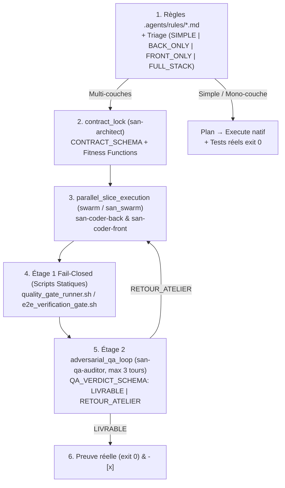

# `san_executer` — Chef d'Orchestre d'Implémentation & Dual-Harness v3.0

`san_executer` pilote l'implémentation dans **SAN AI Harness (`san_*` v3.0)**. L'orchestrateur utilise le `/model` choisi par l'utilisateur (`inherit-user-model`) : le cycle natif **`Plan → Execute`** est autorisé sur les tâches simples ou mono-couche, et **`swarm` / `san_swarm` (`run_workflow`)** orchestre les chantiers multi-couches, Duels UI et audits `san-qa-auditor` via `.agents/models.json`.

---

## 1. DÉCLENCHEURS & DOCTRINE ADAPTATIVE v3.0

- *« Exécute la roadmap active /roadmaps/... »* | *« Implémente la fonctionnalité [X] de bout en bout »* | *« Reprends à la Phase [N] »*
- **Orchestrateur Libre (`/model`) :** Aucun modèle imposé en orchestration.
- **Dual-Harness (`.agents/models.json` / `san-harness models`) :**
  - **Tâche simple / mono-couche :** `Plan → Execute` natif autorisé en direct selon `.agents/rules/*.md`.
  - **Chantier multi-couches / parallèle :** **Antigravity** `swarm(action: "add", model: "<agy.executor>")` (ou `run_workflow` via `scripts/autonomous_slice_workflow.py`) | **OpenCode V2.3** `san_swarm(action: "dispatch")` (vue tableau Swarm Board) ou `subagent` via `.agents/models.json`.
- **Quota & Hygiène :** Éviter `invoke_subagent(Model: "inherit")` sur les workers AGY ; compacter vers `120k` tokens (`/compact`) si la session grossit.

---

## 2. PIPELINE DÉTERMINISTE (`run_workflow` + `swarm` / `san_swarm`)



### Étape 1 : Cadrage, Règles & Contract Lock (`contract_lock`)
- Lire les règles `.agents/rules/*.md` et charger la roadmap active sous `roadmaps/*.md` (ou appeler `san_planner`).
- Classifier selon [orchestration_matrix.md](references/orchestration_matrix.md) (`BACK_ONLY`, `FRONT_ONLY`, `FULL_STACK`).
- En `FULL_STACK`, geler via `san-architect` les contrats OpenAPI 3.1 / Zod / TypeBox, les assertions Bruno et les **Architectural Fitness Functions** avant tout codage parallèle.

### Étape 2 : Exécution & Délégation Parallèle (`parallel_slice_execution`)
- Sur chantier multi-couches, spawner en parallèle `san-coder-back` et `san-coder-front` via `swarm` (`agy.executor`) / `run_workflow` (Antigravity) ou **`san_swarm` / `subagent`** (`opencode.executor` dans `.agents/models.json`) :
```python
import sys
sys.path.insert(0, ".agents/skills/san_executer/scripts")
from autonomous_slice_workflow import run_autonomous_slice
result = await run_autonomous_slice(args, WORKSPACES)
```
- **Clause Obligatoire :** Chaque codeur (`san-coder-back`, `san-coder-front`) énonce une **Dialectique 2 Approches** avant édition ; `san-coder-front` respecte les **5 états UI** et le **Motion System**.

### Étape 3 : Étage 1 — Quality Gates Fail-Closed
Exécuter les scripts déterministes (zéro `--passWithNoTests`, zéro `|| true`) :
- **Backend :** `bash src/skills/san_backend_expert/scripts/backend_quality_gate.sh`
- **Frontend :** `bash src/skills/san_ux_ui_expert/scripts/front_quality_gate.sh`
- **Intégration E2E / Runner :** `bash src/skills/san_executer/scripts/e2e_verification_gate.sh` (ou `quality_gate_runner.sh`)

### Étape 4 : Étage 2 — Boucle Adversariale (`adversarial_qa_loop`, max 3 tours)
- `san-qa-auditor` (lecture seule, `.agents/models.json`) audite sécurité OWASP, substance des tests, Fitness Functions et géométrie DOM (`QA_VERDICT_SCHEMA`).
- **`RETOUR_ATELIER` :** Boucle corrective vers `san-coder-back` / `san-coder-front` (max 3 tours).
- **`LIVRABLE` :** Cocher `- [x]` dans la roadmap après preuve `exit 0` et produire le rapport (avec Swarm Board sous OpenCode).

---

## 3. RESSOURCES & SCRIPTS EMBARQUÉS

- [Workflow Python Autonome `run_workflow`](scripts/autonomous_slice_workflow.py) : Orchestration 3 phases (`CONTRACT_SCHEMA`, `CODE_SLICE_SCHEMA`, `QA_VERDICT_SCHEMA`) + mode `--self-test` / `--dry-run`.
- [Script E2E Verification Gate](scripts/e2e_verification_gate.sh) : Suite d'intégration fail-closed (Front + Back + Bruno).
- [Matrice d'Orchestration & Arbre de Décision](references/orchestration_matrix.md) : Routage `BACK_ONLY`, `FRONT_ONLY`, `FULL_STACK`.
- [Protocole Intangible Contract-First](references/contract_first_protocol.md) : Spécification -> Zod/TypeBox -> Bruno.
- [Modèle de Rapport d'Exécution](templates/EXECUTION_REPORT_TEMPLATE.md) & [Gabarit Contrat d'Endpoint](templates/ENDPOINT_CONTRACT_TEMPLATE.md).
