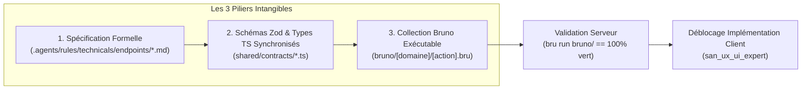

# Protocole Intangible « Contract-First » (`san_executer`)

Ce document formalise la loi d'airain du framework Antigravity (`san_*`) régissant toute interaction client/serveur :  
**« Aucun composant, aucun hook, aucun écran d'interface ne peut être implémenté sans un contrat d'API formellement rédigé, synchronisé en types stricts et validé par une suite de requêtes Bruno au vert. »**

---

## 1. LES TROIS PILIERS DU PROTOCOLE CONTRACT-FIRST

Le protocole repose sur l'alignement strict de trois artefacts techniques obligatoires avant d'autoriser la moindre ligne de code frontend :



---

## 2. PILIER 1 : SPÉCIFICATION NORMALISÉE D'ENDPOINT

Chaque interaction réseau doit faire l'objet d'un fichier de spécification dédié localisé dans :  
`.agents/rules/technicals/endpoints/[domaine]_[action].md` (ex: `payments_momo_charge.md`, `orders_create.md`).

### Structure Obligatoire du Fichier de Contrat :

```markdown
# Contrat d'Endpoint : [DOMAINE] / [ACTION]

## 1. MÉTADONNÉES TECHNIQUES
- **Identifiant :** `[DOMAINE]_[ACTION]`
- **Méthode HTTP :** `POST` | `GET` | `PUT` | `PATCH` | `DELETE`
- **URI Exacte :** `/api/v1/[ressource]`
- **Authentification requise :** `Bearer <Token>` (Sanctum / JWT / API Key) ou `Public`
- **Idempotence :** `Obligatoire (Idempotency-Key UUIDv4)` | `Non applicable`
- **Rate-Limiting :** `60 req/min par IP / User`

## 2. EN-TÊTES HTTP REQUIS
| En-tête | Obligatoire | Valeur Attendue / Format | Description |
| :--- | :---: | :--- | :--- |
| `Content-Type` | OUI | `application/json` | Encodage du payload de requête |
| `Accept` | OUI | `application/json` | Format de réponse attendu |
| `Idempotency-Key` | OUI (mutations) | `UUIDv4` (ex: `8f3b2c1a-...`) | Verrou d'idempotence Redis (24h) |
| `Authorization` | Conditionnel | `Bearer <token>` | Jeton de session utilisateur |

## 3. SCHÉMA DU PAYLOAD DE REQUÊTE (INPUT)
Voir schémas Zod partagés (`shared/contracts/[domaine].ts`).

## 4. SCHÉMAS DES RÉPONSES NORMALISÉES (OUTPUT)
Toutes les réponses de l'API respectent l'enveloppe uniforme Antigravity :
```

### Format Standardisé de Réponse API :

#### A. Cas de Succès (`200 OK` ou `201 Created`) :
```json
{
  "success": true,
  "data": {
    "transaction_id": "tx_20261023_001928",
    "status": "PENDING_CUSTOMER_APPROVAL",
    "amount": 2500,
    "currency": "XAF",
    "reference": "CMD-2026-1023-01",
    "created_at": "2026-10-23T12:00:00Z"
  },
  "meta": {
    "timestamp": 1792756800,
    "idempotency_replayed": false
  }
}
```

#### B. Cas d'Erreur Normalisée (`400`, `401`, `403`, `404`, `409`, `422`, `429`, `500`) :
```json
{
  "success": false,
  "error": {
    "code": "OPERATION_IN_PROGRESS",
    "message": "Une opération identique avec cette clé d'idempotence est en cours de traitement.",
    "details": {
      "retry_after_ms": 3000
    }
  }
}
```

---

## 3. PILIER 2 : SYNCHRONISATION DES SCHÉMAS ZOD ET TYPES TYPESCRIPT

Les définitions de données ne doivent **jamais** être dupliquées manuellement entre le client et le serveur. Elles résident dans un répertoire source partagé :  
`shared/contracts/[domaine].ts` (ou exportées par un module partagé monorepo).

### Exemple Concret : Schéma de Paiement Mobile Money (`payments.ts`)

```typescript
import { z } from "zod";

// 1. Schéma d'entrée validé côté serveur et client
export const MomoChargePayloadSchema = z.object({
  phone: z
    .string()
    .trim()
    .regex(/^\+?242\d{9}$/, "Numéro de téléphone invalide (Format attendu: +242061234567)"),
  operator: z.enum(["AIRTEL_MONEY", "MTN_MOMO"], {
    errorMap: () => ({ message: "Opérateur non supporté. Choisissez AIRTEL_MONEY ou MTN_MOMO." })
  }),
  amount: z
    .number()
    .int("Le montant doit être un entier")
    .positive("Le montant doit être positif")
    .min(500, "Montant minimum requis : 500 FCFA")
    .max(1000000, "Montant maximum par transaction : 1 000 000 FCFA"),
  currency: z.literal("XAF").default("XAF"),
  reference: z
    .string()
    .min(3, "Référence trop courte")
    .max(64, "Référence trop longue")
});

export type MomoChargePayload = z.infer<typeof MomoChargePayloadSchema>;

// 2. Schéma de réponse de succès
export const MomoChargeResponseSchema = z.object({
  success: z.literal(true),
  data: z.object({
    transaction_id: z.string().min(1),
    status: z.enum([
      "PENDING_CUSTOMER_APPROVAL",
      "SUCCESSFUL",
      "FAILED",
      "EXPIRED"
    ]),
    amount: z.number().int(),
    currency: z.literal("XAF"),
    reference: z.string(),
    created_at: z.string().datetime()
  }),
  meta: z.object({
    timestamp: z.number(),
    idempotency_replayed: z.boolean().default(false)
  })
});

export type MomoChargeResponse = z.infer<typeof MomoChargeResponseSchema>;

// 3. Schéma d'erreur uniforme
export const ApiErrorResponseSchema = z.object({
  success: z.literal(false),
  error: z.object({
    code: z.string(),
    message: z.string(),
    details: z.record(z.any()).optional()
  })
});

export type ApiErrorResponse = z.infer<typeof ApiErrorResponseSchema>;
```

---

## 4. PILIER 3 : COLLECTION BRUNO EXÉCUTABLE AVEC ASSERTIONS

Chaque endpoint possède son fichier de test Bruno `.bru` versionné dans le dépôt sous `bruno/[domaine]/[action].bru`.  
Il sert à la fois de **documentation exécutable vivante** et de **test d'intégration automatisé sans dépendance externe**.

### Exemple de Fichier Bruno : `bruno/payments/charge_momo.bru`

```bru
meta {
  name: Initier Paiement Mobile Money STK Push
  type: http
  seq: 1
}

post {
  url: {{baseUrl}}/api/v1/payments/momo/charge
  body: json
  auth: bearer
}

headers {
  Content-Type: application/json
  Accept: application/json
  Idempotency-Key: {{testIdempotencyKey}}
}

auth:bearer {
  token: {{authToken}}
}

body:json {
  {
    "phone": "+242061234567",
    "operator": "AIRTEL_MONEY",
    "amount": 2500,
    "currency": "XAF",
    "reference": "CMD-2026-1023-01"
  }
}

assert {
  res.status: eq 201
  res.body.success: eq true
  res.body.data.transaction_id: isDefined
  res.body.data.status: eq "PENDING_CUSTOMER_APPROVAL"
  res.body.data.amount: eq 2500
  res.body.data.currency: eq "XAF"
  res.responseTime: lte 100
}
```

### Exécution Automatisée par la CLI Bruno :
```bash
# Exécution de l'ensemble de la collection
bru run bruno/ --bail

# Exécution ciblée d'un sous-dossier
bru run bruno/payments/ --bail
```

---

## 5. RÉSILIENCE RÉSEAU ET CONDITIONS DÉGRADÉES

Le protocole Contract-First impose l'intégration native de trois règles défensives pour parer à la fragilité des réseaux mobiles (3G/EDGE instables, latences erratiques, micro-coupures) :

### 1. Verrou d'Idempotence Distribué Redis (`Idempotency-Key`)
Chaque mutation critique doit présenter une clé `Idempotency-Key` (UUIDv4) générée par le client.  
Le serveur gère le cycle de vie du verrou selon la séquence atomique :

```
Client POST (Idempotency-Key: K)
       │
       ▼
Vérifier présence réponse mise en cache (idempotency_resp:K)
       ├── Trouvé ──▶ Renvoyer réponse en cache (HTTP 200, X-Cache-Replay: true)
       ▼
Non trouvé ──▶ Acquisition Verrou Atomique (SET idempotency_lock:K "LOCKED" EX 120 NX)
       ├── Échec d'acquisition ──▶ Renvoyer HTTP 409 (OPERATION_IN_PROGRESS)
       ▼
Verrou acquis ──▶ Exécuter l'action métier
       ├── Succès ──▶ Mettre en cache la réponse (SETEX idempotency_resp:K 86400 resp)
       │             Supprimer le verrou (DEL idempotency_lock:K)
       │             Renvoyer HTTP 201 Created
       └── Erreur ──▶ Supprimer le verrou (DEL idempotency_lock:K)
                     Renvoyer HTTP 422 / 500
```

### 2. Algorithme de Retry Exponentiel avec Jitter Aléatoire
Côté client, en cas d'erreur transitoire réseau (statuts `503 Service Unavailable`, `429 Too Many Requests`, timeout ou perte de connectivité socket), le client calcule le délai de rejeu avec dispersion aléatoire (*Jitter*) pour éviter l'effet troupeau (*Thundering Herd*) :

$$t = \min\left(\text{max\_delay}, \; \text{base} \times 2^{\text{attempt}} + \text{random}(0, \text{jitter})\right)$$

### 3. File d'Attente Hors-Ligne (Offline Outbox Pattern)
Toute mutation initiée lorsque le terminal est hors-ligne est immédiatement sécurisée dans un stockage transactionnel local (SQLite, MMKV ou IndexedDB) avec le statut `PENDING`.  
Dès détection du rétablissement réseau (`online`), un worker dédié dépile et transmet les mutations ordonnées avec leur `Idempotency-Key` d'origine.

---

## 6. CHECKLIST DE CONTRÔLE CONTRACT-FIRST (AVANT DÉBLOCAGE DU FRONT)

Avant d'autoriser le sous-agent [san_ux_ui_expert](../../san_ux_ui_expert/SKILL.md) à écrire le moindre composant graphique :

- [ ] **Spécification validée :** Le fichier `.agents/rules/technicals/endpoints/[domaine]_[action].md` existe et définit URI, méthode, en-têtes et schémas d'erreur.
- [ ] **Types partagés exportés :** Les schémas Zod et types TypeScript sont compilés sans erreur (`tsc --noEmit`).
- [ ] **Requête Bruno opérationnelle :** Le fichier `bruno/[domaine]/[action].bru` est présent avec toutes ses assertions.
- [ ] **Tests serveur 100% au vert :** La commande `bru run bruno/` retourne un code 0 avec temps de réponse satisfaisant ($< 100\text{ms}$).
- [ ] **Gestion de l'idempotence prouvée :** Rejouer la même requête Bruno avec la même clé renvoie immédiatement la réponse sans ré-exécuter l'action métier.
