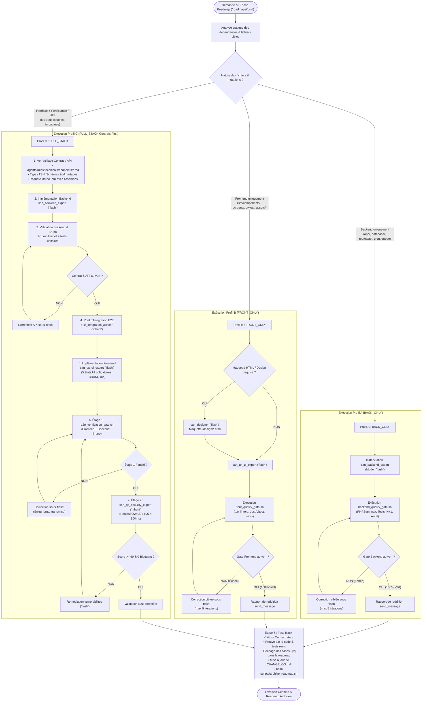

# Matrice d'Orchestration et Arbre de Décision Architectural (`san_executer`)

Ce document constitue la référence formelle pour le moteur de triage architectural et l'allocation des sous-agents chirurgicaux au sein du chef d'orchestre `san_executer` (framework Antigravity `san_*`).

---

## 1. PRINCIPES DU TRIAGE ARCHITECTURAL

Tout incrément logiciel confié à `san_executer` (qu'il provienne d'une roadmap `/roadmaps/*.md` générée par `san_planner` ou d'une demande directe de fonctionnalité) est analysé et ventilé selon **3 profils d'exécution exclusifs** :

1. **Profil A : `BACK_ONLY` (Couche Serveur & Données)**  
   Concerne les actions où aucune interface utilisateur n'est altérée : migrations DDL, entités/modèles, requêtes SQL/Eloquent, contrôleurs/actions API, FormRequests/DTOs, jobs asynchrones Redis/Queues, scripts batch/cron, webhooks entrants, et suites de tests automatisées (Pest, PHPUnit, Japa, Go test, Pytest, Bruno).
   
2. **Profil B : `FRONT_ONLY` (Interface Utilisateur & Expérience Client)**  
   Concerne les évolutions strictement visuelles ou ergonomiques : composants React / React Native Expo, écrans, micro-interactions cinétiques 60 fps, intégration des 5 états UI (Idéal, Vide, Chargement, Erreur, Succès/Hors-ligne), adaptation aux design tokens `BRAND.md`, pages statiques, mentions légales, et formulaires branchés sur des mocks ou contrats préexistants.

3. **Profil C : `FULL_STACK` (Séquencement Squelette Contract-First)**  
   Concerne toute fonctionnalité couplant persistance/API et interface utilisateur : création d'un flux de paiement Mobile Money, tableau de bord interactif avec temps réel, parcours de commande e-commerce, ou synchronisation hors-ligne.  
   **Règle d'or :** L'implémentation frontend est interdite tant que le contrat d'API et sa suite de requêtes Bruno ne sont pas validés au vert côté backend.

---

## 2. ARBRE DE DÉCISION MERMAID

Le flux décisionnel ci-dessous régit l'aiguillage automatique de chaque tâche :

---

## 3. MATRICE D'AIGUILLAGE ET D'ALLOCATION DES SOUS-AGENTS

| Profil Architectural | Tâche / Périmètre | Agent Spécialiste | Modèle | Outils Alloués (`least_privilege`) | Entrées Formelles (`INPUTS`) | Sorties Attendues (`OUTPUTS`) | Critères de Sortie Binaire |
| :--- | :--- | :--- | :---: | :--- | :--- | :--- | :--- |
| **Profil A : `BACK_ONLY`** | Migration DDL, Entité, Action / Contrôleur, Job Queue, Webhook | `san_backend_expert` | `flash` | `read_file`, `write_file`, `edit_file`, `run_command` | Spécification de schéma, règles métier, `PROJECT.md` | Migrations, Modèles, Actions, Tests Pest/Japa, Fichiers `.bru` | 100% tests unitaires verts, 0 erreur PHPStan max, 0 fuite N+1 |
| **Profil B : `FRONT_ONLY`** | Maquettage HTML Haute-Fidélité, Canvas responsive | `san_designer` | `flash` | `read_file`, `write_file`, `edit_file`, `run_command` | `BRAND.md`, spécifications fonctionnelles | `/design/*.html` interactif, tokens CSS | Maquette validée, contraste WCAG AAA |
| **Profil B : `FRONT_ONLY`** | Composants React/Expo, Écrans, Hooks, 5 états UI | `san_ux_ui_expert` | `flash` | `read_file`, `write_file`, `edit_file`, `run_command` | Maquette HTML, `BRAND.md`, types TypeScript | Composants `.tsx`, Hooks, tests RTL/Jest | `tsc --noEmit` 0 erreur, linters verts, 5 états UI codés |
| **Profil C : `FULL_STACK`** (Phase 1 : Contrat) | Alignement des structures et endpoints | `san_backend_expert` | `flash` | `read_file`, `write_file`, `edit_file` | Expression de besoin, règles métier | Fichier `.agents/rules/technicals/endpoints/*.md`, Schémas Zod, `.bru` | Contrat figé, assertions Bruno rédigées |
| **Profil C : `FULL_STACK`** (Phase 2 : Serveur) | Implémentation API, Persistance, Idempotence | `san_backend_expert` | `flash` | `read_file`, `write_file`, `edit_file`, `run_command` | Contrat d'endpoint, règles de sécurité | Contrôleurs, Middleware d'idempotence, Tests backend | `bru run` 100% vert, `res.status == 201`, cache Redis actif |
| **Profil C : `FULL_STACK`** (Phase 3 : Intégration) | Audit croisé des payloads et résilience réseau | `e2e_integration_auditor` | `inherit` | `read_file`, `run_command` | Contrat d'endpoint, code backend et frontend | Rapport d'intégration E2E croisé | Payloads conformes au bit près, Outbox testée en coupure réseau |
| **Profil C : `FULL_STACK`** (Phase 4 : Client) | Branchement UI sur l'API validée | `san_ux_ui_expert` | `flash` | `read_file`, `write_file`, `edit_file`, `run_command` | Contrat validé, endpoints réels, `BRAND.md` | Écrans connectés, gestion Offline Outbox | 0 mock résiduel, 60 fps, 5 états gérés |
| **Profil C : `FULL_STACK`** (Phase 5 : Étage 1) | Quality Gate automatisé déterministe | `san_executer` (scripté) | `N/A` | `run_command` | Dépôt entier | Exécution de `e2e_verification_gate.sh` | Exit code 0 impératif (Arrêt immédiat si 1) |
| **Profil C : `FULL_STACK`** (Phase 5 : Étage 2) | Pentest OWASP, audit de sécurité et charge | `san_qa_security_expert` | `inherit` | `read_file`, `run_command` | Code source complet, endpoints, tests | Rapport de pentest, benchmarks latence | Score $\ge 90/100$, 0 faille critique, p95 $< 100\text{ms}$ |
| **Tous Profils** (Phase 6 : Clôture) | Vérification physique, mise à jour docs & archive | `san_executer` (Orchestrateur) | `inherit` (Hôte) | `read_file`, `edit_file`, `run_command` | Roadmap active, résultats de tests réels | Cases `- [x]` cochées, `CHANGELOG.md`, archive roadmap | Roadmap archivée dans `/roadmaps/archives/`, 0 case orpheline |

---

## 4. RÈGLES FORMELLES D'ISOLATION ET DE SOUVERAINETÉ

### 1. Invariant de Cloisonnement des Modèles (`routing`)
- **Écriture de code et tests unitaires :** Strictement réservée à **`Model: 'flash'`**. Vitesse d'exécution maximale, coûts de tokens réduits de 80 %, déterminisme syntaxique élevé.
- **Réflexion d'architecture, intégration croisée et audit de sécurité :** Réservée à **`Model: 'inherit'`** (modèle de raisonnement supérieur). Capacité d'analyse systémique, détection des effets de bord transverses et modélisation de vecteurs d'attaque.
- **Interdiction formelle :** Instancier un sous-agent de génération de boilerplate ou de composant basique avec `Model: 'inherit'` est classé comme une faute d'ingénierie majeure.

### 2. Invariant de Séparation des Pouvoirs (L'Orchestrateur ne code jamais)
L'orchestrateur `san_executer` a pour mission exclusive d'ordonnancer, de vérifier les preuves et de statuer. Il ne committe aucun code d'application directement dans son contexte hôte : toute modification de code applicatif est obligatoirement déléguée à un sous-agent atomique.

### 3. Règle du Disjoncteur Anti-Boucle (*Circuit Breaker*)
Si un sous-agent échoue plus de **5 fois consécutives** au Quality Gate d'un palier donné :
1. L'orchestrateur interrompt immédiatement les tentatives automatiques.
2. Un diagnostic précis récapitulant les 5 échecs, les traces d'erreurs et les fichiers incriminés est généré.
3. L'arbitrage explicite du développeur humain est sollicité avec propositions d'actions correctives.
