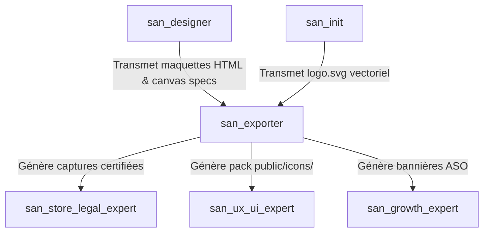
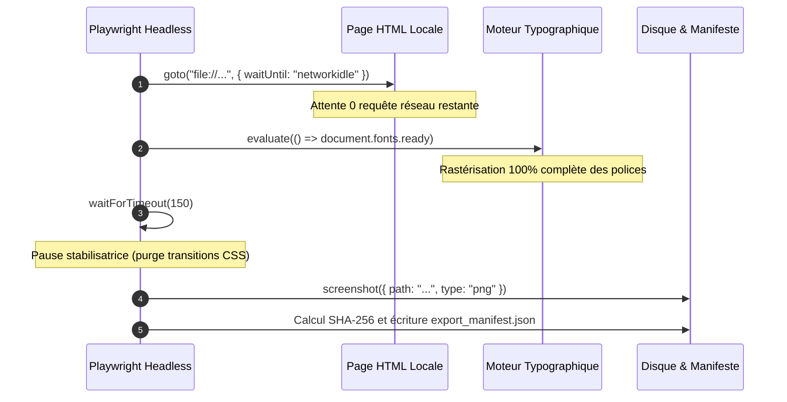

# `san_exporter` — Pipeline de Capture Déterministe Headless, Rendu Graphique & Assets

> **Manifeste Cartésien :** Dans un flux d'ingénierie moderne, aucune capture d'écran, aucun favicon et aucun asset de publication sur les stores ne doit être découpé manuellement au curseur dans un logiciel graphique. Le processus de restitution doit être **déterministe, automatisé et reproductible en une commande CLI unique**. `san_exporter` orchestre le moteur de capture headless (Playwright) et le pipeline vectoriel matriciel (`sharp`) pour transformer le code HTML statique et les vecteurs SVG en livrables d'une netteté absolue au pixel près.

---

## 1. RÔLE, POUR QUI, POUR QUOI

### Rôle Fondamental
`san_exporter` est l'**ingénieur de rendu headless et le gestionnaire de pipeline d'assets** du framework **Antigravity (`san_*`)**. Il comble le fossé entre le code source visuel (fichiers HTML statiques stylisés par Tailwind CSS, logos au format vectoriel SVG) et les artefacts binaires finaux indispensables à la production (fichiers PNG haute définition, bundles complets d'icônes d'applications, favicons multi-résolutions, visuels OpenGraph et documents A4 haute fidélité).

### Pour Qui ?
* Pour le **concepteur d'interfaces** [`san_designer`](../skills/san_designer.md), qui a besoin de figer ses prototypes d'écrans (`/design/mockup/*`) en images haute fidélité pour des revues visuelles ou des présentations clients.
* Pour l'**expert de publication et conformité** [`san_store_legal_expert`](../skills/san_store_legal_expert.md), qui exige des screenshots calibrés aux dimensions exactes imposées par Google Play Console et Apple App Store Connect, sous peine de rejet immédiat de la soumission.
* Pour le **responsable de croissance** [`san_growth_expert`](../skills/san_growth_expert.md), qui exploite les captures certifiées pour habiller les fiches ASO et générer les bannières promotionnelles ou visuels de partage social (OpenGraph).
* Pour le **développeur frontend/mobile** [`san_ux_ui_expert`](../skills/san_ux_ui_expert.md), qui a besoin d'un ensemble complet d'icônes généré depuis le logo source (`favicon.ico`, `apple-touch-icon.png`, `adaptive-icon.png`, `splash.png` Expo).

### Pour Quoi ?
* **Éradiquer le travail manuel d'exportation** : éviter les approximations de découpage d'écran, les pertes de ratio, les flous de mise à l'échelle ou les bordures parasites.
* **Garantir la conformité géométrique absolue aux exigences des stores** :
  * Apple App Store 6.7" : `1290×2796 px` (iPhone 15/16 Pro Max).
  * Google Play Store Téléphone : `1080×1920 px` (ratio 9:16 portrait).
  * Google Play Store Feature Graphic : `1024×500 px` (sans canal alpha).
  * Document Print A4 : `2480×3508 px` (300 DPI haute résolution).
* **Préserver l'intégrité vectorielle** : dériver l'ensemble des formats d'icônes et de favicons directement à partir du SVG validé dans `.agents/rules/logo.svg` sans jamais repartir d'un PNG pixélisé.
* **Éliminer l'erreur Apple ITMS-90717** : suppression formelle du canal alpha sur `assets/icon.png` (1024x1024 px).

---

## 2. FRONTIÈRES STRICTES : CE QU'IL FAIT / CE QU'IL NE FAIT PAS

| CE QU'IL FAIT STRICTEMENT | CE QU'IL NE FAIT ABSOLUMENT PAS |
| :--- | :--- |
| **Capture headless déterministe via Playwright :** Rendu au pixel près des pages HTML locales avec triple synchronisation (`networkidle`, `document.fonts.ready`, stabilisation). | Ne conçoit pas les pages HTML, la hiérarchie visuelle ni le CSS $\rightarrow$ rôle exclusif de [`san_designer`](../skills/san_designer.md). |
| **Conversion vectorielle matricielle (SVG $\rightarrow$ PNG) :** Déclinaison de logos en favicons, icônes PWA, icônes adaptatives Android et splash screens via Sharp. | Ne dessine pas les logos ni ne crée les concepts graphiques $\rightarrow$ établi par [`san_init`](../skills/san_init.md) et validé dans `LOGO.md`. |
| **Suppression du canal alpha pour iOS :** Application systématique de `.removeAlpha().flatten({ background: '#FFFFFF' })` sur l'icône App Store (`1024×1024 px`) pour prévenir l'erreur Apple `ITMS-90717`. | Ne rédige pas les textes d'accroche ni les sous-titres des captures stores $\rightarrow$ dévolu à [`san_copywriter`](../skills/san_copywriter.md). |
| **Génération du manifeste d'intégrité :** Production de `design/export_manifest.json` répertoriant les chemins, dimensions, poids et hachages cryptographiques SHA-256. | Ne gère pas la soumission automatisée des binaires aux APIs des stores $\rightarrow$ orchestré par [`san_store_legal_expert`](../skills/san_store_legal_expert.md). |

---

## 3. COMMENT IL EST MOBILISÉ PAR LES SKILLS PRINCIPAUX



---

## 4. STRUCTURE DU MODULE

```txt
src/skills/san_exporter/
├── SKILL.md                                 # Manifeste de rendu headless, spécifications et invariants
├── references/
│   ├── store_resolutions_matrix.md          # Dimensions officielles Apple App Store et Google Play
│   ├── alpha_channel_guardrails.md          # Diagnostic et remédiation du rejet Apple ITMS-90717
│   └── print_resolutions_300dpi.md          # Formats d'impression papier A4 à 300 DPI
├── templates/
│   ├── HTML_CANVAS_SPEC_HEADER.html         # En-tête de spécification canvas à insérer dans les maquettes
│   └── EXPORT_MANIFEST_TEMPLATE.json        # Schéma du registre d'intégrité avec signatures SHA-256
└── scripts/
    ├── export_png.mjs                       # Moteur de capture headless Playwright avec attente synchrone
    └── svg_to_png.mjs                       # Compilateur vectoriel matriciel multi-formats via Sharp
```

---

## 5. RÉSOLUTIONS DE CANVAS OBLIGATOIRES

Tout mockup HTML destiné à la capture par `san_exporter` doit cibler l'un des standards géométriques suivants :

| Jeton de Cible (`target`) | Dimensions Exactes | Usage Officiel |
| :--- | :--- | :--- |
| **`playstore`** | **`1080×1920 px`** | Google Play Store Screenshots (Smartphone portrait 9:16) |
| **`appstore`** | **`1290×2796 px`** | Apple App Store Screenshots (iPhone 6.7" portrait) |
| **`feature`** | **`1024×500 px`** | Google Play Store Feature Graphic (Bannière tête de fiche) |
| **`print`** | **`2480×3508 px`** | Document A4 Portrait Haute Définition (300 DPI) |
| `print-landscape` | `3508×2480 px` | Document A4 Paysage Haute Définition (300 DPI) |
| `desktop` | `1920×1080 px` | Desktop Standard Full HD (16:9) |
| `ipad` | `2048×2732 px` | Apple iPad Pro 12.9" Portrait |
| `banner` | `1200×630 px` | Bannière OpenGraph / Partage Social |

---

## 6. DIRECTIVES DE SYNCHRONISATION SYNCHRONE (RENDU SANS FAILLE)

Le script de capture headless [`export_png.mjs`](scripts/export_png.mjs) impose une séquence temporelle rigoureuse avant tout déclenchement de `page.screenshot()` :



1. **`waitUntil: 'networkidle'` :** Zéro connexion réseau active (images, styles locaux ou distants résolus).
2. **`await page.evaluate(() => document.fonts.ready)` :** Empêche le phénomène de *FOUT* (Flash of Unstyled Text) ou la substitution par une police système générique.
3. **`await page.waitForTimeout(150)` :** Stabilise les micro-transitions de layout initiales (CSS transitions).

---

## 7. GUIDE OPÉRATIONNEL DES SCRIPTS EXÉCUTABLES

### A. Moteur de Capture Headless : [`scripts/export_png.mjs`](scripts/export_png.mjs)

#### Diagnostic et Dépendance Playwright
Si `playwright` n'est pas installé dans le projet client, le script affiche un diagnostic clair et les commandes exactes de provisionnement :
```bash
# Diagnostic automatique affiché si Playwright est absent :
# pnpm add -D playwright && npx playwright install chromium
```

#### Exemples de Commandes CLI
```bash
# Capture d'un mockup individuel pour le Google Play Store
node src/skills/san_exporter/scripts/export_png.mjs \
  --file design/mockups/mobile_home.html \
  --target playstore \
  --out screenshots/home_playstore.png

# Capture pour l'Apple App Store (1290x2796 px)
node src/skills/san_exporter/scripts/export_png.mjs \
  --file design/mockups/mobile_home.html \
  --target appstore \
  --out screenshots/home_appstore.png

# Exportation de lot de tout un dossier
node src/skills/san_exporter/scripts/export_png.mjs \
  --dir design/mockups/mobile/ \
  --target appstore
```

#### Extraction Automatique par Commentaire HTML
Si le fichier HTML comporte en première ligne :
```html
<!-- CANVAS_SPEC: target=appstore width=1290px height=2796px export_scale=1 -->
```
Le script déduit immédiatement les dimensions sans argument supplémentaire requis.

---

### B. Déclinaison Vectorielle d'Icônes : [`scripts/svg_to_png.mjs`](scripts/svg_to_png.mjs)

Convertit un fichier vectoriel SVG (ex: `.agents/rules/logo.svg`) en pack complet d'icônes multi-résolutions tout en appliquant la suppression stricte du canal alpha pour iOS :

```bash
node src/skills/san_exporter/scripts/svg_to_png.mjs \
  --input logos/san_framework_icon.svg \
  --out-dir public/assets/branding
```

*L'asset critique `assets/icon.png` (1024x1024 px) est aplati sans transparence sur fond blanc pour garantir le passage du test Apple ITMS-90717.*
