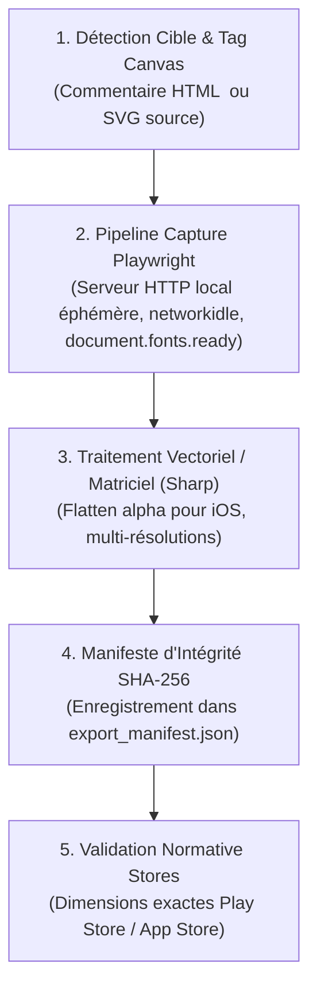

# `san_exporter` — Pipeline Déterministe d'Export Graphique & Assets v2.0

`san_exporter` est l'ingénieur de rendu headless et le compilateur d'assets du framework **Antigravity (`san_*`)**. Il comble le fossé entre le code source visuel (HTML statique, Tailwind CSS, logos vectoriels SVG) et les artefacts binaires finaux de production (PNG haute résolution certifiés pour stores, packs d'icônes PWA/App Store sans canal alpha et documents d'impression 300 DPI).

---

## 1. DÉCLENCHEURS & INTENTIONS RECONNUES

- *« Exporte les captures d'écran Play Store et App Store »*
- *« Convertis le logo SVG en favicons et icônes d'application »*
- *« Génère le document haute résolution A4 300 DPI »*
- *« Supprime le canal alpha de l'icône iOS pour éviter l'erreur ITMS-90717 »*

---

## 2. PROTOCOLE D'EXPORTATION (RUNBOOK PAS À PAS)

Le pipeline de capture et de déclinaison matricielle s'exécute selon le flux séquentiel suivant :



### Étape 1 : Spécification des Dimensions Cibles
Tout fichier HTML destiné à l'exportation doit spécifier son format dans `<body>` ([En-tête Spécification Canvas](templates/HTML_CANVAS_SPEC_HEADER.html)) :
- **Google Play Store :** `1080×1920 px` (portrait 9:16, 100% opaque, aucun canal alpha).
- **Apple App Store 6.7" :** `1290×2796 px` (iPhone 15/16 Pro Max, safe area Dynamic Island).
- **Feature Graphic :** `1024×500 px` (bannière tête de fiche Google Play).
- **Document Print A4 :** `2480×3508 px` (haute fidélité à 300 DPI).

### Étape 2 : Capture Headless Synchrone via Playwright
Lancer le moteur de capture Playwright avec serveur HTTP éphémère pour garantir l'absence d'erreurs CORS et le rendu fidèle des polices locales :
```bash
node src/skills/san_exporter/scripts/export_png.mjs \
  --file design/mockups/mon_ecran.html \
  --target appstore \
  --out screenshots/mon_ecran_appstore.png
```
Le script attend impérativement `networkidle`, `document.fonts.ready` et une temporisation de 150 ms pour purger les micro-transitions de layout.

### Étape 3 : Déclinaison Vectorielle & Éradication du Canal Alpha iOS
Convertir le logo source vectoriel SVG en formats matriciels indispensables :
```bash
node src/skills/san_exporter/scripts/svg_to_png.mjs \
  --input .agents/rules/logo.svg \
  --out-dir public/icons/
```
Pour l'icône iOS (`1024×1024 px`), suppression stricte du canal alpha via `.removeAlpha().flatten({ background: '#FFFFFF' })` ([Garde-fous Canal Alpha iOS](references/alpha_channel_guardrails.md)) interdisant le rejet Apple `ITMS-90717`.

### Étape 4 : Génération du Manifeste d'Intégrité
Chaque lot d'export consigne ses métadonnées dans `design/export_manifest.json` avec les signatures cryptographiques SHA-256 de chaque livrable ([Manifeste d'Exportation](templates/EXPORT_MANIFEST_TEMPLATE.json)).

---

## 3. RESSOURCES & RÉFÉRENCES EMBARQUÉES

- [Matrice des Résolutions Stores](references/store_resolutions_matrix.md) : Dimensions officielles et safe areas Apple App Store et Google Play.
- [Garde-fous Canal Alpha iOS](references/alpha_channel_guardrails.md) : Prévention et remédiation du rejet Apple ITMS-90717.
- [Résolutions Print 300 DPI](references/print_resolutions_300dpi.md) : Formats papier d'impression haute définition A4.
- [Script Capture Playwright export_png.mjs](scripts/export_png.mjs) : Moteur de capture déterministe avec serveur HTTP local.
- [Script Conversion Vectorielle svg_to_png.mjs](scripts/svg_to_png.mjs) : Rastériseur d'icônes multi-formats avec Sharp.
- [Gabarit En-tête Spécification Canvas](templates/HTML_CANVAS_SPEC_HEADER.html) : Commentaire normalisé à insérer en tête des maquettes.
- [Manifeste d'Exportation](templates/EXPORT_MANIFEST_TEMPLATE.json) : Structure JSON d'audit d'intégrité SHA-256.
