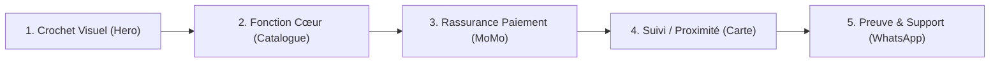

# Playbook ASO de Conversion Multi-Store (Google Play Store & Apple App Store)

> **Framework :** Google Antigravity (`san_*`) — Stratégie d'acquisition organique souveraine (`alexsan.pro`).  
> **Auteur Référent :** `san_growth_expert`  
> **Principe Déontologique :** Strictement White-Hat (Zéro faux avis, zéro manipulation algorithmique).

---

## 1. MATRICE COMPARATIVE DES CONTRAINTES DE MÉTADONNÉES

Les algorithmes d'indexation et de ranking d'Apple et de Google obéissent à des contraintes physiques différentes :

| Élément Métadonnée | Apple App Store | Google Play Store | Règle d'Excellence Antigravity |
| :--- | :---: | :---: | :--- |
| **Titre / App Name** | Max 30 caractères | Max 30 caractères | Format : `[Nom de Marque] : [Bénéfice Clé]` (Poids algorithmique maximal). |
| **Sous-titre (iOS)** | Max 30 caractères | N/A | Promesse d'action immédiate ou proposition de valeur unique. |
| **Description Courte (Google)** | N/A | Max 80 caractères | Phrase percutante synthétisant la promesse et l'ancrage local. |
| **Description Longue** | Max 4 000 caractères | Max 4 000 caractères | Structurée en 4 volets distincts (indexée par Google, conversion sur Apple). |
| **Mots-clés Cachés (iOS)** | Max 100 caractères | N/A | Mots séparés par des virgules **sans aucun espace** (gain de place vital). |
| **Icône Applicative** | 1024x1024 px PNG | 512x512 px PNG | Fond épuré, contraste élevé, symbole identifiable sans texte microscopique. |

---

## 2. RÈGLES DE RÉDACTION DE LA DESCRIPTION LONGUE EN 4 VOLETS

La description longue ne doit jamais être un bloc compact illisible. Elle s'articule obligatoirement en 4 chapitres :

### Volet 1 : L'Accroche & Le Problème Résolu (Les 3 premières lignes)
* *Objectif :* Capter l'utilisateur avant le bouton « Voir plus ».
* *Exemple :*  
  « Vous en avez assez des complications pour payer vos commandes ou transférer de l'argent au Congo ? [Nom de l'App] réunit tous vos commerçants préférés avec paiement instantané par MTN Mobile Money et Airtel Money. »

### Volet 2 : Les Fonctionnalités Majeures (Puces à impact direct)
* *Objectif :* Énumérer les cas d'usage concrets avec emojis professionnels.
* *Structure :*
  - 🛍️ **Catalogue Local :** Des milliers d'articles disponibles immédiatement à Brazzaville et Pointe-Noire.
  - ⚡ **Paiement MoMo & Airtel en 1 Clic :** Vos règlements validés sans carte bancaire internationale.
  - 📍 **Géolocalisation & Suivi :** Localisez les agences de proximité et suivez votre coursier en temps réel.

### Volet 3 : Sécurité Financière & Idempotence
* *Objectif :* Dissiper la peur de la perte financière ou de la fraude.
* *Arguments clés :* Chiffrement bancaire TLS 1.3, aucun débit dupliqué en cas de coupure réseau 3G, validation par code secret sur le téléphone personnel.

### Volet 4 : Proximité Locale & Support Client Réactif
* *Objectif :* Rassurer sur l'existence d'une équipe physique présente sur le terrain.
* *Mention obligatoire :* Disponibilité du support client 7j/7 via WhatsApp local (`+242...`) et adresses physiques de bureaux à Brazzaville / Pointe-Noire.

---

## 3. INGÉNIERIE DU CHAMP MOTS-CLÉS CACHÉS (APPLE APP STORE)

Pour le champ `Keywords` d'Apple App Store (limite stricte de 100 caractères) :
* **Interdiction des espaces après les virgules :** Chaque espace gaspille 1 précieux caractère sur 100 !
* **Interdiction des doublons :** Ne jamais répéter un mot déjà présent dans le Titre ou le Sous-titre (Apple les indexe déjà automatiquement).
* **Interdiction des pluriels inutiles :** Apple gère automatiquement les déclinaisons simples.
* **Exemple conforme optimisé (98 caractères) :**
  ```txt
  momo,airtel,paiement,brazzaville,pointenoire,congo,argent,livraison,transfert,boutique,courses,xaf
  ```

---

## 4. STORYBOARD NARRATIF DE CONVERSION EN 5 SCÈNES (SCREENSHOTS)

Les captures d'écran représentent plus de 70% de la décision de téléchargement. Le brief fourni à [`san_designer`](../san_designer/SKILL.md) respecte la séquence psychologique :



### Scène 1 : Le Crochet Visuel Majeur (*The Hook*)
* **Titre en bandeau :** « Vos achats et paiements MoMo en toute simplicité »
* **Visuel :** Mockup smartphone moderne centré présentant l'écran d'accueil avec solde et actions rapides.
* **Impact :** Réponse au besoin principal en moins de 2 secondes.

### Scène 2 : La Fonction Cœur & Le Choix
* **Titre en bandeau :** « Des milliers de produits avec prix réels en FCFA »
* **Visuel :** Grille élégante d'articles avec étiquettes claires en FCFA/XAF.
* **Impact :** Démonstration de l'utilité pratique immédiate.

### Scène 3 : Le Tunnel de Paiement Réconfortant
* **Titre en bandeau :** « Payez en 1 clic par MTN MoMo & Airtel Money »
* **Visuel :** Écran de sélection des moyens de paiement avec badges officiels MTN Mobile Money et Airtel Money, badge de sécurité cadenas.
* **Impact :** Élimination de la barrière de la carte bancaire.

### Scène 4 : La Livraison & Les Agences de Proximité
* **Titre en bandeau :** « Suivez votre livraison en direct à Brazzaville & Pointe-Noire »
* **Visuel :** Carte interactive avec marqueurs d'agences locales et itinéraire de coursier.
* **Impact :** Ancrage géographique et preuve logistique.

### Scène 5 : La Relation Humaine & Le Support Client
* **Titre en bandeau :** « Une équipe locale à votre écoute 7j/7 sur WhatsApp »
* **Visuel :** Interface de discussion fluide avec un conseiller support réactif.
* **Impact :** Confiance totale avant installation.

---

## 5. COLLECTE ÉTHIQUE DES AVIS CLIENTS (STRICT WHITE-HAT)

* **Zéro Achat d'Avis :** L'achat de fausses évaluations 5 étoiles est une violation des politiques stores entraînant la suppression pure et simple du compte éditeur.
* **Momentum In-App Parfait :**
  - Ne jamais solliciter d'avis au premier démarrage de l'application.
  - Déclencher l'API native `StoreReview.requestReview()` uniquement après un événement de satisfaction vérifié :
    1. Réception réussie d'une livraison.
    2. Troisième transaction Mobile Money consécutive sans incident.
* **Traitement des Insatisfactions :**
  - Si un problème survient (échec de paiement), proposer en priorité un bouton d'assistance directe vers WhatsApp pour résoudre le litige avant qu'il ne se transforme en note 1 étoile sur le store.
