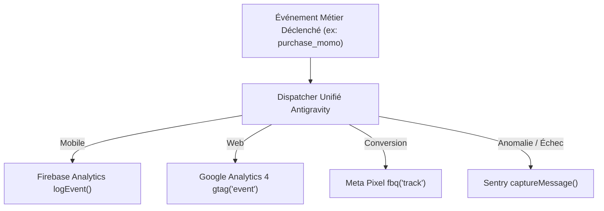

# Taxonomie Analytique Unifiée en `snake_case` & Sobriété Réseau

> **Framework :** Google Antigravity (`san_*`) — Ingénierie de la mesure certifiée (`alexsan.pro`).  
> **Auteur Référent :** `san_growth_expert`  
> **Règle Fondamentale :** Nommage `snake_case` strict, typage systématique, zéro événement fantôme et impact réseau minimal.

---

## 1. PRINCIPES DIRECTEURS DE LA TAXONOMIE ANTIGRAVITY

1. **Unicité Sémantique :** Un événement business porte exactement le même identifiant technique, qu'il soit collecté dans une application React Native (Firebase), une application web Next.js/React (GA4) ou un pixel de conversion (Meta Pixel).
2. **Convention `snake_case` Intégrale :** Tous les noms d'événements et de paramètres adoptent le `snake_case` minuscule (ex: `add_to_cart`, `payment_method`, `item_category`).
3. **Typage Strict et Devises Normalisées :** Tout montant monétaire est associé au paramètre obligatoire `currency: "XAF"` et à une valeur numérique `value: number` (jamais de chaînes de caractères type `"25000 FCFA"`).
4. **Zéro Événement Fantôme (*Anti-Double-Counting*) :** Tout déclencheur d'action utilisateur critique (ex: achat, inscription) est protégé contre le double-clic via un état local de debounce ou d'idempotence.

---

## 2. MATRICE D'ÉVÉNEMENTS BUSINESS STANDARDISÉE

| Événement `snake_case` | Description & Déclencheur | Paramètres Obligatoires & Types | Canaux Cibles |
| :--- | :--- | :--- | :--- |
| `screen_view` | Affichage d'un nouvel écran ou d'une route | `screen_name: string`<br>`screen_class: string` | Firebase, GA4 |
| `sign_up` | Finalisation réussie de la création de compte | `method: "phone_otp" \| "email"`<br>`user_role: "customer" \| "merchant"` | Firebase, GA4, Meta |
| `login` | Authentification utilisateur confirmée | `method: "phone_otp" \| "password"` | Firebase, GA4 |
| `search` | Exécution d'une recherche d'articles ou boutiques | `search_term: string`<br>`results_count: integer` | Firebase, GA4 |
| `view_item` | Consultation de la fiche détail d'un produit | `item_id: string`<br>`item_name: string`<br>`price: number`<br>`currency: "XAF"` | Firebase, GA4, Meta |
| `add_to_cart` | Clic sur le bouton « Ajouter au panier » | `item_id: string`<br>`quantity: integer`<br>`price: number`<br>`currency: "XAF"` | Firebase, GA4, Meta |
| `remove_from_cart` | Retrait d'un article du panier | `item_id: string`<br>`quantity: integer`<br>`currency: "XAF"` | Firebase, GA4 |
| `begin_checkout` | Arrivée sur l'écran récapitulatif de paiement | `value: number`<br>`currency: "XAF"`<br>`items_count: integer` | Firebase, GA4, Meta |
| `select_payment_method` | Choix du mode de règlement | `payment_method: "mtn_momo" \| "airtel_money" \| "cash"` | Firebase, GA4 |
| `purchase_momo` | Confirmation effective de la transaction via webhook | `transaction_id: string`<br>`value: number`<br>`currency: "XAF"`<br>`operator: "mtn" \| "airtel"` | Firebase, GA4, Meta |
| `account_deleted` | Validation finale de suppression de compte (Apple 5.1.1) | `method: "in_app" \| "web_portal"`<br>`reason: string` | Firebase, GA4 |

---

## 3. MAPPING MULTI-CANAUX PAR TECHNOLOGIE



### Exemple d'implémentation TypeScript du Dispatcher :
```typescript
interface PurchaseEventParams {
  transaction_id: string;
  value: number;
  currency: 'XAF';
  operator: 'mtn' | 'airtel';
}

export const trackPurchaseMomo = async (params: PurchaseEventParams): Promise<void> => {
  try {
    // 1. Firebase Analytics (Mobile)
    if (typeof analytics !== 'undefined') {
      await analytics().logEvent('purchase_momo', params);
    }

    // 2. Google Analytics 4 (Web)
    if (typeof window !== 'undefined' && (window as any).gtag) {
      (window as any).gtag('event', 'purchase_momo', params);
    }

    // 3. Meta Pixel (Web & Attribution)
    if (typeof window !== 'undefined' && (window as any).fbq) {
      (window as any).fbq('track', 'Purchase', {
        value: params.value,
        currency: params.currency,
        content_type: 'product',
      });
    }
  } catch (error) {
    // Échec silencieux pour ne jamais bloquer l'expérience utilisateur
    console.warn('[Analytics Error]', error);
  }
};
```

---

## 4. SOBRIÉTÉ RÉSEAU & RESPECT DES FORFAITS MOBILES EN AFRIQUE

Dans le contexte des réseaux mobiles congolais (3G, H+, EDGE) où le coût du mégaoctet est significatif :
1. **Asynchronisme Non-Bloquant :** Aucun script de tracking ne doit être exécuté de façon synchrone dans le chemin critique d'affichage.
2. **Compactage des Payloads (< 2 Ko) :** Les attributs d'événements doivent rester concis pour que chaque envoi HTTP ne consomme pas plus de 2 Ko de données compressées.
3. **Batching Automatisé :** Firebase Analytics et Sentry doivent être configurés pour grouper les envois d'événements toutes les 30 à 60 secondes plutôt que d'émettre une requête réseau par interaction.
4. **Gestion Déconnectée (Offline Mode) :** En cas d'interruption réseau, les événements sont stockés dans la file d'attente locale de l'appareil et synchronisés en arrière-plan dès la reconnexion avec limitation du débit d'envoi.
