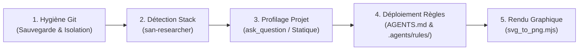

# `san_init` — Expert d'Initialisation, d'Isolation Git et d'Onboarding de Dépôt

Ce runbook impératif régit le bootstrap et l'onboarding de toute codebase sous le framework **Antigravity (`san_*`)**. Il orchestre l'assainissement Git, la détection déterministe de stack, le calibrage du profil de projet et le déploiement des règles de gouvernance natives.

---

## Protocole d'Exécution Séquentiel (Runbook)



### Étape 1 : Hygiène Git Hermétique & Sauvegarde Tiers
1. Exécuter le script d'hygiène à la racine du dépôt :
   ```bash
   bash scripts/git_ai_hygiene.sh
   ```
2. **Effets vérifiés :**
   - Sauvegarde non-destructive de toute configuration tierce existante (`CLAUDE.md`, `.cursorrules`, etc.) vers `.agents/backups/legacy-ai-configs/<timestamp>/`.
   - Désindexation immédiate de `.agents/` du cache Git (`git rm -r --cached --ignore-unmatch .agents/`).
   - Insertion du bloc d'isolation hermétique dans `.gitignore` et `.git/info/exclude`.

### Étape 2 : Détection Déterministe de la Stack Technique
1. Déléguer la reconnaissance à l'agent éclaireur **`san-researcher`** (`Model: 'flash'`, sandbox) :
   ```bash
   bash .agents/skills/san_searcher/scripts/detect_stack_versions.sh --json
   ```
2. Identifier le framework hôte parmi les 10 configurations supportées. Consulter la [Matrice Complète des Stacks](references/stack_matrix.md).

### Étape 3 : Profilage du Projet (`PROJECT_PROFILE`) & Archétype de Marque
1. **Starter vierge ou nouveau projet :**
   - Utiliser `ask_question` pour sélectionner le `PROJECT_PROFILE` adapté : `emerging_market`, `global_saas`, `mobile_consumer`, `cli_devtools`, ou `api_platform`.
   - Clarifier l'archétype visuel (Néo-brutaliste, FinTech sobre, Minimaliste) et la couleur primaire.
2. **Codebase existante :**
   - Déployer `san-researcher` en rétro-ingénierie silencieuse pour déduire le profil, les tokens et l'architecture sans interroger l'utilisateur sur ce qui figure déjà dans le code.
   - Consulter le [Protocole d'Onboarding Détaillé](references/onboarding_protocol.md).

### Étape 4 : Déploiement de `AGENTS.md` et des Règles de Gouvernance
1. Instancier la constitution racine `AGENTS.md` à partir de [AGENTS_INDEX_TEMPLATE.md](templates/AGENTS_INDEX_TEMPLATE.md).
2. Générer les 5 règles normatives sous `.agents/rules/` dotées de leurs frontmatters YAML officiels :
   - `.agents/rules/PROJECT.md` (`trigger: always_on`) depuis [PROJECT_TEMPLATE.md](templates/rules/PROJECT_TEMPLATE.md)
   - `.agents/rules/PRODUCT.md` (`trigger: model_decision`) depuis [PRODUCT_TEMPLATE.md](templates/rules/PRODUCT_TEMPLATE.md)
   - `.agents/rules/BRAND.md` (`trigger: glob`) depuis [BRAND_TEMPLATE.md](templates/rules/BRAND_TEMPLATE.md)
   - `.agents/rules/API.md` (`trigger: glob`) depuis [API_TEMPLATE.md](templates/rules/API_TEMPLATE.md)
   - `.agents/rules/LOGO.md` (`trigger: model_decision`) depuis [LOGO_TEMPLATE.md](templates/rules/LOGO_TEMPLATE.md)
3. Instancier la table de routage centrale `.agents/GEMINI.md` depuis [GEMINI_INDEX_TEMPLATE.md](templates/GEMINI_INDEX_TEMPLATE.md).

### Étape 5 : Déclinaisons Graphiques Vectorielles (Branding)
1. Localiser le logo vectoriel maître (`logos/logo_icon.svg` ou `public/logo.svg`).
2. Générer les déclinaisons matricielles (favicons, icônes Apple, PWA) :
   ```bash
   node scripts/svg_to_png.mjs --input logos/logo_icon.svg --output-dir public/assets/branding
   ```
3. Consigner l'inventaire effectif des assets générés dans `.agents/rules/LOGO.md`.

---

## Invariants Non Négociables
1. **Zéro Fuite Git :** Le dossier `.agents/` et les logs locaux ne doivent jamais figurer dans l'arbre commitable.
2. **Sauvegarde Avant Purge :** Toute configuration existante est déplacée dans `.agents/backups/`, jamais détruite aveuglément.
3. **Constitution Permanente :** Le fichier racine `<racine>/AGENTS.md` est obligatoire et non gitignoré pour ancrer la charte dans tout le repo.
