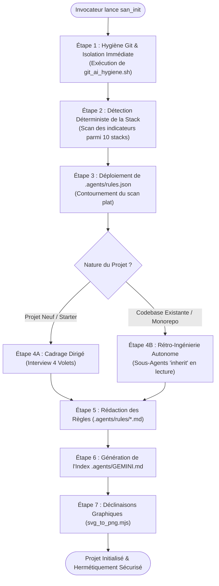

# `san_init` — Expert d'Initialisation, d'Isolation Git et d'Onboarding de Dépôt

## 1. RÔLE ET OBJECTIFS DU SKILL

`san_init` est le point d'entrée souverain pour l'initialisation de tout projet logiciel sous le framework **Antigravity (`san_*`)**.
Il est conçu pour être exécuté par l'agent Antigravity CLI ou IDE au moment du bootstrap ou de l'onboarding d'un dépôt client.

### Missions Fondamentales :
1. **Ériger une barrière Git inviolable :** Empêcher strictement toute fuite de fichiers d'agents (`.agents/`, `GEMINI.md`, logs) vers les dépôts distants (GitHub, GitLab, Bitbucket).
2. **Purge chirurgicale des configurations tierces :** Détecter et supprimer les résidus d'anciens agents concurrents (`CLAUDE.md`, `.cursorrules`, `.windsurfrules`, `.copilot/`) pour éliminer tout conflit d'instructions.
3. **Détection déterministe de la stack :** Identifier immédiatement la technologie hôte parmi 10 stacks standards et calibrer l'environnement sans poser de questions superflues.
4. **Contourner le scan plat d'Antigravity :** Déployer `<root>/.agents/rules.json` pour conditionner le chargement des règles par masques de fichiers (`globs`) et niveaux de priorité.
5. **Générer les règles de gouvernance normatives :** Instancier les règles maîtresse (`BRAND.md`, `PRODUCT.md`, `PROJECT.md`, `API.md`, `LOGO.md`) et la table de routage `.agents/GEMINI.md`.
6. **Pipeline vectoriel de branding :** Convertir le logo SVG en l'ensemble des déclinaisons matricielles PNG obligatoires (favicons, icônes Apple, PWA, splash screens).

---

## 2. ARBORESCENCE ET RESSOURCES EMBARQUÉES

Ce skill embarque des scripts autonomes et des gabarits normés situés dans les sous-répertoires suivants :

### Scripts Exécutables (`scripts/`)
* [git_ai_hygiene.sh](scripts/git_ai_hygiene.sh) : Script Bash d'isolation Git hermétique, désindexation de cache et purge des résidus tiers.
* [svg_to_png.mjs](scripts/svg_to_png.mjs) : Script Node.js ESM de rasterisation multi-résolution vectorielle vers matricielle (Sharp & fallback CLI).

### Modèles et Gabarits (`templates/`)
* [rules_json_template.json](templates/rules_json_template.json) : Spécification JSON anti-scan plat pour `.agents/rules.json`.
* [GEMINI_INDEX_TEMPLATE.md](templates/GEMINI_INDEX_TEMPLATE.md) : Modèle de la table de routage centrale `.agents/GEMINI.md`.
* [BRAND_TEMPLATE.md](templates/rules/BRAND_TEMPLATE.md) : Modèle de charte graphique, design tokens, cinétique 60 fps et directives Anti-AI Taste.
* [PRODUCT_TEMPLATE.md](templates/rules/PRODUCT_TEMPLATE.md) : Modèle de vision produit, personas cibles, KPIs et contraintes marchés émergents (3G, Mobile Money).
* [PROJECT_TEMPLATE.md](templates/rules/PROJECT_TEMPLATE.md) : Modèle d'architecture technique, cascade des modèles LLM et politique de tests stricts.
* [API_TEMPLATE.md](templates/rules/API_TEMPLATE.md) : Modèle de conventions REST & WebSockets, enveloppe JSON et verrous d'idempotence.
* [LOGO_TEMPLATE.md](templates/rules/LOGO_TEMPLATE.md) : Modèle de guide d'utilisation des logos et inventaire des formats PNG.

---

## 3. PROTOCOLE D'EXÉCUTION SÉQUENTIEL (PAS À PAS)

L'agent exécutant `san_init` applique la séquence opérationnelle suivante sans sauter aucune étape :



---

### ÉTAPE 1 : HYGIÈNE GIT & ISOLATION IMMÉDIATE

1. **Localiser la racine Git :** Déterminer la racine du dépôt hôte via `git rev-parse --show-toplevel`. Si le projet actuel est un sous-dossier de monorepo, l'hygiène s'applique toujours à la racine Git.
2. **Exécuter le script d'hygiène :**
   ```bash
   bash scripts/git_ai_hygiene.sh
   ```
3. **Résultats attendus de l'étape :**
   - Tous les résidus obsolètes (`CLAUDE.md`, `.cursorrules`, `.windsurfrules`, `.copilot/`) sont purgés du disque.
   - Si `.agents/` avait été indexé dans Git par mégarde, il est immédiatement désindexé via `git rm -r --cached --ignore-unmatch .agents/`.
   - Le bloc `# --- ANTIGRAVITY AI ISOLATION (san_*) ---` est inséré à la fois dans `.gitignore` ET dans `.git/info/exclude`.
   - La commande `git status` confirme que `.agents/` n'apparaît plus comme fichier à commiter.

---

### ÉTAPE 2 : DÉTECTION DÉTERMINISTE DE LA STACK TECHNIQUE

L'agent inspecte les fichiers indicateurs pour identifier le profil technique du projet parmi la matrice officielle :

| Stack Identifiée | Fichiers Indicateurs | Fichiers de Configuration | Gestionnaire Recommandé | Ports Usuels |
| :--- | :--- | :--- | :--- | :--- |
| **1. React (Vite / CRA)** | `vite.config.ts`, `vite.config.js`, `index.html` racine | `package.json` (`dependencies.react`) | `pnpm` > `bun` > `npm` | `5173` / `3000` |
| **2. Vite (Vanilla / Vue / Svelte)** | `vite.config.*`, absence de React | `package.json`, `vite.config.ts` | `pnpm` > `bun` > `npm` | `5173` |
| **3. Next.js (App / Pages Router)** | `next.config.*`, dossier `app/` ou `pages/` | `tsconfig.json`, `next-env.d.ts` | `pnpm` > `bun` > `npm` | `3000` |
| **4. Expo (Managed / Bare)** | `app.json`, `app.config.*`, `"expo"` dans `package.json` | `metro.config.js`, `tsconfig.json` | `npx expo`, `pnpm` | `8081` |
| **5. React Native CLI (Bare)** | `android/` + `ios/`, `react-native.config.js` | `Podfile`, `metro.config.js` | `yarn`, `npm` | `8081` |
| **6. Laravel** | `artisan`, `composer.json` (`laravel/framework`) | `config/app.php`, `phpunit.xml` | `composer` + `pnpm`/`npm` | `8000`, `5173` |
| **7. AdonisJS** | `ace`, `adonisrc.ts` ou `adonisrc.json` | `tsconfig.json`, `@adonisjs/core` | `pnpm` > `npm` | `3333` |
| **8. NestJS** | `nest-cli.json`, `src/main.ts` (`@nestjs/core`) | `tsconfig.build.json` | `pnpm` > `npm` | `3000` |
| **9. Go (Golang)** | `go.mod`, `go.sum`, `main.go` | `Makefile`, `Dockerfile` | `go mod` | `8080`, `3000` |
| **10. Python (FastAPI / Django)** | `pyproject.toml`, `requirements.txt`, `manage.py` | `poetry.lock`, `Pipfile` | `uv` > `poetry` > `pip` | `8000` |

#### Algorithme de Décision Rapide
```bash
if [ -f "artisan" ] && [ -f "composer.json" ]; then
    STACK="LARAVEL"
elif [ -f "adonisrc.ts" ] || [ -f "adonisrc.json" ]; then
    STACK="ADONISJS"
elif [ -f "next.config.js" ] || [ -f "next.config.mjs" ] || [ -f "next.config.ts" ]; then
    STACK="NEXTJS"
elif [ -f "app.json" ] && grep -q '"expo"' package.json 2>/dev/null; then
    STACK="EXPO"
elif [ -d "android" ] && [ -d "ios" ] && [ -f "react-native.config.js" ]; then
    STACK="REACT_NATIVE_CLI"
elif [ -f "nest-cli.json" ]; then
    STACK="NESTJS"
elif [ -f "vite.config.ts" ] || [ -f "vite.config.js" ]; then
    STACK="VITE_REACT"
elif [ -f "go.mod" ]; then
    STACK="GOLANG"
elif [ -f "pyproject.toml" ] || [ -f "requirements.txt" ] || [ -f "manage.py" ]; then
    STACK="PYTHON"
else
    STACK="GENERIC_WEB"
fi
```

---

### ÉTAPE 3 : DÉPLOIEMENT DU FICHIER DE GOUVERNANCE `rules.json`

Antigravity effectue un scan linéaire de `.agents/rules/`. Pour éviter de charger les règles graphiques lors d'une session de refactoring SQL ou d'API, `san_init` installe `.agents/rules.json`.
1. Créer le répertoire `.agents/rules/` et `.agents/rules/technicals/endpoints/`.
2. Copier [rules_json_template.json](templates/rules_json_template.json) vers `.agents/rules.json`.
3. Ajuster si nécessaire les masques `globs` selon les répertoires effectifs de la stack détectée (ex: `app/Http/Controllers/**` pour Laravel, `src/controllers/**` pour Express/NestJS, `app/api/**` pour Next.js).

---

### ÉTAPE 4 : INSTANCIATION DES RÈGLES NORMATIVES

L'agent détermine si le dépôt est un projet neuf ou une codebase existante :

#### Cas 4A : Dépôt Neuf ou Starter Vierge (Interview Dirigée en 4 Volets)
Si aucun code applicatif substantiel n'est présent, poser un entretien concis au développeur en 4 questions groupées :
1. **Identité & Émotion Visuelle :** Quel est le nom du produit, son archétype visuel (Néo-brutaliste, FinTech sobre, Minimaliste) et sa couleur primaire ?
2. **Logo Maître :** Disposez-vous d'un SVG de logo maître ou souhaitez-vous une proposition vectorielle initiale ?
3. **Vision Produit & Personas :** Qui est l'utilisateur principal, quel problème douloureux résout-on et y a-t-il des contraintes terrain spécifiques (Mobile Money, 3G, offline) ?
4. **Socle Technique :** Base de données cible (PostgreSQL, MySQL, SQLite), cache/files d'attente (Redis) et conventions spécifiques.

#### Cas 4B : Codebase Existante ou Monorepo (Rétro-Ingénierie Autonome)
Si le dépôt contient déjà une application développée, **interdiction d'interroger le développeur à froid sur des éléments déjà configurés dans le code**. L'agent déploie des sous-agents en lecture seule (`Model: 'inherit'`) :
* **Styles & Tokens :** Lecture de `tailwind.config.*`, variables CSS (`globals.css`, `tokens.scss`) $\rightarrow$ Remplissage de `BRAND.md`.
* **Logos & Médias :** Repérage des SVGs existants dans `public/`, `assets/`, `resources/` $\rightarrow$ Rédaction de `LOGO.md`.
* **Modèles & Logique Métier :** Inspection des migrations de base de données, schémas Prisma/Drizzle/TypeORM, modèles Eloquent $\rightarrow$ Remplissage de `PRODUCT.md` et `API.md`.
* **Tests & Linters :** Analyse de `package.json`, `composer.json`, `phpunit.xml`, `jest.config.*` $\rightarrow$ Remplissage de `PROJECT.md`.
* **Synthèse Expéditive :** Présentation d'un court récapitulatif pour simple confirmation du développeur.

#### Instanciation des Fichiers dans `.agents/rules/`
À partir des gabarits du dossier `templates/rules/`, créer les fichiers instanciés :
* `.agents/rules/PROJECT.md` depuis [PROJECT_TEMPLATE.md](templates/rules/PROJECT_TEMPLATE.md)
* `.agents/rules/PRODUCT.md` depuis [PRODUCT_TEMPLATE.md](templates/rules/PRODUCT_TEMPLATE.md)
* `.agents/rules/BRAND.md` depuis [BRAND_TEMPLATE.md](templates/rules/BRAND_TEMPLATE.md)
* `.agents/rules/API.md` depuis [API_TEMPLATE.md](templates/rules/API_TEMPLATE.md)
* `.agents/rules/LOGO.md` depuis [LOGO_TEMPLATE.md](templates/rules/LOGO_TEMPLATE.md)

---

### ÉTAPE 5 : GÉNÉRATION DE L'INDEX MAÎTRE `GEMINI.md`

1. À partir du gabarit [GEMINI_INDEX_TEMPLATE.md](templates/GEMINI_INDEX_TEMPLATE.md), instancier `.agents/GEMINI.md`.
2. S'assurer que les chemins relatifs pointent rigoureusement vers les fichiers de règles créés dans `.agents/rules/`.
3. Si un fichier `CHANGELOG.md` ou `roadmaps/` existe déjà, lier les pointeurs. Sinon, préparer les sections prêtes à l'accueil.
4. Assainir le fichier `README.md` racine de tout vestige ou mention obsolète relative à d'autres agents IA.

---

### ÉTAPE 6 : DÉCLINAISONS GRAPHIQUES VIA `svg_to_png.mjs`

1. Vérifier l'emplacement du logo vectoriel maître (ex: `logos/logo_icon.svg` ou `public/logo.svg`).
2. Exécuter le script de génération :
   ```bash
   node scripts/svg_to_png.mjs --input logos/logo_icon.svg --output-dir public/assets/branding
   ```
3. Si la bibliothèque `sharp` n'est pas encore installée dans le projet :
   - Le script bascule automatiquement sur les outils système disponibles (`rsvg-convert`, `inkscape`, `magick`).
   - Si aucun moteur n'est présent, il affiche la commande d'installation recommandée (`pnpm add -D sharp` ou `npm install -D sharp`) sans bloquer le reste de l'onboarding.
4. Renseigner dans `.agents/rules/LOGO.md` l'inventaire effectif des assets générés.

---

## 4. INVARIANTS ET GARANTIES DE SOUVERAINETÉ

L'agent Antigravity exécutant ce skill respecte les 4 invariants suprêmes :

1. **Zéro Fuite Git (Isolation Hermétique) :**
   Aucun commit ne doit jamais inclure `.agents/`. Même si le projet distant possède un `.agents/` hérité d'un autre contributeur, `san_init` isole l'index local par `git update-index --skip-worktree` et protège `.gitignore` et `.git/info/exclude`.
2. **Priorité à l'Autonomie d'Observation :**
   Dans une codebase existante, l'IA privilégie l'analyse statique du code plutôt que de saturer le développeur de questions élémentaires.
3. **Application Stricte de `rules.json` :**
   Le scan plat par défaut d'Antigravity doit être systématiquement court-circuité pour assurer un chargement contextuel propre.
4. **Cascade Déterministe des Modèles :**
   - L'orchestrateur supervise en modèle parent (`inherit` / `pro`).
   - Toute exécution atomique de script ou sous-tâche de code est déléguée à **`Model: 'flash'`**.
