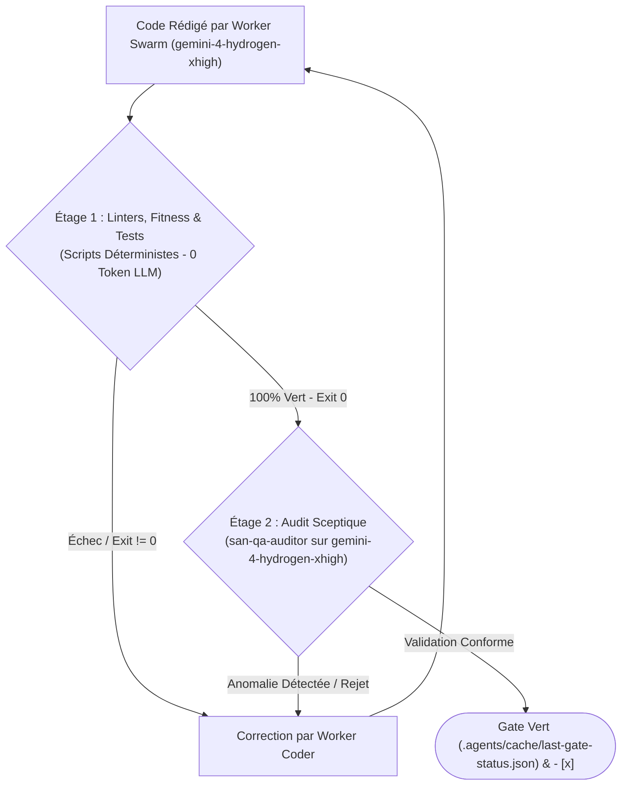

# CONSTITUTION TECHNIQUE & RÈGLES D'INGÉNIERIE (`PROJECT.md`)

> **Loi technique suprême :** Ce document fixe l'architecture d'ingénierie, le profil opérationnel, la doctrine d'orchestration autonome Antigravity (`Argon` / `Carbon` $\rightarrow$ `swarm` `gemini-4-hydrogen-xhigh`), la politique de tests non négociable et l'entonnoir de validation.

---

## 1. PROFIL DU PROJET (`PROJECT_PROFILE`)

Chaque projet adopte un profil contextuel qui conditionne les contraintes produit et architecturales :

* **PROFIL ACTIF :** `PROJECT_PROFILE: [global_saas | emerging_market_3g | mobile_consumer | cli_devtools | api_platform]`

### Spécificités par Profil :
* **`global_saas` :** Multi-tenant, conformité SOC2/RGPD, billing Stripe/LemonSqueezy, SSO SAML, observabilité OpenTelemetry.
* **`emerging_market_3g` :** Offline-first strict, payload session < 1.5 Mo, passerelles Mobile Money (USSD asynchrone), SMS OTP, adresses sans codes postaux.
* **`mobile_consumer` :** Touch 44x44px minimum, gestures 60 fps, batterie/CPU préservés, deep links WhatsApp/stores.
* **`cli_devtools` :** Démarrage instantané (< 100ms), zéro dépendance runtime lourde, flags POSIX conformes, stdout structuré JSON optionnel.
* **`api_platform` :** OpenAPI 3.1 contract-first, rate limiting granulaire, idempotence distribuée Redis, latence p99 < 50ms.

---

## 2. STACK TECHNIQUE OFFICIELLE DU PROJET

* **Écosystème & Framework :** `[Ex: Laravel 11 / Next.js 15 (App Router) / React 19 (Vite) / Expo SDK 52 / Go 1.23 / Fastify]`
* **Langage & Typage :** TypeScript (`"strict": true`, interdiction de `any`) / PHP 8.3 (`declare(strict_types=1);`) / Python 3.12 (`ruff` + `mypy`) / Go.
* **Base de Données Primaire :** `[Ex: PostgreSQL 16 (JSONB, GIN) / MySQL 8.0 / SQLite / LibSQL]`
* **Cache & Files d'Attente :** `[Ex: Redis 7.2 pour verrous d'idempotence, jobs asynchrones et sessions]`
* **Gestionnaire de Paquets :** `[pnpm / bun / npm / composer / uv / go mod]`
* **Spécification des Contrats d'API :** OpenAPI 3.1 (`openapi.yaml`), schémas Zod/TypeBox gelés et collections Bruno (`.bru`) dans `bruno/`.
* **Ports Standards d'Exécution Locale :**
  - Frontend Web : `http://localhost:5173` (Vite) ou `http://localhost:3000` (Next.js)
  - Backend / API : `http://localhost:8000` (Laravel) ou `http://localhost:3000` (Nest/Fastify) ou `http://localhost:3333` (Adonis)
  - Mobile Metro (Expo / React Native) : `http://localhost:8081`

---

## 3. DOCTRINE ORCHESTRATEUR SOUVERAIN & ROUTAGE `SWARM` (CLI v1.5.8)

> **Autonomie Mécanique (`Argon` / `Carbon`) :** L'Orchestrateur du thread principal prend l'initiative mécanique de déléguer en parallèle sans jamais demander à l'utilisateur de taper `/model` ni le nom d'un sous-agent.  
> **Vérité Technique Antigravity CLI v1.5.8 :** Interdiction formelle d'appeler `invoke_subagent(Model: "inherit")` quand le thread principal tourne sur `Argon` ou `Carbon` (protection du quota hebdomadaire). De plus, `invoke_subagent` bascule silencieusement sur `gemini-3.8-flash-tiered` : toute délégation doit être routée via l'outil natif **`swarm(action: "add", model: "gemini-4-hydrogen-xhigh", ...)`** (ou `agy -p --model gemini-4-hydrogen-xhigh`) pour exécuter réellement sur **Gemini 4 Hydrogen (XHigh)**. *(Les 8 fichiers `src/agents/*.md` conservent `model: "pro"` dans leur frontmatter YAML pour compatibilité ascendante du parser CLI.)*

| Rôle / Worker Spécialisé | Outil & Modèle Runtime (`swarm`) | Frontmatter YAML | Justification & Périmètre |
| :--- | :--- | :--- | :--- |
| **Orchestrateur Principal** | Thread `Argon` / `Carbon` | `mainAgent: true` | Stratégie, découpage, arbitrage, zéro solo-coding. |
| **`san-architect`** | `swarm` $\rightarrow$ `gemini-4-hydrogen-xhigh` | `model: "pro"` | Contract-First (OpenAPI/Zod/TypeBox), Fitness Functions, Pre-Mortem. |
| **`san-qa-auditor`** | `swarm` $\rightarrow$ `gemini-4-hydrogen-xhigh` | `model: "pro"` | Présomption de défaut, OWASP, Anti-Mock Theater, audit DOM/PNG. |
| **`san-coder-back`** | `swarm` $\rightarrow$ `gemini-4-hydrogen-xhigh` | `model: "pro"` | Code atomique cadré sur contrat gelé, ACID, tests réels. |
| **`san-coder-front`** | `swarm` $\rightarrow$ `gemini-4-hydrogen-xhigh` | `model: "pro"` | Composants `< 220` lignes, 5 états, Motion System, A11y. |
| **`san-designer-worker`** | `swarm` $\rightarrow$ `gemini-4-hydrogen-xhigh` | `model: "pro"` | Studio Duel UI (`option-a`/`option-b`), `export_png.mjs` v2. |
| **`san-researcher`** | `swarm` $\rightarrow$ `gemini-4-hydrogen-xhigh` | `model: "pro"` | Cartographie Map-First (`REPO_MAP.md`), matrice 2 approches. |
| **`san-ops-devops`** | `swarm` $\rightarrow$ `gemini-4-hydrogen-xhigh` | `model: "pro"` | Docker multi-stage, CI/CD, rollback < 30s, backup testé. |
| **`san-growth-legal`** | `swarm` $\rightarrow$ `gemini-4-hydrogen-xhigh` | `model: "pro"` | Conformité stores Apple/Play, RGPD code réel, SEO/ASO. |

---

## 4. INVARIANTS D'ORCHESTRATION & DISCIPLINE HARNESS

* **Zéro Solo-Coding en Ligne :** L'orchestrateur délègue impérativement toute feature, refonte ou audit via `swarm(action: "add", model: "gemini-4-hydrogen-xhigh", ...)` (ou `run_workflow`).
* **Discipline Map-First :** Consulter `.agents/cache/REPO_MAP.md` avant toute lecture de fichier source.
* **Fast-Track d'Hygiène Autorisé :** L'orchestrateur peut intervenir directement uniquement pour :
  1. Cocher les cases `- [x]` dans `/roadmaps/*.md` après vérification physique et exécution réelle des tests (`exit 0`).
  2. Déplacer une roadmap 100% achevée vers `/roadmaps/archives/`.
  3. Mettre à jour `CHANGELOG.md` (*Keep a Changelog*).
  4. Enrichir les règles `.agents/rules/*.md`.

---

## 5. POLITIQUE DE TESTS OBLIGATOIRE (ZÉRO TESTING THEATER)

Aucune fonctionnalité n'est acceptée sans suite automatisée au vert et **Architectural Fitness Functions** validées :

### A. Tests Unitaires, Métier & Fitness Functions
* Logique métier pure testée sans mock du domaine ; isolation avec mocks des passerelles externes.
* **Fitness Functions :** Tests automatisés vérifiant l'étanchéité inter-modules, l'absence de dépendances circulaires et le respect des budgets techniques.

### B. Tests d'Intégration d'API (Contract-First : OpenAPI / Zod / Bruno)
* Contrats OpenAPI 3.1 / Zod / TypeBox gelés avant codage parallèle ; validation des statuts (`200`, `201`, `400`, `401`, `403`, `422`) et transactions ACID.

### C. Standard UI 5 États Non-Destructifs & Motion System
1. **`Empty` :** État vide incitatif avec CTA clair.
2. **`Skeleton Cold-Start` :** Squelette géométrique réservé uniquement au chargement initial à froid (`CLS < 0.05`).
3. **`Populated` :** Rendu complet structuré en 3 plans.
4. **`Stale-While-Revalidate` :** Données antérieures préservées lors d'un refetch/filtre + indicateur discret.
5. **`Error` :** Message actionnable avec bouton « Réessayer » sans effacer les données déjà affichées.
* **Motion & Tactile :** `cubic-bezier`, `@media (prefers-reduced-motion: reduce)`, cibles tactiles `>= 44x44px`, `font-variant-numeric: tabular-nums`.

---

## 6. ENTONNOIR DE VÉRIFICATION EN 2 ÉTAGES (FAIL-CLOSED)

