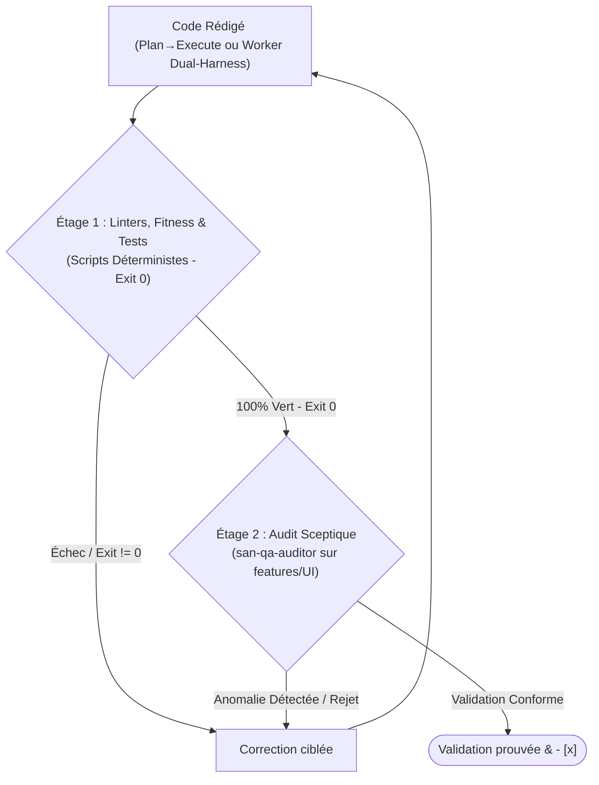

# CONSTITUTION TECHNIQUE & RÈGLES D'INGÉNIERIE (`PROJECT.md`)

> **Loi technique suprême :** Ce document fixe l'architecture d'ingénierie, le profil opérationnel, la doctrine **Dual-Harness** (`Antigravity` + `OpenCode V2.3`) pilotée par `.agents/models.json`, et les critères de validation.

---

## 1. PROFIL DU PROJET (`PROJECT_PROFILE`)

Chaque projet adopte un profil contextuel qui conditionne les contraintes produit et architecturales :

* **PROFIL ACTIF :** `PROJECT_PROFILE: [global_saas | emerging_market_3g | mobile_consumer | cli_devtools | api_platform]`

### Spécificités par Profil :
* **`global_saas` :** Multi-tenant, conformité SOC2/RGPD, billing Stripe/LemonSqueezy, SSO SAML, observabilité OpenTelemetry.
* **`emerging_market_3g` :** Offline-first strict, payload session réduit, passerelles Mobile Money (USSD asynchrone), SMS OTP, adresses sans codes postaux.
* **`mobile_consumer` :** Touch 44x44px minimum, gestures fluides, batterie/CPU préservés, deep links WhatsApp/stores.
* **`cli_devtools` :** Démarrage rapide, zéro dépendance runtime lourde, flags POSIX conformes, stdout structuré JSON optionnel.
* **`api_platform` :** OpenAPI 3.1 contract-first, rate limiting granulaire, idempotence distribuée Redis, temps de réponse optimisés.

---

## 2. STACK TECHNIQUE OFFICIELLE DU PROJET

* **Écosystème & Framework :** `[Ex: Laravel 11 / Next.js 15 / React 19 / Expo SDK 52 / Go 1.23 / Fastify]`
* **Langage & Typage :** TypeScript (`"strict": true`, zéro `any`) / PHP 8.3 (`declare(strict_types=1);`) / Python 3.12 (`ruff` + `mypy`) / Go.
* **Base de Données & Cache :** `[Ex: PostgreSQL 16 / SQLite]` + `[Ex: Redis 7.2 pour verrous d'idempotence et files]`
* **Contrats d'API :** OpenAPI 3.1 (`openapi.yaml`), schémas Zod/TypeBox gelés et collections Bruno (`.bru`) dans `bruno/`.
* **Ports Locaux Standards :** Web `5173`/`3000`, API `8000`/`3000`/`3333`, Mobile Metro `8081`.

---

## 3. DOCTRINE DUAL-HARNESS & PROFIL EXÉCUTEUR UNIFIÉ (`.agents/models.json`)

> **Orchestration Libre (`/model`) & Délégation Adaptative :** L'orchestrateur principal hérite du `/model` choisi par l'utilisateur (`inherit-user-model`). Il aligne d'abord le cadrage produit/UI (`ask_question` / `question` + `export_png.mjs --url`) avant toute roadmap ou refonte UI.
> - **Tâches simples / mono-couche :** le cycle natif `Plan → Execute` est autorisé en direct dans le respect des règles `.agents/rules/*.md`.
> - **Features multi-couches, Studio Duel UI & Audit `san-qa-auditor` :** délégation parallèle pilotée par `.agents/models.json` (`san-harness models`) via `swarm(action: "add", model: "<agy.executor>")` sous Antigravity ou `san_swarm` / `subagent` (`<opencode.executor>`) sous OpenCode V2.3. *(Les 8 `src/agents/*.md` gardent `model: "pro"` en YAML pour compatibilité CLI AGY.)*

| Rôle / Worker (`san-*`) | Exécuteur Unifié (`.agents/models.json`) | Frontmatter | Périmètre & Responsabilité |
| :--- | :--- | :--- | :--- |
| **Orchestrateur** | `/model` utilisateur (`inherit-user-model`) | `mainAgent: true` | Alignement préalable, Plan→Execute simple ou pilotage parallèle `swarm` / `san_swarm`. |
| **`san-architect`** | `agy.executor` \| `opencode.executor` | `model: "pro"` | Contract-First (OpenAPI/Zod/TypeBox), Fitness Functions, Pre-Mortem. |
| **`san-qa-auditor`** | `agy.executor` \| `opencode.executor` | `model: "pro"` | Présomption de défaut, OWASP, Anti-Mock Theater, audit DOM/PNG. |
| **`san-coder-back`** | `agy.executor` \| `opencode.executor` | `model: "pro"` | Code atomique cadré sur contrat gelé, ACID, tests réels. |
| **`san-coder-front`** | `agy.executor` \| `opencode.executor` | `model: "pro"` | Composants `< 220` lignes, 5 états, Motion System, A11y. |
| **`san-designer-worker`** | `agy.executor` \| `opencode.executor` | `model: "pro"` | Studio Duel UI (`option-a`/`option-b`), `export_png.mjs` Multi-Viewports. |
| **`san-researcher`** | `agy.executor` \| `opencode.executor` | `model: "pro"` | Exploration factuelle directe, matrice 2 approches. |
| **`san-ops-devops`** | `agy.executor` \| `opencode.executor` | `model: "pro"` | Docker multi-stage, CI/CD, rollback < 30s, backup testé. |
| **`san-growth-legal`** | `agy.executor` \| `opencode.executor` | `model: "pro"` | Conformité stores Apple/Play, RGPD code réel, SEO/ASO. |

---

## 4. INVARIANTS, COMPACTION 120K & FAST-TRACK

* **Alignement Socratique & Visuel Préalable :** L'Orchestrateur valide les choix structurants via `ask_question` / `question` et capture les URLs d'inspiration (`export_png.mjs --url`) avant de déléguer roadmap ou UI.
* **Compaction Automatique 120k :** Zéro index map/cache redondant ; compacter le fil de conversation à `120 000` tokens (`/compact`) pour maintenir la précision au moindre coût.
* **Fast-Track d'Hygiène Autorisé :** L'orchestrateur peut intervenir directement pour cocher `- [x]` après test réel `exit 0`, archiver une roadmap vers `roadmaps/archives/`, mettre à jour `CHANGELOG.md` ou enrichir `.agents/rules/*.md`.

---

## 5. POLITIQUE DE TESTS (ZÉRO TESTING THEATER) & STANDARD UI 5 ÉTATS

* **Unitaires, Métier & Fitness Functions :** Zéro mock du domaine ; vérification d'étanchéité inter-modules, 0 cycle de dépendances et budgets techniques.
* **Intégration API Contract-First :** Contrats OpenAPI 3.1 / Zod / TypeBox gelés avant codage parallèle ; validation HTTP (`200`, `201`, `400`, `401`, `403`, `422`) et transactions ACID.
* **Standard UI 5 États & Motion System :** `Empty`, `Skeleton Cold-Start` (`CLS < 0.05`), `Populated` (3 plans), `Stale-While-Revalidate` (refetch non destructif), `Error` actionnable ; `cubic-bezier`, `@media (prefers-reduced-motion: reduce)`, cibles tactiles `>= 44x44px`, `font-variant-numeric: tabular-nums`.

---

## 6. ENTONNOIR DE VÉRIFICATION EN 2 ÉTAGES (FAIL-CLOSED)

