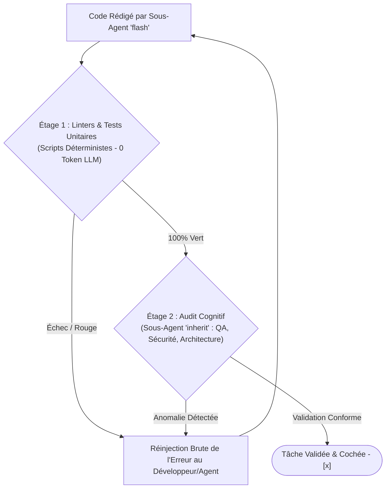

# CONSTITUTION TECHNIQUE & RÈGLES D'INGÉNIERIE (`PROJECT.md`)

> **Loi technique suprême :** Ce document fixe l'architecture d'ingénierie, la gouvernance des modèles IA Antigravity, la politique de tests non négociable et les règles d'hygiène documentaire du projet.

---

## 1. STACK TECHNIQUE OFFICIELLE DU PROJET

* **Écosystème & Framework Principal :** `[Ex: Laravel 11 / Next.js 15 (App Router) / React 19 (Vite) / Expo SDK 52]`
* **Langage & Typage :** TypeScript (Mode `"strict": true`, interdiction de `any` sans justification documentée) / PHP 8.3 (Typage strict `declare(strict_types=1);`) / Python 3.12 / Go 1.23.
* **Base de Données Primaire :** `[Ex: PostgreSQL 16 avec extensions JSONB et GIN / MySQL 8.0]`
* **Cache & Files d'Attente (Queues) :** `[Ex: Redis 7.2 pour verrous d'idempotence, jobs asynchrones et sessions]`
* **Gestionnaire de Paquets Imposé :** `[pnpm / bun / npm / composer / uv / go mod]`
* **Outil de Spécification des Contrats d'API :** Collections de requêtes Bruno (`.bru`) situées dans le dossier `bruno/`.
* **Ports Standards d'Exécution Locale :**
  - Application Frontend / Web : `http://localhost:5173` (Vite) ou `http://localhost:3000` (Next.js)
  - Serveur Backend / API : `http://localhost:8000` (Laravel) ou `http://localhost:3000` (NestJS) ou `http://localhost:3333` (Adonis)
  - Serveur Mobile Metro (React Native / Expo) : `http://localhost:8081`

---

## 2. ROUTAGE STRICT DES MODÈLES ANTIGRAVITY (`invoke_subagent`)

Pour maximiser la pertinence intellectuelle tout en préservant le quota de tokens et la vélocité d'exécution, la répartition des modèles IA suit une cascade rigoureuse :

| Rôle de l'Agent / Sous-Agent | Paramètre `Model` Recommandé | Modèle Réel Actif | Justification & Périmètre |
| :--- | :--- | :--- | :--- |
| **Session Principale (Orchestrateur Suprême)** | `inherit` (ou `pro`) | `argon-latest-max` / `gemini-3.1-pro-high` | Architecture, raisonnement stratégique, planification des phases, arbitrages complexes. |
| **Sous-Agents de Code & Implémentation** | `flash` | `gemini-3.8-flash-high` | Écriture atomique de code, rédaction de scripts, corrections ciblées de bugs. |
| **Sous-Agents d'Audit, Sécurité & QA** | `inherit` | `argon-latest-max` / `gemini-3.1-pro-high` | Revue critique de code, recherche de failles OWASP, validation de conformité architecturale. |
| **Sous-Agents d'Exploration & Recherche** | `flash` (ou `flash_lite`) | `gemini-3.8-flash-high` | Exploration de répertoires, vérification de documentation officielle, scraping ciblé. |

---

## 3. INVARIANTS D'ORCHESTRATION & FAST-TRACK D'HYGIÈNE

### Principe de Non-Pollution de la Session Maîtresse
* L'orchestrateur maître agit comme un chef de chantier : **il ne rédige pas directement le code applicatif**. Il prépare les prompts fermés et délègue l'écriture aux sous-agents spécialisés (`Model: 'flash'`).

### Fast-Track d'Hygiène Orchestrateur Immédiat
L'orchestrateur est formellement autorisé à intervenir directement (sans gaspillage de sous-agent superflu) pour les actions d'hygiène suivantes :
1. **Validation formelle des roadmaps :** Cocher les cases `- [x]` dans `/roadmaps/*.md` **uniquement** après avoir inspecté et vérifié physiquement l'existence du code et le passage des tests associés.
2. **Archivage des roadmaps :** Déplacer toute roadmap achevée à 100 % vers `/roadmaps/archives/`.
3. **Journal de bord (Changelog) :** Renseigner et maintenir à jour `CHANGELOG.md` selon le standard *Keep a Changelog*.
4. **Mise à jour des règles de gouvernance :** Enrichir les fichiers de configuration `.agents/rules/*.md` au fur et à mesure des décisions prises.

---

## 4. POLITIQUE DE TESTS OBLIGATOIRE (ZÉRO DETTE TECHNIQUE)

Aucune fonctionnalité n'est validée sans une suite de tests automatisés au vert :

### A. Tests Unitaires & Métier (Domain Core)
* Couverture exhaustive des classes de calcul financier, algorithmes d'arrondis et conversions de devises.
* Validation étanche des règles d'autorisation (Policies, RBAC, Guards).
* Tests isolés avec mocks des passerelles tierces (Mobile Money, SMS, services météo ou géolocalisation).

### B. Tests d'Intégration d'API (Collections Bruno)
* Chaque route exposée dispose d'une collection exécutable dans `bruno/`.
* Validation impérative des scénarios nominaux (`200 OK`, `201 Created`).
* Validation impérative des scénarios d'erreurs aux limites (`400 Bad Request`, `401 Unauthorized`, `403 Forbidden`, `422 Unprocessable Entity`).

### C. Tests de Composants UI (Les 5 États Obligatoires)
Tout composant ou écran affichant des données dynamiques doit valider formellement ses **5 états invariants** :
1. **État Idéal (Ideal State) :** Données complètes affichées avec mise en page parfaite.
2. **État Vide (Empty State) :** Aucune donnée présente (message explicatif bienveillant et bouton d'action d'amorce).
3. **État de Chargement (Loading / Skeleton State) :** Squelette animé aux dimensions exactes du contenu final (interdiction de spinner plein écran bloquant).
4. **État d'Erreur (Error State) :** Message clair sans jargon technique avec bouton de réessai explicite (« Réessayer »).
5. **État Hors-Ligne / Cache (Offline / Degraded State) :** Affichage des données locales avec badge discret indiquant la date de dernière synchronisation.

---

## 5. ENTONNOIR D'AUDIT EN 2 ÉTAGES (TWO-STAGE VERIFICATION)

Avant de déclarer une tâche complétée, le système franchit systématiquement deux filtres successifs :

1. **Étage 1 (Vérification Scriptée Déterministe - Zéro Token LLM) :**
   - Lancement des linters et vérificateurs statiques de types (`pnpm run lint`, `tsc --noEmit`, `vendor/bin/pint`, `pytest`).
   - Exécution de la suite de tests unitaires existante.
   - En cas d'erreur de syntaxe ou de type, rejet immédiat sans faire intervenir d'audit LLM coûteux.
2. **Étage 2 (Audit Cognitif Approfondi - LLM 'inherit') :**
   - Déploiement d'un sous-agent d'inspection architecturale et de sécurité.
   - Contrôle du respect des conventions de nommage, des fuites de données sensibles et de l'idempotence des endpoints.
