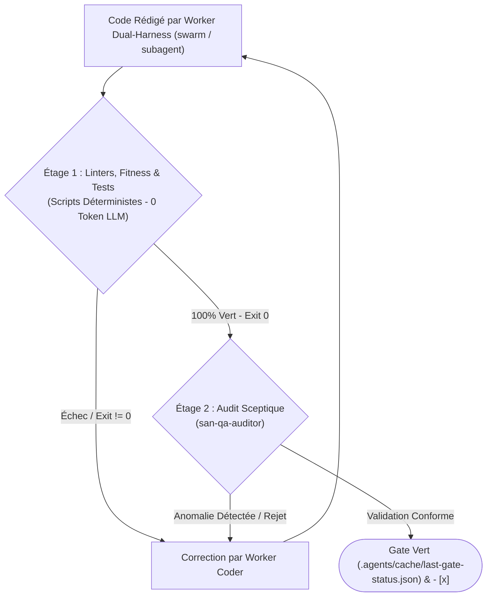

# CONSTITUTION TECHNIQUE & RÈGLES D'INGÉNIERIE (`PROJECT.md`)

> **Loi technique suprême :** Ce document fixe l'architecture d'ingénierie, le profil opérationnel, la doctrine **Dual-Harness** (`Antigravity` + `OpenCode V2`), la souveraineté cognitive préalable et l'entonnoir de validation.

---

## 1. PROFIL DU PROJET (`PROJECT_PROFILE`)

Chaque projet adopte un profil contextuel qui conditionne les contraintes produit et architecturales :

* **PROFIL ACTIF :** `PROJECT_PROFILE: [global_saas | emerging_market_3g | mobile_consumer | cli_devtools | api_platform]`

### Spécificités par Profil :
* **`global_saas` :** Multi-tenant, conformité SOC2/RGPD, billing Stripe/LemonSqueezy, SSO SAML, observabilité OpenTelemetry.
* **`emerging_market_3g` :** Offline-first strict, payload session < 1.5 Mo, passerelles Mobile Money (USSD asynchrone), SMS OTP, adresses sans codes postaux.
* **`mobile_consumer` :** Touch 44x44px minimum, gestures 60 fps, batterie/CPU préservés, deep links WhatsApp/stores.
* **`cli_devtools` :** Démarrage instantané (< 100ms), zéro dépendance runtime lourde, flags POSIX conformes, stdout structuré JSON optionnel.
* **`api_platform` :** OpenAPI 3.1 contract-first, rate limiting granulaire, idempotence distribuée Redis, latence p99 < 50ms.

---

## 2. STACK TECHNIQUE OFFICIELLE DU PROJET

* **Écosystème & Framework :** `[Ex: Laravel 11 / Next.js 15 / React 19 / Expo SDK 52 / Go 1.23 / Fastify]`
* **Langage & Typage :** TypeScript (`"strict": true`, zéro `any`) / PHP 8.3 (`declare(strict_types=1);`) / Python 3.12 (`ruff` + `mypy`) / Go.
* **Base de Données & Cache :** `[Ex: PostgreSQL 16 / SQLite]` + `[Ex: Redis 7.2 pour verrous d'idempotence et files]`
* **Contrats d'API :** OpenAPI 3.1 (`openapi.yaml`), schémas Zod/TypeBox gelés et collections Bruno (`.bru`) dans `bruno/`.
* **Ports Locaux Standards :** Web `5173`/`3000`, API `8000`/`3000`/`3333`, Mobile Metro `8081`.

---

## 3. DOCTRINE DUAL-HARNESS & PROFIL EXÉCUTEUR UNIFIÉ (`.agents/models.json`)

> **Autonomie & Alignement Préalable :** L'Orchestrateur prend l'initiative mécanique de déléguer sans jamais demander `/model` ni un nom de sous-agent, mais il aligne d'abord le cadrage produit/UI avec l'utilisateur (`ask_question` / `question`) et capture les références visuelles (`export_png.mjs --url`) avant de déléguer aux workers.  
> **Routage Dual-Harness (piloté par `.agents/models.json` & `san-framework models`) :**
> - **Antigravity (`agy`) :** `swarm(action: "add", model: "gemini-4-hydrogen-xhigh", ...)` (ou `agy.executor` dans `.agents/models.json`). `invoke_subagent(Model: "inherit")` est **INTERDIT** sur `Argon`/`Carbon` (quota hebdo + fallback `3.8-flash`).
> - **OpenCode V2 (`opencode`) :** `subagent({ agent: "san-...", prompt: "..." })` adossé à `opencode.json` `"agents"` (ex: `opencode-go/deepseek-v4-pro`, `opencode-go/qwen3.8-flash`). *(Les 8 `src/agents/*.md` gardent `model: "pro"` en frontmatter YAML pour compatibilité CLI.)*

| Rôle / Worker (`san-*`) | Exécuteur Unifié (`.agents/models.json`) | Frontmatter | Périmètre & Responsabilité |
| :--- | :--- | :--- | :--- |
| **Orchestrateur** | Thread `Argon`/`Carbon` \| `hy4` | `mainAgent: true` | Alignement socratique/visuel, découpage, arbitrage, zéro solo-coding. |
| **`san-architect`** | `swarm` \| `subagent` (`executor`) | `model: "pro"` | Contract-First (OpenAPI/Zod/TypeBox), Fitness Functions, Pre-Mortem. |
| **`san-qa-auditor`** | `swarm` \| `subagent` (`executor`) | `model: "pro"` | Présomption de défaut, OWASP, Anti-Mock Theater, audit DOM/PNG. |
| **`san-coder-back`** | `swarm` \| `subagent` (`executor`) | `model: "pro"` | Code atomique cadré sur contrat gelé, ACID, tests réels. |
| **`san-coder-front`** | `swarm` \| `subagent` (`executor`) | `model: "pro"` | Composants `< 220` lignes, 5 états, Motion System, A11y. |
| **`san-designer-worker`** | `swarm` \| `subagent` (`executor`) | `model: "pro"` | Studio Duel UI (`option-a`/`option-b`), `export_png.mjs` v2. |
| **`san-researcher`** | `swarm` \| `subagent` (`executor`) | `model: "pro"` | Cartographie Map-First (`REPO_MAP.md`), matrice 2 approches. |
| **`san-ops-devops`** | `swarm` \| `subagent` (`executor`) | `model: "pro"` | Docker multi-stage, CI/CD, rollback < 30s, backup testé. |
| **`san-growth-legal`** | `swarm` \| `subagent` (`executor`) | `model: "pro"` | Conformité stores Apple/Play, RGPD code réel, SEO/ASO. |

---

## 4. INVARIANTS D'ORCHESTRATION, RELAIS SCEPTIQUE & FAST-TRACK

* **Alignement Socratique & Visuel Préalable :** L'Orchestrateur ne délègue jamais le cadrage produit/UI à un worker aveugle ; il valide les choix via `ask_question` / `question` et capture les URLs d'inspiration (`export_png.mjs --url`).
* **Discipline Map-First & Relais Sceptique (`san_transcriber`) :** Consulter `.agents/cache/REPO_MAP.md` avant lecture. En fin de quota ou changement de modèle/harnais, exécuter `/san_transcriber` (`roadmaps/transcripts/`) et appliquer le **Doubt & Verify** à la reprise.
* **Fast-Track d'Hygiène Autorisé :** L'orchestrateur peut intervenir en direct uniquement pour : (1) cocher `- [x]` dans `roadmaps/*.md` après test réel `exit 0`, (2) archiver une roadmap 100% cochée vers `roadmaps/archives/`, (3) mettre à jour `CHANGELOG.md`, (4) enrichir `.agents/rules/*.md`.

---

## 5. POLITIQUE DE TESTS (ZÉRO TESTING THEATER) & STANDARD UI 5 ÉTATS

* **Unitaires, Métier & Fitness Functions :** Zéro mock du domaine ; vérification d'étanchéité inter-modules, 0 cycle de dépendances et budgets techniques.
* **Intégration API Contract-First :** Contrats OpenAPI 3.1 / Zod / TypeBox gelés avant codage parallèle ; validation HTTP (`200`, `201`, `400`, `401`, `403`, `422`) et transactions ACID.
* **Standard UI 5 États & Motion System :** `Empty`, `Skeleton Cold-Start` (`CLS < 0.05`), `Populated` (3 plans), `Stale-While-Revalidate` (refetch non destructif), `Error` actionnable ; `cubic-bezier`, `@media (prefers-reduced-motion: reduce)`, cibles tactiles `>= 44x44px`, `font-variant-numeric: tabular-nums`.

---

## 6. ENTONNOIR DE VÉRIFICATION EN 2 ÉTAGES (FAIL-CLOSED)

